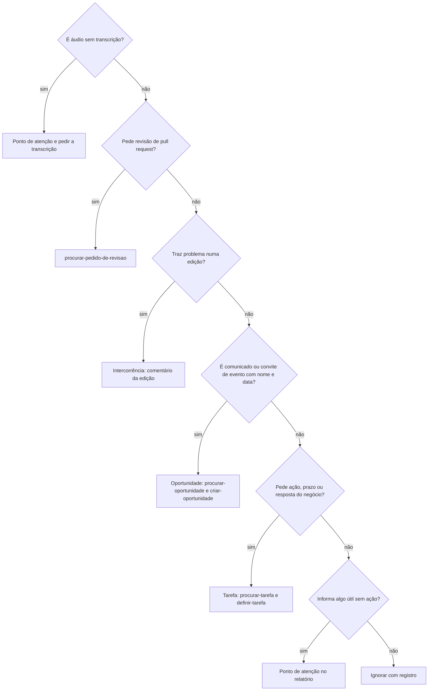

## Contexto

Use este modelo para escrever a árvore de decisão da triagem de um negócio e para a `triar-conversas` seguir cada mensagem ou conversa. O negócio guarda a árvore numa página do Notion, que o parâmetro `Página da árvore de decisão` da `triar-conversas` nomeia. A página é a árvore em uso e este modelo é a forma e o ponto de partida. Uma decisão nova da pessoa muda a página. Uma mudança de forma volta a este modelo pela `evoluir-habilidade`.

## Formato

### Árvore

### Perguntas

| Ordem | Pergunta | Se sim | Ação opcional no WhatsApp |
| --- | --- | --- | --- |
| <número> | <pergunta que a mensagem responde com sim ou não> | <destino: o passo ou a habilidade> | <reagir, favoritar ou nada, com a reação> |

### Ignorar

O que não cai em nenhuma pergunta é ignorado: não vira tarefa nem ação. Mesmo assim, deixa um registro curto:

- **O que era:** <a mensagem ou a conversa, em uma linha>
- **De qual conversa:** <nome da conversa, com o link da mensagem quando houver>
- **Por que ficou sem ação:** <a pergunta da árvore que decidiu>
- **Data:** <data e hora no Formato da data com dia da semana>

O registro vai no histórico do item quando o assunto já existe, como um comentário da página da oportunidade, do ponto de contato ou da edição. Sem o assunto cadastrado, vai no relatório da triagem. Nunca vira tarefa.

### Exemplos que ficam de fora

- <caso real que a pessoa decidiu ignorar, sem nome de pessoa>

## Estilo

Uma pergunta por linha da tabela, na ordem em que a triagem as faz, e a primeira resposta sim decide. A última linha é sempre ignorar com registro. Cada destino cita a habilidade ou o passo, sem repetir a regra dela. A ação no WhatsApp só sugere: reagir, favoritar e apagar dependem do sim da pessoa. A página do negócio troca os exemplos pelos casos reais e não cita nome de pessoa.
