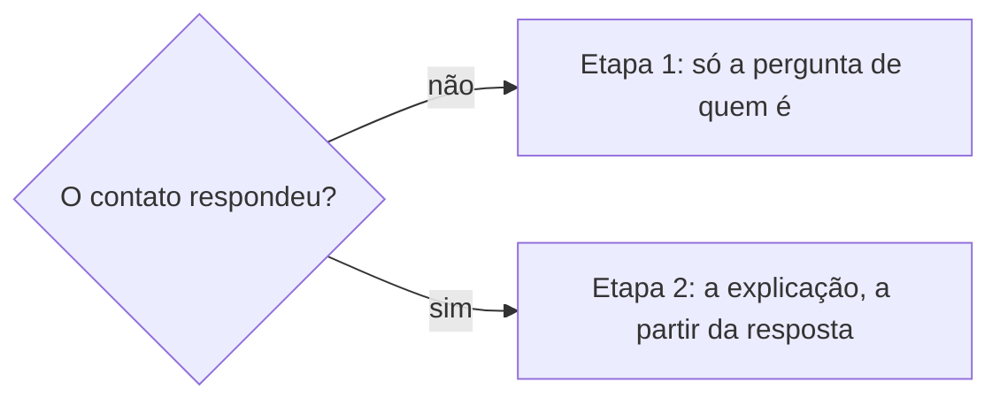

# Abordar contato

## Parâmetros de configuração

Leia cada valor nas instruções do projeto: primeiro na entrada com o nome desta habilidade, depois na entrada `Global`. Quando um valor não estiver lá, use o padrão abaixo.

```yaml
# `Modo de aprendizado` diz se a habilidade pergunta antes de evoluir ou evolui sozinha.
"Modo de aprendizado": "perguntar"
# `Ordem dos canais de execução` é a ordem em que a habilidade tenta enviar uma mensagem ou fazer uma inscrição. Passa ao canal seguinte só quando o anterior não existe ou falha.
"Ordem dos canais de execução": ["conector", "linha de comando", "API", "navegador do app", "extensão do navegador"]
# `Posição sobre o serviço oferecido` é o que a marca afirma, na segunda etapa da resposta ao contato frio, sobre o serviço que o contato oferece, como não trabalhar com esse tipo de empresa. Vazio, a segunda etapa não toma posição.
"Posição sobre o serviço oferecido": ""
# Globais: os nomes das propriedades da lista de pessoas que guardam a janela de contato. Vazio não impõe regra.
"Dias sem contato": ""
"Sem contato a partir de": ""
"Sem contato até": ""
```

## Instruções

### Passo 1

Abordar é procurar o contato com uma empresa, organização ou pessoa e, sem registro, propor e enviar a primeira mensagem. A conversa que já existe se consulta antes, pelo checklist do Passo 4 de `definir-negociacao`. Diga também em que etapa do funil o contato está, por `diagnosticar-funil`.

Quando a pergunta é se já houve contato com uma empresa ou pessoa e nenhuma fonte tem registro, não encerre com "não achei". Confira se a oportunidade dela está cadastrada, com `procurar-oportunidade`. Pesquise na internet o site, o perfil social e o contato público da empresa, da pessoa ou da oportunidade, e veja se há edição futura e formulário de inscrição ou de curadoria. Diga o que achou, com os links.

### Passo 2

Com formulário aberto, tente a inscrição já. Antes de abrir o formulário, carregue `inscrever-na-oportunidade` e preencha só como ela manda, com o contato da empresa e o formato que cada campo valida.

### Passo 3

Com ou sem inscrição, proponha também o contato direto, pelo canal em que a organização responde, para a marca se apresentar e avisar da inscrição. O texto cita quem indicou a marca quando a pessoa contar, e não inventa indicação. Ele sai por `redigir-com-tom-de-voz`.

A primeira mensagem se apresenta em primeira pessoa por quem assina, com nome e papel, e não só pela marca. Quem assina vem do cadastro de pessoas e das instruções do projeto, que dizem quem representa a marca e quando outra pessoa pode aparecer. Sem essa fonte, pergunte. Não ponha uma segunda pessoa sem a condição que a fonte pede.

A organização e quem a dirige costumam ter perfis separados. Procure o perfil de cada um, na bio, no site de links e nas publicações, e proponha uma mensagem para cada, escrita para quem lê aquele perfil: o perfil da organização recebe um texto para a equipe, no plural, e o perfil pessoal recebe um texto com o nome da pessoa. Não mande ao perfil da organização um texto endereçado a uma pessoa.

Antes de redigir, pergunte como o contato nasceu quando nenhuma fonte diz, como o evento em que a marca esteve, quem apresentou ou o encontro que não aconteceu. O texto conta essa cena, com quem indicou e o que cada um disse, só com o que a pessoa contou.

### Passo 4

Com o texto e o destino aprovados, envie você mesmo, sem pedir à pessoa que envie. Tente os canais na `Ordem dos canais de execução` e passe ao seguinte só quando o anterior não existir ou falhar. Se nenhum enviar, entregue o texto pronto e diga o que falhou em cada canal.

Antes do envio, quando a pessoa já está cadastrada, confira a janela de contato dela, como `definir-janela-de-contato` manda. Fora da janela, a mensagem aprovada não sai e espera o próximo horário permitido. Quem não tem cadastro não tem janela.
 Sem a aprovação, não envie nem cadastre a empresa ou a pessoa. Depois do envio, registre a troca como `definir-negociacao` manda.

### Passo 5

Quando a organização atende num grupo, como o de uma feira, e a marca escreveu a ela no privado, proponha também uma mensagem curta ao grupo, endereçada à pessoa da organização pelo nome. Ela só avisa que a marca já escreveu no privado, o que pediu, como a baia escolhida, e que aguarda o retorno. Não repete valor nem dado do privado. Ela sai com o sim da pessoa, pelo mesmo caminho, e o registro de `definir-negociacao` a inclui.

### Passo 6

Contato frio é quem escreve sem se apresentar, sem dizer como chegou até a marca e só manda conteúdo ou oferta, como um vídeo sem texto. Ele não vira negociação sem pedido, proposta ou interesse verificável, e não recebe a resposta inteira de uma vez.



Na etapa 1, escreva um parágrafo só, por quem fala pela marca, com nome e papel. Ele pergunta com quem a gente está falando, diz que a marca não lembra do contato e pergunta se alguém da marca conversou com ele recentemente. Não critique a abordagem nesse parágrafo, e espere a resposta antes de seguir.

A etapa 2 só vem depois da resposta. Ela explica que quem quer conquistar cliente começa uma conversa e entende quem está do outro lado, e que conteúdo sem texto passa a impressão de spam em vez de abordagem de vendas. Diga também a posição da marca em `Posição sobre o serviço oferecido`.

Os dois textos saem por `redigir-com-tom-de-voz` e só com o sim da pessoa. A conversa é registrada como `definir-negociacao` manda.

### Passo 7

Ao terminar, siga `evoluir-habilidade` conforme `Modo de aprendizado`.

## Problemas comuns

### Contato frio respondido por inteiro

Se você mandar de uma vez a pergunta, a crítica e a posição da marca, a resposta soa como bronca a quem pode ser alguém que a marca já conhece, e ninguém disse ainda quem é.

1. Mande só a etapa 1, a pergunta de quem é.
2. Espere a resposta.
3. Só então escreva a etapa 2, a partir do que o contato disse.

### Sem registro e sem proposta

Se você responder só que não achou registro de contato, a pessoa tem de pedir a pesquisa e a abordagem, e o contato não anda.

1. Depois do checklist do Passo 4 de `definir-negociacao`, confira se a oportunidade está cadastrada e pesquise na internet o site, o perfil social, o contato público, a próxima edição e o formulário de inscrição.
2. Com formulário aberto, tente a inscrição. Responda com o que achou, com os links, e proponha o canal, o motivo e o texto da primeira mensagem, apresentada por quem fala e com a indicação quando a pessoa contar.
3. Não envie nem cadastre sem a aprovação do texto e do destino.

### Envio devolvido à pessoa

Se você escrever o texto aprovado e esperar a pessoa mandar, o contato atrasa e a negociação fica sem o registro do envio.

1. Com a aprovação, envie o texto pela `Ordem dos canais de execução`.
2. Só entregue o texto à pessoa quando nenhum canal enviar, e diga o que falhou em cada um.
3. Registre a troca na mesma rodada do envio, como `definir-negociacao` manda.

### Um texto para dois perfis

Se você escrever uma só mensagem para a organização e a mandar ao perfil dela endereçada a uma pessoa, quem lê não se reconhece no texto, e o perfil pessoal de quem dirige fica sem contato.

1. Procure o perfil da organização e o da pessoa que a dirige.
2. Proponha uma mensagem para cada um: plural para a equipe, o nome da pessoa no perfil pessoal.
3. Assine em primeira pessoa quem a fonte diz que representa a marca, com nome e papel.

### Privado sem aviso ao grupo

Se você escrever à organização só no privado, quem atende o grupo pode não ligar a mensagem à marca e responder as outras primeiro.

1. Depois do envio, proponha ao grupo uma mensagem curta, endereçada à pessoa da organização.
2. Ela diz que a marca já escreveu no privado, o que pediu e que aguarda o retorno.
3. Envie só com o sim da pessoa e registre a mensagem como `definir-negociacao` manda.

## Exemplos de entrada e saída

Estes exemplos ilustram fatos. Eles podem não estar no data source.

### uma consultoria mandou um vídeo sem texto no direct

Escrevi só a etapa 1, assinada por quem fala pela marca: com quem a gente está falando, que a marca não lembra da consultoria e se já houve conversa. Não critiquei a abordagem. Esperei a resposta e só então escrevi a etapa 2, com a explicação e a posição da marca sobre o serviço oferecido.

### já falamos com a Lia, do Ateliê Exemplo?

Consultei os comentários, o cronograma, as inscrições e o e-mail, e nenhum tem registro. A oportunidade não estava cadastrada. Pesquisei na internet: o Ateliê Exemplo tem site e perfil no Instagram, que responde a mensagens, e não tem formulário de inscrição. Propus abordar pelo Instagram, para pedir uma cotação de bordado, com o texto no tom de voz. Não enviei nem cadastrei a empresa antes da aprovação. Aprovado o texto, enviei pelo conector do Instagram, registrei a troca na discussão da página da pessoa e disse o que registrei.

### já falamos com a organização da Feira Exemplo?

Sem registro, achei a feira cadastrada e, no Instagram dela, um formulário aberto de curadoria para a edição de março. Tentei a inscrição e propus também duas mensagens pelo Instagram, uma para o perfil da organização, no plural, e outra para o perfil pessoal da organizadora, as duas assinadas pela Ana, que representa a marca, com nome e papel, e citando a Lia como quem indicou a marca, porque a pessoa contou isso.

Depois do envio, registrei o formulário na página da inscrição e a mensagem na discussão da organizadora, sem criar negociação, porque a lista de negociações proíbe o contato com a organização de feiras.

## Casos-limite

- O contato frio responde quem é e o que oferece: escreva a etapa 2 a partir da resposta. Se for alguém que a marca conhece, siga a conversa normal.
- Quem escreveu já é conhecido da marca: não é contato frio. Siga `definir-negociacao`.
- O perfil pessoal de quem dirige a organização não aparece na busca: proponha só a mensagem do perfil da organização e diga que não achou o pessoal.
- Sem registro de contato, e a pesquisa na internet não acha site, perfil nem contato público: diga o que pesquisou e peça à pessoa o canal. Não invente um contato.
- Nenhum canal de execução consegue enviar: entregue o texto pronto e diga o que falhou em cada canal. Não peça à pessoa que tente primeiro.
- A pesquisa acha mais de uma empresa ou pessoa com o mesmo nome: mostre as candidatas com o link de cada uma e pergunte qual é, antes de propor a abordagem.

## Pegadinhas

- A crítica à abordagem parece cabida já na primeira resposta. Antes de saber quem é, a pergunta vem sozinha.
- O texto aprovado parece o fim do trabalho. A aprovação é o sim ao envio, e quem envia é você, pelos canais da `Ordem dos canais de execução`.
- "Não achei registro" parece uma resposta completa. Ela só diz que as fontes do workspace estão vazias: a próxima ação é pesquisar na internet e propor a abordagem.
- Um formulário aberto parece pedir só os campos preenchidos com os dados que você já tem. A skill de inscrição define de onde vem cada dado e o formato de cada campo, como o celular só com dígitos: carregue-a antes de digitar.

## Scripts disponíveis

- Nenhum.

1. Não há script para executar.
