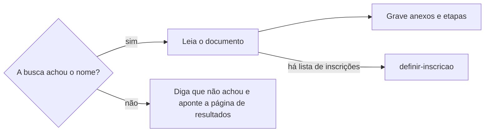

# Acompanhar edital

## Parâmetros de configuração

Leia cada valor nas instruções do projeto: primeiro na entrada com o nome desta habilidade, depois na entrada `Global`. Quando um valor não estiver lá, use o padrão abaixo.

```yaml
# `Nome do data source de oportunidades` é o banco de oportunidades da fonte de dados conectada. Vazio, a skill procura um.
"Nome do data source de oportunidades": ""
# `Nome do data source de anexos` é o banco de anexos, links e editais da oportunidade, quando o negócio tem um. Vazio, a skill procura um.
"Nome do data source de anexos": ""
# `Nome do data source de etapas` é o banco das datas da oportunidade, quando o negócio tem um. Vazio, a skill procura um.
"Nome do data source de etapas": ""
# `Ao achar um banco` é `propor`, que propõe gravar o nome achado, ou `registrar`, que grava e avisa.
"Ao achar um banco": "propor"
# `Domínios por organização` liga cada organização à lista de domínios onde ela publica resultados e editais.
"Domínios por organização": {}
# `Frequência da busca do resultado` vale enquanto o resultado não sai e o edital não dá a data dele.
"Frequência da busca do resultado": "semanal"
# `Frequência da busca do próximo edital` vale depois do resultado, até o próximo edital abrir.
"Frequência da busca do próximo edital": "mensal"
"Modo de aprendizado": "perguntar"
```

## Instruções

### Passo 1

O pedido nomeia um edital, uma inscrição ou uma organização.
Edital aqui inclui chamada, convocatória e seleção de curso.
Sem nome, acompanhe cada organização de `Domínios por organização` e, quando o projeto mapeia uma lista de inscrições, cada inscrição dela sem resultado.
A situação da inscrição na lista se lê por `procurar-inscricao`.
O nome buscado é o da pessoa ou empresa inscrita.
Antes de buscar, siga `definir-grafia` e junte cada forma do nome: o artístico, o civil completo, com e sem acento, e a ordem com o sobrenome primeiro.
A página da oportunidade muda só pela skill dona dela.
Esta habilidade grava só nos bancos de anexos e de etapas.

### Passo 2

Com as fontes de dados conectadas, como o Notion, ache nelas os bancos da oportunidade: o de oportunidades, o de anexos, que guarda documentos, links e editais, e o de etapas, que guarda as datas.
O nome de cada um varia de um negócio para outro, e os de anexos e de etapas podem não existir.

1. Com o parâmetro do banco preenchido, procure o data source com esse nome.
2. Vazio, procure um banco com esse papel, ligado à oportunidade por relação.
3. Um achado sem estar nos parâmetros: use-o e siga `Ao achar um banco`, no harness de negócio. Com `propor`, proponha gravar o nome nas instruções do projeto. Com `registrar`, grave e diga que gravou.
4. Mais de um: pergunte uma vez qual.
5. Nenhum: siga sem ele e diga isso uma vez. Sem banco de oportunidades, ou sem fonte de dados conectada, siga só com `Domínios por organização`.

Leia o esquema de cada banco antes de ler ou gravar. Não use um banco de outro espaço de trabalho.
O banco, o esquema e a oportunidade que já foram lidos nesta conversa não se procuram de novo: use o que está no contexto.

### Passo 3

Levante os domínios da organização antes da primeira busca.
A oportunidade é a primeira referência: use a edição que já está no contexto da conversa; sem ela, ache a edição ligada à inscrição, ou siga `procurar-oportunidade`, e leia cada propriedade de link da edição e do grupo dela, como a página original, o edital e o formulário, e cada anexo ligado à edição.
Leia também as etapas ligadas à edição: elas dão a data do resultado e a da abertura.
Sem o link original, busque na web a página oficial do edital.
O link achado volta para a oportunidade pela skill dona: o desta edição, como o edital e o formulário, por `criar-oportunidade`; o que se repete em toda edição, como o site oficial, por `definir-grupo-de-oportunidades`.
Depois complete com o que a oportunidade costuma não ter.
A marca que a pessoa conhece costuma publicar no domínio de quem a mantém, como uma fundação, uma secretaria ou uma universidade.

1. O domínio da própria organização.
2. O domínio da mantenedora, que aparece no rodapé do site, no edital e no CNPJ do edital.
3. O domínio da plataforma em que a inscrição foi feita.
4. O diário oficial do governo que mantém a organização, municipal, estadual ou federal.
5. O domínio do remetente e dos links da confirmação da inscrição, quando a pessoa a tem; a busca na caixa segue `procurar-email`.

Use o domínio registrável, sem `www` nem subdomínio, para o `site:` cobrir os subdomínios.
Mostre cada domínio com a origem dele.
O domínio que não tem propriedade na oportunidade, como o da mantenedora e o do diário oficial, vai para `Domínios por organização`, na entrada da organização.
O nome da organização é a chave, e cada domínio é um item curto da lista.

### Passo 4

Para cada forma do nome e cada domínio, busque na web o nome entre aspas com `site:` no domínio.
Busque também, uma vez, cada forma do nome entre aspas com o nome da organização, sem `site:`, para achar um domínio que a lista não tem.
Um domínio novo que trouxe resultado entra na lista conforme `Modo de aprendizado`.
Mostre cada consulta feita.



### Passo 5

Abra cada documento achado e leia o trecho do nome.
Diga a seleção, a edição, a situação da pessoa, como selecionada, suplente, classificada ou eliminada, a data do documento e o link.
Diga o prazo de matrícula, de confirmação ou de recurso que o documento der, e se ele já passou.
Prazo passado: diga isso primeiro e sugira contato com a organização.
Outra pessoa com o mesmo nome aparece como dúvida, com o dado que diferencia, como cidade, categoria ou parte do documento.
Quando o projeto mapeia uma lista de inscrições, a mudança da inscrição segue `definir-inscricao`.

Grave o que o edital, a retificação ou o resultado trouxer, sempre ligado à edição.
Sem a edição, não grave: siga `procurar-oportunidade` e, se ela não existir, `criar-oportunidade`.

1. No banco de anexos, um registro por documento ou link, com o link e o tipo, como edital, retificação ou resultado. O mesmo link já ligado à edição não se grava de novo. Não baixe o arquivo.
2. No banco de etapas, um registro por data: abertura das inscrições, prazo de inscrição, publicação do edital, publicação do resultado, matrícula ou confirmação, início e fim da execução. Use o nome e as opções que o esquema do banco já tem. Não crie opção.
3. Antes de criar uma etapa, procure a mesma etapa ligada à edição. Mesma data: não grave. Data diferente: atualize e diga a data antiga, a nova e o link da fonte.
4. Achado o resultado, grave a data real da publicação na etapa do resultado, numa propriedade de data real que o esquema tenha, sem apagar a data anunciada. Sem essa propriedade, liste a data real no fim. Ela vira o histórico da próxima previsão.
5. A data vem do documento. Sem data, não grave. Sem hora, não invente a hora.
6. Sem banco de anexos, o link do edital vai para a edição por `criar-oportunidade`. Sem banco de etapas, a data vai para a propriedade de data da edição por `criar-oportunidade`; sem essa propriedade, liste a data no fim e não a escreva no corpo.

### Passo 6

Busque o próximo edital de cada organização acompanhada.
Nos domínios dela, busque o nome do curso ou do edital com `inscrições` e o ano seguinte ao da inscrição.
Diga o período de inscrição achado, e se ele já fechou.
O próximo edital é outra edição: siga `procurar-oportunidade` e, se ela não existir, `criar-oportunidade`, e grave as datas dele como no Passo 5.
Sem nada achado, diga as consultas feitas.

### Passo 7

Quando a pessoa pede para não perder o resultado, ou para acompanhar a organização, siga `definir-rotina` para criar a busca recorrente dos Passos 4 a 6.
A data anunciada não garante o dia: o resultado pode sair um pouco antes, um dia depois ou semanas depois.
O edital e a publicação do resultado também podem ser prorrogados.
Preveja a janela antes de escolher a frequência.

1. Procure o histórico da organização: nas etapas das edições anteriores, a data anunciada e a data real do resultado; sem etapas, a data dos documentos de resultado anteriores que a busca achar.
2. Com histórico, a janela vai da data anunciada menos a maior antecipação vista até a data anunciada mais o maior atraso visto. Dentro dela, a busca é diária em dias úteis.
3. Sem histórico, use `Frequência da busca do resultado` até a semana anterior à data anunciada, e diária em dias úteis a partir daí, até o resultado sair.
4. Busque também a prorrogação e a retificação nos domínios da organização. A data nova move a janela, e a etapa muda como no Passo 5.
5. Mostre as datas anunciadas e reais que usou na previsão.

Em ambientes com suporte, a página de resultados ou do edital, quando conhecida, pode ser vigiada por diff: um monitor guarda a última versão da página e compara com a atual.
Com esse monitor, a rotina dispara pela mudança da página, como `definir-rotina` faz com um gatilho, e lê só o trecho que mudou; a busca do nome roda quando esse trecho é um resultado.
Quando o diff de uma página chega como entrada, leia só o trecho que mudou.
Sem monitor, a busca periódica segue a janela.
Depois do resultado achado, use `Frequência da busca do próximo edital`.
A rotina pausa quando a próxima inscrição abre e a pessoa já sabe dela.

### Passo 8

Ao terminar, siga `evoluir-habilidade` conforme `Modo de aprendizado`.

## Problemas comuns

### Domínio só da marca

Se você buscar só no domínio da organização que a pessoa conhece, o resultado publicado no domínio da mantenedora não aparece.

1. Levante a mantenedora no rodapé e no edital.
2. Acrescente a plataforma da inscrição e o diário oficial.
3. Faça a busca aberta com o nome da organização.

### Busca vazia como reprovação

Se você disser que a pessoa não passou porque a busca não achou o nome, um PDF digitalizado ou uma página fora do índice vira reprovação.

1. Diga que a busca não achou o nome.
2. Aponte a página de resultados do edital para conferir à mão.

### Resultado sem prazo

Se você disser só que a pessoa passou, o prazo de matrícula vence sem ela saber.

1. Leia o documento inteiro do resultado.
2. Diga o prazo e se ele já passou.

## Exemplos de entrada e saída

Estes exemplos ilustram fatos. Eles podem não estar no data source.

### Passei no curso livre de teatro do Teatro Exemplo?

Levantei os domínios: teatroexemplo.org.br, da organização; fundacaoexemplo.gov.br, da mantenedora, no rodapé do edital; e o diário oficial do estado. Busquei "Ana Souza" e "Ana Maria de Souza" com `site:` em cada um. O nome está na lista de selecionados de fevereiro, no domínio da fundação, com matrícula até 10/02, que já passou. Sugeri contato com a organização. Achei também as inscrições da turma do ano seguinte, que fecharam em setembro.

### Quero não perder o resultado do edital de circulação

Gravei os domínios em `Domínios por organização`. As duas edições anteriores publicaram o resultado 10 e 20 dias depois da data anunciada, então segui `definir-rotina` com a busca diária em dias úteis da data anunciada até 20 dias depois, atenta a prorrogações.

## Casos-limite

- O documento traz só iniciais e parte do CPF: diga que a forma casa, mas não confirma a pessoa, e aponte o documento.
- A pessoa não lembra onde se inscreveu: comece pela busca aberta do Passo 4 e levante os domínios a partir do que ela achar.
- O resultado está numa imagem ou num PDF sem texto: o índice da busca não o lê; aponte a página do edital.

## Pegadinhas

- A instituição que dá o curso nem sempre publica o resultado no próprio site: o documento sai no domínio da mantenedora.
- O link da oportunidade parece cobrir tudo. Ele aponta para a organização ou para o formulário; o resultado pode sair na mantenedora ou no diário oficial.
- O banco de etapas pode ter outro nome, como cronograma ou prazos, e as opções podem ter outro texto. Ache pelo papel e use as opções que o esquema tem.
- O resultado pode nunca chegar por e-mail. A ausência de aviso não é resultado.
- Listas oficiais usam o nome civil completo, em maiúsculas ou com o sobrenome primeiro. A busca só pelo nome artístico não o acha.
- O edital seguinte abre perto do resultado do anterior e também não é avisado.
- A data anunciada do resultado parece o dia da busca. Órgãos públicos costumam publicar depois dela, e a janela vem do histórico.

## Scripts disponíveis

- Nenhum.

1. Não há script para executar.
