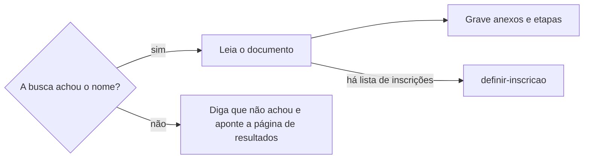

# Acompanhar edital

## Parâmetros de configuração

Leia cada valor nas instruções do projeto: primeiro na entrada com o nome desta habilidade, depois na entrada `Global`. Quando um valor não estiver lá, use o padrão abaixo.

```yaml
# `Nome do data source de oportunidades` é o banco de oportunidades da fonte de dados conectada. Vazio, a skill procura um.
"Nome do data source de oportunidades": ""
# `Nome do data source de anexos` é o banco de anexos, links e editais da oportunidade, quando o negócio tem um. Vazio, a skill procura um.
"Nome do data source de anexos": ""
# `Nome do data source de etapas` é o banco das datas da oportunidade, quando o negócio tem um. Vazio, a skill procura um.
"Nome do data source de etapas": ""
# `Ao achar um banco` é `propor`, que propõe gravar o nome achado, ou `registrar`, que grava e avisa.
"Ao achar um banco": "propor"
# `Domínios monitorados` lista os domínios buscados além dos que a oportunidade dá.
"Domínios monitorados": []
# `Uso dos domínios monitorados` é `prioridade`, que busca neles primeiro, `alternativa`, que só busca neles quando a oportunidade não dá domínio, ou `exclusivo`, que busca só neles.
"Uso dos domínios monitorados": "prioridade"
# `Ao achar um domínio novo` é `perguntar`, que pergunta se ele entra em `Domínios monitorados`, ou `automático`, que decide e explica por quê.
"Ao achar um domínio novo": "perguntar"
# `Árvore de decisão dos domínios` é o arquivo da árvore que decide se um domínio novo entra. Vazio, não há árvore.
"Árvore de decisão dos domínios": ""
# `Dias de busca diária antes da data anunciada` vale quando a oportunidade não tem histórico.
"Dias de busca diária antes da data anunciada": 7
# `Frequência da busca do resultado` vale fora dos dias de busca diária, enquanto o resultado não sai.
"Frequência da busca do resultado": "semanal"
# `Frequência da busca do próximo edital` vale depois do resultado, até o próximo edital abrir.
"Frequência da busca do próximo edital": "mensal"
"Modo de aprendizado": "perguntar"
```

## Instruções

### Passo 1

Quem chama esta habilidade é a pessoa, numa mensagem, ou outra habilidade, como `procurar-inscricao`.
A mensagem ou a habilidade nomeia um edital, uma inscrição ou uma organização.
Edital aqui inclui chamada, convocatória, seleção de curso e qualquer oportunidade com inscrição.
Sem nome, acompanhe cada inscrição sem resultado da lista de inscrições, lida por `procurar-inscricao`, quando o projeto mapeia uma; sem lista, pergunte qual edital acompanhar.
O nome que vai entre aspas na busca na web do Passo 4 é o da pessoa ou empresa inscrita.
Antes dessa busca, siga `definir-grafia` e junte as variações do nome: o artístico, o civil completo, com e sem acento, e com o sobrenome primeiro.
O documento oficial costuma trazer o nome civil inteiro, com sobrenomes que a pessoa não usa: sem ele no contexto, pergunte uma vez.
Manter a página da oportunidade não é papel desta habilidade: a mudança na edição vai para `criar-oportunidade`, e a do grupo para `definir-grupo-de-oportunidades`.
Esta habilidade grava só nos bancos de anexos e de etapas.

### Passo 2

Com as fontes de dados conectadas, como o Notion, ache nelas os bancos da oportunidade: o de oportunidades, o de anexos, que guarda documentos, links e editais, e o de etapas, que guarda as datas.
O nome de cada um varia de um negócio para outro, e os de anexos e de etapas podem não existir.
O banco, o esquema e a oportunidade já lidos nesta conversa, inclusive por `procurar-oportunidade`, não se procuram de novo.
Procure de novo só para remapear, quando um banco ou uma propriedade foi criado ou mudado depois da confirmação da pessoa.

1. Com o parâmetro do banco preenchido, procure o data source com esse nome.
2. Vazio, procure um banco com esse papel, ligado à oportunidade por relação.
3. Um achado sem estar nos parâmetros: siga `Ao achar um banco`, no harness de negócio. Com `propor`, proponha gravar o nome nas instruções do projeto. Com `registrar`, grave e diga que gravou.
4. Mais de um: pergunte uma vez qual.
5. Nenhum, ou o banco sem a propriedade de que esta habilidade precisa: pergunte uma vez se a pessoa informa onde o banco está, se quer criar o banco ou a propriedade, ou se a resposta fica só na conversa. Não crie banco nem propriedade por conta própria.
6. Sem banco de oportunidades, ou sem fonte de dados conectada, siga com `Domínios monitorados` e a busca na web.

Leia o esquema de cada banco antes de ler ou gravar. Não use um banco de outro espaço de trabalho.

### Passo 3

A oportunidade existir é pré-requisito do acompanhamento.
Use a edição que já está no contexto; sem ela, ache a edição ligada à inscrição ou siga `procurar-oportunidade`; se ela não existir, siga `criar-oportunidade` e só então continue.
Quando o edital não é do negócio cuja fonte de dados está conectada, como o curso pessoal de quem trabalha num espaço da empresa, não crie a oportunidade nesse espaço: siga com a busca na web, com a resposta só na conversa, e diga isso.
Em alguns negócios, a edição pertence a um grupo de oportunidades, com as outras edições da mesma oportunidade.

Levante os domínios antes da primeira busca. A oportunidade é a fonte principal:

1. Cada propriedade de link da edição e do grupo, como a página original, o edital e o formulário.
2. Cada anexo ligado à edição.
3. A página do mapa de oportunidades ligada à edição ou ao grupo, como uma plataforma que reúne editais.

Sem o link original, busque na web a página oficial do edital e entregue o link achado à skill dona da página, como diz o Passo 1.
Depois complete com o que a oportunidade costuma não ter.
A organização que a pessoa conhece costuma publicar no domínio de quem a mantém, como uma fundação, uma secretaria ou uma universidade.

1. O domínio da mantenedora, que aparece no rodapé do site, no edital e no CNPJ do edital.
2. O domínio da plataforma em que a inscrição foi feita.
3. O diário oficial do governo que mantém a organização, municipal, estadual ou federal.
4. O domínio do remetente e dos links da confirmação da inscrição, quando a pessoa a tem; a busca na caixa segue `procurar-email`.

Use o domínio registrável, sem `www` nem subdomínio, para o `site:` cobrir os subdomínios.
Identifique o edital pelo órgão, pelo objeto e pelo ano, não só pelo número: órgãos da mesma mantenedora repetem o número no mesmo ano.
Mostre cada domínio com a origem dele.
Junte `Domínios monitorados` conforme `Uso dos domínios monitorados`: `prioridade` busca neles primeiro, `alternativa` só quando a oportunidade não dá domínio, e `exclusivo` só neles.
Prefira `prioridade`: na web, um edital muda de página e até de domínio.
Os domínios levantados valem para a conversa inteira.
Quando o ambiente guarda dados entre execuções, como uma rotina, guarde os domínios da edição e releia-os antes de levantar de novo; a oportunidade continua a fonte de verdade.

### Passo 4

Para cada variação do nome e cada domínio, busque na web o nome entre aspas com `site:` no domínio.
Quando a ferramenta de busca tem filtro de domínio, use o filtro: há buscador que ignora o `site:` escrito na consulta.
Busque também, uma vez, cada variação entre aspas com o nome da organização, sem `site:`, para achar um domínio que a lista não tem.
Um domínio novo que trouxe resultado passa primeiro pela `Árvore de decisão dos domínios`, quando ela existe.
Quando nenhuma pergunta da árvore decide, siga `Ao achar um domínio novo`: com `perguntar`, pergunte se ele entra em `Domínios monitorados`; com `automático`, decida e diga por que incluiu ou não. Depois acrescente na árvore a regra que essa decisão mostrou.
Mostre cada consulta feita.
A página da notícia do edital costuma sair do ar depois da seleção, e os documentos continuam no site: procure-os pelo nome do arquivo ou pela listagem de arquivos do site por data, quando ele a oferece.



### Passo 5

Abra cada documento achado e leia o trecho do nome.
Quando a leitura pela web não devolve o texto de um PDF, baixe-o numa pasta temporária e extraia o texto antes de concluir.
Diga a seleção, a edição, a situação da pessoa, como selecionada, suplente, classificada, menção honrosa, eliminada ou desclassificada com o motivo, a data do documento e o link.
Diga também a etapa do documento: inscrição habilitada, convocação, resultado preliminar, resultado final ou chamada de excedentes.
Inscrição habilitada, homologada ou deferida só libera a etapa seguinte: não diga que a pessoa passou, e siga buscando até o resultado final.
A convocação para prova, entrevista ou envio de material é um prazo de agir, com data, hora e local.
Diga o prazo que o documento der para agir, como matrícula, confirmação, aceite, contato com a organização ou recurso, e se ele já passou.
Um prazo de 1 ou 2 dias, ou um prazo passado, abre a resposta; o prazo passado vem com a sugestão de contato com a organização.
Outra pessoa com o mesmo nome aparece como dúvida, com o dado que diferencia, como cidade, categoria ou parte do documento.
Quando o projeto mapeia uma lista de inscrições, a mudança da inscrição segue `definir-inscricao`.

Grave o que o edital, a retificação, a prorrogação ou o resultado trouxer, sempre ligado à edição do Passo 3.

1. No banco de anexos, um registro por documento ou link, com o link e o tipo, como edital, retificação, prorrogação, convocação ou resultado. O mesmo link já ligado à edição não se grava de novo. Grave o link, não o arquivo.
2. No banco de etapas, um registro por data: abertura das inscrições, prazo de inscrição, publicação do edital, publicação do resultado, prazo de resposta e execução. A execução dividida em dias, períodos ou módulos, como as aulas de um curso, ganha uma etapa por dia, período ou módulo. Use o nome e as opções que o esquema já tem. Não crie opção.
3. Antes de criar, procure a mesma etapa ligada à edição. É a mesma quando o nome, a data, a hora e o local coincidem. Mesma data com hora ou local diferente, como palestras ou shows simultâneos, é outra etapa.
4. Na prorrogação ou na retificação de uma data, mantenha a etapa antiga à vista, marcada como substituída pela opção ou relação que o esquema tiver, e crie a nova como a data que vale, com o link da fonte. Sem como marcar, atualize a data e diga a antiga, a nova e o link.
5. Cada etapa se prorroga sozinha: a prorrogação das inscrições não move o resultado, nem o contrário, a menos que o documento diga. Uma retificação sem data nova só entra nos anexos.
6. Achado o resultado, grave a data real da publicação na etapa do resultado, numa propriedade de data real que o esquema tenha, sem apagar a data anunciada. Sem essa propriedade, liste a data real no fim. Ela vira o histórico da próxima previsão.
7. A data vem do documento. Sem data, não grave. Sem hora, não invente a hora.
8. Sem banco de anexos, o link do edital vai para a edição por `criar-oportunidade`. Sem banco de etapas, a data vai para a propriedade de data da edição por `criar-oportunidade`; sem essa propriedade, liste a data no fim e não a escreva no corpo.

### Passo 6

Busque o próximo edital de cada oportunidade acompanhada.
Nos domínios dela, busque o nome da oportunidade com `inscrições` e o ano seguinte ao da inscrição.
Diga o período de inscrição achado, e se ele já fechou.
Sem nada achado, diga as consultas feitas.
O próximo edital é outra edição da mesma oportunidade: siga `procurar-oportunidade` e, se ela não existir, `criar-oportunidade`.
Quando o negócio agrupa as edições, a nova entra no mesmo grupo, por `definir-grupo-de-oportunidades`.
Grave as datas dela como no Passo 5.

### Passo 7

Quando a pessoa pede para não perder o resultado, ou para acompanhar a organização, siga `definir-rotina` para criar a busca recorrente dos Passos 4 a 6.
A data anunciada não garante o dia: o resultado pode sair um pouco antes, um dia depois ou semanas depois.
O edital e a publicação do resultado também podem ser prorrogados.
Preveja a janela antes de escolher a frequência.

1. Procure o histórico: nas etapas das edições anteriores do mesmo grupo de oportunidades, ou da mesma organização quando não há grupo, a data anunciada e a data real do resultado; sem etapas, a data dos documentos de resultado anteriores que a busca achar.
2. Com histórico, a janela vai da data anunciada menos a maior antecipação vista até a data anunciada mais o maior atraso visto. Dentro dela, a busca é diária em dias úteis.
3. Sem histórico, use a heurística: `Frequência da busca do resultado` até `Dias de busca diária antes da data anunciada` antes da data anunciada, e diária em dias úteis a partir daí, até o resultado sair.
4. Quando o edital dá um prazo curto de resposta, como aceite em 1 ou 2 dias, a busca na janela roda com intervalo menor que esse prazo, inclusive no fim de semana.
5. Busque também a prorrogação e a retificação nos domínios da oportunidade. A etapa que mudou move só a busca dela, como o Passo 5 diz.
6. Mostre as datas anunciadas e reais e a heurística que usou na previsão.

Em ambientes com suporte, a página de resultados ou do edital, quando conhecida, pode ser vigiada por diff: um monitor guarda a última versão da página e compara com a atual.
Com esse monitor, a rotina dispara pela mudança da página, como `definir-rotina` faz com um gatilho, e lê só o trecho que mudou; a busca do nome roda quando esse trecho é um resultado.
Quando o diff de uma página chega como entrada, leia só o trecho que mudou.
Sem monitor, a busca periódica segue a janela.
Depois do resultado achado, use `Frequência da busca do próximo edital`.
A rotina pausa quando a próxima inscrição abre e a pessoa já sabe dela.

### Passo 8

Ao terminar, siga `evoluir-habilidade` conforme `Modo de aprendizado`.

## Problemas comuns

### Domínio só da marca

Se você buscar só no domínio da organização que a pessoa conhece, o resultado publicado no domínio da mantenedora não aparece.

1. Levante a mantenedora no rodapé e no edital.
2. Acrescente a plataforma da inscrição e o diário oficial.
3. Faça a busca aberta com o nome da organização.

### Busca vazia como reprovação

Se você disser que a pessoa não passou porque a busca não achou o nome, um PDF digitalizado ou uma página fora do índice vira reprovação.

1. Diga que a busca não achou o nome.
2. Aponte a página de resultados do edital para conferir à mão.

### Resultado sem prazo

Se você disser só que a pessoa passou, o prazo de matrícula ou de aceite vence sem ela saber.

1. Leia o documento inteiro do resultado.
2. Diga o prazo e se ele já passou.

### Prorrogação apagando a data antiga

Se você trocar a data da etapa pela prorrogada, ninguém vê que o prazo mudou nem de quanto.

1. Marque a etapa antiga como substituída.
2. Crie a nova como a data que vale, com o link da prorrogação.

### Habilitação como aprovação

Se você disser que a pessoa passou porque a inscrição foi habilitada, ela perde a prova que vem depois.

1. Diga a etapa do documento.
2. Busque a convocação e o resultado final.

## Exemplos de entrada e saída

Estes exemplos ilustram fatos. Eles podem não estar no data source.

### Passei no curso livre de teatro do Teatro Exemplo?

Usei a edição que a conversa já tinha. Os links dela deram teatroexemplo.org.br; completei com fundacaoexemplo.gov.br, da mantenedora, no rodapé do edital, e com o diário oficial do estado. Busquei "Ana Souza" e "Ana Maria de Souza" com `site:` em cada um. O nome está na lista de selecionados de fevereiro, no domínio da fundação, com matrícula até 10/02, que já passou. Sugeri contato com a organização. Achei também as inscrições da turma do ano seguinte, que fecharam em setembro, e as levei a `criar-oportunidade`, no mesmo grupo.

### Quero não perder o resultado do edital de circulação

As duas edições anteriores do grupo publicaram o resultado 10 e 20 dias depois da data anunciada. Segui `definir-rotina` com a busca diária em dias úteis da data anunciada até 20 dias depois, atenta a prorrogações. O edital pede aceite em 2 dias, então a janela inclui o fim de semana.

## Casos-limite

- O documento traz só iniciais e parte do CPF: diga que a variação casa, mas não confirma a pessoa, e aponte o documento.
- A pessoa não lembra onde se inscreveu: comece pela busca aberta do Passo 4 e levante os domínios a partir do que ela achar.
- O resultado está numa imagem ou num PDF digitalizado: o índice da busca não o lê; aponte a página do edital.

## Pegadinhas

- A organização que fornece a oportunidade só parece publicar o resultado no próprio site. Muitas vezes o documento sai no domínio da mantenedora.
- O link da oportunidade só parece cobrir tudo. Mesmo que ele aponte para a organização ou para o formulário, muitas vezes o resultado pode sair em outro lugar, como na mantenedora ou no diário oficial.
- A falta de e-mail só parece falta de resultado. O resultado pode nunca chegar por e-mail.
- Inferir que listas oficiais sempre usam o nome civil completo, em maiúsculas ou com o sobrenome primeiro pode limitar a busca. A busca só pelo nome artístico também pode não achar. Buscas com variações são mais certeiras.
- A lista de inscrições habilitadas só parece a lista de aprovados. Ela vem antes da prova.
- O número do edital só parece identificá-lo. A mesma mantenedora repete o número no mesmo ano.
- O próximo edital só parece distante. Ele costuma abrir perto do resultado do anterior e também não é avisado.
- A data anunciada do resultado só parece o dia da busca. A publicação pode vir antes, depois ou prorrogada, e a janela vem do histórico.
- O banco de etapas só parece ausente quando não se chama etapas. Ele pode ter outro nome, como cronograma ou prazos, e as opções podem ter outro texto.

## Scripts disponíveis

- Nenhum.

1. Não há script para executar.
