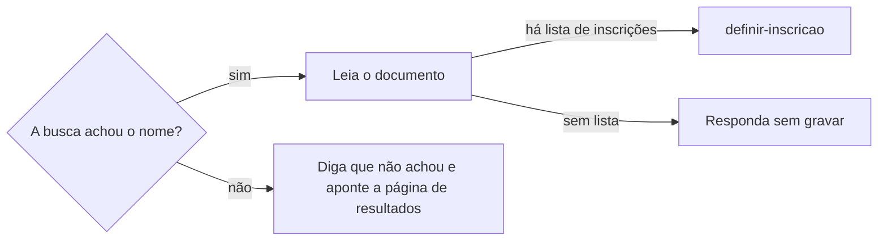

# Acompanhar edital

## Parâmetros de configuração

Leia cada valor nas instruções do projeto: primeiro na entrada com o nome desta habilidade, depois na entrada `Global`. Quando um valor não estiver lá, use o padrão abaixo.

```yaml
# `Nome do data source de oportunidades` é o banco de oportunidades do workspace conectado. Vazio, a skill procura um.
"Nome do data source de oportunidades": ""
# `Ao achar o banco de oportunidades` é `propor`, que propõe gravar o nome achado, ou `registrar`, que grava e avisa.
"Ao achar o banco de oportunidades": "propor"
# `Domínios por organização` liga cada organização à lista de domínios onde ela publica resultados e editais.
"Domínios por organização": {}
# `Frequência da busca do resultado` vale enquanto o resultado não sai e o edital não dá a data dele.
"Frequência da busca do resultado": "semanal"
# `Frequência da busca do próximo edital` vale depois do resultado, até o próximo edital abrir.
"Frequência da busca do próximo edital": "mensal"
"Modo de aprendizado": "perguntar"
```

## Instruções

### Passo 1

O pedido nomeia um edital, uma inscrição ou uma organização.
Edital aqui inclui chamada, convocatória e seleção de curso.
Sem nome, acompanhe cada organização de `Domínios por organização` e, quando o projeto mapeia uma lista de inscrições, cada inscrição dela sem resultado.
A situação da inscrição na lista se lê por `procurar-inscricao`.
O nome buscado é o da pessoa ou empresa inscrita.
Antes de buscar, siga `definir-grafia` e junte cada forma do nome: o artístico, o civil completo, com e sem acento, e a ordem com o sobrenome primeiro.
Esta habilidade não grava no Notion: a página da oportunidade muda pela skill dona dela.

Com o Notion conectado, ache o banco de oportunidades.
Com `Nome do data source de oportunidades` preenchido, procure o data source com esse nome no workspace conectado.
Vazio, procure no workspace conectado um banco de oportunidades, editais ou chamadas.
Um achado sem estar nos parâmetros: use-o e siga `Ao achar o banco de oportunidades`, no harness de negócio. Com `propor`, proponha gravar o nome nas instruções do projeto. Com `registrar`, grave e diga que gravou.
Mais de um: pergunte uma vez qual. Nenhum, ou sem o Notion: siga só com `Domínios por organização`.
Não use um banco de outro workspace.

### Passo 2

Levante os domínios da organização antes da primeira busca.
A oportunidade é a primeira referência: ache a edição ligada à inscrição, ou siga `procurar-oportunidade`, e leia cada propriedade de link da edição e do grupo dela, como a página original, o edital e o formulário.
Sem o link original, busque na web a página oficial do edital.
O link achado volta para a oportunidade pela skill dona: o desta edição, como o edital e o formulário, por `criar-oportunidade`; o que se repete em toda edição, como o site oficial, por `definir-grupo-de-oportunidades`.
Depois complete com o que a oportunidade costuma não ter.
A marca que a pessoa conhece costuma publicar no domínio de quem a mantém, como uma fundação, uma secretaria ou uma universidade.

1. O domínio da própria organização.
2. O domínio da mantenedora, que aparece no rodapé do site, no edital e no CNPJ do edital.
3. O domínio da plataforma em que a inscrição foi feita.
4. O diário oficial do governo que mantém a organização, municipal, estadual ou federal.
5. O domínio do remetente e dos links da confirmação da inscrição, quando a pessoa a tem; a busca na caixa segue `procurar-email`.

Use o domínio registrável, sem `www` nem subdomínio, para o `site:` cobrir os subdomínios.
Mostre cada domínio com a origem dele.
O domínio que não tem propriedade na oportunidade, como o da mantenedora e o do diário oficial, vai para `Domínios por organização`, na entrada da organização.
O nome da organização é a chave, e cada domínio é um item curto da lista.

### Passo 3

Para cada forma do nome e cada domínio, busque na web o nome entre aspas com `site:` no domínio.
Busque também, uma vez, cada forma do nome entre aspas com o nome da organização, sem `site:`, para achar um domínio que a lista não tem.
Um domínio novo que trouxe resultado entra na lista conforme `Modo de aprendizado`.
Mostre cada consulta feita.



### Passo 4

Abra cada documento achado e leia o trecho do nome.
Diga a seleção, a edição, a situação da pessoa, como selecionada, suplente, classificada ou eliminada, a data do documento e o link.
Diga o prazo de matrícula, de confirmação ou de recurso que o documento der, e se ele já passou.
Prazo passado: diga isso primeiro e sugira contato com a organização.
Uma homonímia aparece como dúvida, com o dado que diferencia, como cidade, categoria ou parte do documento.
Quando o projeto mapeia uma lista de inscrições, a mudança da inscrição segue `definir-inscricao`.

### Passo 5

Busque o próximo edital de cada organização acompanhada.
Nos domínios dela, busque o nome do curso ou do edital com `inscrições` e o ano seguinte ao da inscrição.
Diga o período de inscrição achado, e se ele já fechou.
Sem nada achado, diga as consultas feitas.

### Passo 6

Quando a pessoa pede para não perder o resultado, ou para acompanhar a organização, siga `definir-rotina` para criar a busca recorrente dos Passos 3 a 5.
O cronograma do edital dá a temperatura: a busca fica diária na semana da data do resultado e da data de abertura.
Sem essa data, use `Frequência da busca do resultado`.
Depois do resultado achado, use `Frequência da busca do próximo edital`.
A rotina pausa quando a próxima inscrição abre e a pessoa já sabe dela.

### Passo 7

Ao terminar, siga `evoluir-habilidade` conforme `Modo de aprendizado`.

## Problemas comuns

### Domínio só da marca

Se você buscar só no domínio da organização que a pessoa conhece, o resultado publicado no domínio da mantenedora não aparece.

1. Levante a mantenedora no rodapé e no edital.
2. Acrescente a plataforma da inscrição e o diário oficial.
3. Faça a busca aberta com o nome da organização.

### Busca vazia como reprovação

Se você disser que a pessoa não passou porque a busca não achou o nome, um PDF digitalizado ou uma página fora do índice vira reprovação.

1. Diga que a busca não achou o nome.
2. Aponte a página de resultados do edital para conferir à mão.

### Resultado sem prazo

Se você disser só que a pessoa passou, o prazo de matrícula vence sem ela saber.

1. Leia o documento inteiro do resultado.
2. Diga o prazo e se ele já passou.

## Exemplos de entrada e saída

Estes exemplos ilustram fatos. Eles podem não estar no data source.

### Passei no curso livre de teatro do Teatro Exemplo?

Levantei os domínios: teatroexemplo.org.br, da organização; fundacaoexemplo.gov.br, da mantenedora, no rodapé do edital; e o diário oficial do estado. Busquei "Ana Souza" e "Ana Maria de Souza" com `site:` em cada um. O nome está na lista de selecionados de fevereiro, no domínio da fundação, com matrícula até 10/02, que já passou. Sugeri contato com a organização. Achei também as inscrições da turma do ano seguinte, que fecharam em setembro.

### Quero não perder o resultado do edital de circulação

Gravei os domínios em `Domínios por organização` e segui `definir-rotina`: a busca roda toda semana e fica diária na semana da data do resultado que o edital dá.

## Casos-limite

- O documento traz só iniciais e parte do CPF: diga que a forma casa, mas não confirma a pessoa, e aponte o documento.
- A pessoa não lembra onde se inscreveu: comece pela busca aberta do Passo 3 e levante os domínios a partir do que ela achar.
- O resultado está numa imagem ou num PDF sem texto: o índice da busca não o lê; aponte a página do edital.

## Pegadinhas

- A instituição que dá o curso nem sempre publica o resultado no próprio site: o documento sai no domínio da mantenedora.
- O link da oportunidade parece cobrir tudo. Ele aponta para a organização ou para o formulário; o resultado pode sair na mantenedora ou no diário oficial.
- O resultado pode nunca chegar por e-mail. A ausência de aviso não é resultado.
- Listas oficiais usam o nome civil completo, em maiúsculas ou com o sobrenome primeiro. A busca só pelo nome artístico não o acha.
- O edital seguinte abre perto do resultado do anterior e também não é avisado.

## Scripts disponíveis

- Nenhum.

1. Não há script para executar.
