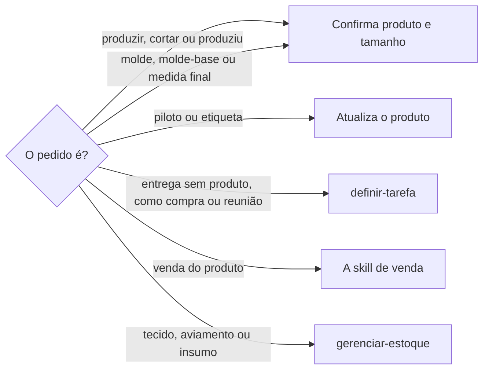
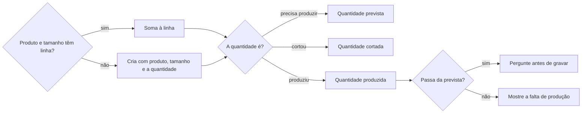

# Acompanhar produção de produto

## Parâmetros de configuração

Leia cada valor nas instruções do projeto: primeiro na entrada com o nome desta habilidade, depois na entrada `Global` ou no primeiro nível do bloco. Quando um valor não estiver lá, use o padrão abaixo.

Os nomes dos bancos e das propriedades são do negócio e ficam nas instruções do projeto. Esta habilidade só declara os parâmetros e não traz valor. Parâmetro de banco ou de propriedade sem valor: pergunte uma vez e pare, sem usar um nome suposto.

```yaml
"Modo de aprendizado": "perguntar"
# Bancos.
"Banco de produtos": ""
"Banco de variações e produção": ""
# Propriedades do banco de variações e produção.
"Relação com o produto": ""
"Quantidade prevista": ""
"Quantidade cortada": ""
"Quantidade produzida": ""
# Propriedades do banco de produtos.
"Variações de nome": ""
"Status da produção": ""
"Status do piloto": ""
"Status da etiqueta": ""
"Molde": ""
"Molde-base": ""
"Falta produção": ""
# `Ligação com o estoque` vazia quer dizer que esta habilidade não move nem lê estoque.
"Ligação com o estoque": ""
```

## Instruções

### Passo 1

A produção fica nos registros do produto, não em tarefa. O produto fica no `Banco de produtos`. Cada tamanho dele é uma linha do `Banco de variações e produção`, ligada ao produto pela `Relação com o produto`, com a quantidade prevista, a cortada e a produzida. A pessoa informa o data source na execução. Se um dos dois bancos não estiver no workspace conectado, pare. Não use a lista de outro workspace.



### Passo 2

Ache o produto pelo nome e pelas `Variações de nome`. Antes de criar uma linha, busque com `identificar-duplicata`. Não crie o produto aqui. Se ele não existir, diga e pergunte.

Confirme o tamanho de cada unidade, como XGG. O tamanho é do produto, não estimativa de tarefa. Se vier mais de um, confirme todos. Se faltar algum, pergunte antes de gravar. Molde, molde-base e medida final também pedem cada tamanho.

### Passo 3



Some só a quantidade dita. Sem número, a quantidade é 1 só quando a pessoa falou de uma unidade. Caso contrário, pergunte. Não preencha o título da linha: ele é gerado.

### Passo 4

Molde e molde-base são relações do produto. Relacione o registro que já existe. O molde-base é o ponto de partida. O molde é o final do produto, mesmo quando é o mesmo registro. Não crie o molde sem pedir.

O status do piloto e o da etiqueta mudam só quando a pessoa disser. A etiqueta corre em paralelo e não muda o status da produção.

### Passo 5

O status da produção é o macro do produto. Mude só quando a pessoa disser, ou proponha com base na falta de produção e espere o sim. Não marque o produto como produzido enquanto a falta de produção mostrar unidade faltando.

### Passo 6

Com `Ligação com o estoque` preenchida, siga o que ela diz. Vazia, não mova nem leia estoque, nem invente campo de estoque. Insumo segue `gerenciar-estoque`.

### Passo 7

Ao terminar, siga `evoluir-habilidade` conforme `Modo de aprendizado`.

## Problemas comuns

### Produção virou tarefa

Se você criar uma tarefa para lembrar de produzir um produto, a produção sai do banco de produtos e o tamanho vira estimativa.

1. Grave na quantidade prevista, na linha do produto e do tamanho.
2. Não crie tarefa.
3. Só a entrega que não é o produto segue `definir-tarefa`.

### Unidade sem tamanho

Se você gravar a unidade sem o tamanho, ela não cai em nenhuma linha e o SKU perde a variante.

1. Pergunte cada tamanho, como XGG.
2. Grave só depois da resposta.

## Exemplos de entrada e saída

Estes exemplos ilustram fatos. Eles podem não estar no data source.

### preciso produzir 2 camisetas GG

Somei 2 na quantidade prevista da linha da camiseta GG. Não criei tarefa.

### terminei a calça jeans

Perguntei o tamanho antes de gravar.

### fiz o molde da camisa no XGG

Confirmei o tamanho XGG e relacionei o molde da camisa. Não criei tarefa.

### a blusa já está etiquetada

Mudei o status da etiqueta para etiquetada. O status da produção ficou como estava.

## Casos-limite

- Banco de produtos ou de variações e produção fora do workspace conectado: pare.
- O produto não existe: diga e pergunte. Não crie aqui.
- Produzidas passaria de previstas: pergunte antes de gravar.
- Vários tamanhos no mesmo pedido: uma linha por tamanho.
- O pedido é uma entrega que não é o produto: `definir-tarefa`.

## Pegadinhas

- O produto tem o status da produção, mas a quantidade por tamanho fica no banco de variações e produção.
- Falta de produção, total produzido, total previsto e progresso são fórmulas. Não grave nelas.
- Produto finalizado com etiqueta em produção pode acender um alerta de etiqueta. Não trate o produto como pronto.

## Scripts disponíveis

- Nenhum.

1. Não há script para executar.
