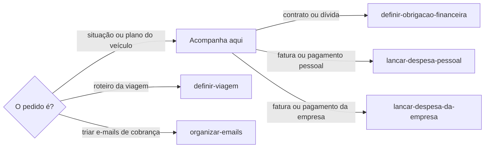
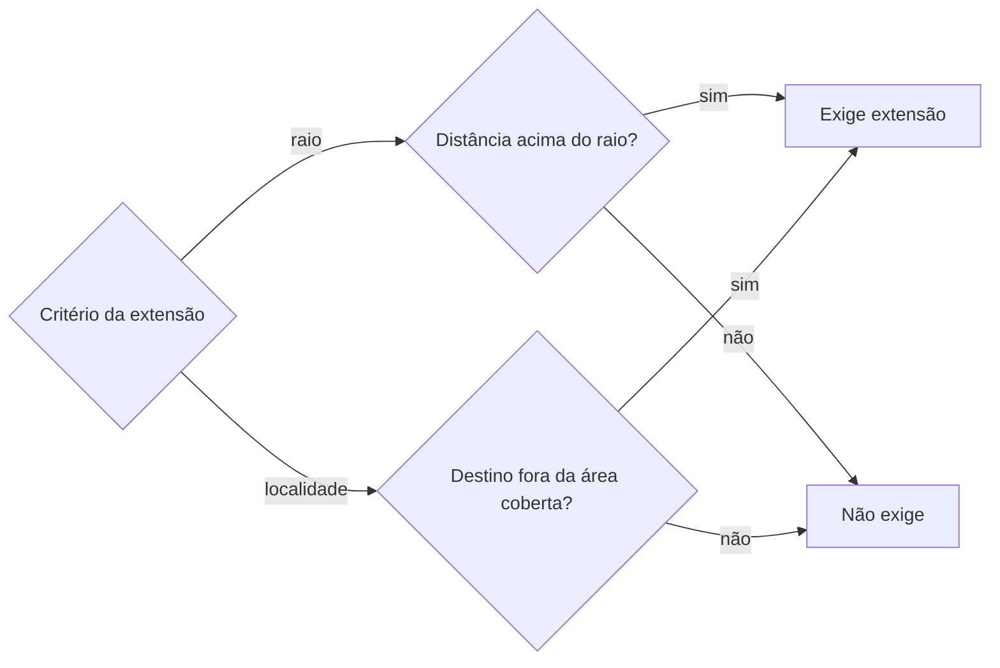

# Acompanhar veículo

## Parâmetros de configuração

Leia cada valor nas instruções do projeto: primeiro na entrada com o nome desta habilidade, depois na entrada `Global`. Quando um valor não estiver lá, use o padrão abaixo.

```yaml
"Moeda": "BRL"
"Canais das pendências": []
"Frequência da consulta nos canais": "mensal"
"Dias corridos de antecedência da extensão": 7
"Critério da extensão da proteção": "raio"
"Unidade de distância": "km"
"Área coberta sem extensão": "país"
"Modo de aprendizado": "perguntar"
```

## Instruções

### Passo 1

O veículo junta o que ele deve e o que custa: IPVA, licenciamento, seguro, multas e pontos, tag de pedágio, pedágio eletrônico sem praça, consórcio ou financiamento, reparos, combustível e manutenção. Cada contrato ou dívida é uma obrigação de `definir-obrigacao-financeira`, ligada ao veículo. Cada fatura, parcela ou pagamento é uma despesa de `lancar-despesa-pessoal`, ou de `lancar-despesa-da-empresa` quando a finalidade é da empresa. Esta habilidade não grava essas páginas por conta própria: ela chama as duas.



### Passo 2

A pessoa informa o data source na execução. Sem essa indicação, use a lista de veículos do mapeamento de dados do projeto, com os nomes de propriedade dele. Se a lista não estiver no workspace conectado, pare. Busque o veículo antes de criar. O veículo registra quem é dono, quem dirige e o estado de registro, que decide o órgão de trânsito a consultar, mesmo quando a pessoa mora em outra cidade.

### Passo 3

Um plano de regularização, como uma planilha com dívida, total, parcelas e vencimentos, vira uma obrigação por linha e uma despesa por vencimento. Converta cada coluna de vencimento na data informada pela pessoa; sem o dia, deixe o vencimento pendente. Uma parcela com valor zero não vira despesa. Confira que a soma das parcelas bate com o total de cada linha e aponte a diferença, sem corrigi-la sozinho. Uma linha mensal pode ter no total só o primeiro mês.

Uma cobrança nova de uma dívida que já tem obrigação, como um acordo que quita faturas em atraso, não entra como outra dívida antes do extrato. Peça à empresa o extrato e confira se as faturas já estão nas parcelas.
Sem o extrato, o pagamento do acordo fica ligado à obrigação existente, com o valor original e o valor pago, e a dúvida fica anotada como pendência.

### Passo 4

Aviso recebido não é situação conferida. `Canais das pendências` diz, para cada tipo de pendência, onde ela chega ou se consulta: e-mail, aplicativo ou site do órgão. Pendência que não chega por e-mail ganha uma consulta no canal indicado, com `Frequência da consulta nos canais`, e a ausência de e-mail não vale como situação em dia. Tipo ausente do parâmetro: pergunte uma vez onde ele se consulta. Multa, pontos, IPVA e licenciamento se conferem no órgão de trânsito do estado de registro ou no sistema nacional de trânsito; pedágio sem praça, na concessionária ou na tag; parcela, na administradora. Diga de onde veio cada situação. Pontos caem na habilitação de quem a pessoa indicar como condutor; sem indicação, pergunte. Pedágio eletrônico sem praça gera cobrança posterior com prazo: diga o prazo que a concessionária informar, sem inventar outro.

Uma pendência que só se resolve num painel, como a tag que continua inativa depois do pagamento, entra em `acompanhar-retornos-pendentes` com o prazo que a empresa informou. A pessoa não confere à mão.

### Passo 5

A finalidade decide o contexto de cada gasto: uma viagem da empresa com o carro pessoal gera gasto da empresa, mesmo que o carro seja pessoal. Uma decisão nova sobre o uso do carro vale dali em diante e não muda o histórico. Quando outra pessoa paga, a despesa registra quem pagou. Se a pessoa da família pagou a um terceiro e espera receber de volta, o pagamento é uma despesa paga por ela e o reembolso é uma obrigação com ela; sem forma combinada, a obrigação fica `A verificar`, sem parcelas inventadas.

### Passo 6

Viagem com o veículo pode exigir a extensão da proteção ou do seguro. `Critério da extensão da proteção` diz como decidir. Com `raio`, compare a distância da viagem, na `Unidade de distância`, com o raio de cobertura que o contrato dá ao veículo. Com `localidade`, compare o destino com `Área coberta sem extensão`, que pode ser o município, o estado ou o país. Sem o raio registrado no veículo, pergunte uma vez e grave.



O pedido sai com `Dias corridos de antecedência da extensão` antes da partida. Crie o lembrete na agenda do contexto e o marco no cronograma da viagem por `sincronizar-cronograma`. Registre na viagem e no veículo o pedido feito, com data e protocolo, ou a recusa com justificativa. Recusa por falta de caixa numa viagem de trabalho mostra que a projeção de caixa não cobriu a extensão: diga isso e que a participação deve ser revista. Sem pedido nem recusa justificada, diga que o veículo viaja sem a extensão. Proteção veicular não é seguro: confira o que ela cobre, como enchente ou perda de placa, em vez de supor.

O produto adicional, como a extensão, tem regras no contrato: a carência, o intervalo entre alterações e a quem pedir. Leia a carência antes de pedir. Se ela termina depois da viagem, a extensão não cobre a viagem: diga isso e deixe a pessoa decidir se contrata.

Grave no veículo as regras que a empresa informou, o limite de cobertura que ela disser e a decisão da pessoa, com a data, quem decidiu e o motivo, como a carência que termina depois das viagens previstas. Faça isso quando a resposta chegar, sem esperar a pessoa pedir. Uma decisão de não contratar não é recusa por falta de caixa e não pede o aviso sobre a projeção de caixa.

### Passo 7

Toda fatura ou parcela citada traz o vencimento e o valor. Entregue as pendências do veículo em ordem de vencimento, com o total do mês, e diga o que ainda falta conferir. Ao terminar, siga `evoluir-habilidade` conforme `Modo de aprendizado`.

## Problemas comuns

### Aviso tratado como situação

Se você der uma multa ou um IPVA como pagos ou pendentes só por um e-mail, a situação real pode ser outra.

1. Diga de onde veio a informação.
2. Indique a consulta no órgão de trânsito do estado de registro.

### Regra da proteção só na conversa

Se você der a carência e a decisão de não contratar à pessoa e não gravar no veículo, a próxima viagem repete a pergunta e a mesma resposta da empresa.

1. Grave no veículo as regras, o limite e a decisão, com a data e o motivo.
2. Preencha o raio de cobertura quando a empresa disser o limite.
3. Diga na resposta qual página mudou, com o link.

### Planilha copiada sem conferir

Se você migrar o plano sem somar as parcelas, uma diferença de digitação vira dívida no sistema.

1. Some as parcelas de cada linha.
2. Aponte a diferença para a pessoa.

## Exemplos de entrada e saída

Estes exemplos ilustram fatos. Eles podem não estar no data source.

### planilha com IPVA em 4 parcelas, reparos em 6, multas, tag e seguro, vencimentos de outubro a março

Criei uma obrigação por linha, ligada ao carro, e uma despesa por vencimento com valor e data. Deixei pendente o dia que a pessoa não sabia e apontei a soma que não bateu.

### pedágio de rodovia sem praça numa viagem pessoal

Registrei como despesa pessoal, ligada ao carro e à viagem, com o prazo de pagamento informado pela concessionária.

### a proteção só cobre a assistência até 200 km, e a extensão tem carência de 30 dias

A carência termina depois da viagem do fim de semana, então a extensão não a cobre. A pessoa decidiu não contratar. Gravei no veículo as regras do produto adicional, o limite de 200 km e a decisão com a data e o motivo, e preenchi o raio de cobertura. Não avisei a projeção de caixa, porque não foi recusa por caixa.

## Casos-limite

- A pessoa decide não contratar a extensão por causa da carência: grave a decisão, a data e o motivo no veículo. A decisão vale para as viagens parecidas até a pessoa mudar.
- Várias pessoas dirigem o mesmo carro: a multa vai para quem a pessoa indicar como condutor.
- O carro foi registrado numa cidade e a pessoa mora em outra: o estado de registro decide o órgão de trânsito.
- Uma parcela já foi paga por outra pessoa: registre o pagamento e quem pagou.
- A tag de pedágio está inativa por dívida: a tag fica registrada como inativa e a dívida dela é uma obrigação. Paga a dívida, o desbloqueio entra em `acompanhar-retornos-pendentes` até a tag aparecer ativa no painel.
- A pessoa que pagou diz que vai combinar o reembolso depois: a obrigação com ela fica `A verificar`, sem valor de parcela.

## Pegadinhas

- A resposta da empresa parece só informação para a conversa. A carência, o limite e a decisão da pessoa mudam a próxima viagem: grave no veículo antes de responder.
- O endereço de quem dirige parece decidir o órgão de trânsito. Quem decide é o estado de registro do veículo.
- Quem anda no carro parece motorista. Motorista é só quem dirige; passageiro não recebe pontos.
- O e-mail da tag parece a fatura do pedágio sem praça. São cobranças diferentes.
- Um acordo com desconto parece uma dívida nova. Ele quita faturas que já existem: as faturas originais vêm do extrato.
- Planilha com o ano escrito como "26/01" pode ser 2026, e não uma data.

## Scripts disponíveis

- Nenhum.

1. Não há script para executar.
