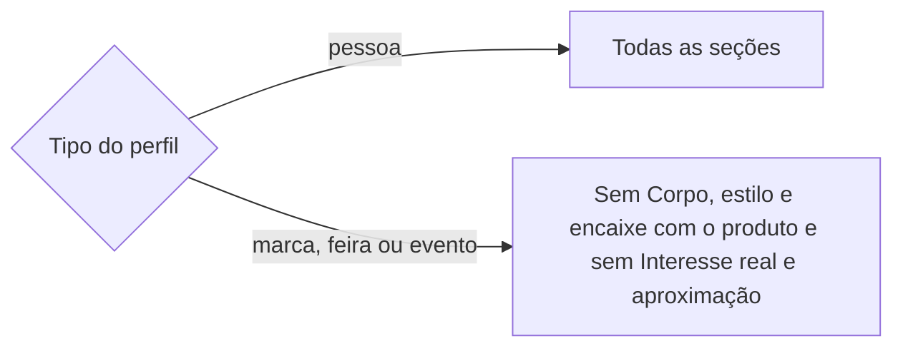

# Analisar perfil social

## Parâmetros de configuração

Leia cada valor nas instruções do projeto: primeiro na entrada com o nome desta habilidade, depois na entrada `Global` ou no primeiro nível do bloco. Quando um valor não estiver lá, use o padrão abaixo.
```yaml
# `Posicionamento da marca` é o texto, ou a referência, que descreve a estética, os valores e o público da marca. Vazio quer dizer que a habilidade pergunta uma vez onde ele está e para.
"Posicionamento da marca": ""
# `Posts recentes a olhar` é quantos posts a habilidade lê além da bio, dos destaques e dos fixados.
"Posts recentes a olhar": 12
"Modo de aprendizado": "perguntar"
```

## Instruções

### Passo 1

Leia o `Posicionamento da marca` nas instruções do projeto. Sem ele, pergunte uma vez onde está e pare: sem a base de comparação, a nota não diz nada.

Peça o canal e o perfil, se a pessoa não os trouxe, e o gatilho: por que esse perfil entrou na lista.

### Passo 2

Defina o tipo do perfil e escolha as seções do modelo de saída `perfil-social`.



Leia o modelo de saída `perfil-social` quando for gerar a saída.

### Passo 3

Abra o perfil. Se o canal abrir com um aviso de login, pare antes de ler e peça à pessoa que entre na conta. Diga o que o login libera, como os destaques, as legendas, os comentários e os posts além dos primeiros, e espere a resposta. Siga só depois que ela entrar ou disser que não quer entrar.

Com a ferramenta de credencial do gerenciador de senhas na sessão, ofereça o login por ela e espere o sim da pessoa. A pessoa aprova o item no próprio gerenciador, o valor entra direto na página e você nunca o vê, nem o código de verificação. Sem essa ferramenta, a pessoa entra pelo navegador. Nunca peça nem digite a senha da pessoa.

Leia o perfil inteiro, não só o último post: a bio e o link da bio, o grid, os destaques, os posts fixados e os `Posts recentes a olhar`, com legendas e comentários. Destaque e post fixado contam como identidade do perfil, porque ficam ali mesmo depois de anos.

Sem o login, leia só o que está visível e liste em `Limites da análise` o que ficou de fora.

Perfil privado, bloqueado ou fora do ar: diga que não analisou e por quê, e pergunte se a pessoa quer trazer capturas. Não deduza estética nem valores do nome. Capturas trazidas pela pessoa seguem `reconhecer-imagem`.

### Passo 4

Preencha cada seção só com o que o perfil mostra. Cada sinal cita o post ou o destaque e a data que o sustenta.

Conteúdo cujo sentido depende de contexto que o perfil não dá fica como hipótese: diga o que está visível, liste as leituras possíveis e não afirme a intenção da pessoa nem o valor que ela defende. A decisão é de quem lê a análise.

### Passo 5

Escreva o veredito. A nota de estética e a nota de valores e discurso ficam separadas, sem nota única, porque um eixo forte esconde o fraco. Liste até 5 sinais verdes e até 5 vermelhos, o perfil em uma frase e o próximo passo, com o eixo que pesou.

Diga em `Limites da análise` o que o perfil não mostra. Numa feira ou num evento, o perfil não mostra como é a presença no local: a leitura é da apresentação digital.

### Passo 6

Entregue a análise na resposta, no modelo. Não grave em banco, página nem tarefa: quem pediu decide onde lançar. Com mais de uma análise na conversa, feche com os `Padrões` do modelo.

### Passo 7

Ao terminar, siga `evoluir-habilidade` conforme `Modo de aprendizado`.

## Problemas comuns

### Análise começada sem o login

Se você ler o perfil que abriu com aviso de login sem pedir o login antes, a análise sai sem os destaques, as legendas e os comentários, e a pessoa só descobre depois.

1. Pare antes de ler e peça à pessoa que entre na conta, pelo gerenciador de senhas ou pelo navegador.
2. Diga o que o login libera.
3. Sem o login, liste em `Limites da análise` o que ficou de fora.

### Nota única

Se você der uma nota só, a estética alta esconde um discurso que destoa da marca, ou o contrário.

1. Dê a nota de estética e a de valores e discurso separadas.
2. Diga no próximo passo qual eixo pesou.

### Só o último post

Se você ler só os posts mais recentes, o destaque e o post fixado, que ficam anos no perfil, passam sem leitura.

1. Abra a bio, os destaques e os fixados antes dos posts.
2. Cite a data de cada sinal.

### Conclusão sem evidência

Se você escrever "estética inconsistente" sem apontar onde, quem lê não consegue conferir nem discordar.

1. Cite o post ou o destaque e a data.
2. Sem evidência visível, deixe a resposta vazia ou como hipótese.

### Hipótese escrita como fato

Se você afirmar a intenção ou o valor de uma pessoa a partir de um post ambíguo, a análise acusa sem base.

1. Descreva o que está visível.
2. Liste as leituras possíveis e deixe a decisão para quem lê.

### Análise gravada sem pedido

Se você gravar o resultado num banco ou numa página, a análise vira registro sem a pessoa ter decidido.

1. Entregue o texto na resposta, no modelo.
2. Grave só quando a pessoa pedir, com a habilidade do destino.

## Exemplos de entrada e saída

Estes exemplos ilustram fatos. Eles podem não estar no data source.

### Antes de fechar a Feira Exemplo, analise o Instagram dela

Li o posicionamento da marca, abri a bio, os destaques e os 12 posts recentes e usei as seções que valem para feira. O feed mistura vários estilos sem curadoria, e um destaque de 2024 tem conteúdo político que destoa dos valores da marca, citado com a data como hipótese de posicionamento. Estética 3/10 e valores 4/10, três sinais vermelhos e um verde, próximo passo descartar pelo eixo da estética. Avisei que o perfil não mostra a presença no local.

## Casos-limite

- O perfil é de pessoa: use todas as seções do modelo.
- O perfil é de feira, evento ou marca: omita o encaixe com o produto e a aproximação.
- O canal não é o Instagram: leia o equivalente de bio, destaques, fixados e posts recentes, e diga o que o canal não oferece.
- O canal abre com aviso de login: peça à pessoa que entre na conta antes de ler, e ofereça o gerenciador de senhas quando a sessão tem a ferramenta. Se ela não quiser, siga com o que está visível e diga o que ficou de fora.
- Mais de um perfil da mesma feira ou pessoa: analise cada um e junte no veredito.
- A pessoa pede a nota sem o posicionamento da marca: pergunte onde está e pare.
- A pessoa quer cadastrar o perfil analisado: siga `definir-perfil-social`.

## Pegadinhas

- O aviso de login parece só uma janela a fechar. O grid inicial ainda carrega por baixo, mas os destaques, as legendas e os comentários não abrem sem a conta.
- A ferramenta de credencial do gerenciador de senhas parece valer em qualquer navegador da sessão. Ela age só no navegador da própria pessoa, não no embutido no aplicativo, e pode estar sem conexão com o gerenciador. Sem ela, a pessoa entra pela aba.
- O destaque parece conteúdo antigo e menos importante. Ele fica fixo no perfil e pesa tanto quanto o último post.
- A estética do feed parece a estética do evento. O perfil mostra a apresentação digital, não a presença no local.
- Um número de seguidores alto parece bom sinal. A qualidade da conversa nos comentários pesa mais.
- Um perfil sem post recente parece abandonado. Pode ser um perfil que publica só perto da edição, e a frequência é um sinal, não um veredito.

## Scripts disponíveis

- Nenhum.

1. Não há script para executar.
