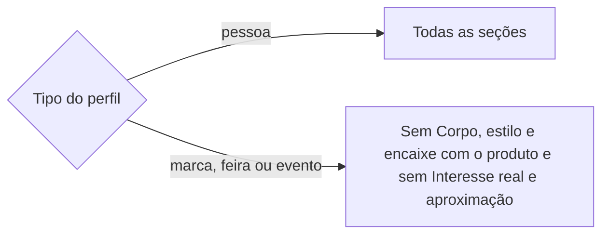

# Analisar perfil social

## Parâmetros de configuração

Leia cada valor nas instruções do projeto: primeiro na entrada com o nome desta habilidade, depois na entrada `Global` ou no primeiro nível do bloco. Quando um valor não estiver lá, use o padrão abaixo.
```yaml
# `Posicionamento da marca` é o texto, ou a referência, que descreve a estética, os valores e o público da marca. Vazio quer dizer que a habilidade pergunta uma vez onde ele está e para.
"Posicionamento da marca": ""
# `Posts recentes a olhar` é quantos posts a habilidade lê além da bio, dos destaques e dos fixados.
"Posts recentes a olhar": 12
# `Publicar a análise no perfil social` é `sim` ou `não`. `sim` publica a análise no corpo da página do perfil, na lista de perfis sociais do mapeamento de dados do projeto. `não` só entrega a análise na resposta.
"Publicar a análise no perfil social": "sim"
"Modo de aprendizado": "perguntar"
```

## Instruções

### Passo 1

Leia o `Posicionamento da marca` nas instruções do projeto. Sem ele, pergunte uma vez onde está e pare: sem a base de comparação, a nota não diz nada.

Peça o canal e o perfil, se a pessoa não os trouxe, e o gatilho: por que esse perfil entrou na lista.

### Passo 2

Defina o tipo do perfil e escolha as seções do modelo de saída `perfil-social`.



Leia o modelo de saída `perfil-social` quando for gerar a saída.

### Passo 3

Abra o perfil. Se o canal abrir com um aviso de login, pare antes de ler e peça à pessoa que entre na conta. Diga o que o login libera, como os destaques, as legendas, os comentários e os posts além dos primeiros, e espere a resposta. Siga só depois que ela entrar ou disser que não quer entrar.

Com a ferramenta de credencial do gerenciador de senhas na sessão, ofereça o login por ela e espere o sim da pessoa. A pessoa aprova o item no próprio gerenciador, o valor entra direto na página e você nunca o vê, nem o código de verificação. Sem essa ferramenta, a pessoa entra pelo navegador. Nunca peça nem digite a senha da pessoa.

Leia o perfil inteiro, não só o último post: a bio e o link da bio, o grid, os destaques, os posts fixados e os `Posts recentes a olhar`, com legendas e comentários. Destaque e post fixado contam como identidade do perfil, porque ficam ali mesmo depois de anos.

Abra os `Posts recentes a olhar` um por um, com a legenda e os comentários. O destaque não substitui o post, nem o post o destaque: os dois entram. Post que não carregou é aberto de novo, e o que continua sem abrir fica listado com a data em `Limites da análise`. Conte os posts que você abriu e leu, e diga na análise quantos foram, de quantos pedidos. Não escreva que leu um post que só viu na grade ou que não abriu.

Em cada post, leia o rótulo da plataforma, como "Conteúdo de IA", e os contadores de curtidas, comentários e compartilhamentos. Confira o que cada número é antes de usá-lo.

Sem o login, leia só o que está visível e liste em `Limites da análise` o que ficou de fora.

Quadro de destaque que abre vazio ou preto não foi lido. Não deduza o conteúdo pelo título do destaque: liste-o em `Limites da análise` e ofereça ler no navegador da própria pessoa. Abrir um destaque com a conta logada pode mostrar a conta como quem viu, então diga na resposta que abriu.

Perfil privado, bloqueado ou fora do ar: diga que não analisou e por quê, e pergunte se a pessoa quer trazer capturas. Não deduza estética nem valores do nome. Capturas trazidas pela pessoa seguem `reconhecer-imagem`.

### Passo 4

Preencha cada seção só com o que o perfil mostra. Cada sinal cita o post ou o destaque e a data que o sustenta.

Conteúdo cujo sentido depende de contexto que o perfil não dá fica como hipótese: diga o que está visível, liste as leituras possíveis e não afirme a intenção da pessoa nem o valor que ela defende. A decisão é de quem lê a análise.

O rótulo de conteúdo de IA entra como sinal, com o post e a data, e não como acusação: ele diz o que a plataforma marcou. Os contadores servem para medir o engajamento contra o tamanho do perfil.

### Passo 5

Escreva o veredito. A nota de estética e a nota de valores e discurso ficam separadas, sem nota única, porque um eixo forte esconde o fraco. Liste até 5 sinais verdes e até 5 vermelhos, o perfil em uma frase e o próximo passo, com o eixo que pesou.

Diga em `Limites da análise` o que o perfil não mostra. Numa feira ou num evento, o perfil não mostra como é a presença no local: a leitura é da apresentação digital.

### Passo 6

Entregue a análise na resposta, no modelo. Com mais de uma análise na conversa, feche com os `Padrões` do modelo.

Com `Publicar a análise no perfil social` em `sim`, publique a análise também no corpo da página do perfil analisado, na lista de perfis sociais do mapeamento de dados do projeto, e dê o link da página na resposta. Cada canal tem a própria página de perfil e a própria análise: não publique na página da pessoa nem da empresa, porque a leitura muda de um canal para outro.

Perfil sem página na lista: cadastre-o com `definir-perfil-social` antes de publicar. Página que já tem uma análise: acrescente a nova abaixo da anterior, com a data no título, e não apague a anterior, porque o histórico mostra como o perfil mudou. Sem a lista no workspace conectado, entregue só na resposta e diga que não publicou.

### Passo 7

Ao terminar, siga `evoluir-habilidade` conforme `Modo de aprendizado`.

## Problemas comuns

### Análise começada sem o login

Se você ler o perfil que abriu com aviso de login sem pedir o login antes, a análise sai sem os destaques, as legendas e os comentários, e a pessoa só descobre depois.

1. Pare antes de ler e peça à pessoa que entre na conta, pelo gerenciador de senhas ou pelo navegador.
2. Diga o que o login libera.
3. Sem o login, liste em `Limites da análise` o que ficou de fora.

### Destaque lido pelo título

Se você descrever o conteúdo de um destaque pelo nome dele ou pela edição que ele arquiva, a análise afirma o que não viu.

1. Confira se os quadros abriram. Quadro vazio ou preto não foi lido.
2. Liste o destaque em `Limites da análise`.
3. Ofereça ler no navegador da própria pessoa.

### Nota única

Se você der uma nota só, a estética alta esconde um discurso que destoa da marca, ou o contrário.

1. Dê a nota de estética e a de valores e discurso separadas.
2. Diga no próximo passo qual eixo pesou.

### Só o último post

Se você ler só os posts mais recentes, o destaque e o post fixado, que ficam anos no perfil, passam sem leitura.

1. Abra a bio, os destaques e os fixados antes dos posts.
2. Cite a data de cada sinal.

### Destaques no lugar dos posts

Se você ler os destaques e só alguns posts, ou disser que leu mais posts do que abriu, a análise parece completa e quem lê a toma por inteira.

1. Abra cada um dos `Posts recentes a olhar`, com legenda e comentários, além dos destaques.
2. Tente de novo o que não carregou e liste o que continuar fechado.
3. Diga na análise quantos posts leu, de quantos pedidos.

### Conclusão sem evidência

Se você escrever "estética inconsistente" sem apontar onde, quem lê não consegue conferir nem discordar.

1. Cite o post ou o destaque e a data.
2. Sem evidência visível, deixe a resposta vazia ou como hipótese.

### Hipótese escrita como fato

Se você afirmar a intenção ou o valor de uma pessoa a partir de um post ambíguo, a análise acusa sem base.

1. Descreva o que está visível.
2. Liste as leituras possíveis e deixe a decisão para quem lê.

### Análise publicada na página errada

Se você publicar a análise na página da pessoa ou da empresa do perfil, ela mistura canais diferentes e a leitura de um canal passa pela de outro.

1. Publique no corpo da página do perfil do canal analisado.
2. Deixe a página da pessoa e a da empresa como estão.
3. Dê o link da página do perfil na resposta.

### Análise anterior apagada

Se você substituir a análise que a página do perfil já tinha, o histórico some e ninguém vê como o perfil mudou.

1. Acrescente a análise nova abaixo da anterior.
2. Ponha a data no título de cada análise.

## Exemplos de entrada e saída

Estes exemplos ilustram fatos. Eles podem não estar no data source.

### Antes de fechar a Feira Exemplo, analise o Instagram dela

Li o posicionamento da marca, abri a bio, os destaques e os 12 posts recentes e usei as seções que valem para feira. O feed mistura vários estilos sem curadoria, e um destaque de 2024 tem conteúdo político que destoa dos valores da marca, citado com a data como hipótese de posicionamento. Estética 3/10 e valores 4/10, três sinais vermelhos e um verde, próximo passo descartar pelo eixo da estética. Avisei que o perfil não mostra a presença no local. Publiquei a análise na página do perfil `feiraexemplo`, na lista de perfis sociais, e dei o link.

## Casos-limite

- O perfil é de pessoa: use todas as seções do modelo.
- O perfil é de feira, evento ou marca: omita o encaixe com o produto e a aproximação.
- O canal não é o Instagram: leia o equivalente de bio, destaques, fixados e posts recentes, e diga o que o canal não oferece.
- Os quadros de um destaque abrem pretos: o destaque conta como não lido. Diga isso e ofereça ler no navegador da pessoa.
- O canal abre com aviso de login: peça à pessoa que entre na conta antes de ler, e ofereça o gerenciador de senhas quando a sessão tem a ferramenta. Se ela não quiser, siga com o que está visível e diga o que ficou de fora.
- Mais de um perfil da mesma feira ou pessoa: analise cada um e junte no veredito.
- A pessoa pede a nota sem o posicionamento da marca: pergunte onde está e pare.
- A pessoa quer cadastrar o perfil analisado: siga `definir-perfil-social`.
- O perfil analisado não tem página na lista de perfis sociais: cadastre-o com `definir-perfil-social` antes de publicar.
- `Publicar a análise no perfil social` está em `não`: entregue só na resposta.

## Pegadinhas

- O aviso de login parece só uma janela a fechar. O grid inicial ainda carrega por baixo, mas os destaques, as legendas e os comentários não abrem sem a conta.
- A ferramenta de credencial do gerenciador de senhas parece valer em qualquer navegador da sessão. Ela age só no navegador da própria pessoa, não no embutido no aplicativo, e pode estar sem conexão com o gerenciador. Sem ela, a pessoa entra pela aba.
- A página da pessoa ou da empresa parece o lugar natural da análise. A estética e o público mudam de um canal para outro, então a análise fica na página do perfil de cada canal.
- O destaque aberto parece lido. No navegador embutido no aplicativo os quadros podem abrir pretos, e o título do destaque não diz o que há nele.
- O destaque parece conteúdo antigo e menos importante. Ele fica fixo no perfil e pesa tanto quanto o último post.
- A estética do feed parece a estética do evento. O perfil mostra a apresentação digital, não a presença no local.
- Um número de seguidores alto parece bom sinal. A qualidade da conversa nos comentários pesa mais.
- Um perfil sem post recente parece abandonado. Pode ser um perfil que publica só perto da edição, e a frequência é um sinal, não um veredito.

## Scripts disponíveis

- Nenhum.

1. Não há script para executar.
