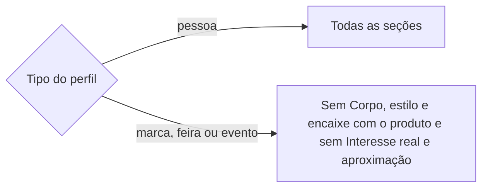

# Analisar perfil social

## Parâmetros de configuração

Leia cada valor nas instruções do projeto: primeiro na entrada com o nome desta habilidade, depois na entrada `Global` ou no primeiro nível do bloco. Quando um valor não estiver lá, use o padrão abaixo.
```yaml
# `Posicionamento da marca` é o texto, ou a referência, que descreve a estética, os valores e o público da marca. Vazio quer dizer que a habilidade pergunta uma vez onde ele está e para.
"Posicionamento da marca": ""
# `Posts recentes a olhar` é quantos posts a habilidade lê além da bio, dos destaques e dos fixados.
"Posts recentes a olhar": 12
# `Leitura do feed inteiro` é `sempre`, `nunca` ou `automático`. `sempre` varre o grid do primeiro ao último post, miniatura por miniatura. `nunca` fica nos `Posts recentes a olhar`. `automático` varre quando o que já foi lido não basta para a conclusão.
"Leitura do feed inteiro": "automático"
# `Limite de posts por varredura` é quantos posts o modo `automático` varre no grid e nos reposts antes de parar. Perfil com mais posts que o limite é varrido até ele, do mais recente para trás, e a análise diz o quanto cobriu. `0` não põe limite. `sempre` ignora o limite.
"Limite de posts por varredura": 150
# `Leitura dos reposts` é `sempre`, `nunca` ou `automático`, com o mesmo sentido, para a aba de reposts.
"Leitura dos reposts": "automático"
# `Abertura dos posts` é `todos`, `nenhum`, `automático em conjunto` ou `automático um por um`. `todos` abre cada post lido, com a legenda e os comentários. `nenhum` lê só a miniatura e o texto alternativo. `automático em conjunto` decide uma vez, pelo conjunto, entre abrir todos ou nenhum. `automático um por um` decide a cada post.
"Abertura dos posts": "automático um por um"
# `Quadros por destaque` é quantos quadros a habilidade lê em cada destaque, do primeiro em diante. `0` lê todos.
"Quadros por destaque": 3
# `Amostra de destaques` é quantos destaques a habilidade abre primeiro, para decidir se lê os outros. Vale em todos os modos em que ela abre destaques.
"Amostra de destaques": 3
# `Destaques com a conta logada` é `perguntar`, `sempre`, `automático` ou `nunca`. Abrir um destaque com a conta logada pode mostrar essa conta como quem viu, para a pessoa dona do perfil. `perguntar` diz isso uma vez por análise, com o nome da conta e o número de destaques, e espera o sim. Com o sim, segue como `automático`. `sempre` abre todos sem perguntar. `automático` abre sem perguntar a amostra e decide pelos demais. `nunca` não abre.
"Destaques com a conta logada": "perguntar"
# `Publicar a análise no perfil social` é `sim` ou `não`. `sim` grava a análise no `Destino da análise`. `não` só entrega a análise na resposta.
"Publicar a análise no perfil social": "sim"
# `Destino da análise` é onde a análise é gravada quando `Publicar a análise no perfil social` é `sim`. O padrão é o corpo da página do perfil, na lista de perfis sociais do mapeamento de dados do projeto. Um negócio que grava noutro lugar descreve o lugar aqui.
"Destino da análise": "corpo da página do perfil social"
# `Quando já existe análise publicada` é `perguntar`, `mesclar`, `substituir`, `nunca substituir` ou `automático`. `perguntar` mostra as duas análises e espera a escolha. `mesclar` grava uma análise só, com o que há de melhor nas duas. `substituir` põe a nova no lugar da anterior. `nunca substituir` deixa a anterior como está e acrescenta a nova abaixo. `automático` mescla quando as duas leem o mesmo perfil no mesmo período e acrescenta abaixo quando o perfil mudou e a comparação no tempo importa.
"Quando já existe análise publicada": "perguntar"
"Modo de aprendizado": "perguntar"
```

## Instruções

### Passo 1

Leia o `Posicionamento da marca` nas instruções do projeto. Sem ele, pergunte uma vez onde está e pare: sem a base de comparação, a nota não diz nada.

Peça o canal e o perfil, se a pessoa não os trouxe, e o gatilho: por que esse perfil entrou na lista.

Com `Publicar a análise no perfil social` em `sim`, confira antes de ler o perfil que o `Destino da análise` está ao alcance: a lista existe no workspace conectado e a ferramenta escreve nela. Sem isso, pare e diga, antes de gastar a leitura. A análise não é feita para ficar só na conversa.

### Passo 2

Defina o tipo do perfil e escolha as seções do modelo de saída `perfil-social`.



Leia o modelo de saída `perfil-social` quando for gerar a saída.

### Passo 3

Abra o perfil. Se o canal abrir com um aviso de login, pare antes de ler e peça à pessoa que entre na conta. Diga o que o login libera, como os destaques, as legendas, os comentários e os posts além dos primeiros, e espere a resposta. Siga só depois que ela entrar ou disser que não quer entrar.

Com a ferramenta de credencial do gerenciador de senhas na sessão, ofereça o login por ela e espere o sim da pessoa. A pessoa aprova o item no próprio gerenciador, o valor entra direto na página e você nunca o vê, nem o código de verificação. Sem essa ferramenta, a pessoa entra pelo navegador. Nunca peça nem digite a senha da pessoa.

Leia o perfil inteiro, não só o último post: a bio e o link da bio, o grid, os destaques, os posts fixados e os `Posts recentes a olhar`, com legendas e comentários. Destaque e post fixado contam como identidade do perfil, porque ficam ali mesmo depois de anos.

Conte os destaques do perfil. Antes de abrir, siga `Destaques com a conta logada`. Com `nunca`, ou com a pessoa dizendo não, nenhum destaque abre e todos ficam em `Limites da análise`, sem dedução pelo título.

Abra a `Amostra de destaques`: o mais recente, o mais antigo e os do meio, e leia os `Quadros por destaque` de cada um. O título do destaque não diz o conteúdo, e o destaque fica no perfil por anos.

Decida pela amostra se lê os demais. Leia todos quando a amostra mostra conteúdo que não se resume à divulgação do evento, como discurso, posicionamento, identidade ou um tema que pesa na marca, ou quando os destaques da amostra diferem entre si. Pare quando a amostra repete o mesmo formato, como o cartaz de cada edição. Com `sempre`, leia todos.

Diga em `Limites da análise` quantos destaques o perfil tem, quantos abriu, quantos quadros leu de cada um e quais abriram pretos.

O alcance da leitura segue `Leitura do feed inteiro`, `Leitura dos reposts` e `Abertura dos posts`. Os `Posts recentes a olhar` são o mínimo e valem em todos os modos. O destaque não substitui o post, nem o post o destaque: os dois entram.

No modo `automático`, a leitura é suficiente quando cada nota e cada sinal do veredito cita um post ou um destaque com data. Ela não basta quando o que você viu aponta para um tema que pesa na marca, como política, religião ou discurso, e ficou ambíguo, ou quando a miniatura traz texto na imagem, bandeira, slogan ou um post sem legenda que a plataforma descreve como imagem de texto.

Um tema que só aparece dentro de uma imagem não aparece na legenda. Antes do veredito, releia o que reuniu. Se não basta, amplie o que o parâmetro deixar automático: varra o feed, leia os reposts ou abra os posts que faltam. A varredura automática para no `Limite de posts por varredura`, e a análise diz o quanto do total cobriu.

Com `Abertura dos posts` em `automático um por um`, abra o post que a miniatura ou a legenda mostrar que pesa. Em `automático em conjunto`, decida pelo conjunto: abra todos se a leitura não basta, nenhum se basta.

Post que não carregou é aberto de novo, e o que continua sem abrir fica listado com a data em `Limites da análise`.

Em `Limites da análise`, diga o que cada parâmetro fez e, no modo automático, o que decidiu e por quê. Conte os posts abertos, os que só viu na miniatura e o total do perfil, diga se leu os reposts e quanto varreu do total quando o limite parou a leitura. Não escreva que um tema não aparece no perfil quando o alcance foi `nunca`, `nenhum` ou uma amostra pequena do total, nem que leu um post que só viu na grade.

Post só de imagem pode não devolver texto pelo leitor de página. Leia o texto pela página aberta no navegador ou pela captura, e não conte como lido o post que não devolveu nada.

Em cada post, leia o rótulo da plataforma, como "Conteúdo de IA", e os contadores de curtidas, comentários e compartilhamentos. Confira o que cada número é antes de usá-lo.

Sem o login, leia só o que está visível e liste em `Limites da análise` o que ficou de fora.

Quadro de destaque que abre vazio ou preto não foi lido. Não deduza o conteúdo pelo título do destaque: liste-o em `Limites da análise` e ofereça ler no navegador da própria pessoa. Diga na resposta quais destaques abriu e com qual conta.

Perfil privado, bloqueado ou fora do ar: diga que não analisou e por quê, e pergunte se a pessoa quer trazer capturas. Não deduza estética nem valores do nome. Capturas trazidas pela pessoa seguem `reconhecer-imagem`.

### Passo 4

Preencha cada seção só com o que o perfil mostra. Cada sinal cita o post ou o destaque e a data que o sustenta.

Conteúdo cujo sentido depende de contexto que o perfil não dá fica como hipótese: diga o que está visível, liste as leituras possíveis e não afirme a intenção da pessoa nem o valor que ela defende. A decisão é de quem lê a análise.

O rótulo de conteúdo de IA entra como sinal, com o post e a data, e não como acusação: ele diz o que a plataforma marcou. Os contadores servem para medir o engajamento contra o tamanho do perfil.

### Passo 5

Escreva o veredito. A nota de estética e a nota de valores e discurso ficam separadas, sem nota única, porque um eixo forte esconde o fraco. Liste até 5 sinais verdes e até 5 vermelhos, o perfil em uma frase e o próximo passo, com o eixo que pesou.

Diga em `Limites da análise` o que o perfil não mostra. Numa feira ou num evento, o perfil não mostra como é a presença no local: a leitura é da apresentação digital.

### Passo 6

Entregue a análise no modelo. Com mais de uma análise na conversa, feche com os `Padrões` do modelo.

Com `Publicar a análise no perfil social` em `sim`, a análise não termina na conversa: grave no `Destino da análise` e dê o link na resposta. Com o destino padrão, é o corpo da página do perfil analisado. Cada canal tem a própria página de perfil e a própria análise: não grave na página da pessoa nem da empresa, porque a leitura muda de um canal para outro.

Grave só no `Destino da análise`. Não deixe a análise num arquivo local, numa página solta, num comentário ou só na conversa.

Depois de gravar, abra a página e confira que o texto está lá. A resposta abre com o link da página. Se não gravou, a primeira linha diz "Não publicada" e o motivo, e o texto vai na resposta para a pessoa guardar.

Com `sim`, publique sempre, também quando a execução é um teste da skill ou da análise. Quem não quer a publicação define `não` ou diz antes de rodar. Não decida por conta própria deixar de publicar.

Perfil sem página na lista: cadastre-o com `definir-perfil-social` antes de publicar. Página que já tem uma análise: siga `Quando já existe análise publicada`, depois de ler a análise anterior inteira.

Com `mesclar`, grave uma análise só, com a data nova no título. Cada sinal mantém o post ou o destaque e a data de onde veio, seja da análise anterior ou da nova. Um sinal da anterior só sai quando a evidência nova o contradiz, e a análise diz o que mudou.

Quando as notas das duas leituras divergem, a nota segue a leitura que cobriu mais do perfil. Em `Limites da análise`, diga o que cada leitura cobriu e por que as notas diferem, e registre as notas anteriores com a data delas.

Com `automático`, diga na resposta qual caminho escolheu e por quê. Com `perguntar`, não grave antes da resposta.

Ligue o perfil ao que ele representa. Um perfil que é a conta própria de uma feira entra nos perfis oficiais do grupo de oportunidades dela. Um perfil de uma edição específica entra nos perfis do evento da oportunidade. O perfil da empresa que organiza entra nos perfis da empresa, e o da pessoa, nos da pessoa.

Cada perfil entra só no que representa, e uma mesma feira pode ter o perfil da empresa, o da feira e o da edição. Quando o organizador é uma pessoa física, o perfil dela entra só nos da pessoa, e a skill não cria uma empresa para isso. Sem certeza de qual deles é, pergunte antes de ligar.

### Passo 7

Ao terminar, siga `evoluir-habilidade` conforme `Modo de aprendizado`.

## Problemas comuns

### Análise começada sem o login

Se você ler o perfil que abriu com aviso de login sem pedir o login antes, a análise sai sem os destaques, as legendas e os comentários, e a pessoa só descobre depois.

1. Pare antes de ler e peça à pessoa que entre na conta, pelo gerenciador de senhas ou pelo navegador.
2. Diga o que o login libera.
3. Sem o login, liste em `Limites da análise` o que ficou de fora.

### Destaque lido pelo título

Se você descrever o conteúdo de um destaque pelo nome dele ou pela edição que ele arquiva, a análise afirma o que não viu.

1. Conte os destaques e abra a `Amostra de destaques`, em qualquer modo, depois de seguir `Destaques com a conta logada`.
2. Decida pela amostra se lê os demais.
3. Confira se os quadros abriram. Quadro vazio ou preto não foi lido.
4. Liste o destaque em `Limites da análise`, com os quadros lidos.
5. Ofereça ler no navegador da própria pessoa.

### Nota única

Se você der uma nota só, a estética alta esconde um discurso que destoa da marca, ou o contrário.

1. Dê a nota de estética e a de valores e discurso separadas.
2. Diga no próximo passo qual eixo pesou.

### Só o último post

Se você ler só os posts mais recentes, o destaque e o post fixado, que ficam anos no perfil, passam sem leitura.

1. Abra a bio, os destaques e os fixados antes dos posts.
2. Cite a data de cada sinal.

### Amostra pequena tomada como o perfil inteiro

Se você ler os destaques e alguns posts, e concluir que o perfil não tem um tema, o conteúdo que fica nas imagens, nos reposts e nos posts que você não abriu passa sem leitura.

1. Confira `Leitura do feed inteiro`, `Leitura dos reposts` e `Abertura dos posts`. No modo automático, releia o que reuniu e amplie quando não basta.
2. Tente de novo o que não carregou e liste o que continuar fechado.
3. Diga em `Limites da análise` o que cada parâmetro fez, quantos posts abriu, quantos só viu na miniatura e o total do perfil.
4. Com alcance `nunca` ou `nenhum`, não afirme que um tema não aparece.
5. Perfil com mais posts que o `Limite de posts por varredura`: varra até o limite e diga o quanto cobriu do total.

### Conclusão sem evidência

Se você escrever "estética inconsistente" sem apontar onde, quem lê não consegue conferir nem discordar.

1. Cite o post ou o destaque e a data.
2. Sem evidência visível, deixe a resposta vazia ou como hipótese.

### Hipótese escrita como fato

Se você afirmar a intenção ou o valor de uma pessoa a partir de um post ambíguo, a análise acusa sem base.

1. Descreva o que está visível.
2. Liste as leituras possíveis e deixe a decisão para quem lê.

### Análise que não chega ao destino

Se você entregar a análise só na conversa, ou gravar num lugar que não é o `Destino da análise`, ela se perde, e a leitura gasta não serve a ninguém.

1. Antes de ler, confira que o destino está ao alcance. Sem isso, pare.
2. Grave só no `Destino da análise` e confira abrindo a página.
3. Abra a resposta com o link, ou com "Não publicada" e o motivo.

### Publicação pulada por ser teste

Se você não publicar porque a execução parece um teste, a análise fica só na conversa, e a pessoa descobre depois que a página do perfil não existe.

1. Com `Publicar a análise no perfil social` em `sim`, cadastre o perfil, se falta, e publique.
2. Para não publicar, o parâmetro é `não` ou a pessoa diz antes de rodar.
3. Não decida a omissão por conta própria. Se tiver dúvida, pergunte antes de rodar.

### Análise publicada na página errada

Se você publicar a análise na página da pessoa ou da empresa do perfil, ela mistura canais diferentes e a leitura de um canal passa pela de outro.

1. Publique no corpo da página do perfil do canal analisado.
2. Deixe a página da pessoa e a da empresa como estão.
3. Dê o link da página do perfil na resposta.

### Análise anterior coberta pela nova

Se você grava a análise nova sem ler a que a página já tinha, uma leitura rasa pode cobrir uma funda, ou as duas ficam com notas que se contradizem sem explicação.

1. Leia a análise anterior inteira e siga `Quando já existe análise publicada`.
2. Ao mesclar, mantenha o post e a data de cada sinal, siga a nota da leitura que cobriu mais e registre as notas anteriores com a data.
3. Só substitua com `substituir`. Com `nunca substituir`, a anterior não muda.

## Exemplos de entrada e saída

Estes exemplos ilustram fatos. Eles podem não estar no data source.

### Antes de fechar a Feira Exemplo, analise o Instagram dela

Li o posicionamento da marca, abri a bio, os destaques e os 12 posts recentes e usei as seções que valem para feira. O feed mistura vários estilos sem curadoria, e um destaque de 2024 tem conteúdo político que destoa dos valores da marca, citado com a data como hipótese de posicionamento. Estética 3/10 e valores 4/10, três sinais vermelhos e um verde, próximo passo descartar pelo eixo da estética. Avisei que o perfil não mostra a presença no local. Publiquei a análise na página do perfil `feiraexemplo`, na lista de perfis sociais, e dei o link.

## Casos-limite

- O perfil é de pessoa: use todas as seções do modelo.
- O perfil é de feira, evento ou marca: omita o encaixe com o produto e a aproximação.
- O canal não é o Instagram: leia o equivalente de bio, destaques, fixados e posts recentes, e diga o que o canal não oferece.
- Os quadros de um destaque abrem pretos: o destaque conta como não lido. Diga isso e ofereça ler no navegador da pessoa.
- O canal abre com aviso de login: peça à pessoa que entre na conta antes de ler, e ofereça o gerenciador de senhas quando a sessão tem a ferramenta. Se ela não quiser, siga com o que está visível e diga o que ficou de fora.
- Mais de um perfil da mesma feira ou pessoa: analise cada um e junte no veredito.
- A pessoa pede a nota sem o posicionamento da marca: pergunte onde está e pare.
- A pessoa quer cadastrar o perfil analisado: siga `definir-perfil-social`.
- O perfil analisado não tem página na lista de perfis sociais: cadastre-o com `definir-perfil-social` antes de publicar.
- `Publicar a análise no perfil social` está em `não`: entregue só na resposta.
- A página do perfil já tem uma análise: siga `Quando já existe análise publicada`. O padrão `perguntar` mostra as duas e espera a escolha.

## Pegadinhas

- O aviso de login parece só uma janela a fechar. O grid inicial ainda carrega por baixo, mas os destaques, as legendas e os comentários não abrem sem a conta.
- A ferramenta de credencial do gerenciador de senhas parece valer em qualquer navegador da sessão. Ela age só no navegador da própria pessoa, não no embutido no aplicativo, e pode estar sem conexão com o gerenciador. Sem ela, a pessoa entra pela aba.
- A página da pessoa ou da empresa parece o lugar natural da análise. A estética e o público mudam de um canal para outro, então a análise fica na página do perfil de cada canal.
- O destaque aberto parece lido. No navegador embutido no aplicativo os quadros podem abrir pretos, e o título do destaque não diz o que há nele.
- O destaque parece conteúdo antigo e menos importante. Ele fica fixo no perfil e pesa tanto quanto o último post.
- A estética do feed parece a estética do evento. O perfil mostra a apresentação digital, não a presença no local.
- Um número de seguidores alto parece bom sinal. A qualidade da conversa nos comentários pesa mais.
- Um perfil sem post recente parece abandonado. Pode ser um perfil que publica só perto da edição, e a frequência é um sinal, não um veredito.

## Scripts disponíveis

- Nenhum.

1. Não há script para executar.
