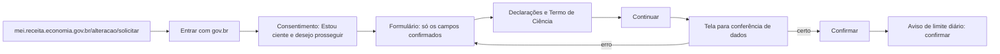

# Atualizar cadastro fiscal

## Parâmetros de configuração

Leia cada valor nas instruções do projeto: primeiro na entrada com o nome desta habilidade, depois na entrada `Global` ou no primeiro nível do bloco. Quando um valor não estiver lá, use o padrão abaixo.

```yaml
# `Fonte dos dados do titular` é o nome do banco, da página ou do cofre onde ficam os dados oficiais da empresa. Vazio, pergunte.
"Fonte dos dados do titular": ""
"Modo de aprendizado": "perguntar"
```

## Instruções

### Passo 1

Ache o cadastro que muda e a seção dele no Passo 4.
Um cadastro sem seção não é alterado de memória: diga que falta o caminho e peça uma sessão gravada, ou o endereço do serviço, para criar a seção com `evoluir-habilidade`.

### Passo 2

Leia os valores atuais na `Fonte dos dados do titular`.
Liste para o titular os campos que o portal deixa alterar, com o valor atual e o novo.
Não siga sem a confirmação explícita de cada campo e de cada valor novo.

### Passo 3

Confira se o navegador já entrou no gov.br com a conta do titular.
Se o portal pedir login, pare e peça à pessoa que entre. Não digite senha.
Antes de aceitar um termo de consentimento, marcar uma declaração ou confirmar a alteração, diga o que a tela pede e espere a confirmação da pessoa.
Se a ferramenta que você usa não deixa digitar documento de identificação, peça à pessoa que digite.

### Passo 4

Siga o caminho de cliques do cadastro, numa das seções abaixo.
Altere só os campos confirmados no Passo 2. Os outros ficam como estão.
Na tela de conferência, compare cada campo com o que o titular confirmou. Se algo diverge, corrija antes de confirmar.

Cada cadastro conhecido tem um caminho de cliques em Mermaid, gravado de uma sessão real, e as armadilhas dele. Um cadastro novo entra aqui como uma seção.

#### MEI

Atualização cadastral no Portal do Empreendedor.



- Outro caminho: a página `gov.br/empresas-e-negocios/pt-br/empreendedor/servicos-para-mei/atualizacao-cadastral`, no botão Solicitar.
- Os campos que mudam: nome social no nome empresarial, telefone de contato, celular, e-mail, ocupação principal, ocupações secundárias e os complementos dos endereços comercial e residencial.
- O complemento abre uma janela com o tipo e o texto. Preencha os dois e clique em OK.
- Para o endereço residencial igual ao comercial, repita o mesmo complemento.
- O portal tem um limite diário de alterações. Atingido, diga que só dá para tentar no dia seguinte.
- Depois da confirmação, os próximos passos oferecem emitir o CCMEI atualizado. Emita só se a tarefa pedir, e confira no PDF os dados alterados.

### Passo 5

Atualize a `Fonte dos dados do titular` com os valores novos, só nos campos alterados.
Responda com os campos alterados, o valor antes e depois, e onde a fonte de verdade foi atualizada.

### Passo 6

Ao terminar, siga `evoluir-habilidade` conforme `Modo de aprendizado`.

## Problemas comuns

### Alteração sem confirmação

Se você alterar um campo sem o ok explícito do titular, o cadastro oficial muda sem a decisão dele.

1. Pare antes de confirmar.
2. Liste os campos, com o valor atual e o novo.
3. Siga só com a confirmação de cada um.

### Campo não pedido alterado

Se você mexer num campo que o titular não confirmou, a alteração leva uma mudança que ninguém pediu.

1. Na tela de conferência, clique em Corrigir.
2. Volte o campo ao valor original.
3. Confirme só com os campos pedidos.

### Declaração marcada sem a pessoa

Se você marcar as declarações e o termo sem perguntar, a pessoa assume uma responsabilidade que não leu.

1. Diga o que cada declaração afirma.
2. Espere a confirmação.

### Fonte de verdade esquecida

Se você terminar no portal e não atualizar a `Fonte dos dados do titular`, o próximo documento sai com o valor antigo.

1. Atualize os campos alterados na fonte.
2. Diga na resposta onde atualizou.

## Exemplos de entrada e saída

Estes exemplos ilustram fatos. Eles podem não estar no data source.

### Atualiza o celular e o e-mail do MEI

Listei o celular e o e-mail, com o valor atual e o novo, e você confirmou os dois. Pedi a sua confirmação antes do consentimento, das declarações e da confirmação final. Alterei só os dois campos e atualizei a fonte de verdade.

### O complemento comercial agora é Sala 302, e o residencial é igual

Confirmei os dois complementos com você, preenchi o tipo e o texto na janela de cada um e conferi na tela de conferência antes de confirmar.

## Casos-limite

- O titular quer mudar um campo só: confirme e altere só esse.
- A ocupação principal muda: não mexa nas secundárias que ele não citou.
- O titular diz que algo está errado na tela de conferência: clique em Corrigir e volte ao formulário.
- O limite diário foi atingido: diga que só dá para tentar no dia seguinte.
- A fonte de verdade não está acessível: diga isso e liste os valores novos para a pessoa atualizar.
- O cadastro pedido não tem seção: não altere. Peça o caminho.

## Pegadinhas

- O formulário mostra todos os campos. Só os confirmados mudam.
- O complemento parece um campo de texto. Ele abre uma janela com o tipo e o texto.
- A confirmação na tela de conferência parece a última. Ainda vem o aviso do limite diário.
- O portal parece a fonte de verdade depois da alteração. A fonte de verdade é a `Fonte dos dados do titular`, e ela precisa ser atualizada.

## Scripts disponíveis

- Nenhum.

1. Não há script para executar.
