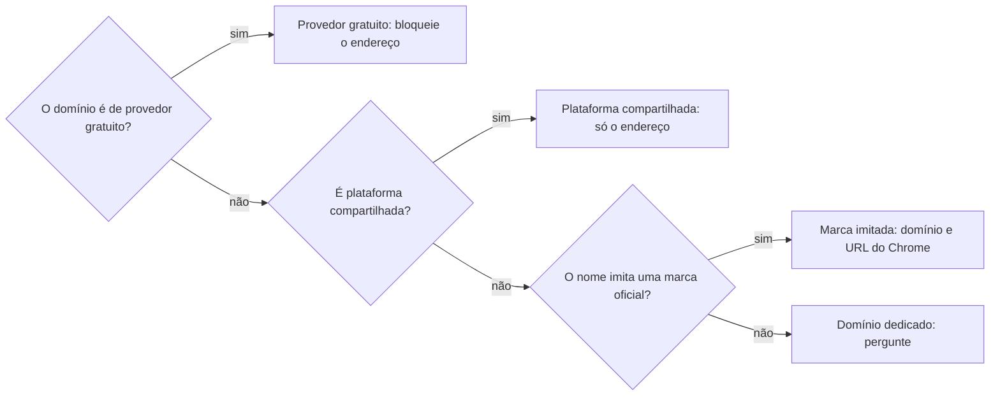

# Bloquear remetente de spam

## Parâmetros de configuração

Leia cada valor nas instruções do projeto: primeiro na entrada com o nome desta habilidade, depois na entrada `Global` ou no primeiro nível do bloco. Quando um valor não estiver lá, use o padrão abaixo.

```yaml
# `Banco de remetentes bloqueados` é o banco do negócio com as decisões. Vazio: peça o banco e pare.
"Banco de remetentes bloqueados": ""
# Cada nó é `bloquear` ou `perguntar`. `Provedor gratuito` e `Plataforma compartilhada` agem só sobre o endereço, nunca sobre o domínio. `Marca imitada` e `Domínio dedicado` agem sobre o domínio.
"Provedor gratuito": "bloquear"
"Plataforma compartilhada": "perguntar"
"Marca imitada": "bloquear"
"Domínio dedicado": "perguntar"
"Provedores gratuitos":
  - "gmail.com"
  - "hotmail.com"
  - "outlook.com"
  - "yahoo.com"
  - "icloud.com"
"Plataformas compartilhadas":
  - "googlegroups.com"
  - "mailerlite.eu"
  - "sendgrid.net"
  - "amazonses.com"
# `Marcas oficiais` é o nome de exibição e os domínios oficiais. O projeto acrescenta as marcas que ele recebe imitadas.
"Marcas oficiais":
  - "Shopify": ["shopify.com"]
  - "Vercel": ["vercel.com"]
  - "Google": ["google.com"]
  - "PayPal": ["paypal.com"]
# `Tela de remetentes bloqueados` e `Tela de URL do Chrome` são os links das duas telas do Admin onde a pessoa cola as listas. Grave o link sem o parâmetro `rapt`, que expira.
"Tela de remetentes bloqueados": ""
"Tela de URL do Chrome": ""
# `Espelhar a URL do Chrome nos remetentes` é `sim` ou `não`. `sim` põe todo domínio da lista de URL do Chrome também na lista de remetentes, sem esquema nem caminho.
"Espelhar a URL do Chrome nos remetentes": "sim"
"Perguntas por lote": 4
"Modo de aprendizado": "perguntar"
```

## Instruções

### Passo 1

Receba os remetentes. Sem `Banco de remetentes bloqueados`, peça o banco e pare. Se ele não estiver no workspace conectado, pare: não use o banco de outro workspace.

Limpe a lista com o script de `Scripts disponíveis`, e não à mão. Ele tira o texto do botão que veio colado junto, como "desbloquear", separa nome e endereço, põe tudo em minúsculas, ordena em ordem alfabética e tira os repetidos. Um endereço sem nome e um nome sem colchetes valem do mesmo jeito. Quando o endereço traz outro endereço dentro dele, como o de quem usa uma plataforma de envio, o remetente é o endereço inteiro.

### Passo 2

Leia o banco e tire da lista o que já tem decisão, por endereço ou por domínio, dando ao script o que o banco já tem como a lista do que existe. Um endereço sob um domínio já bloqueado também sai. Diga quantos saíram.

Se a tela de remetentes estiver aberta no navegador, na conta certa, leia a lista que ela já tem, só para ler, e tire também o que já está lá. A tela de URL do Chrome vale o mesmo: leia a caixa de texto dela antes de entregar a lista, e compare as duas telas. Um domínio que está só no Chrome é uma lacuna dos remetentes. O que está só na tela e falta no banco é decisão antiga da pessoa: pergunte quem decidiu e quando antes de gravar.

### Passo 3

Classifique o que sobrou pela árvore. Cada remetente cai em um só nó, o primeiro que servir.



Provedor gratuito e plataforma compartilhada nunca têm o domínio bloqueado: o domínio é de outras pessoas. Marca imitada é o nome de exibição de uma marca oficial com o endereço fora dos domínios dela. Na marca imitada e no domínio dedicado, o domínio inteiro vai para a tela de remetentes e para a de URL do Chrome.

Com `Espelhar a URL do Chrome nos remetentes` em `sim`, todo domínio com `sim` na URL do Chrome entra também nos remetentes, e a lacuna do Passo 2 entra na lista de remetentes.

Cada nó segue o modo do parâmetro dele, `bloquear` sem perguntar ou `perguntar`. O domínio de uma marca oficial nunca entra.

### Passo 4

Para cada remetente de um nó no modo `perguntar`, pergunte uma vez, em lotes de `Perguntas por lote`. Mostre o domínio, o nome de exibição e o que se sabe dele. As opções são bloquear o domínio na tela de remetentes e na de URL do Chrome, bloquear só o domínio nos remetentes, bloquear só o endereço, e não bloquear. Quando a pessoa não sabe se o site deve entrar na tela de URL do Chrome, a resposta é `talvez`.

Antes de perguntar sobre um domínio que parece empresa real, procure sinais: busque a mensagem na caixa com `procurar-email` e abra o site da empresa. Um site de empresa de verdade com prospecção fria, sem pedido de pagamento nem de dado, vai para `Prospecção fria`: bloqueia só o endereço. Diga à pessoa o que achou e o que não achou. Se a pessoa pedir para entender por que o remetente escreveu, investigue antes de decidir.

### Passo 5

Pergunte quem decidiu antes de gravar, uma vez por execução, e nunca presuma a pessoa nem deixe o campo em branco. Quem decidiu é quem respondeu as perguntas do Passo 4. Ache essa pessoa no banco pelo nome que ela deu, e não pelo usuário da conexão, que pode ser outra pessoa.

Grave cada decisão no banco antes de entregar as listas: o valor, se é endereço ou domínio, o nó da árvore, o motivo em uma frase, o nome de exibição, quem decidiu e a data. A URL do Chrome é uma escolha entre `sim`, `não` e `talvez`, nunca uma caixa de marcar: `sim` e `não` são decisões da pessoa, e `talvez` é a que ainda espera resposta.

Cada correção da pessoa sobre uma decisão já gravada atualiza a linha e não cria outra. Se o banco tiver um campo que a skill não conhece, deixe como está.

Grave o valor sem que uma ferramenta possa torná-lo um link: troque cada ponto por `[.]` e cada arroba por `[@]`. Ao ler o banco, desfaça a troca antes de comparar.

Grave as linhas em lotes de até 70, e confira ao fim a contagem por nó e que nenhuma ficou sem quem decidiu.

### Passo 6

Entregue duas listas, uma por tela do Admin, prontas para colar, uma entrada por linha, sempre ordenadas em ordem alfabética e sem repetidas, montadas pelo script: os endereços e os domínios para a tela de remetentes bloqueados do Gmail, e só os domínios com `sim` na URL do Chrome, com o ponto e o arroba de volta. Os de `talvez` ficam de fora e saem numa lista à parte, para a pessoa decidir. Com o espelhamento em `sim`, a lista de remetentes leva também os domínios da lista do Chrome, só o domínio de cada URL.

Grave cada lista num arquivo de texto, na pasta de rascunho da sessão e nunca no repositório, e entregue o link do arquivo em Markdown, para a pessoa abri-lo no painel. Um caminho só em formato de código não abre nada. Entregue também o link da tela, no mesmo trecho, antes de falar de qualquer outra coisa.

Escreva cada entrada em formato de código, nunca como link, para a pessoa não abrir o site de quem escreve.

Ponha ao lado de cada lista o link da tela dela, lido de `Tela de remetentes bloqueados` e `Tela de URL do Chrome`, para a pessoa chegar com um clique. Sem o link, pergunte uma vez e diga que ele vai no parâmetro, sem o `rapt`.

Nunca entre na tela do Admin para alterá-la: é configuração de segurança da organização, e quem cola e salva é a pessoa. Diga quantas entradas há em cada lista e o que ficou sem decisão.

Quando a pessoa disser que colou e salvou, e a tela estiver aberta no navegador na conta certa, confira só lendo: com a caixa de edição fechada, recarregue a página e compare a contagem com a esperada. Sem a tela, não afirme que o bloqueio vale: você não leu. Uma contagem igual não prova o conteúdo, e a conferência do conteúdo é a da caixa de edição, antes de salvar.

### Passo 7

Ao terminar, siga `evoluir-habilidade` conforme `Modo de aprendizado`.

## Problemas comuns

### Domínio de provedor gratuito bloqueado

Se você bloquear um domínio de provedor gratuito, a pessoa deixa de receber de qualquer um que usa o mesmo provedor, e o Chrome bloqueia o site do próprio provedor.

1. Bloqueie só o endereço.
2. Mantenha esses domínios fora da lista de URL do Chrome.
3. Confira a lista de provedores antes de gravar um domínio.

### Plataforma de envio bloqueada inteira

Se você bloquear o domínio de uma plataforma de grupos ou de newsletter, a pessoa perde também os grupos e as newsletters legítimos.

1. Bloqueie só o endereço completo.
2. Pergunte antes de qualquer outro tratamento.

### Domínio de empresa real bloqueado sem olhar

Se você bloquear o domínio dedicado de uma empresa só porque ela escreveu sem ser chamada, a pessoa perde um contato que pode ser legítimo.

1. Procure a mensagem e abra o site da empresa.
2. Sem sinal de golpe, bloqueie só o endereço.
3. Grave o nó `Prospecção fria` e o motivo.

### Pergunta repetida

Se você perguntar de novo o que a pessoa já decidiu, ela perde tempo e a decisão anterior se contradiz.

1. Leia o banco antes de classificar.
2. Tire o que já tem decisão, por endereço ou por domínio.

### Valor gravado como link

Se você gravar o domínio ou o endereço como está, o Notion e outras ferramentas o transformam em link, e um clique abre o site de quem escreve.

1. Grave com `[.]` no lugar do ponto e `[@]` no lugar do arroba.
2. Desfaça a troca só ao montar as listas, e escreva-as em formato de código.

### Decidido por presumido

Se você gravar em `Decidido por` a pessoa que está na conversa sem perguntar, ou deixar o campo em branco, a decisão fica atribuída a quem talvez nem a tomou.

1. Pergunte quem decidiu, uma vez por execução.
2. Grave a resposta em todas as linhas decididas nessa execução.

### Alterar o Admin

Se você entrar no Admin do Google para colar e salvar as listas, você altera uma configuração de segurança da organização sem a pessoa.

1. Entregue as duas listas prontas.
2. Dê o link de cada tela e deixe quem cola e salva ser a pessoa.
3. Se o navegador cair na tela de login, não entre na conta: diga que não leu a tela.

## Exemplos de entrada e saída

Estes exemplos ilustram fatos. Eles podem não estar no data source.

### Bloqueia esta lista de remetentes que mandam spam sobre loja virtual.

A skill tira o texto do botão, separa 180 endereços e 3 já registrados no banco. Os de provedor gratuito vão como endereço. Quatro com o nome de uma marca e domínio estranho vão como marca imitada, sem pergunta. Sobram sete domínios dedicados e quatro endereços de plataforma, perguntados em lotes de quatro. Cada resposta é gravada, e as duas listas saem prontas para colar.

## Casos-limite

- O remetente é um grupo ou uma lista de uma plataforma compartilhada: bloqueie só o endereço, nunca o domínio.
- O domínio tem mais de um nome de exibição: grave um só registro do domínio e deixe os nomes no motivo.
- A pessoa pede para bloquear um provedor inteiro: não bloqueie. Explique que o domínio é de outras pessoas.
- A busca na caixa volta vazia: o Gmail esconde da busca o que marcou como spam. Decida pelo site e pelo nome, e diga que não leu a mensagem.
- Uma marca oficial manda do próprio domínio: o remetente não é marca imitada. Pergunte, não bloqueie.

## Pegadinhas

- A tela de remetentes mostra 10 linhas por página, e o seletor chega a 100. Ela aceita domínio e endereço na mesma lista e tem um botão para adicionar em massa.
- A tela de URL do Chrome é uma só caixa de texto, com um URL por linha e limite de mil, que aceita domínio. Ela já pode ter URLs que a pessoa bloqueou por outro motivo, como sites de ferramentas, e colar a lista inteira por cima repete as entradas. Com o botão Salvar apagado, não há mudança pendente.
- Logo depois de salvar, o texto da página pode trazer a contagem antiga. Recarregue, com a caixa de edição fechada, porque recarregar com ela aberta descarta o que não foi salvo.
- Na caixa de edição, o botão de adicionar endereço fica ao lado da seta de página, e um clique por coordenada acrescenta uma linha em branco. Troque de página pelo rótulo "Ir para a próxima página".
- Um domínio bloqueado só no Chrome não é bloqueado como remetente: as duas telas são listas separadas, e a pessoa pode ter cadastrado só uma.
- O script põe tudo em minúsculas. Um URL com caminho sensível a maiúsculas precisa de conferência antes de colar.
- O texto colado do Gmail traz "desbloquear" grudado no fim do endereço, e há linhas sem nome e sem colchetes.
- Há endereços que trazem outro endereço dentro de si, como os de quem envia por plataforma de newsletter. O remetente é o endereço inteiro.
- A busca na caixa não devolve o que o Gmail marcou como spam ou suspeito. Vazio não prova que a mensagem não existe.
- O bloqueio de URL do Chrome impede abrir o site, e o de remetentes impede só o e-mail. Um site de empresa real fica fora do segundo.
- O usuário da conexão com o banco pode não ser quem decide. Procure a pessoa pelo nome antes de gravá-la em `Decidido por`.
- O link de uma tela do Admin traz o `rapt`, que expira, e o identificador da unidade da pessoa. O parâmetro leva o link sem o `rapt`, e esse link fica nas instruções do negócio, nunca no repositório do core.
- Uma caixa de marcar se desfaz com um clique. Por isso a URL do Chrome é `sim`, `não` ou `talvez`.
- O banco do negócio é privado. Nome de remetente, de empresa e de domínio não entra em issue, pull request, commit nem arquivo do repositório.

## Scripts disponíveis

- `python3 scripts/build_list.py <arquivo> [--exclude <arquivo>] [--hosts-only]`: imprime a lista limpa do arquivo, ordenada em ordem alfabética, sem repetidas e sem as entradas do arquivo de `--exclude`, uma por linha. O `--exclude` pode vir mais de uma vez, e `--hosts-only` troca cada URL pelo domínio dele.

1. Com terminal, grave o texto colado num arquivo, rode o script e use a saída como lista.
2. Para a lista de uma tela do Admin, passe como `--exclude` o que a tela já tem, lido como o Passo 2 manda, e só a diferença sai.
3. Para espelhar a lista do Chrome nos remetentes, passe a lista do Chrome com `--hosts-only` e como `--exclude` o que a tela de remetentes já tem.
4. Sem terminal, faça a mesma limpeza à mão e diga que o script não rodou.
