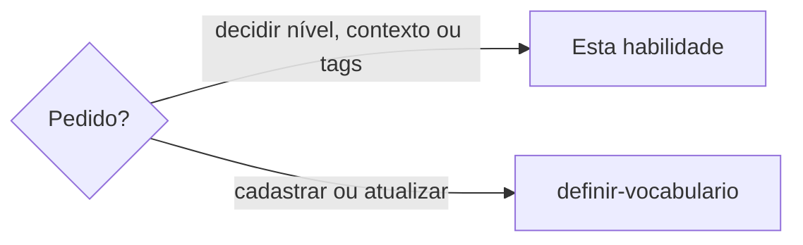

# Classificar estado do termo

## Parâmetros de configuração

Esta habilidade não tem parâmetro próprio.

```yaml
{}
```

## Instruções

### Passo 1

`definir-vocabulario` monta o plano e chama esta habilidade para decidir o `state`, as `tags`, o `allowed_in` e o `forbidden_in` de cada termo. Esta habilidade só classifica. A validação dos campos segue `validar-plano-de-vocabulario`, e a escrita segue `gravar-termos-no-vocabulario`. Use só o que a pessoa enviou.



### Passo 2

Antes de responder se o termo cabe na marca, e antes de gravar, leia as fontes da marca que as instruções do projeto nomeiam. A pessoa informa essas fontes. Se uma não estiver no workspace conectado, pare. Não invente persona, posicionamento nem modelo. Gosto, estética isolada e julgamento genérico não fecham o nível. Tensão entre intenção criativa e viabilidade comercial fica em `description` ou `when`.

Canal, público, coleção, vertente, intenção comercial ou situação de uso ainda ambíguos: pergunte. Não responda e não grave.

### Passo 3

O `state` é um de cinco níveis, do mais rígido ao mais livre:

| Nível | No texto | Campos esperados |
| --- | --- | --- |
| `forbidden` | nunca | `description`, `substitution`, `rejected`, `alternatives` |
| `strongly_discouraged` | só a pedido ou na exceção do `when` | `description`, `substitution` |
| `discouraged` | só com a cena e o contexto do `when` | `description`, `when`, `examples` |
| `allowed_with_care` | como o `when` diz | `description`, `when`, `examples` |
| `allowed` | sempre | `description`, `reason`, `examples` |

`allowed` e `forbidden` são regra geral: a escrita recusa `when` e `tags` neles. O termo que só cabe num contexto fica num dos três do meio, com o `when`. `situationally_allowed` está obsoleto e vira `allowed_with_care`. Formato ou canal que libera ou veta o termo vai em `allowed_in` ou `forbidden_in`, com nomes no formato das tags.

Termo de contexto de quem fala em primeira pessoa, de um evento ou de um canal também leva `tags`, como `maria-silva` ou `palco`. O `when` guarda a regra. As tags deixam a consulta filtrar. Sem o contexto, pergunte. Reaproveite a tag que já está. Não invente.

### Passo 4

- Proibido fica `forbidden`. Evitar fica `strongly_discouraged` ou `discouraged`, como a pessoa disser. Na dúvida, pergunte.
- Emoji, combinação e uso simbólico são termo. A combinação junta é um termo. Não é decoração.
- Clichê, genérico, automatizado ou gasto por IA, útil como intenção e não como palavra final: categoria `cliche`, estado `forbidden`. A `description` pede imagem, cena, ação, efeito ou situação. A frase literal entra em `rejected`. `substitution` repete a troca e não vira sinônimo. A escrita recusa `cliche` fora de `forbidden`. Variação recorrente entra proibida e ligada, ou só sugerida. Não invente a variação.
- Frase descartada por perda consumada, cobrança agressiva, exclusão, capacitismo, ameaça real, culpa ou sensação incompatível entra `forbidden`. O motivo fica na `description`. A alternativa mantém desejo, urgência e conversa natural, sem dizer que a chance já passou. Sem alternativa, pergunte. Não invente a frase.

## Problemas comuns

### Regra geral num contexto só

Se você gravar como permitido ou proibido um termo que só vale num canal, público, coleção, vertente, intenção comercial ou situação de uso, a marca inteira herda uma regra local.

1. Pare.
2. Leia as fontes da marca que as instruções do projeto nomeiam. Se faltar fonte, peça.
3. Se o contexto continuar ambíguo, pergunte.
4. Grave num nível do meio, com o `when`. Não grave como regra geral.

### Emoji como enfeite

Se você deixar o emoji fora do vocabulário, ou gravar sem estado, descrição e exemplo, o símbolo entra na marca sem regra de usar ou evitar.

1. Grave o emoji como termo, com o estado que a pessoa definiu.
2. Não repita o estado na descrição.
3. Ponha um exemplo. Se só cabe num contexto, o nível é um dos três do meio. Se a marca evita o emoji, o exemplo ruim vai em `rejected`.

### Frase descartada sem motivo

Se você só apagar a frase, o motivo some.

1. Grave a frase proibida com o motivo na descrição.
2. A alternativa mantém desejo, urgência e conversa natural, sem dizer que a chance já passou.

### Clichê virando sinônimo

Se você trocar o clichê por outra palavra, ou gravar a frase a evitar como exemplo permitido, a marca continua dizendo a fórmula.

1. Grave `forbidden` com a categoria `cliche`.
2. Na descrição, peça imagem, cena, ação, efeito ou situação com a mesma sensação.
3. A frase literal a evitar entra em `rejected`. A variação recorrente entra proibida e ligada, ou fica só sugerida.

## Exemplos de entrada e saída

Estes exemplos ilustram fatos. Eles podem não estar no data source.

### Descarte "você perdeu".

A frase entrou proibida. A descrição registrou a perda consumada. A alternativa manteve o desejo sem dizer que a chance acabou.

### Proíba exclusivo porque é clichê. A intenção ainda serve.

A categoria ficou cliche. A descrição pediu imagem, cena, ação, efeito ou situação no lugar da palavra. A frase literal foi para rejected. Sugeri a variação recorrente e não gravei sem a forma. Não criei um sinônimo permitido.

### Permita o termo só no canal que a pessoa nomeou.

Li as fontes da marca que as instruções do projeto nomeiam. O nível ficou `allowed_with_care`, com esse `when`. Não gravei como permitido geral.

### Cadastre o emoji que a pessoa enviou, com o estado e a descrição que ela deu.

O emoji ficou um termo. A combinação junta ficou um termo só. O estado, a descrição e o exemplo ficaram nos campos desse estado. Não tratei como decoração. Não inventei se ele é permitido.

## Casos-limite

- Falta uma fonte da marca que as instruções do projeto nomeiam: pare e peça. Não invente.
- Permitidos, proibidos e situacionais no mesmo plano: classifique cada termo pelo próprio nível. Não copie o nível do termo vizinho.
- O pedido é saber se a frase pode: não é esta habilidade.

## Pegadinhas

- Gosto, estética isolada ou julgamento genérico parecem fechar o estado. Sem as fontes da marca que as instruções do projeto nomeiam, ele espera. A tensão entre intenção e viabilidade fica em `description` ou `when`.
- O `when` parece bastar. Sem `tags`, o texto de outro contexto lê o termo. `maria` e `maria-silva` são dois contextos.
- `allowed` com `when` parece um termo de contexto. A escrita recusa: o termo de contexto fica num dos três níveis do meio.

## Scripts disponíveis

- Nenhum.
