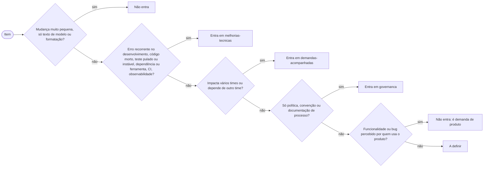

# Classificar melhoria técnica

## Parâmetros de configuração

Leia cada valor nas instruções do projeto: primeiro na entrada com o nome desta habilidade, depois na entrada `Global` ou no primeiro nível do bloco, depois nas instruções de usuário, que o agente do Notion não lê. Quando um valor não estiver lá, use o padrão abaixo. Todo nome de seção, de documento e de regra vem daqui: esta habilidade não conhece nenhum.

```yaml
"Documento (ID)": ""
"Documento (título)": ""
"Árvore de decisão do projeto": ""
"Casos que moldaram a árvore": ""
"Seções":
  melhorias-tecnicas:
    nome: "Melhorias técnicas"
    status: "o que falta e o que já foi entregue ficam na mesma tabela; entregue leva a data"
  demandas-acompanhadas:
    nome: "Demandas que acompanhamos"
    regra: "impacta vários times ou depende de outro time; entra sem detalhar"
  governanca:
    nome: "Governança"
    regra: "política, convenção e documentação de processo que não são melhoria técnica"
"Detalhamento": "o documento não detalha: o detalhe fica numa issue ou num card, e o documento leva título curto, uma frase e o link"
"Modo de aprendizado": "perguntar"
```

Um projeto pode renomear, tirar ou acrescentar seções. Cada seção tem uma chave, e os destinos da árvore do projeto citam a chave. Uma seção do projeto também pode ter `repositório`, `destaque`, `status` e `regra`.

## Instruções

### Passo 1

Entenda o item: leia o título, a descrição e o estado dele (aberto, em revisão, mesclado, data do merge). Se faltar o que decide, como o que ele muda, pergunte uma vez. Se o item é um card ou um PR, leia-o em vez de supor.

### Passo 2

Abra a árvore de decisão do projeto, `Árvore de decisão do projeto`. Sem ela, use a árvore padrão abaixo. Leia também os casos de `Casos que moldaram a árvore`, se existirem: eles dizem por que cada regra existe e valem mais que a intuição.



### Passo 3

Percorra a árvore de cima para baixo. A primeira pergunta que bater decide. Não pule pergunta nem escolha a resposta pelo que parece mais simpático ao item.

Quando nenhuma pergunta bate, o resultado é `a definir`: pergunte à pessoa, registre a decisão como regra nova na árvore do projeto e como caso nos casos do projeto. Não invente a regra.

### Passo 4

Decidido que entra, escolha a seção pela chave citada no destino da árvore. Aplique o `status` da seção: item mesclado leva a data do merge, ou o texto de `status` da seção; item aberto leva o estado do momento, como a fazer ou aguardando revisão. Se a seção tem `repositório`, o item cujo PR é desse repositório vai para ela. Dois itens que são partes do mesmo processo viram um só.

### Passo 5

Entregue, para cada item: `entra` ou `não entra`, a chave e o nome da seção, o status e o motivo em uma frase. O motivo cita a pergunta da árvore que decidiu. Diga quando a decisão é suspeita ou pede confirmação.

Se o item não tem card nem issue, siga `Detalhamento`: o documento aponta para um card ou uma issue, e quem criar o registro é a pessoa. Não edite o documento: esta habilidade classifica e entrega a decisão.

### Passo 6

Ao terminar, siga `evoluir-habilidade` conforme `Modo de aprendizado`.

## Problemas comuns

### Seção inventada

Se você escrever um nome de seção que não está nos parâmetros, o documento ganha uma seção que o projeto não quer.

1. Releia `Seções` e use só as chaves de lá.
2. Se nenhuma serve, responda `a definir` e pergunte.

### Decisão pelo tamanho do item

Se você decidir pelo tamanho do esforço e não pela pergunta da árvore, itens pequenos que valem ficam de fora e itens grandes de produto entram.

1. Percorra a árvore na ordem.
2. Use o tamanho só quando a árvore tem uma pergunta sobre ele.

### Regra nova sem confirmação

Se você acrescentar uma regra à árvore sem a pessoa confirmar, a próxima decisão repete um erro.

1. Pergunte à pessoa.
2. Só então grave a regra e o caso.

## Exemplos de entrada e saída

Estes exemplos ilustram fatos. Eles podem não estar no data source.

### O PR que ajusta o agrupamento das atualizações automáticas de dependência entra como melhoria técnica?

Entra, na seção `melhorias-tecnicas`, aguardando revisão. A pergunta que decidiu é a de dependência e ferramenta de desenvolvimento: o PR reduz o volume que a equipe precisa revisar de uma vez.

### E a nova tela de exportação de relatórios?

Não entra. É funcionalidade percebida por quem usa o produto, então é demanda de produto e segue o fluxo dela.

## Casos-limite

- O projeto não tem árvore: use a padrão e avise que ela é só o ponto de partida.
- O item cabe em duas seções: a primeira pergunta da árvore que bater decide. Se as duas respostas valem, entregue as duas e deixe a pessoa escolher.
- O item é parte de um processo que já está no documento: junte ao item existente.
- A seção tem `repositório` e o item é de outro: aplique a regra normal da árvore.
- O documento não abre pelo ID: busque pelo título. Se também falhar, entregue a decisão sem ler o documento e diga que não o leu.

## Pegadinhas

- A árvore padrão é só o ponto de partida. A do projeto sempre vale mais.
- Entrar no documento não é prioridade: para ordenar itens, use `priorizar-itens`.
- Um item classificado como bug pode ser melhoria técnica, se só afeta o ambiente de desenvolvimento ou previne falha que chega ao usuário. A árvore do projeto diz.

## Scripts disponíveis

- Nenhum.

1. Não há script para executar.
