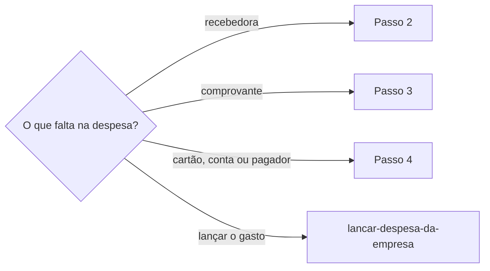

# Completar despesa de compra

## Parâmetros de configuração

Leia cada valor nas instruções do projeto: primeiro na entrada com o nome desta habilidade, depois na entrada `Global` ou no primeiro nível do bloco. Quando um valor não estiver lá, use o padrão abaixo.
```yaml
"Modo de aprendizado": "perguntar"
```
## Instruções

### Passo 1

A despesa de uma compra online ou no cartão já foi lançada por `lancar-despesa-da-empresa`. Completar a recebedora, o comprovante e quem pagou, a partir do pedido da compra, é esta habilidade. Se a despesa ainda não existe, volte para `lancar-despesa-da-empresa`.



### Passo 2

Quando a evidência traz só o nome da fatura do cartão ou o da plataforma, abra o pedido da compra e o anúncio, só para ler, e procure o vendedor. A plataforma e a instituição de pagamento não são a recebedora quando o vendedor é outro.

A nota fiscal do pedido traz a razão social e o CNPJ de quem emitiu. Com eles, siga `definir-empresa` para cadastrar a recebedora e ligue-a à despesa. Sem a nota, deixe a recebedora como pendência e diga o que a resolve. Uma verificação de segurança do site não se contorna: espere que passe sozinha e, se não passar, peça à pessoa que a conclua.

### Passo 3

Compra com nota fiscal: baixe o PDF e o XML da nota sem pedir o sim, e anexe os dois com `anexar-arquivo-no-notion`. A nota fica no arquivo da despesa, junto com os comprovantes que já estão.

Compare o destinatário da nota com a pessoa ou a empresa que comprou. Quando a nota sai em nome de pessoa física numa compra da empresa, diga isso na resposta e grave na observação da despesa. É um fato do cadastro, não uma orientação fiscal.

Compra paga com o dinheiro que já estava numa conta de pagamento, como o saldo de um marketplace, tem o meio de saldo de conta de pagamento: o valor sai na hora, sem fatura nem parcela, e não é Pix nem cartão. A conta de pagamento vai em quem pagou. Se ela financiou ou parcelou a compra, o meio é o do crédito. Sem esse meio na lista de meios, deixe-o vazio, diga qual é o mais próximo e não mude a lista.
Sem nota fiscal, capture as telas dos detalhes da compra, com valor, data, situação, meio de pagamento, número da transação e produto, e anexe como comprovante mínimo. Confira os anexos na página salva antes de marcar a conciliação como comprovada.

### Passo 4

Compra paga no cartão: siga `definir-cartao` para achar ou cadastrar o cartão e ligar a despesa a ele. A pessoa titular do cartão é quem arcou com o dinheiro, e a conta vinculada ao cartão é a conta que pagou, quando a pessoa confirma. A compra continua da empresa, e a regra de quem pagou de `lancar-despesa-da-empresa` vale para a dívida com a pessoa.

Grave o final do cartão e as parcelas nas observações da despesa quando a lista não tem campo para elas. Confira o vínculo salvo nos dois lados antes de dizer que ligou.

### Passo 5

Responda com o link da despesa e diga, para cada ponto, o que foi completado e o que ficou pendente: recebedora, comprovante, cartão, conta e pagador.

Ao terminar, siga `evoluir-habilidade` conforme `Modo de aprendizado`.

## Problemas comuns

### Recebedora deixada como a plataforma

Se você vincular a despesa à plataforma da compra porque o nome dela está no comprovante, a despesa fica sem o vendedor e sem o CNPJ.

1. Abra o pedido e leia o vendedor e a nota fiscal.
2. Cadastre o emitente com `definir-empresa`.
3. Ligue essa empresa como recebedora.

### Nota fiscal pedida à pessoa

Se você pedir o sim para baixar a nota fiscal, a pessoa responde o que já disse, e o comprovante demora.

1. Baixe o PDF e o XML da nota.
2. Anexe os dois à despesa.
3. Diga o que foi anexado.

### Compra sem comprovante em arquivo

Se você deixar a despesa sem anexo porque não há PDF, a conciliação fica sem prova.

1. Capture as telas dos detalhes da compra.
2. Anexe como comprovante mínimo.
3. Confira os anexos na página antes de marcar a conciliação.

## Exemplos de entrada e saída

Estes exemplos ilustram fatos. Eles podem não estar no data source.

### completa a despesa da galoneira: falta a empresa, o comprovante e quem pagou

Abri o pedido no marketplace e a nota fiscal trouxe o emitente e o CNPJ. Cadastrei a empresa e a liguei como recebedora. Baixei o PDF e o XML da nota e os anexei. A nota saiu em nome de pessoa física, e anotei isso. Achei o cartão de pessoa física na lista de cartões, liguei a despesa a ele e registrei as 10 parcelas nas observações.

## Casos-limite

- O pedido não mostra o vendedor nem tem nota fiscal: deixe a recebedora como pendência e anexe as telas como comprovante mínimo.
- A nota fiscal ainda não foi gerada: anexe as telas e volte quando ela existir.
- O cartão não está na lista: siga `definir-cartao` para cadastrá-lo.
- A despesa já tem comprovantes: some os novos, sem tirar os que já estão.

## Pegadinhas

- O nome que aparece no cartão ou na plataforma parece a recebedora. O vendedor e o CNPJ estão na nota fiscal do pedido.
- A nota fiscal parece pedir autorização para baixar. A pessoa já autorizou o PDF e o XML.
- Uma compra sem PDF parece sem comprovante. As telas do detalhe valem como comprovante mínimo.

## Scripts disponíveis

- Nenhum.

1. Não há script para executar.
