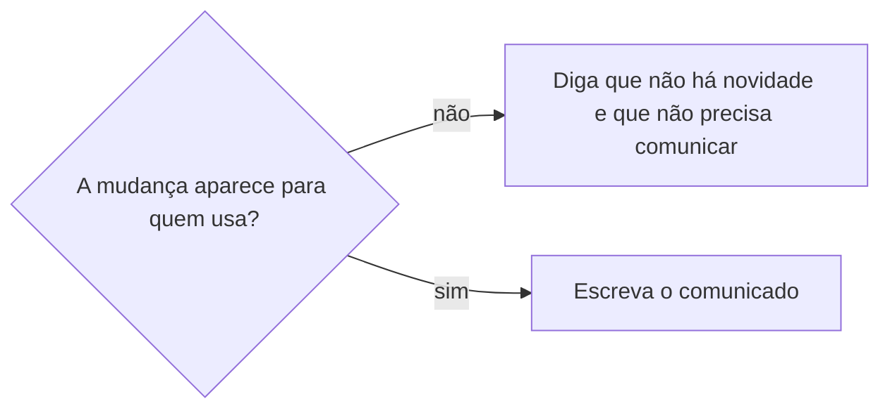

# Comunicar novidade do produto

## Parâmetros de configuração

Leia cada valor nas instruções do projeto: primeiro na entrada com o nome desta habilidade, depois na entrada `Global` ou no primeiro nível do bloco. Quando um valor não estiver lá, use o padrão abaixo. `Repositório` vem do remoto `origin` quando as instruções não dizem. De preferência, `Habilidade de tom de voz` vem preenchida nas instruções do projeto. Vazia, ela só não foi informada: não quer dizer que o projeto não tem uma.

```yaml
"Repositório": ""
"Branch base": "main"
"Fontes do comunicado":
  - "pull requests mesclados na base"
  - "commits na base fora de pull request"
"Público do comunicado": ""
"Quem publica o comunicado": ""
"Canal do comunicado": ""
"Idioma do comunicado": "português"
"Habilidade de tom de voz": ""
"Modo de aprendizado": "perguntar"
```

## Instruções

### Passo 1

Junte o que entrou, um PR mesclado, vários ou um período, de cada uma das `Fontes do comunicado`, na ordem da lista. A base das fontes é a `Branch base`. De um PR, leia o título, a descrição, os arquivos alterados e as issues ligadas. Um commit está fora de PR quando o GitHub não liga nenhum PR a ele. Desse commit, leia a mensagem e o diff. Uma fonte de outra ferramenta, como páginas do Notion criadas ou editadas pela pessoa, entra filtrada pelo período e pela autoria que ela diz. Quando o pedido cita uma fonte fora da lista, junte essa também.

### Passo 2

Decida se há novidade para o `Público do comunicado`. Sem público definido, o público é o time.



Sem novidade: dependência, refatoração, CI, teste, documentação interna, reunião. Com novidade: tela, texto, fluxo, comportamento, desempenho que se nota, correção de algo que alguém sentia, dado novo ou que sumiu, e organização dos dados que o público usa, como cadastros consolidados, bancos reorganizados e páginas antigas retiradas.

### Passo 3

Escreva o comunicado no `Idioma do comunicado`, para quem não é técnico: o que muda na prática, onde a pessoa percebe, quem é afetado, se precisa fazer algo e a partir de quando. Nunca cite PR, commit, biblioteca, arquivo nem ferramenta interna. Conte a correção pelo problema que a pessoa sentia: "corrigimos um problema que fazia a página demorar", não o novo comportamento isolado. Um período vira um comunicado só, agrupado por área e com o intervalo corrido no título, como "últimos 15 dias", sem uma seção por semana ou sprint.

O rascunho passa obrigatoriamente pela habilidade de tom de voz antes de ir para a pessoa, com o público e o canal do comunicado. Quem fala é `Quem publica o comunicado`. Vazio, pergunte quem publica, uma vez, junto com o canal quando `Canal do comunicado` também estiver vazio.

Ache essa habilidade pela `Habilidade de tom de voz`. Vazia, ou se a habilidade indicada não aparecer, procure nesta ordem:

1. Uma habilidade da sessão chamada `redigir-com-tom-de-voz`.
2. Uma habilidade da sessão cuja descrição fale de tom de voz, copy ou vocabulário da marca.
3. No Notion, a base de habilidades do workspace, buscando por "tom de voz".

Achou: use e sugira preencher `Habilidade de tom de voz`. Não achou: pergunte se a pessoa quer usar uma. Se ela disser que não, escreva com o vocabulário que conseguir consultar e diga isso na entrega.

### Passo 4

Entregue no `Canal do comunicado`, com a formatação dele. Ao perguntar quem publica ou o canal, as opções saem só das instruções do projeto: nunca sugira um canal que elas não citam. A opção de publicar vem primeiro, e a de não comunicar vem por último. O comunicado vai numa mensagem só, com parágrafos curtos, mesmo no WhatsApp, onde a conversa costuma ir em mensagens quebradas. Só a novidade entra nessa mensagem. Um pedido, uma cobrança ou uma lista de pendências é outro assunto: vai numa mensagem à parte, depois do comunicado. Se houver uma ferramenta para esse canal, mostre o texto e peça o ok antes de publicar. Se não houver, ou se o canal estiver vazio, entregue o texto pronto para copiar.

### Passo 5

Ao terminar, siga `evoluir-habilidade` conforme `Modo de aprendizado`.

## Problemas comuns

### Jargão no comunicado

Se você escrever "refatoramos o adaptador", quem não é técnico não sabe o que mudou para ele.

1. Troque pelo efeito que a pessoa percebe.
2. Se não houver efeito, não há novidade.

### Comunicado sem novidade

Se você comunicar uma mudança que ninguém percebe, o público passa a ignorar os comunicados.

1. Classifique pelo Passo 2.
2. Sem novidade, diga em uma frase que não precisa comunicar e pare, mesmo que a pessoa tenha pedido o comunicado.

### Publicação sem ok

Se você publicar no canal sem mostrar o texto, a pessoa perde a chance de corrigir.

1. Mostre o texto.
2. Publique só depois do ok.

### Correção contada pelo resultado

Se você escrever "a página parou de pedir a localização", a pessoa não reconhece o problema que ela sentia.

1. Comece com "corrigimos um problema que".
2. Descreva o incômodo como a pessoa o percebia.

### Pendência dentro do comunicado

Se você colocar no comunicado a lista do que ainda falta fazer, como os registros sem um campo novo, o anúncio vira cobrança e a pessoa perde a novidade no meio.

1. Deixe no comunicado só o que mudou e o que fazer daqui em diante.
2. Mande a lista de pendências numa mensagem à parte, depois do comunicado.

### Canal suposto

Se você oferecer um canal que as instruções do projeto não citam, como o Slack, a pessoa precisa corrigir a opção antes de responder.

1. Leia `Quem publica o comunicado` e `Canal do comunicado`.
2. Vazios, pergunte sem sugerir canal e ofereça o texto pronto para copiar.
3. Deixe a opção de não comunicar por último.

### Ação escondida

Se você deixar de dizer que a pessoa precisa fazer algo, a mudança vira problema para ela.

1. Diga o que fazer e até quando.

## Exemplos de entrada e saída

Estes exemplos ilustram fatos. Eles podem não estar no data source.

### o que mudou hoje no site?

Três PRs entraram: duas atualizações de dependência e uma correção no formulário de contato. Só a correção aparece para quem usa. O comunicado diz que o campo de WhatsApp voltou a aceitar números com nono dígito e que nada precisa ser feito.

## Casos-limite

- Vários PRs da mesma frente: um comunicado só, agrupado.
- `Quem publica o comunicado` e `Canal do comunicado` estão vazios: pergunte quem publica. Sem canal, o texto vai pronto para copiar.
- O merge não coloca no ar, como um worker, uma release ou um deploy agendado: diga quando a pessoa vai ver a mudança, não quando o PR entrou.
- A mudança tira algo que as pessoas usavam: diga o que usar no lugar.

## Pegadinhas

- A habilidade de tom de voz pode existir e não ser carregada sozinha, como no Notion, quando a página não está marcada como habilidade ou a busca automática não a encontra. Procure antes de concluir que ela não existe.
- WhatsApp não é Markdown: o negrito é `*texto*`, com um asterisco, o itálico é `_texto_`, e não há título, separador nem link `[texto](url)`. Entregue o texto num bloco de código, para a formatação não se perder ao copiar.
- A mensagem do commit não diz se ele veio de um PR: um merge escreve `Merge pull request #`, um rebase pode não citar o número e um commit direto pode citar `(#<número>)`. Pergunte ao GitHub quais PRs estão ligados ao commit.
- O tipo no título do PR engana: um `fix` pode mudar o que a pessoa vê, e um `chore` pode mudar um texto da tela. Classifique pelo diff, não pelo tipo.

## Scripts disponíveis

- `gh pr view <número> --repo <Repositório> --json title,body,files,closingIssuesReferences`: o que mudou no Passo 1.
- `gh pr list --repo <Repositório> --base <Branch base> --state merged --search "merged:>=<data>"`: PRs de um período no Passo 1.
- `git fetch origin && git log origin/<Branch base> --since=<data> --first-parent --format=%H`: commits da base no Passo 1.
- `gh api repos/<Repositório>/commits/<sha>/pulls --jq length`: PRs ligados a um commit no Passo 1. Zero quer dizer fora de PR.

1. Junte cada fonte, leia cada item, classifique, escreva e entregue.
