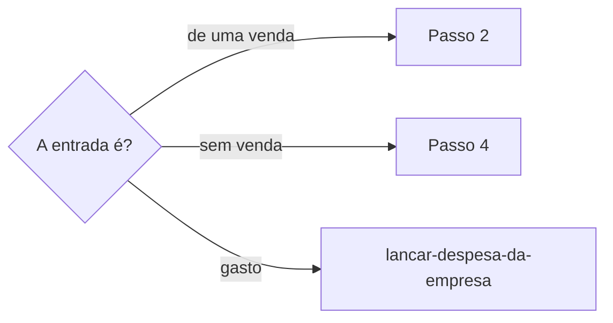

# Conciliar recebimento

## Parâmetros de configuração

Leia cada valor nas instruções do projeto: primeiro na entrada com o nome desta habilidade, depois na entrada `Global` ou no primeiro nível do bloco. Quando um valor não estiver lá, use o padrão abaixo. Banco vazio: use `procurar-banco-de-dados`. Outro valor vazio: pergunte à pessoa uma vez e não escolha.

```yaml
"Modo de aprendizado": "perguntar"
# Nomes de banco: o projeto define. Os nomes das propriedades vêm do mapeamento de dados do projeto.
"Banco de vendas": ""
"Banco de contas bancárias": ""
# `Fonte do valor recebido` é onde se lê o detalhe de cada venda no meio de pagamento, como a lista de vendas do painel, e o caminho até esse detalhe.
"Fonte do valor recebido": ""
```

## Instruções

### Passo 1

Conciliar o que o meio de pagamento liberou com as vendas é esta habilidade. Cadastrar, completar ou corrigir a venda segue `lancar-venda`, que recebe daqui o que a fonte mostrou.



### Passo 2

Abra `Fonte do valor recebido` na parte de vendas e leia o detalhe de cada venda do período, uma por uma, mesmo quando o resumo mostra o total. O detalhe traz o valor bruto cobrado, a taxa, o valor líquido, a data e a hora da liberação do dinheiro e o ID da transação. Leve tudo isso para a venda, por `lancar-venda`.

O valor recebido pela empresa é o líquido liberado, e não o bruto cobrado. Sem o detalhe, não grave o bruto no valor recebido: diga qual venda ficou sem o líquido e pergunte. A pessoa não precisa abrir o aplicativo do meio de pagamento para descobrir a liberação.

Leia também todos os outros campos que o detalhe mostra, como o nome do cliente, a referência adicional, o meio e a bandeira, os dígitos finais, as parcelas, o nome na fatura e a loja ou o caixa. Um valor que a tela corta, como uma referência com reticências, vem inteiro pelo botão de copiar ou pela requisição que a página faz. Grave na venda o link do detalhe da transação e o que a venda não tem campo para guardar, por `lancar-venda`. O cliente que o detalhe nomeia é procurado e ligado à venda, por `lancar-venda`.

O comprovante completo da transação vai para o campo de comprovantes da venda, quando a venda ainda não tem um. Baixe o arquivo que a fonte oferece e anexe. Quando a fonte só envia o comprovante por e-mail ou SMS, pergunte à pessoa se envia para a caixa da empresa, e anexe o arquivo que chegar. Diga qual venda ficou sem comprovante.

Depois de anexar o comprovante que chegou por e-mail, rotule a conversa por `rotular-item` e arquive. Arquivar é tirar a conversa da caixa de entrada, e não aplicar uma etiqueta com nome de arquivo. Cada cópia do mesmo comprovante, como a do pagador e a do recebedor, recebe o mesmo tratamento. Conversa cujo arquivo não foi anexado fica na entrada.

Quando a fonte permite uma nota na transação, grave nela a ligação de volta com o sistema: a venda, o cliente, cada unidade, cada variante, cada produto, a família do produto e o ponto de contato, cada um com o ID do registro. A nota pode ter limite de tamanho e recusar link, acento e pontuação: teste uma nota antes, e com a recusa grave uma nota por registro, só com letras, números e espaços. Registro que ainda não existe, como a unidade sem página, entra na nota como pendência.

### Passo 3

Ligue cada liberação a uma venda pelo ID da transação. Sem o ID, use o valor bruto e a hora da cobrança. Quando duas vendas têm o mesmo bruto, mostre a ligação e espere a pessoa confirmar. Não ligue pela ordem.

Liberação que diverge do que a venda já tem: mostre o diff por campo e siga a decisão canônica de `lancar-venda`.

### Passo 4

Saque com cartão de crédito na máquina de cartão não é venda. Alguém passa o próprio cartão para receber o dinheiro, sem levar produto. Não há receita, e a entrada não vai para as vendas, mesmo quando o extrato mostra a liberação do dinheiro.

Uma entrada sem venda, devolvida logo depois para quem passou o cartão, pode ser um saque desse tipo. Antes de conciliar, pergunte à pessoa. Não crie uma venda para fechar a conciliação. Se a pessoa contar que vai passar um cartão para sacar, avise antes, pelos motivos abaixo.

Quando for saque, consulte em `Banco de contas bancárias` quem era titular da conta da máquina na data da entrada:

- Conta de pessoa física: o saque é movimento dessa pessoa e não entra nos registros da empresa. Comente na conciliação o que a entrada é, para ninguém procurar a venda de novo.
- Conta da empresa: avise que o saque infla o faturamento e que a máquina não aceita cobrança sem venda, e recomende não repetir. Registre a entrada e a devolução como um par, em `definir-lancamento-financeiro`, com os comprovantes. Confirme o tratamento contábil com quem cuida da contabilidade.

Se parte desse dinheiro pagou um débito da empresa, quem pagou segue `lancar-despesa-da-empresa`.

### Passo 5

Ao terminar, siga `evoluir-habilidade` conforme `Modo de aprendizado`.

## Problemas comuns

### Bruto no valor recebido

Se você gravar o valor bruto cobrado no valor recebido, a venda esconde a taxa e ninguém sabe o líquido.

1. Abra o detalhe de cada venda em `Fonte do valor recebido`.
2. Grave o líquido liberado, a hora da liberação e o ID da transação, por `lancar-venda`.
3. Sem o detalhe, diga qual venda ficou sem o líquido e pergunte.

### Só o resumo lido

Se você ler só o total do dia ou da lista, as vendas ficam sem a taxa e sem a liberação de cada uma.

1. Abra cada venda do período.
2. Leia bruto, taxa, líquido, liberação e ID em cada uma.

### Só o valor levado

Se você levar só o bruto, a taxa e o líquido, a venda perde o cliente, a referência e o comprovante, e a fonte não aponta de volta para a venda.

1. Leia todos os campos do detalhe e pegue inteiro o valor que a tela corta.
2. Anexe o comprovante completo, ou pergunte quando a fonte só o envia por e-mail ou SMS.
3. Depois de anexar o comprovante do e-mail, rotule a conversa e tire-a da caixa de entrada.
4. Grave na nota da transação os IDs da venda, do cliente, das unidades, das variantes, dos produtos, da família e do ponto de contato.

### Liberação na venda errada

Se você ligar as liberações às vendas pela ordem, duas vendas do mesmo bruto podem trocar de líquido.

1. Ligue pelo ID da transação.
2. Sem o ID, use o bruto e a hora da cobrança.
3. Mesmo bruto em duas vendas: mostre a ligação e espere a confirmação.

### Venda criada para fechar a conciliação

Se você criar uma venda para uma entrada sem venda, um saque vira receita.

1. Pergunte se a entrada é venda ou saque com cartão.
2. Consulte o titular da conta da máquina na data.
3. Siga o Passo 4.

## Exemplos de entrada e saída

Estes exemplos ilustram fatos. Eles podem não estar no data source.

### faltou abrir o painel do meio de pagamento na parte de vendas e pegar todos os detalhes de todas as vendas

Abri a lista de vendas da fonte e o detalhe de cada venda do dia da feira. As duas vendas de R$ 320 tiveram liberações de R$ 300,13, às 13h55, e de R$ 316,45, às 14h32, com taxas diferentes. Liguei cada liberação à venda pelo ID da transação, e o valor recebido passou a ser o líquido.

### O extrato tem uma liberação sem venda. Concilie.

Perguntei se era venda ou saque com cartão de crédito. Uma parente tinha passado o cartão, e o dinheiro voltou para ela no mesmo dia, sem as taxas. Na data, a conta da máquina era de pessoa física, conforme as contas bancárias. A entrada ficou fora das vendas, e o comentário da conciliação disse o que ela era.

## Casos-limite

- A fonte não abre o detalhe de uma venda: não grave o bruto como recebido. Diga qual venda ficou sem o líquido e pergunte.
- Duas vendas com o mesmo bruto e sem ID da transação: mostre a ligação e espere a confirmação.
- A liberação ainda não aconteceu: grave o que o detalhe mostra e diga que o líquido fica para quando o dinheiro for liberado.
- Entrada no extrato sem venda que é saque com cartão de crédito: não entra nas vendas. O titular da conta na data da entrada decide se fica fora dos registros ou se vira o par de entrada e devolução, com o alerta.
- A venda não existe: siga `lancar-venda`. Não crie a venda aqui.

## Pegadinhas

- O valor cobrado na maquininha parece o valor recebido. O recebido é o líquido liberado, depois da taxa.
- O resumo do painel parece bastar. A taxa, o líquido e a hora da liberação aparecem no detalhe de cada venda.
- Duas vendas do mesmo bruto parecem ter o mesmo líquido. A taxa muda com o meio, como débito, crédito ou Pix, e o líquido muda junto.
- A referência que aparece com reticências parece o valor inteiro. O valor inteiro vem pelo botão de copiar ou pela requisição da página.
- Arquivar o e-mail parece mover para a etiqueta de arquivo. Arquivar é tirar da caixa de entrada, depois de rotular.
- A nota que falha parece um defeito da fonte. A nota pode recusar link, acento e pontuação: só letras, números e espaços passam.
- A liberação de dinheiro no extrato parece venda. Um saque com cartão de crédito na máquina de cartão não é venda nem receita.

## Scripts disponíveis

- Nenhum.

1. Não há script para executar.
