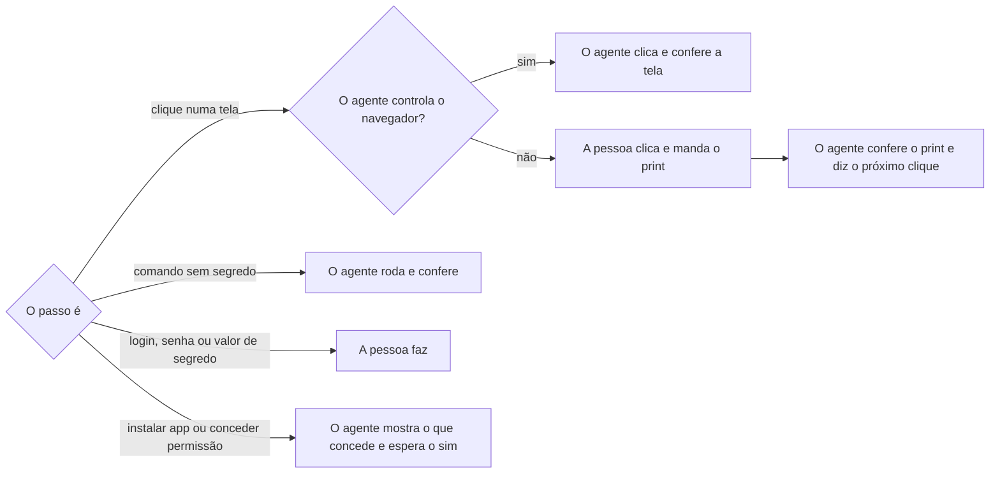

# Configurar harness de negócio

## Parâmetros de configuração

Leia cada valor nas instruções do projeto: primeiro na entrada com o nome desta habilidade, depois na entrada `Global`. Quando um valor não estiver lá, use o padrão abaixo.

```yaml
# `Ferramentas a configurar` lista, na ordem, os runbooks do core que esta habilidade segue depois do repositório.
"Ferramentas a configurar":
  - "Renovate"
  - "Notion"
  - "Claude Code"
  - "Cursor"
  - "Codex"
"Modo de aprendizado": "perguntar"
```

## Instruções

### Passo 1

Confirme que o repositório aberto é um harness de negócio novo, com `Papel do repositório atual` em `harness`.
O core já está configurado: no repositório do core, diga isso e não mude nada.
Siga `levantar-ambiente-do-repositorio` e leia a ficha antes do primeiro passo.

### Passo 2

Confira os pré-requisitos, nesta ordem, antes de qualquer runbook de ferramenta:

1. A branch padrão do remoto é `main`. Uma branch de trabalho como padrão segue o passo do runbook do repositório de negócio que cria a `main` e a seção do guia de problemas do core sobre a branch padrão.
2. O core fixado no projeto é a release atual. Um core antigo traz uma cópia antiga dos runbooks e dos exemplos: leve o core à release atual antes de seguir.
3. O Renovate está instalado na conta ou organização dona do repositório. Sem painel nem pull request do Renovate, a configuração existe e o app falta.

Siga sempre o runbook da versão fixada no projeto, depois de atualizada.
Não copie o runbook inteiro para a resposta: diga o passo atual, o comando e a verificação dele.

### Passo 3

Siga o runbook de cada item de `Ferramentas a configurar`, na ordem.
Quanto mais o agente faz, melhor: os prints da pessoa são o último recurso.
Em cada passo, separe quem faz:



Com uma ferramenta que controla o navegador, como a do Claude, de outro agente ou de uma extensão, o agente abre cada tela, clica e confere o resultado nela, sem pedir print.
Uma tela de login, senha ou código de verificação para o agente: a pessoa entra na conta, e o agente continua.
Antes de clicar no botão que instala um app ou concede acesso, mostre o que será concedido e espere o sim da pessoa.
Confira cada tela antes do próximo passo, contra a verificação do runbook.
Uma opção que a tela traz marcada por padrão e o runbook não pede é desmarcada antes de seguir.

### Passo 4

Na sincronização com o Notion, confira além do runbook:

1. A conexão é nova, só da sincronização, criada no espaço de trabalho do banco de habilidades, pelo método de token de API.
2. Nas funções, a informação de usuários fica em nenhuma: o Notion marca por padrão a leitura com e-mail.
3. No acesso a conteúdo, fica só o banco de habilidades. Um ícone personalizado esconde se o resultado é o banco ou a página que o contém: o banco mostra as propriedades em colunas. A lista agrupa pelo espaço de equipe, então peça para expandir tudo.
4. O token nunca passa pela conversa nem pela tela. O agente com navegador pode clicar no botão de copiar, sem mostrar nem ler o valor; a pessoa testa com a busca da API usando a área de transferência, guarda o segredo direto dela e depois a limpa, no terminal dela.
5. A busca responde `200` com qualquer token válido; quem confirma o banco é a aba de acesso. Um `401` pede para copiar de novo, sem gerar outro token, porque gerar outro invalida o segredo já guardado.
6. A hora que a lista de segredos mostra vem em UTC; diga no fuso da pessoa.

### Passo 5

Quando uma tela difere do runbook, guarde os prints, os do próprio agente quando ele opera o navegador, e, ao terminar, abra a issue por `definir-issue-do-github` e o pull request por `criar-pull-request` no core.
Recorte cada print na área que importa e tire nome de pessoa, de negócio, de espaço de trabalho, de espaço de equipe e de conexão.
Um print com segredo visível não entra: peça outro.

### Passo 6

Ao terminar, siga `evoluir-habilidade` conforme `Modo de aprendizado`.

## Problemas comuns

### Runbook antigo

Se você seguir o runbook da versão do core fixada sem conferir a release, os passos e as telas não batem com o que a pessoa vê.

1. Confira a versão fixada contra a release atual.
2. Leve o core à release atual antes do runbook da ferramenta.

### Segredo errado guardado

Se você mandar colar o token à mão, outro valor pode ir para o segredo, e a sincronização falha só na primeira execução.

1. Teste o token na área de transferência antes de guardar.
2. Guarde direto da área de transferência e limpe-a depois.

### Opção padrão aceita

Se você seguir com a tela como veio, a conexão pode ganhar acesso a e-mails ou a páginas além do banco.

1. Compare cada opção do print com o runbook.
2. Peça para desmarcar o que o runbook não pede antes do próximo passo.

## Exemplos de entrada e saída

Estes exemplos ilustram fatos. Eles podem não estar no data source.

### Liga a sincronização com o Notion no harness do estúdio

A branch padrão era uma branch de trabalho, e o core estava 38 versões atrás. Criei a `main`, pedi a instalação do Renovate e segui o runbook do Notion depois da atualização. No print das funções, a leitura de e-mails vinha marcada, e pedi para trocar. O primeiro teste do token deu `401`; a pessoa copiou de novo, o teste deu `200`, e o segredo foi guardado da área de transferência às 20h45, horário de Brasília. A tela de conexão tinha mudado de lugar, e abri um pull request no runbook com os prints recortados.

### Configura o harness no repositório do core

O repositório aberto é o core, que já está configurado. Não mudei nada.

## Casos-limite

- A pessoa trabalha fora do macOS: o teste e a gravação do token usam o comando que pede o valor, e a conferência é o número de caracteres mascarados.
- O negócio não usa o Notion: o item sai de `Ferramentas a configurar` nas instruções do projeto.
- O banco de habilidades não existe: pare e peça à pessoa que crie ou indique o banco. Não crie banco.

## Pegadinhas

- O core só parece precisar de configuração. Ele já está configurado; esta habilidade serve ao harness de negócio novo.
- O botão de copiar do token só parece copiar um link. O Notion diz "Link copiado" mesmo quando copia o token.
- O ícone ao lado do botão de copiar só parece outro jeito de copiar. Ele gera um token novo e invalida o guardado.
- A busca da API respondendo `200` só parece provar o acesso ao banco. Ela responde assim com qualquer token válido.
- O espaço de equipe na lista de acesso só parece um acesso ao espaço inteiro. É o grupo do banco, e o cabeçalho conta as páginas.
- Pedir prints só parece o jeito seguro. Com o navegador sob controle, o agente vê a tela na hora e poupa a pessoa; ela entra só no login, no sim e no segredo.

## Scripts disponíveis

- `gh`, para o repositório, as releases e os segredos.
- `curl`, para testar o token na API do Notion, pelo comando do runbook.
- `pbpaste` e `pbcopy`, só no macOS, para usar e limpar a área de transferência.
- `magick`, do ImageMagick, para recortar os prints.

1. Branch padrão: `gh repo view <dono>/<repositório> --json defaultBranchRef --jq .defaultBranchRef.name`.
2. Release atual do core: `gh release view --repo jimmyandrade/harness --json tagName --jq .tagName`. Compare com a versão do `harness` no manifesto do projeto.
3. Renovate: `gh issue list --repo <dono>/<repositório> --state all --search "Dependency Dashboard in:title"`. Sem resultado, o app falta.
4. Teste do token, que a pessoa roda: o comando `curl` da busca na seção do token do runbook do Notion, que só devolve o código HTTP.
5. Gravação do token, que a pessoa roda: `pbpaste | gh secret set NOTION_TOKEN --repo <dono>/<repositório>`. Fora do macOS: `gh secret set NOTION_TOKEN --repo <dono>/<repositório>`, que pede o valor.
6. Limpeza da área de transferência, que a pessoa roda: `pbcopy < /dev/null`.
7. Conferência do segredo: `gh secret list --repo <dono>/<repositório>`. A hora vem em UTC.
8. Recorte de um print: `magick <entrada> -crop <largura>x<altura>+<x>+<y> +repage -fill "<cor do fundo>" -draw "rectangle <x1>,<y1> <x2>,<y2>" -strip <saída>.webp`, com um `-draw` por nome a cobrir.
