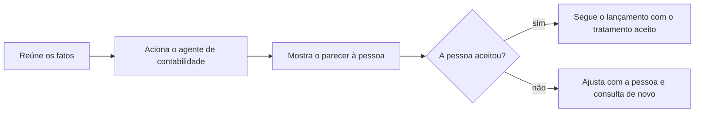

# Consultar contabilidade

## Parâmetros de configuração

Leia cada valor nas instruções do projeto: primeiro na entrada com o nome desta habilidade, depois na entrada `Global` ou no primeiro nível do bloco. Quando um valor não estiver lá, use o padrão abaixo.
```yaml
"Modo de aprendizado": "perguntar"
```

## Instruções

### Passo 1

Estorno, reembolso, cancelamento com devolução, ressarcimento ou auxílio de terceiro, no lançamento ou na correção de um lançamento, sempre vai ao agente `contabilidade` do core. Esta habilidade não decide o tratamento contábil sozinha.

Reúna os fatos antes de acionar o agente: os valores, as datas, quem pagou, para onde volta o dinheiro e o que está ou não confirmado por escrito. Leia-os na evidência e nos registros, e pergunte à pessoa só o que faltar. Não complete um fato com suposição.

### Passo 2

Acione o agente `contabilidade` com esses fatos e peça o tratamento contábil: como registrar o estorno, o reembolso ou o auxílio, e o que fica pendente.



Mostre o parecer à pessoa antes de dar o tratamento como concluído, com os fatos que o sustentam. O lançamento só segue depois do aceite dela.

### Passo 3

O que não está confirmado por escrito, como um auxílio só prometido, segue como pendência no parecer, não como valor lançado. Diga à pessoa o que falta para confirmar.

### Passo 4

Ao terminar, siga `evoluir-habilidade` conforme `Modo de aprendizado`.

## Problemas comuns

### Tratamento decidido sem a contabilidade

Se você decidir sozinho como lançar um estorno, um reembolso ou um auxílio de terceiro, o valor entra como receita, abatimento ou dívida sem validação, e a pessoa só descobre no fechamento.

1. Reúna os fatos e acione o agente `contabilidade`.
2. Mostre o parecer à pessoa antes de dar o tratamento como concluído.
3. Siga o lançamento só com o tratamento aceito.

### Auxílio sem confirmação lançado como valor certo

Se você lançar um auxílio que ainda não está confirmado por escrito, o lançamento conta com um valor que pode não chegar.

1. Leve o auxílio ao agente como fato não confirmado.
2. Deixe-o como pendência no parecer.
3. Lance só depois da confirmação por escrito.

## Exemplos de entrada e saída

Estes exemplos ilustram fatos. Eles podem não estar no data source.

### uma hospedagem paga por uma pessoa sócia foi cancelada, o reembolso integral voltou para o cartão dela e a plataforma ofereceu um auxílio parcial para outro hotel, ainda sem confirmação por escrito

Acionei o agente `contabilidade` com os valores, as datas, quem pagou, para onde voltou o dinheiro e o que não está confirmado. Mostrei o parecer antes de dar o tratamento como concluído e deixei o auxílio como pendência.

## Casos-limite

- O dinheiro volta para quem pagou, não para a conta da empresa: leve isso ao agente como fato. Não trate como devolução à empresa.
- Falta um fato, como a data ou para onde volta o dinheiro: pergunte só esse fato antes de acionar o agente.
- A pessoa pede para concluir sem o parecer: mostre o que falta e não dê o tratamento como concluído.
- O gasto é comum, sem devolução nem auxílio: não use esta habilidade.

## Pegadinhas

- Um reembolso parece só corrigir o valor da despesa. O dinheiro pode voltar para quem pagou, não para a empresa, e o tratamento é do agente `contabilidade`.
- Um auxílio oferecido parece valor certo. Sem confirmação por escrito, é pendência.

## Scripts disponíveis

- Nenhum.

1. Não há script para executar.
