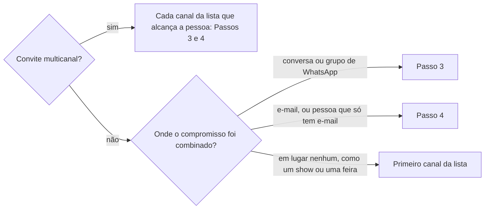

# Convidar para evento

## Parâmetros de configuração

Leia cada valor nas instruções do projeto: primeiro na entrada com o nome desta habilidade, depois na entrada `Global` ou no primeiro nível do bloco. Quando um valor não estiver lá, use o padrão abaixo.
```yaml
# `Convite multicanal` é `sim`, que manda o convite por todos os canais da lista que alcançam a pessoa, para ela ser lembrada mais de uma vez, ou `não`, que manda por um canal só.
"Convite multicanal": "sim"
# `Canais do convite em ordem de preferência` lista os canais do convite: `WhatsApp` e `Google Agenda`. Com `Convite multicanal` em `não`, a conversa em que o compromisso foi combinado manda mais que esta lista, e sem conversa de origem vale o primeiro canal dela.
"Canais do convite em ordem de preferência": ["WhatsApp", "Google Agenda"]
"Modo de aprendizado": "perguntar"
```

## Instruções

### Passo 1

Peça o que falta do compromisso: quem convida, quem recebe o convite, pessoa ou grupo, e o que é, como uma reunião, um show, uma feira ou um lançamento. Leia o evento na agenda antes de pedir qualquer outro dado: o título, o início, o término, o local ou o link da chamada e os convidados vêm dele.

O evento existe antes do convite. Sem evento, siga `definir-agenda` e volte aqui com ele criado. Um convite com horário que não está na agenda deixa a pessoa com um compromisso que ninguém guarda.

### Passo 2



Com `Convite multicanal` em `sim`, o convite sai por cada canal que alcança a pessoa: o WhatsApp, para quem tem conversa ou grupo, e o Google Agenda, para quem tem e-mail no evento. Receber o mesmo convite mais de uma vez serve de lembrete. Todos os canais repetem o título, o dia, a hora e o local ou o link do evento, para a pessoa não receber dados diferentes.

Com `Convite multicanal` em `não`, o convite sai por um canal só, o da conversa em que o compromisso foi combinado.

### Passo 3

Convite pelo WhatsApp, numa conversa ou num grupo: o evento da agenda já traz o título, o início e o link da chamada, e o evento do WhatsApp copia esses dados de lá. As palavras seguem `redigir-com-tom-de-voz`, a data vai no formato de mensagem de `conversar-no-whatsapp`, e cada mensagem segue o sim e o envio do Passo 5 dela. Se o convite leva uma imagem, ela segue `enviar-imagem-no-whatsapp`.

Quando a pessoa confirma a participação, mande nessa conversa o evento nativo do WhatsApp e, à parte, uma mensagem com o link da chamada, o dia e a hora. O cartão do evento não deixa o link à vista de quem só lê a conversa.

Checklist do evento:
- [ ] Botão de anexar da conversa, depois Evento.
- [ ] Nome do evento e descrição com o link da chamada.
- [ ] Data de início: clique no campo e digite dia, mês e ano sem separador, como 19102026.
- [ ] Hora de início: clique na hora e digite hora e minuto, como 1615.
- [ ] Término, se houver, depois do início. Mudar um desloca o outro: confira os dois a cada mudança. Se não firmar, deixe o término vazio e diga isso.
- [ ] Antes de criar, amplie o formulário e confira nome, descrição, data e hora.
- [ ] Botão de criar cinza com o início no passado: diga isso e peça o novo horário. Não mude o horário sozinho.
- [ ] Depois de criar, confira o cartão do evento na conversa, com o dia e a hora.
- [ ] Depois do cartão, a mensagem com o link da chamada, o dia e a hora. Com o término vazio, ela diz até que horas vai a call.

### Passo 4

Convite pelo Google Agenda: a pessoa entra como convidada do evento por `definir-convidado`, e o convite sai do próprio evento, com o link da chamada.

### Passo 5

Quando o convite espera resposta, siga `acompanhar-resposta-no-whatsapp` para o WhatsApp. Para o Google Agenda, a resposta aparece na participação do convidado, e `definir-convidado` a registra. Ao terminar, siga `evoluir-habilidade` conforme `Modo de aprendizado`.

## Problemas comuns

### Convite sem evento

Se você mandar o convite antes de o evento existir na agenda, o horário fica só na mensagem, e o compromisso some da agenda de quem convidou.

1. Leia o evento na agenda.
2. Sem evento, siga `definir-agenda` antes do convite.
3. Monte o convite com os dados do evento, sem pedir de novo o que ele já tem.

### Dados diferentes em cada canal

Se você montar o convite de cada canal à mão, a pessoa recebe horários ou links diferentes e não sabe qual vale.

1. Leia o título, o dia, a hora e o local ou o link do evento na agenda.
2. Use os mesmos dados em todos os canais.

### Link só no cartão do evento

Se você mandar só o evento nativo do WhatsApp, o link da chamada fica dentro do cartão, e quem só lê a conversa não o vê.

1. Mande o evento nativo.
2. Mande à parte a mensagem com o link, o dia e a hora.

## Exemplos de entrada e saída

Estes exemplos ilustram fatos. Eles podem não estar no data source.

### a Dora confirmou a call de amanhã às 15h

O evento já estava na agenda, com o link do Meet. Mostrei o texto, esperei o sim, mandei o evento nativo na conversa da Dora e, à parte, a mensagem com o dia, a hora e o link. Deixei o término vazio, porque ele deslocava o início, e a mensagem disse até que horas ia a call.

### convida o grupo para o lançamento de sábado

O evento estava na agenda, e `Convite multicanal` estava em `sim`. O convite foi para o grupo, com o evento nativo e a mensagem com o local, o dia e a hora, e também pelo Google Agenda, para quem tinha e-mail no evento, com os mesmos dados.

### marca uma reunião com o Caio, que só tem e-mail

O compromisso foi combinado por e-mail, e o Caio não tem conversa de WhatsApp. Criei o evento por `definir-agenda`, e o Caio entrou como convidado por `definir-convidado`, o que fez o Google Agenda mandar o convite. O WhatsApp não o alcançava.

## Casos-limite

- O grupo tem muita gente: o evento nativo vai uma vez, no grupo, e cada pessoa responde nele.
- O evento é presencial: o convite leva o local. Só a reunião remota leva o link da chamada.
- A pessoa corrige o horário depois do convite: altere o evento por `definir-agenda` e mande o convite de novo, avisando o que mudou.
- `Convite multicanal` em `não` e o compromisso combinado em dois canais: pergunte em qual a pessoa vai responder.

## Pegadinhas

- O link da chamada numa mensagem parece marcar a reunião na conversa. O convite é o evento nativo mais a mensagem com o link.
- No formulário de evento do WhatsApp, o início e o término se empurram: mudar um muda o dia e a hora do outro.
- O formulário de evento do WhatsApp abre com uma data e uma hora padrão que não são as do pedido.
- O WhatsApp não cria evento com início no passado. O botão de criar fica cinza, sem mensagem de erro.
- O cartão do evento do WhatsApp mostra a hora no formato de 12 horas, como "Hoje às 4:20".

## Scripts disponíveis

- Nenhum.

1. Não há script para executar.
