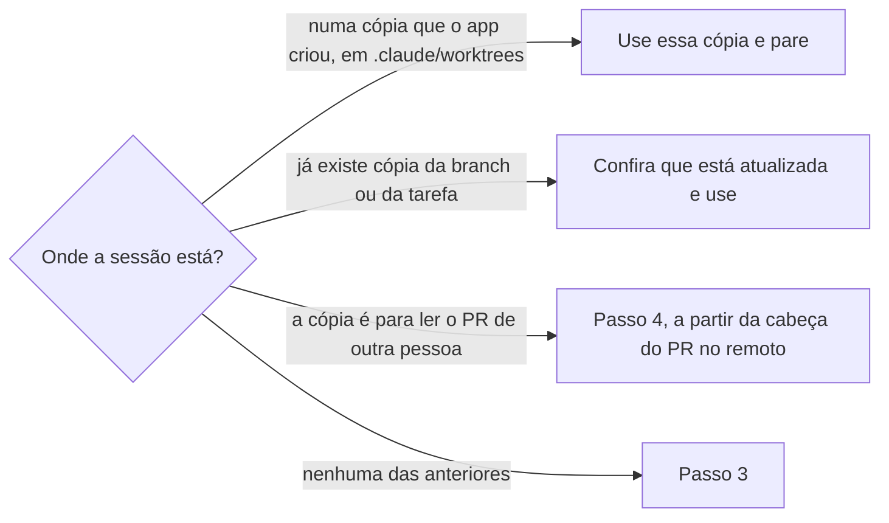

# Criar cópia de trabalho

## Parâmetros de configuração

```yaml
# `Branch base` é a branch remota de onde a cópia nasce.
"Branch base": "main"
# `Padrão do nome da pasta` é o nome da pasta da cópia, ao lado do clone. `<repositório>` é o nome da pasta do clone e `<nome>` é uma palavra da tarefa.
"Padrão do nome da pasta": "<repositório>-wt-<nome>"
# `Itens a ligar do clone` lista o que o git não versiona e a cópia precisa para commitar e rodar. Cada item entra na cópia como link para o do clone, só se existir no clone e faltar na cópia.
"Itens a ligar do clone": [".husky/_", "node_modules"]
"Modo de aprendizado": "perguntar"
```

## Instruções

### Passo 1

Rode quando a habilidade que escreve manda seguir `Cópia de trabalho` em `worktree`, como `evoluir-habilidade`, `criar-habilidade` e `criar-commit`, ou quando a pessoa pede uma cópia para revisar ou testar.
Peça o repositório, o assunto da mudança e a chave do rastreador, se houver.
O clone da pessoa não recebe a mudança: ele pode estar noutra branch, com mudança pendente.

### Passo 2

Veja de onde partir.



A cópia do app tem limpeza própria. Não crie outra em `.claude/worktrees` nem ao lado dela.

### Passo 3

Nomeie a branch `<tipo>/<descrição>`, em ASCII e kebab-case, com o tipo do Conventional Commits da mudança prevista.
Ponha a chave do rastreador na branch quando houver, no formato que o repositório documenta.
Nomeie a pasta pelo `Padrão do nome da pasta`, ao lado do clone. Não crie dentro do clone.

### Passo 4

Atualize a `Branch base` remota e crie a cópia a partir dela, sem rastrear a base.
Uma branch que rastreia a base manda o `push` para a base.
Com o `Passo 2` em "ler o PR de outra pessoa", crie a cópia a partir da cabeça do PR e não leve commit seu.

### Passo 5

Ligue cada um dos `Itens a ligar do clone` que existe no clone e falta na cópia.
Ligue com link, não copie nem instale.
Sem o hook de commit, o commit falha. Não use `--no-verify`.
Se o PR vai mudar as dependências, o link de `node_modules` serve a branch errada: diga isso e não instale sem pedido.

### Passo 6

Ache a versão do runtime no arquivo de versão do projeto. Os comandos de instalar, lint e teste saem de `levantar-ambiente-do-repositorio`.
Se a versão exata não está instalada, use a instalada da mesma série e diga qual foi.
Não instale o runtime sem pedido.

### Passo 7

Responda com a pasta, a branch, o commit de onde nasceu, o que foi ligado e o runtime usado, dizendo se difere do pedido.
Avise que o shell do chat volta para o clone a cada comando, então cada comando leva `cd` ou `git -C` para a cópia.
Quem roda um teste em outro terminal entra na cópia e confere a branch antes.
Quando o PR for mesclado, siga `limpar-copias-de-trabalho`.

### Passo 8

Ao terminar, siga `evoluir-habilidade` conforme `Modo de aprendizado`.

## Problemas comuns

### Mudança no clone da pessoa

Se você editar e commitar no clone porque ele já está aberto, a mudança cai na branch em que a pessoa estava e leva junto o que ela deixou pendente.

1. Pare e crie a cópia pelo `Passo 4`.
2. Leve a mudança para a cópia antes de commitar.
3. Diga que o clone não foi tocado.

### Commit pulado com --no-verify

Se você pular o hook porque a cópia nova não tem o item que ele usa, o commit sai sem as checagens que o repositório exige.

1. Ligue o item do clone, pelo `Passo 5`.
2. Commite de novo, com o hook.
3. Não diga que está pronto antes do hook passar.

### Teste rodado no clone

Se você mandar rodar o teste, ou a pessoa rodar num terminal já aberto, sem entrar na cópia, o teste roda o código do clone e o resultado não diz nada sobre a mudança.

1. Mande entrar na cópia e conferir a branch antes de rodar.
2. Se um resultado já saiu, diga de qual pasta e de qual branch ele veio.
3. Rode de novo na cópia.

### Runtime que não existe

Se você insistir na versão do arquivo de versão e o `nvm use` falhar, a cópia fica sem lint nem teste.

1. Use a versão instalada da mesma série.
2. Diga qual usou e que o CI pode exigir a exata.
3. Não instale sem pedido.

### Cópia dentro de .claude/worktrees

Se você criar a cópia na pasta que o app gerencia, a limpeza do app pode removê-la no meio do trabalho.

1. Use a cópia que o app já criou para a sessão.
2. Se precisa de outra, crie ao lado do clone.

## Exemplos de entrada e saída

Estes exemplos ilustram fatos. Eles podem não estar no data source.

### crie uma cópia de trabalho para corrigir um teste num repositório com hook de commit e `.nvmrc`, card ABC-12

Criei `app-wt-corrige-teste` ao lado do clone `app`, na branch `fix/ABC-12-corrige-teste`, a partir da `origin/main` atualizada. Liguei `.husky/_` e `node_modules` do clone. O `.nvmrc` pede o Node 22.9.0, que não está instalado, e usei o 22.8.0. O clone não foi tocado. Cada comando leva `git -C` ou `cd` para a cópia, e quem rodar o teste em outro terminal entra nela e confere a branch antes.

### ajuste uma regra de uma habilidade do harness

Criei `harness-wt-<nome>` ao lado do clone, numa branch `fix/` a partir da `origin/main`. Nada a ligar: o repositório não tem os itens da lista. O clone ficou como estava, com a branch dele.

## Casos-limite

- A sessão já está numa cópia que o app criou: use essa e não crie outra.
- Já existe cópia da mesma branch: use essa, depois de conferir que está atualizada.
- A pasta pelo padrão já existe e é de outra tarefa: troque o `<nome>` e não reaproveite.
- O item a ligar não existe no clone: pule e diga qual faltou.
- A cópia serve para ler o PR de outra pessoa: nasce da cabeça do PR no remoto, não da `Branch base`, e não leva commit.
- A `Branch base` não existe no remoto: pare e pergunte, não use a branch atual do clone.
- O clone tem mudança pendente: não toque nela, a cópia existe por isso.

## Pegadinhas

- O shell do chat volta para o clone a cada comando. O terminal da pessoa não: fica onde ela deixou.
- `.husky/_` não é versionado: o instalador o cria. Numa cópia nova, o commit falha com `husky.sh` ausente até o link existir.
- O link de `node_modules` faz a cópia usar as dependências do clone. Se a branch muda o `package.json` ou o lockfile, essas dependências não servem a mudança.
- A criação da branch por `worktree add` com `origin/<base>` rastreia a base, como o `switch -c`. Sem `--no-track`, o `push` vai para a base.
- Uma versão de Node da mesma série basta para lint e formatação, mas o CI usa a exata.
- A limpeza de `.claude/worktrees` é do app. A de uma cópia criada por esta habilidade é de `limpar-copias-de-trabalho`.

## Scripts disponíveis

- `git -C <clone> fetch origin <Branch base>`: atualiza a base no `Passo 4`.
- `git -C <clone> worktree list --porcelain`: cópias que já existem, no `Passo 2`.
- `git -C <clone> worktree add --no-track -b <branch> <pasta> origin/<Branch base>`: cria a cópia no `Passo 4`.
- `ln -s <clone>/<item> <pasta>/<item>`: liga um item no `Passo 5`, só se existir no clone e faltar na cópia.
- `cat <pasta>/.nvmrc` e `source ~/.nvm/nvm.sh && nvm ls --no-colors`: versão pedida e versões instaladas, no `Passo 6`.
- `git -C <pasta> branch --show-current`: confere a branch da cópia no `Passo 7`.

1. Atualize a base, crie a cópia, ligue o que falta, ache o runtime e responda com o que foi feito.
