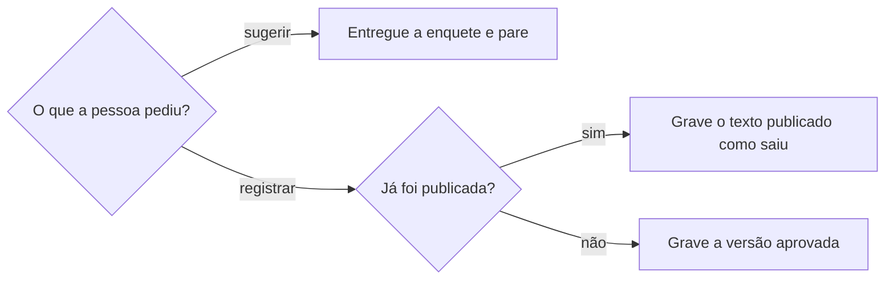

# Criar enquete

## Parâmetros de configuração

Leia cada valor nas instruções do projeto: primeiro na entrada com o nome desta habilidade, depois na entrada `Global` ou no primeiro nível do bloco. Quando um valor não estiver lá, use o padrão abaixo.
```yaml
# `Banco de modelos de conteúdo` é a fonte de ideias de enquete e de pergunta do projeto, como o nome do banco no workspace conectado. Vazio: pergunte uma vez e, sem resposta, crie a ideia do zero.
"Banco de modelos de conteúdo": ""
# `Banco de copy` é a fonte de textos aprovados que `redigir-com-tom-de-voz` consulta. Vazio: só o tom de voz.
"Banco de copy": ""
# `Banco de posts` e `Banco de opções de enquete` recebem o registro, só a pedido da pessoa. Vazio: pergunte uma vez antes de registrar.
"Banco de posts": ""
"Banco de opções de enquete": ""
# `Canal padrão` é o canal da enquete quando o pedido não diz. Vazio: pergunte uma vez e, sem resposta, entregue sem canal e diga isso.
"Canal padrão": ""
# `Localidade-alvo` é a praça da enquete quando o pedido não diz. `todas` usa toda a lista de localidades.
"Localidade-alvo": "todas"
# `Intervalo para repetir pergunta` é o tempo mínimo, em dias, antes de repetir uma pergunta já feita.
"Intervalo para repetir pergunta": 30
"Modo de aprendizado": "perguntar"
```

## Instruções

### Passo 1

Entenda o que a pessoa quer descobrir sobre o público e a decisão que a enquete apoia: conteúdo, comunidade, demanda ou programação. O aprendizado pode ser o menor público viável, o perfil de cliente ideal, comportamento, desejo, preferência, repertório, relação com a cena ou intenção de participar. Aplique `Canal padrão` e `Localidade-alvo` quando o pedido não os traz, e diga na resposta os valores que assumiu. Canal ou praça ausente não bloqueia.

### Passo 2

Sem objetivo informado, não pare. Sorteie no `Banco de modelos de conteúdo` uma ideia aderente a conhecer o público, diga que é uma sugestão exploratória e o aprendizado provável. Sem ideia aderente, pare e peça só o dado que falta, em uma frase, como "Quero descobrir se esse público…", "A decisão que a enquete apoia é…" ou "Se quiser fugir do padrão: o canal ou a praça é…".

### Passo 3

Consulte o `Banco de modelos de conteúdo` antes de propor. A ideia cadastrada e aderente vem antes de qualquer ideia nova, e a resposta diz qual usou. Sem ideia aderente, crie a ideia do zero e marque-a como ainda não consolidada. Se ela puder ser reutilizada e a pessoa a aprovar, recomende cadastrá-la com `criar-ideia-de-conteudo`. Ideia pontual ou experimental não vira padrão.

### Passo 4

Cheque se a enquete gera aprendizado acionável. Uma pergunta divertida que só move a comunidade é ajustada ou trocada, e a resposta distingue movimento de comunidade de aprendizado real. Confira o histórico de posts: não repita uma pergunta feita há menos que `Intervalo para repetir pergunta` sem variação. Se a repetição serve para comparar ao longo do tempo, diga que é escolha de medição.

### Passo 5

Monte as opções. Quando a pergunta é de cidade ou de praça, as opções saem da lista de localidades, com `definir-localidade-geografica`, dentro de `Localidade-alvo`, e "outra cidade" é uma opção válida, com a resposta aberta. Remova ou troque a opção sem aderência ao repertório, à cena, ao público viável ou ao posicionamento do negócio. Não encha a lista com opção fraca.

### Passo 6

Peça a pergunta final e as variações a `redigir-com-tom-de-voz`, com o `Banco de copy` quando houver. Esta habilidade só decide quando chamá-la: depois da ideia, do objetivo e das opções fechados. Ela não escreve a copy final. Para apoiar a decisão com a comunidade, cabe o subagente `core:gestao-de-comunidade`.

### Passo 7

Entregue, nesta ordem, o objetivo de aprendizado, a ideia usada, o canal e o formato recomendados, a pergunta final, as opções, uma justificativa curta do que a enquete descobre e da decisão futura que apoia, e variações controladas quando fizerem sentido. A skill só entrega a enquete pronta, com a pergunta e as opções. O envio no WhatsApp segue `conversar-no-whatsapp` e `usar-whatsapp-web`, e só com o sim da pessoa.

Quando a enquete serve a uma ação, como entregar algo, convidar ou organizar um encontro, a pergunta sozinha não basta. Entregue também uma mensagem de contexto, antes da enquete, com o que é oferecido, quem o fez e qual é o papel do negócio nisso, o limite (como poucas unidades), como a pessoa recebe ou participa e quando e onde. Esses fatos vêm da pessoa ou da fonte do projeto: pergunte o que faltar e não invente autoria, data, local nem quantidade. As opções podem juntar interesse e praça, e quem for de fora das praças responde no grupo.

Nome de pessoa ou de organização na mensagem sai na grafia canônica do cadastro, conferida com `definir-grafia`. Nome que não está no cadastro: avise e não escolha a grafia pelo que a conversa escreveu.

A mensagem de contexto abre com uma saudação, mesmo quando a pessoa passa um texto próprio: o texto dela entra no corpo, e a saudação continua. A pergunta da enquete se entende sozinha, porque quem a vê sem ler a mensagem de cima não sabe do que se trata. Ela repete o objeto, como "Você quer pegar um exemplar da fanzine com a gente?", e não só o nome dele.

### Passo 8

Sem pedido de registro, só sugira e não crie página. Com o pedido, grave o post no `Banco de posts` e as opções no `Banco de opções de enquete`. Enquete já publicada é registrada com o texto publicado, sem reescrever nem melhorar: a melhoria vira aprendizado para a próxima. Enquete aprovada com potencial de reuso: recomende o cadastro como modelo, com título, objetivo, formato, modelo de copy e referência.



### Passo 9

Ao terminar, siga `evoluir-habilidade` conforme `Modo de aprendizado`.

## Problemas comuns

### Pergunta que só movimenta

Se você entregar uma pergunta divertida sem objetivo de aprendizado, a resposta rende curtida e nenhuma decisão.

1. Diga o que a resposta ensina e a decisão que apoia.
2. Sem decisão, ajuste a pergunta ou troque-a.
3. Se o objetivo é só mover a comunidade, diga isso.

### Três camadas misturadas

Se você escrever a copy final ou criar página no mesmo passo em que sugere a ideia, a mecânica, o texto e o registro se confundem.

1. Sugira a ideia e a mecânica nesta habilidade.
2. Peça a escrita a `redigir-com-tom-de-voz`.
3. Registre só quando a pessoa pedir.

### Registro que melhora o publicado

Se você reescrever a enquete já publicada ao registrá-la, o banco deixa de refletir o que o público respondeu.

1. Grave o texto publicado como saiu.
2. Guarde a melhoria como aprendizado da próxima enquete.

## Exemplos de entrada e saída

Estes exemplos ilustram fatos. Eles podem não estar no data source.

### Sugira uma enquete para saber de qual cidade a minha comunidade é

Assumi o canal padrão do projeto e todas as praças. O objetivo é saber onde está o público, para decidir onde programar a próxima ação. Não havia ideia cadastrada aderente, então criei uma ideia nova, ainda não consolidada. A pergunta é "De qual cidade você é?", com as opções Belo Horizonte, São Paulo e "outra cidade" (a pessoa diz qual). Peça o texto final a `redigir-com-tom-de-voz`. Não registrei nada nem enviei.

## Casos-limite

- Sem `Banco de modelos de conteúdo` na conexão: pergunte uma vez e, sem resposta, crie a ideia do zero e diga isso.
- Pedido de escrever, publicar ou cadastrar a ideia: devolva ao `redigir-com-tom-de-voz`, a `conversar-no-whatsapp` ou a `criar-ideia-de-conteudo`.
- A pessoa quer a mesma pergunta de novo: entregue e diga se é medição ou repetição.
- Praça fora da lista de localidades: use "outra cidade" e sugira cadastrar a localidade.

## Pegadinhas

- Uma enquete divertida parece sempre boa para a comunidade. Sem decisão que ela apoie, o aprendizado é nulo.
- "Outra cidade" parece opção fraca. Ela mantém a lista honesta e vira resposta aberta.
- Uma pergunta curta parece boa para uma enquete. Quando a resposta decide uma ação, sem contexto a pessoa não sabe por que responde, nem se haverá o que receber.
- O negócio parece o autor do que distribui. Ele pode só apoiar a distribuição de um trabalho de outra pessoa ou grupo, sem fim comercial: a fonte diz quem fez e a mensagem não toma a autoria.
- A pergunta de uma enquete parece poder apoiar-se na mensagem de cima. A enquete aparece sozinha na lista de conversas e na prévia, e a mensagem pode estar fora da tela.
- O banco de copy parece o lugar da pergunta final. A escrita passa por `redigir-com-tom-de-voz`.
- O WhatsApp Web cria a enquete no menu de anexar. Esta habilidade não descreve o clique: ele fica nas habilidades do WhatsApp.

## Scripts disponíveis

- Nenhum.

1. Não há script para executar.
