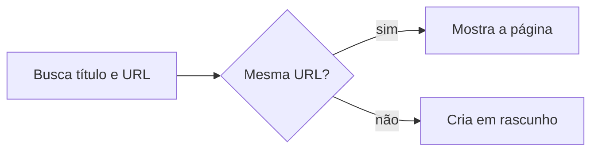

# Criar ideia de conteúdo

## Parâmetros de configuração

Leia cada valor nas instruções do projeto: primeiro na entrada com o nome desta habilidade, depois na entrada `Global` ou no primeiro nível do bloco. Quando um valor não estiver lá, use o padrão abaixo.

```yaml
"Formato da data com dia da semana": "terça-feira, 01/09/2026"
```

## Instruções

### Passo 1

A lista de ideias de conteúdo, o nome de cada propriedade e as opções de status vêm do mapeamento de dados do projeto, no workspace conectado. Este texto usa os conceitos: a ideia, que é o título, a descrição, a URL do conteúdo original, a data da captura, a data prevista e o status, com as opções em rascunho, em produção e transformado em conteúdo. Se a lista não estiver nessa conexão, pare. Não use a lista de outro workspace. O post com roteiro, legenda e data de publicação fica na lista de posts. Esta habilidade não cria essa página. Não escreva a legenda. Não agende. Não crie tarefa. Não cadastre o perfil.

### Passo 2

Antes de criar, busque o pedaço do título e a URL que a pessoa trouxe. A mesma URL é a mesma ideia. Uma cena parecida com outra URL é outra ideia: mostre a página parecida e siga o cadastro.



### Passo 3

Crie a página só com o que a pessoa afirmou.

1. A ideia é o título, curto, no feitio das ideias que a lista já tem. O formato entra no título quando a pessoa nomeou, como Reel.
2. A descrição guarda a cena e o que a pessoa pediu para aparecer. Não vira roteiro nem legenda.
3. A URL do conteúdo original recebe o link como a pessoa escreveu. O nome da propriedade entra sem prefixo. Não deixe o link só na descrição.
4. A data da captura inclui a data e a hora do instante do cadastro. O campo é data com hora. Essa hora separa ideias cadastradas no mesmo dia. Não grave só o dia. Não invente uma hora diferente da do cadastro.
5. O status é em rascunho. Os status desta lista são em rascunho, em produção e transformado em conteúdo, com os nomes que o mapeamento dá.
6. A data prevista fica vazia, salvo se a pessoa deu a data.

Não invente data de postagem, perfil, hashtag, eixo narrativo nem nome do áudio.

### Passo 4

Mostre o título, o status, a data da captura e o link. Na resposta, a data sai no formato da data com dia da semana e a hora, calculados a partir do instante do cadastro. A resposta não pede para nomear a habilidade.

## Problemas comuns

### Ideia que vira post

Se você criar a página na lista de posts, a ideia ganha data de postagem, formato e legenda que a pessoa não deu.

1. Cadastre na lista de ideias de conteúdo.
2. Deixe a lista de posts para o post que já tem data e hora de publicação.
3. Não escreva roteiro nem legenda nesta habilidade.

### Link só na descrição

Se você guardar a URL só na descrição, a mesma referência entra de novo.

1. Grave o link na URL do conteúdo original.
2. A descrição fica com a cena.
3. Antes de criar, busque essa URL.

### URL com prefixo

Se você prefixar o nome da propriedade ao criar a página, a chamada falha e a ideia não entra.

1. Use o nome da propriedade da URL do conteúdo original, sem prefixo.
2. O valor é o link, como a pessoa escreveu.
3. Se a chamada falhar por prefixo, repita sem o prefixo. Não crie outra página.

### Captura sem hora

Se você gravar só o dia, ideias cadastradas no mesmo dia ficam indistinguíveis.

1. Grave a data e a hora do instante do cadastro.
2. Marque o campo como data com hora.
3. Não invente uma hora diferente da do cadastro.

### Status de outra lista

Se você gravar o status de outra lista, como rascunho, planejado ou publicado de uma lista de posts, o status não é o desta lista.

1. Use em rascunho numa ideia nova.
2. Em produção e transformado em conteúdo só quando a pessoa disser essa etapa.
3. Não use o nome que uma view antiga mostra se ele não for um desses três.

## Exemplos de entrada e saída

Estes exemplos ilustram fatos. Eles podem não estar no data source.

### quero criar uma ideia de um Reel em que eu mostro os bastidores do ensaio, com esse áudio de fundo https://www.instagram.com/reels/audio/1234567890/

A ideia entrou na lista de ideias de conteúdo, com status em rascunho. O título resume o Reel dos bastidores do ensaio. A descrição guarda a cena e o áudio de fundo. A URL ficou na URL do conteúdo original. A data da captura inclui a hora do cadastro. A data prevista ficou vazia. Não criei página na lista de posts.

## Casos-limite

- A lista de ideias de conteúdo não está no workspace conectado: pare.
- A mesma URL já está numa ideia: mostre essa página e não crie outra.
- Cena parecida com outra URL: mostre a página e crie esta.
- A pessoa não deu data prevista: o campo fica vazio.
- Várias ideias no mesmo dia: cada uma guarda a própria hora de captura.
- A pessoa não nomeou o áudio: não invente o nome. O link basta.
- O pedido é publicar, legendar ou agendar: pare nesta habilidade.

## Pegadinhas

- A lista de posts parece o lugar do Reel. Sem data e hora de publicação, o registro é ideia e fica na lista de ideias de conteúdo.
- Uma ideia com a mesma cena e outra URL parece a mesma. A URL do conteúdo original separa as referências.
- O status em rascunho desta lista parece o rascunho da lista de posts. São listas diferentes.
- Uma view pode citar um status que o cadastro não aceita. A ideia nova entra em rascunho.
- O nome da propriedade parece precisar de prefixo na chamada. A URL do conteúdo original entra pelo nome do mapeamento, e o valor é o link.
- O dia da captura parece bastar. Várias ideias no mesmo dia só se separam pela hora.

## Scripts disponíveis

- Nenhum.

1. Não há script para executar.
