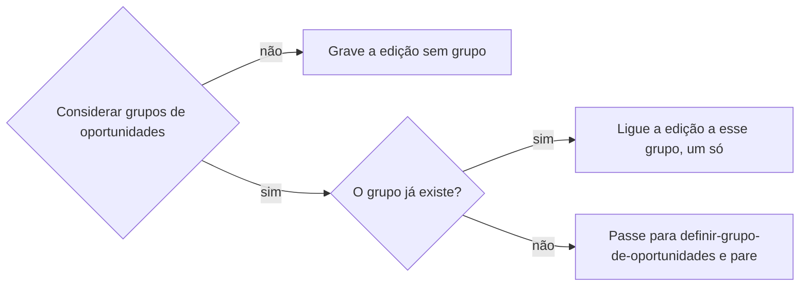

# Criar oportunidade

## Parâmetros de configuração

Leia cada valor nas instruções do projeto: primeiro na entrada com o nome desta habilidade, depois na entrada `Global` ou no primeiro nível do bloco. Quando um valor não estiver lá, use o padrão abaixo. As datas são AAAA-MM-DD.
```yaml
"Formato da data com dia da semana": "terça-feira, 01/09/2026"
# `Considerar grupos de oportunidades` é `sim` ou `não`.
"Considerar grupos de oportunidades": "sim"
"Data de fundação do negócio": ""
# `Data mínima da edição` vazia vale a `Data de fundação do negócio`. As duas vazias: sem limite.
"Data mínima da edição": ""
```
## Instruções

### Passo 1

A lista de oportunidades e o nome de cada propriedade vêm do mapeamento de dados do projeto, no workspace conectado. Se a lista não estiver nessa conexão, pare. Não use a lista de outro workspace. Este texto usa os conceitos: o título da edição, a sugestão de título, a data da edição, o grupo da edição, as variações de nome, os perfis da edição, o ingresso do visitante, a taxa do expositor, o link de inscrição, o e-mail da organização, os links não oficiais, a empresa ou local, a localidade, a etiqueta de e-mail da edição, os anexos da edição, as notas de curadoria e a decisão humana.

Saber se já existe fica com `procurar-oportunidade`. Se a edição existe e o pedido é cadastrar, mostre essa página, anexe o cartaz que ainda não está nos anexos da edição, e pare. Não crie outra. Revisar, limpar, enriquecer, consolidar, reorganizar ou atualizar uma edição que já existe, o conteúdo, o corpo ou as anotações, segue `revisar-oportunidade`. O grupo fica com `definir-grupo-de-oportunidades`.

### Passo 2

Confira o mapeamento antes de gravar. O título da edição e a data da edição são obrigatórios. O grupo da edição também, quando `Considerar grupos de oportunidades` é `sim`. Se um obrigatório faltar no mapeamento, pare antes de criar e diga qual. Uma propriedade opcional que falta e para a qual o texto traz um valor: grave o resto e, no fim, liste esse valor e proponha criar a propriedade, com o nome, o tipo e a descrição que explica a pessoas e a IAs por que ela existe, dentro do limite de tamanho da ferramenta. Crie só com o sim da pessoa. Não grave o valor no corpo. Opcional sem valor no texto: nada a fazer.

### Passo 3

O título da edição começa pelo nome da edição, depois a data no formato da data com dia da semana, a cidade e, por fim, o grupo, quando há grupo. Não comece pelo grupo. Ano, número de edição e data entram nesse título quando separam uma data da outra. Dois dias entram os dois. A data da edição recebe o intervalo, com as horas. A data só no título não basta. Data anterior à `Data mínima da edição` não entra. Data já passada, depois dela, entra: a edição fica no radar do grupo, e a presença segue `definir-inscricao`.

Quando o mapeamento tem a sugestão de título, uma fórmula que monta o título da edição, ela vale no lugar da ordem acima: grave a data, o grupo e a localidade, leia o valor da sugestão de título e copie-o para o título da edição, na mesma execução. O título da edição nunca fica só com o nome do grupo.

Antes de cadastrar ou atualizar, confira se o ano da edição está coberto por algum ciclo da lista de ciclos do projeto. Ano posterior ao último ciclo: busque o ciclo por nome, ano e variações e, se não existir, crie-o sem duplicar antes de seguir. Ano anterior ao ciclo mais antigo: ignore a edição e diga o motivo. Ano incerto, fontes em conflito ou data parcial: pergunte, nunca chute o ano. Nunca promova um evento passado a futuro: o ano é o da fonte, copiado exatamente, com a evidência registrada.

### Passo 4

O grupo da edição depende de `Considerar grupos de oportunidades`.



Não crie o grupo aqui. Com `sim`, não salve a edição com o vínculo vazio. Página sem data na lista de oportunidades fica com `definir-grupo-de-oportunidades`, com `sim`.

Cada data é uma página na lista de oportunidades, com a data. Não crie outra página para seleção, inscrição, edital ou chamada. O conteúdo estável desse processo fica no grupo, com `sim`, ou na edição, com `não`. Formulário, valor ou vaga desta data ficam na edição. As variações de nome, quando a pessoa der, são uma lista de bullets, um nome alternativo por item, cada item com ponto e vírgula no fim. Mantenha as grafias úteis para a busca, com e sem sigla e com e sem ano.

### Passo 5

O que é desta data fica na edição: endereço, horário, valor, formulário e número de vagas. Um lugar visto numa data só não vira lugar padrão do grupo. Os perfis da edição só recebem a conta própria desta edição. O perfil oficial fica com `definir-grupo-de-oportunidades`, com `sim`. Não grave o texto do cartaz nem a operação no corpo.

O título e a síntese descrevem a oferta: chamada, edição, modalidade, data, local e entidade responsável. Não dizem que ela é "da" ou "para" o negócio, salvo quando o próprio negócio é o organizador. A candidatura específica vai para as inscrições e as tratativas para as negociações, todas ligadas à mesma oportunidade canônica. Mais de uma candidata na mesma oferta mantém uma só oportunidade.

O arquivo do cartaz, do print da divulgação ou do comunicado desta data vai nos anexos da edição, na mesma gravação, sem pedir confirmação. Preserve os arquivos que já estão lá e não anexe o mesmo arquivo de novo. Use a referência de arquivo aceita pela ferramenta: o ID do anexo da conversa pode não ser um ID de arquivo do Notion. Se o pedido só consulta a edição, ofereça anexar e não grave. Sem os anexos da edição no mapeamento, liste o arquivo no fim, como valor sem propriedade. O arquivo local sobe como `anexar-arquivo-no-notion` manda.

A legenda de um post muitas vezes não traz o nome, a data, o local ou o prazo. Leia também a imagem do card, por `reconhecer-imagem`, antes de perguntar à pessoa o que falta, e diga na resposta de onde veio cada dado, como "a data veio da imagem". Dado que só a imagem traz não é falha nem pede aviso.

Legenda e imagem com datas diferentes: avise a organização na hora, sem esperar a pessoa pedir. Prefira o WhatsApp ou o e-mail que já temos dela e, sem canal, um comentário no post. O texto passa por `redigir-com-tom-de-voz`, o envio segue `conversar-no-whatsapp` ou `enviar-email`, e a resposta conta o que foi avisado. A data a gravar segue o Passo 3, para fontes em conflito.

As etapas do cronograma da edição, inclusive a programação publicada, seguem `definir-cronograma`. Esta habilidade não as grava.

### Passo 6

Não preencha fórmula, rollup nem botão. Não invente categoria nem prioridade.

O ingresso do visitante é o que paga quem visita. A taxa do expositor é o que paga quem expõe. Gratuidade para um público restrito, como compradores credenciados, não preenche nenhuma das duas.

Quando a taxa da marca varia entre 1 dia e 2 dias, preencha os dois campos numéricos de taxa por duração. O campo de texto da taxa só recebe taxa variável ou condicional, como a partir de, lote, porcentagem ou metragem. A propriedade de taxa é a fonte prioritária: o valor achado em notas, transcrição, PDF ou formulário migra para ela e some da nota quando fica redundante, mas a fonte fica se for preciso para auditoria. Taxa nunca vai no corpo.

Sem URL no texto, o link de inscrição fica vazio. O e-mail da organização vai na propriedade dele. Links não oficiais recebem só URL.

Quando a pessoa envia o link completo de uma página específica de uma plataforma de ingressos e o link oficial ou o de inscrição está vazio, genérico ou menos específico, troque-o pelo específico na oportunidade existente, sem criar outra. Duas URLs da mesma plataforma com o mesmo identificador são a mesma oportunidade.

O local e a localidade seguem `definir-local-fisico`, que confirma o nome do espaço e o endereço e cadastra a empresa do local pelo `definir-empresa`. A empresa fora da lista, com o nome do espaço e o endereço vindos da fonte, é cadastrada na mesma resposta, sem perguntar. A localidade que falta segue `definir-localidade-geografica`. Esta habilidade não cria empresa nem localidade por conta própria: chama essas habilidades e vincula o resultado. Nunca use o estado como aproximação da cidade.

A etiqueta de e-mail da edição guarda o nome inteiro da etiqueta que a caixa aplica às conversas desta data, não o identificador: a busca da caixa usa o nome, e o identificador muda de uma conta para outra. Quando a etiqueta é renomeada, o campo muda junto.

Ao cadastrar a edição, grave na mesma gravação o nome da etiqueta de e-mail dela, mesmo sem conversa ainda: a etiqueta de e-mail do grupo, uma barra, a data da edição em AAAA-MM-DD, um hífen e o nome da edição, como `Projetos/Oportunidades/Festival Rota Sul/2026-09-29 - Festival Rota Sul`. A etiqueta em si é criada pela primeira conversa que a recebe, por `organizar-emails`, ou agora, quando a sessão tem o e-mail conectado. O Gmail não leva a etiqueta do grupo junto com a da edição: a conversa recebe as duas, e a que trata de mais de uma edição recebe a de cada uma.

### Passo 7

Revisar o conteúdo, o corpo ou as anotações de uma edição que já existe segue `revisar-oportunidade`. Uma edição nova nasce sem bloco de anotações, sem callout e sem comentário: não os escreva aqui. O corpo também não recebe aviso de que a página foi criada por automação nem lista do que falta verificar: a verificação feita e a pendência vão nas notas de curadoria.

### Passo 8

Mostre o título, a data, o grupo, quando há, o nome da etiqueta de e-mail, os arquivos anexados e o link. Liste os valores que ficaram sem propriedade. Mostre o link do Google Maps do local, que `definir-local-fisico` devolve, para a pessoa ver como é o lugar.

Procure por `procurar-inscricao` uma inscrição em outra oportunidade na mesma data da edição nova. Havendo, avise do conflito: diga as duas oportunidades, a data com o dia da semana e o status de cada inscrição, e que quem vai em cada uma é decisão da pessoa, caso a marca seja selecionada nas duas. Não decida isso e não crie tarefa.

Na edição nova de um grupo, mostre as lições das notas do grupo, cada uma com a data, como pontos de atenção da próxima participação. A decisão humana fica vazia e não vira pergunta nem pendência na resposta: ela é da revisão das oportunidades, quando a pessoa quiser. Não organize a participação. Não crie tarefa. Com o link do formulário no comunicado, siga `inscrever-na-oportunidade` na mesma resposta. A resposta não pede para nomear a habilidade.

### Passo 9

Data de evento, compromisso, prazo, viagem, reserva, lançamento, entrega ou outro marco, na resposta, no resumo, na tabela, na descrição, no título ou em outro texto, sai no formato da data com dia da semana. Calcule o dia da semana com a data, o horário e o fuso do evento, como a regra do dia da semana manda, antes de escrever.

Sem horário ou sem fuso, e se o dia puder mudar, peça. Não invente. Intervalo ou vários dias: o dia da semana em cada data. Se a fonte trouxer um dia da semana incompatível com a data, sinalize e confirme antes de criar ou alterar. A data da edição permanece um intervalo válido. O dia da semana é a camada extra para a pessoa.

## Problemas comuns

### Edição salva sem grupo

Se você salvar a edição com o grupo vazio enquanto `Considerar grupos de oportunidades` é `sim`, ou criar o grupo aqui, a data fica fora do grupo canônico.

1. Use uma página que já existe, no máximo uma.
2. Se não houver, passe para `definir-grupo-de-oportunidades`.
3. Não salve com o vínculo vazio. Com `não`, grave sem grupo.

### Propriedade ausente

Se você criar a propriedade, ou jogar o valor no corpo, porque o mapeamento não tem onde gravar, a lista muda sem a pessoa decidir.

1. Obrigatório ausente: pare antes de criar e diga qual.
2. Opcional ausente com valor: grave o resto e liste o valor no fim, com a proposta da propriedade: nome, tipo e descrição.
3. Crie só com o sim da pessoa. Não grave no corpo.

### Página de processo

Se você criar na lista de oportunidades uma página só de seleção, inscrição, edital ou chamada, o processo vira uma edição falsa.

1. Não crie essa página.
2. O conteúdo estável fica no grupo, ou na edição sem grupos.
3. Formulário, valor ou vaga desta data ficam na edição.

### Página repetida

Se você cadastrar sem passar por `procurar-oportunidade`, a lista ganha a edição duas vezes.

1. Confirme que não existe.
2. Se existe, mostre essa página, anexe o cartaz que ainda não está nos anexos da edição, e pare.
3. Não crie outra com o mesmo nome e a mesma data.

### Data só no título

Se você escrever a data só no título, a data da edição fica vazia.

1. Grave o intervalo na propriedade, com as horas.
2. O título também leva dia, mês e ano.
3. Data anterior à `Data mínima da edição` não entra.

### Cartaz no corpo

Se você colar o texto da imagem no corpo da página, a operação fica fora das propriedades.

1. O título, a data e o grupo vão nas propriedades.
2. O corpo não recebe o cartaz, aviso de automação nem lista do que verificar.
3. Sem URL, o link fica vazio.

### Cartaz fora dos anexos

Se você usar o cartaz só para ler o texto e deixar o arquivo de fora, a edição perde a prova de que existe e a pessoa precisa pedir o anexo.

1. Anexe o arquivo nos anexos da edição, na mesma gravação.
2. Preserve os arquivos que já estão lá. Não anexe o mesmo de novo.
3. Se o pedido só consulta, ofereça anexar e não grave.

### Entrada trocada

Se você marcar a taxa do expositor ou o ingresso do visitante porque um público restrito entra de graça, a taxa ou o ingresso sai errado.

1. Gratuidade para um público restrito não preenche essas duas.
2. Deixe as duas vazias quando o texto não disser a taxa de quem expõe nem o ingresso de quem visita.
3. Não invente o valor.

### Edição sem etiqueta de e-mail

Se você cadastrar a edição com a etiqueta de e-mail vazia, as conversas dela ficam só na pasta geral das oportunidades e a pessoa não as acha por edição.

1. Grave o nome da etiqueta na mesma gravação da edição.
2. A etiqueta fica dentro da do grupo, com a data da edição em AAAA-MM-DD e o nome da edição.
3. A etiqueta é criada pela primeira conversa que a recebe, ou agora, com o e-mail conectado.
4. Grupo com a etiqueta de e-mail vazia: pare e passe para `definir-grupo-de-oportunidades`, que grava o nome dela.

### Data sem o dia da semana

Se você escrever a data numérica sem o dia da semana, ou aceitar um dia da semana que não bate com a data, a pessoa lê a edição errada.

1. Calcule o dia como a regra do dia da semana manda, com a data, o horário e o fuso.
2. Escreva no formato da data com dia da semana em cada data, inclusive no título.
3. Se divergir, sinalize e confirme antes de criar ou alterar. A data da edição permanece um intervalo válido.

## Exemplos de entrada e saída

Estes exemplos ilustram fatos. Eles podem não estar no data source.

### a oportunidade Festival Rota Sul não existe na lista de oportunidades. Datas 29 de setembro de 2026 a 30 de setembro de 2026, das 09h às 19h, no Centro de Eventos Aurora, Rua das Flores, 100, Cidade Exemplo. Entrada gratuita para compradores credenciados.

a edição não existia. O grupo foi para `definir-grupo-de-oportunidades`. A edição entrou com a data, o endereço e o horário. No título e na resposta, terça-feira, 29/09/2026 e quarta-feira, 30/09/2026. A data da edição ficou o intervalo válido. Sem página de inscrição. O ingresso do visitante e a taxa do expositor ficaram vazios. O vínculo aponta para um grupo só.

### cadastre o Festival Rota Sul de sábado, 12/12/2026 e domingo, 13/12/2026. O grupo existe, com a etiqueta de e-mail `Projetos/Oportunidades/Festival Rota Sul`.

a edição entrou com a etiqueta de e-mail `Projetos/Oportunidades/Festival Rota Sul/2026-12-12 - Festival Rota Sul`, gravada na mesma gravação. A etiqueta no Gmail fica para a primeira conversa que a receber. A resposta mostrou o nome dela.

### Considerar grupos de oportunidades é não. Cadastre o Festival Rota Sul de 29 de setembro de 2026.

a edição entrou sem grupo, com a data no título e na data da edição. Não passei para `definir-grupo-de-oportunidades`.

### o mapeamento não tem as notas de curadoria. O texto traz um comentário sobre o público do evento.

gravei a edição com o resto. No fim, listei o comentário sem propriedade e propus as notas de curadoria, como texto, com a descrição de por que elas existem. O corpo não recebeu o comentário.

### a fonte diz segunda-feira, 01/09/2026

01/09/2026 é terça-feira. Sinalizei a divergência e confirmei antes de criar ou alterar. A data da edição ficou um intervalo válido. No título e na resposta, usei o formato da data com dia da semana.

## Casos-limite

- A edição já existe e o pedido é cadastrar: mostre a página, anexe o cartaz que ainda não está nos anexos da edição, e pare. Não crie outra.
- `Considerar grupos de oportunidades` é `sim` e não há grupo: pare e passe para `definir-grupo-de-oportunidades`. Não crie o grupo aqui.
- `Considerar grupos de oportunidades` é `não`: grave sem grupo e não chame `definir-grupo-de-oportunidades`.
- O mapeamento não tem o título, a data ou, com `sim`, o grupo: pare antes de criar e diga qual.
- A data é anterior à `Data mínima da edição`: não grave. Pergunte.
- Dois dias com hora: a data da edição recebe o intervalo, com as horas. Cada data no texto leva o próprio dia da semana.
- O texto não traz URL: o link de inscrição fica vazio.
- A empresa do local não está na lista e a fonte traz o nome do espaço e o endereço: cadastre por `definir-local-fisico`, sem perguntar. Sem o endereço, ou com a localidade fora da lista, a pergunta é a dela.
- A legenda não traz o dado, e a imagem traz: use a imagem e diga que veio dela. Legenda e imagem com datas diferentes: avise a organização, como o Passo 5 manda.
- Já há inscrição em outra oportunidade na mesma data: avise do conflito. Não decida quem vai em cada uma.
- Seleção, inscrição, edital ou chamada: não vira página na lista de oportunidades.
- A pessoa enviou cartaz, print ou comunicado da edição: o arquivo vai nos anexos da edição, sem duplicar. Na consulta, só ofereça.
- Conta própria desta edição: perfis da edição. Perfil oficial fica com `definir-grupo-de-oportunidades`.
- O pedido é revisar uma edição que já existe: `revisar-oportunidade`.
- O pedido é pôr etapas no cronograma da edição, ou guardar a programação publicada: `definir-cronograma`.

## Pegadinhas

- Entrada gratuita para um público restrito parece o ingresso do visitante ou a taxa do expositor. Não é nenhuma das duas.
- O corpo da página parece o lugar do texto do cartaz, ou do valor sem propriedade. As propriedades recebem o fato novo. O valor sem propriedade vai para a lista do fim. O bloco de anotações que já está lá fica.
- Não gravar o cartaz no corpo parece dispensar o arquivo. O texto não vai ao corpo. O arquivo vai nos anexos da edição.
- Começar o título pelo grupo deixa as linhas iguais. O nome da edição vem primeiro.
- O nome do grupo parece bastar como título da edição. Com a sugestão de título no mapeamento, o título é o valor dela, com a data e a cidade.
- A data numérica parece bastar. O título e a resposta levam o dia da semana, calculado com a data, o horário e o fuso. A data da edição continua um intervalo válido.
- Data anterior à `Data mínima da edição`, ou à fundação do negócio, parece válida. A propriedade não aceita.
- "Link na bio" parece um endereço. Sem URL, o campo fica vazio.
- Uma propriedade ausente parece pedir para ser criada já. Esta habilidade propõe o nome, o tipo e a descrição, e cria só com o sim da pessoa.
- Seleção, inscrição, edital e chamada parecem outra oportunidade. São conteúdo do grupo ou da edição.
- Criar o grupo junto da edição parece um passo só. O grupo fica com `definir-grupo-de-oportunidades`.
- A etiqueta de e-mail parece nascer quando chega a primeira conversa. O nome dela é da edição desde o cadastro.

## Scripts disponíveis

- Nenhum.

1. Não há script para executar.
