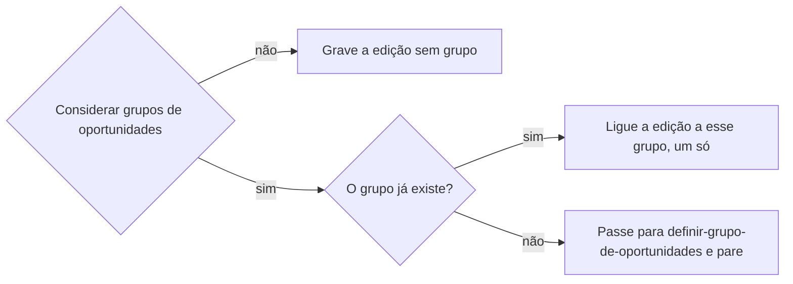

# Criar oportunidade

## Parâmetros de configuração

Leia cada valor nas instruções do projeto: primeiro na entrada com o nome desta habilidade, depois na entrada `Global` ou no primeiro nível do bloco. Quando um valor não estiver lá, use o padrão abaixo. `Considerar grupos de oportunidades` é `sim` ou `não`. `Ano mínimo da edição` vazio quer dizer sem limite.

```yaml
"Formato da data com dia da semana": "terça-feira, 01/09/2026"
"Considerar grupos de oportunidades": "sim"
"Ano mínimo da edição": ""
```

## Instruções

### Passo 1

A lista de oportunidades e o nome de cada propriedade vêm do mapeamento de dados do projeto, no workspace conectado. Se a lista não estiver nessa conexão, pare. Não use a lista de outro workspace. Este texto usa os conceitos: o título da edição, a data da edição, o grupo da edição, as variações de nome, os perfis da edição, o ingresso do visitante, a taxa do expositor, o link de inscrição, o e-mail da organização, os links não oficiais, a empresa ou local, a localidade, as notas de curadoria e a decisão humana.

Saber se já existe fica com `procurar-oportunidade`. Se a edição existe e o pedido é cadastrar, mostre essa página e pare. Não crie outra. Se o pedido é revisar, limpar, enriquecer, consolidar, reorganizar ou atualizar a edição, o conteúdo, o corpo ou as anotações, siga nessa página. O grupo fica com `definir-grupo-de-oportunidades`.

### Passo 2

Confira o mapeamento antes de gravar. O título da edição e a data da edição são obrigatórios. O grupo da edição também, quando `Considerar grupos de oportunidades` é `sim`. Se um obrigatório faltar no mapeamento, pare antes de criar e diga qual. Uma propriedade opcional que falta e para a qual o texto traz um valor: grave o resto e, no fim, liste esse valor e sugira criar a propriedade. Não crie a propriedade. Não grave o valor no corpo. Opcional sem valor no texto: nada a fazer.

### Passo 3

O título da edição começa pelo nome da edição, depois a data no formato da data com dia da semana, a cidade e, por fim, o grupo, quando há grupo. Não comece pelo grupo. Ano, número de edição e data entram nesse título quando separam uma data da outra. Dois dias entram os dois. A data da edição recebe o intervalo, com as horas. A data só no título não basta. Data anterior ao `Ano mínimo da edição` não entra.

### Passo 4

O grupo da edição depende de `Considerar grupos de oportunidades`.



Não crie o grupo aqui. Com `sim`, não salve a edição com o vínculo vazio. Página sem data na lista de oportunidades fica com `definir-grupo-de-oportunidades`, com `sim`.

Cada data é uma página na lista de oportunidades, com a data. Não crie outra página para seleção, inscrição, edital ou chamada. O conteúdo estável desse processo fica no grupo, com `sim`, ou na edição, com `não`. Formulário, valor ou vaga desta data ficam na edição. As variações de nome, quando a pessoa der, são uma lista de bullets, um nome alternativo por item, cada item com ponto e vírgula no fim. Mantenha as grafias úteis para a busca, com e sem sigla e com e sem ano.

### Passo 5

O que é desta data fica na edição: endereço, horário, valor, formulário e número de vagas. Um lugar visto numa data só não vira lugar padrão do grupo. Os perfis da edição só recebem a conta própria desta edição. O perfil oficial fica com `definir-grupo-de-oportunidades`, com `sim`. Não grave o cartaz nem a operação no corpo.

### Passo 6

Não preencha fórmula, rollup nem botão. Não invente categoria nem prioridade. O ingresso do visitante é o que paga quem visita. A taxa do expositor é o que paga quem expõe. Gratuidade para um público restrito, como compradores credenciados, não preenche nenhuma das duas. Sem URL no texto, o link de inscrição fica vazio. O e-mail da organização vai na propriedade dele. Links não oficiais recebem só URL. A empresa ou local e a localidade só recebem página que já existe. Não crie empresa nem localidade.

### Passo 7

Na edição, bloco de anotações, reunião, transcrição, resumo ou outro bloco de notas da pessoa fica inteiro. Não sugira apagar, arquivar, substituir, ocultar nem remover. O bloco é evidência, mesmo quando um fato dele também cabe numa propriedade. Na revisão do conteúdo, do corpo ou das anotações, leia o bloco para preencher a propriedade que a lista já tem. Data, localidade, empresa ou local, canal, links, taxa, variações de nome e decisão humana entram só quando o bloco afirma um valor que a propriedade já aceita. O comentário analítico vai nas notas de curadoria. O bloco não vira checklist, resumo nem texto operacional, e não se copia de novo no corpo. Se o bloco não basta para afirmar, a propriedade fica vazia e a pendência fica nas notas de curadoria. Não invente o dado nem a propriedade. O bloco do grupo fica com `definir-grupo-de-oportunidades`.

### Passo 8

Mostre o título, a data, o grupo, quando há, e o link. Liste os valores que ficaram sem propriedade. Não organize a participação. Não inscreva. Não crie tarefa. A resposta não pede para nomear a habilidade.

### Passo 9

Data de evento, compromisso, prazo, viagem, reserva, lançamento, entrega ou outro marco, na resposta, no resumo, na tabela, na descrição, no título ou em outro texto, sai no formato da data com dia da semana. Calcule e confira o dia com a data, o horário e o fuso do evento antes de escrever. Sem horário ou sem fuso, e se o dia puder mudar, peça. Não invente. Intervalo ou vários dias: o dia da semana em cada data. Se a fonte trouxer um dia da semana incompatível com a data, sinalize e confirme antes de criar ou alterar. A data da edição permanece um intervalo válido. O dia da semana é a camada extra para a pessoa.

## Problemas comuns

### Edição salva sem grupo

Se você salvar a edição com o grupo vazio enquanto `Considerar grupos de oportunidades` é `sim`, ou criar o grupo aqui, a data fica fora do grupo canônico.

1. Use uma página que já existe, no máximo uma.
2. Se não houver, passe para `definir-grupo-de-oportunidades`.
3. Não salve com o vínculo vazio. Com `não`, grave sem grupo.

### Propriedade ausente

Se você criar a propriedade, ou jogar o valor no corpo, porque o mapeamento não tem onde gravar, a lista muda sem a pessoa decidir.

1. Obrigatório ausente: pare antes de criar e diga qual.
2. Opcional ausente com valor: grave o resto e liste o valor no fim, com a sugestão.
3. Não crie a propriedade. Não grave no corpo.

### Página de processo

Se você criar na lista de oportunidades uma página só de seleção, inscrição, edital ou chamada, o processo vira uma edição falsa.

1. Não crie essa página.
2. O conteúdo estável fica no grupo, ou na edição sem grupos.
3. Formulário, valor ou vaga desta data ficam na edição.

### Página repetida

Se você cadastrar sem passar por `procurar-oportunidade`, a lista ganha a edição duas vezes.

1. Confirme que não existe.
2. Se existe, mostre essa página e pare.
3. Não crie outra com o mesmo nome e a mesma data.

### Data só no título

Se você escrever a data só no título, a data da edição fica vazia.

1. Grave o intervalo na propriedade, com as horas.
2. O título também leva dia, mês e ano.
3. Data anterior ao `Ano mínimo da edição` não entra.

### Cartaz no corpo

Se você colar o texto da imagem no corpo da página, a operação fica fora das propriedades.

1. O título, a data e o grupo vão nas propriedades.
2. O corpo não recebe o cartaz.
3. Sem URL, o link fica vazio.

### Bloco de anotações removido

Se você apagar, arquivar, substituir, ocultar ou remover o bloco de anotações ao revisar a edição, a evidência da pessoa some.

1. Mantenha o bloco inteiro, com o mesmo texto.
2. Fato estruturável pode ir para a propriedade.
3. Não copie o bloco de novo no corpo.

### Entrada trocada

Se você marcar a taxa do expositor ou o ingresso do visitante porque um público restrito entra de graça, a taxa ou o ingresso sai errado.

1. Gratuidade para um público restrito não preenche essas duas.
2. Deixe as duas vazias quando o texto não disser a taxa de quem expõe nem o ingresso de quem visita.
3. Não invente o valor.

### Data sem o dia da semana

Se você escrever a data numérica sem o dia da semana, ou aceitar um dia da semana que não bate com a data, a pessoa lê a edição errada.

1. Calcule o dia com a data, o horário e o fuso.
2. Escreva no formato da data com dia da semana em cada data, inclusive no título.
3. Se divergir, sinalize e confirme antes de criar ou alterar. A data da edição permanece um intervalo válido.

## Exemplos de entrada e saída

Estes exemplos ilustram fatos. Eles podem não estar no data source.

### a oportunidade Festival Rota Sul não existe na lista de oportunidades. Datas 29 de setembro de 2026 a 30 de setembro de 2026, das 09h às 19h, no Centro de Eventos Aurora, Rua das Flores, 100, Cidade Exemplo. Entrada gratuita para compradores credenciados.

a edição não existia. O grupo foi para `definir-grupo-de-oportunidades`. A edição entrou com a data, o endereço e o horário. No título e na resposta, terça-feira, 29/09/2026 e quarta-feira, 30/09/2026. A data da edição ficou o intervalo válido. Sem página de inscrição. O ingresso do visitante e a taxa do expositor ficaram vazios. O vínculo aponta para um grupo só.

### Considerar grupos de oportunidades é não. Cadastre o Festival Rota Sul de 29 de setembro de 2026.

a edição entrou sem grupo, com a data no título e na data da edição. Não passei para `definir-grupo-de-oportunidades`.

### o mapeamento não tem as notas de curadoria. O texto traz um comentário sobre o público do evento.

gravei a edição com o resto. No fim, listei o comentário sem propriedade e sugeri criar as notas de curadoria. O corpo não recebeu o comentário.

### revise as anotações da edição. O bloco diz que o evento foi em Cidade Exemplo, sem dia e sem valor.

localidade só entra se a página já existe. Data e taxa ficaram vazias. A pendência ficou nas notas de curadoria. O bloco ficou inteiro.

### a fonte diz segunda-feira, 01/09/2026

01/09/2026 é terça-feira. Sinalizei a divergência e confirmei antes de criar ou alterar. A data da edição ficou um intervalo válido. No título e na resposta, usei o formato da data com dia da semana.

## Casos-limite

- A edição já existe e o pedido é cadastrar: mostre a página e pare. Não crie outra.
- `Considerar grupos de oportunidades` é `sim` e não há grupo: pare e passe para `definir-grupo-de-oportunidades`. Não crie o grupo aqui.
- `Considerar grupos de oportunidades` é `não`: grave sem grupo e não chame `definir-grupo-de-oportunidades`.
- O mapeamento não tem o título, a data ou, com `sim`, o grupo: pare antes de criar e diga qual.
- A data é anterior ao `Ano mínimo da edição`: não grave. Pergunte.
- Dois dias com hora: a data da edição recebe o intervalo, com as horas. Cada data no texto leva o próprio dia da semana.
- O texto não traz URL: o link de inscrição fica vazio.
- A empresa ou a localidade não está na lista: pergunte. Não crie essa página aqui.
- Seleção, inscrição, edital ou chamada: não vira página na lista de oportunidades.
- A página já tem bloco de anotações, reunião, transcrição ou resumo: ele fica inteiro. Um fato dele pode ir para a propriedade.
- O bloco não afirma o valor: a propriedade fica vazia. A pendência vai nas notas de curadoria.
- Conta própria desta edição: perfis da edição. Perfil oficial fica com `definir-grupo-de-oportunidades`.

## Pegadinhas

- Entrada gratuita para um público restrito parece o ingresso do visitante ou a taxa do expositor. Não é nenhuma das duas.
- O corpo da página parece o lugar do cartaz, ou do valor sem propriedade. As propriedades recebem o fato novo. O valor sem propriedade vai para a lista do fim. O bloco de anotações que já está lá fica.
- O bloco de anotações parece rascunho que a limpeza apaga. Ele é evidência da pessoa. A propriedade recebe a cópia, e o bloco permanece.
- Começar o título pelo grupo deixa as linhas iguais. O nome da edição vem primeiro.
- A data numérica parece bastar. O título e a resposta levam o dia da semana, calculado com a data, o horário e o fuso. A data da edição continua um intervalo válido.
- Data anterior ao `Ano mínimo da edição` parece válida. A propriedade não aceita.
- "Link na bio" parece um endereço. Sem URL, o campo fica vazio.
- Uma propriedade ausente parece pedir para ser criada. Esta habilidade não cria schema. Ela sugere.
- Seleção, inscrição, edital e chamada parecem outra oportunidade. São conteúdo do grupo ou da edição.
- Criar o grupo junto da edição parece um passo só. O grupo fica com `definir-grupo-de-oportunidades`.

## Scripts disponíveis

- Nenhum.

1. Não há script para executar.
