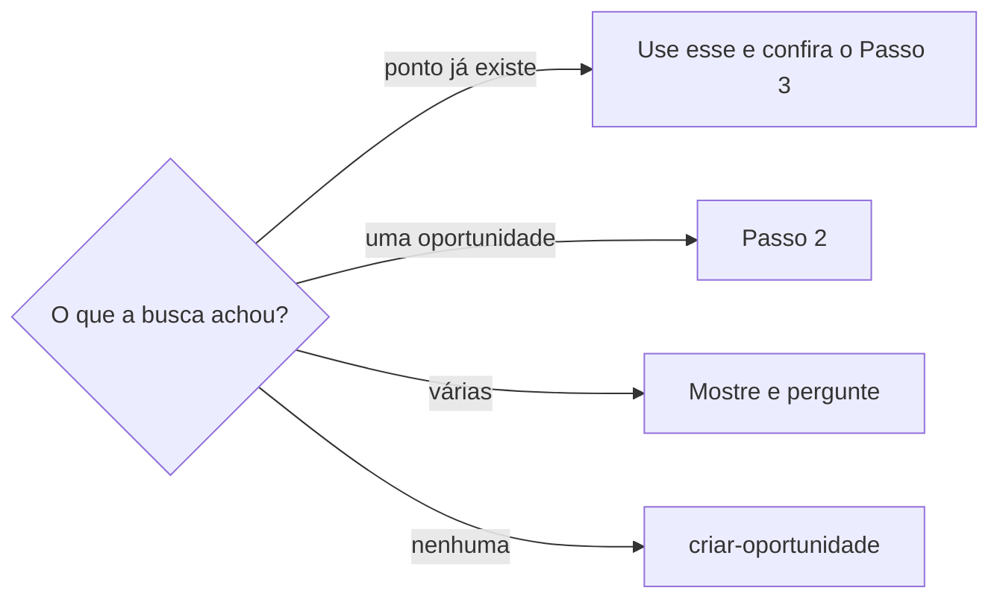

# Criar ponto de contato

## Parâmetros de configuração

Leia cada valor nas instruções do projeto: primeiro na entrada com o nome desta habilidade, depois na entrada `Global` ou no primeiro nível do bloco. Quando um valor não estiver lá, use o padrão abaixo.
```yaml
"Formato da data com dia da semana": "terça-feira, 01/09/2026"
# `Relação geral padrão das despesas` é a relação que a despesa de uma atividade formativa sem venda usa no lugar do ponto de contato. Vazio: pergunte uma vez.
"Relação geral padrão das despesas": ""
```
## Instruções

### Passo 1

As listas e o nome de cada propriedade vêm do mapeamento de dados do projeto.
O ponto de contato nasce de uma oportunidade que existe e que a pessoa nomeou ou colou.
Se a pessoa passou o link, essa é a página.
Sem link, busque o pedaço do nome nas duas listas, a lista de pontos de contato e a lista de oportunidades, em consulta direta e em busca semântica. Uma variação em Variações de nome conta como a mesma oportunidade.
Se uma das listas não estiver no workspace conectado, pare. Não use a lista de outro workspace.



Não invente a página. Não crie outro ponto com o nome de um que já existe.

Antes de criar ou relacionar o ponto, distinga a oportunidade do ponto de venda. Ponto de venda é a feira, o pop-up, o corner, a loja física, a loja virtual, o social commerce, o marketplace ou outra operação em que produtos do negócio são oferecidos à venda. Uma oportunidade, um programa ou um evento com aulas, cursos, oficinas, palestras, mentorias, reuniões, encerramentos ou outra atividade formativa não prova venda. A despesa, o deslocamento, a alimentação, a hospedagem, o cronograma ou a participação ligados a eles também não provam. Inscrição, local, data ou custo idem.

1. Pergunte à pessoa se a atividade também funcionou como ponto de venda físico ou digital do negócio. Explique que «feira» aqui é qualquer ponto de venda físico ou digital, não qualquer evento.
2. Houve venda: siga o Passo 2.
3. Não houve venda: não crie nem associe ponto de contato. A atividade fica ligada à oportunidade e ao cronograma. Oriente `lancar-despesa-da-empresa` a usar a `Relação geral padrão das despesas`.
4. Ambiguidade: interrompa e peça a confirmação explícita. Não decida sozinho.

### Passo 2

O título vai em Nome, no padrão de título dos pontos vizinhos.
Ligue a oportunidade, uma só, e as demais relações que o mapeamento do ponto de contato exige, copiando-as da página da oportunidade.
Grupo de oportunidade que não veio fica com `definir-grupo-de-oportunidades`. Não invente.
Não preencha fórmula, rollup nem botão. Não escreva a oportunidade nem o contrato no corpo da página.

O número do título é o maior número que aparece no nome dos pontos da lista mais um.
A ordem visual pode estar vazia num ponto antigo, e uma ordenação a põe por último. Leia também os nomes antes de numerar e não repita o número de outro ponto.
Preencha a ordem visual com o mesmo número do título.
Preencha o ciclo com o período que contém a data de início da execução, ou a da oportunidade quando o ponto não tem data. O ciclo do trimestre anterior esconde o ponto no trimestre certo.
Ponto sem ciclo ou sem ordem visual some das visões da lista, que filtram e ordenam por esses campos.

O status começa em Não iniciada, salvo se a pessoa disser outro que a lista já tem.
Participação confirmada, reserva ou pré-produção citadas nas páginas não mudam o status.

O início da execução só entra quando a pessoa disse a data ou quando a oportunidade a traz confirmada. O fim só entra com a data dita.
Uma reserva provisória não é data confirmada: pergunte, ou deixe vazio e diga que ficou vazio.
O dia do lembrete não é a data do ponto.
A pessoa que disse o dia, ou a reunião que traz o horário de abertura, já bastam: grave o início com data e hora.
Sem horário, grave só a data, como data única. Não grave intervalo do dia com ele mesmo.

### Passo 3

Vale ao criar e ao achar um ponto que já existe.

1. Sem ciclo: preencha o ciclo sem perguntar, pela data de início do ponto ou da oportunidade, e diga o que preencheu. Sem data para escolher, pergunte.
2. Ordem visual vazia: preencha com o número do nome, quando nenhum outro ponto o usa.
3. Número repetido no nome: renumere sem perguntar. Fica com o número o ponto mais antigo, e o mais novo recebe o maior número mais um, no nome e na ordem visual. Diga o que renumerou.
4. Início da execução vazio: diga isso, com o que falta para preencher. Com o dia e o horário sabidos, grave.
5. Início em intervalo do dia com ele mesmo e sem horário: troque por data única.
6. Data já passada com status de fase anterior à execução: pergunte qual status vale. Não escolha sozinha.

### Passo 4

Mostre o nome, o status e o link do que criou ou corrigiu, com o que preencheu sem perguntar.
Diga o que ficou vazio e o que depende de uma resposta.
A data do evento na resposta sai no formato da data com dia da semana. Calcule e confira o dia com a data, o horário e o fuso antes de responder. Não copie esse dia para o início da execução.
Não marque a tarefa como concluída.
Os itens do cronograma de horários, como montagem, início, fim, desmontagem e blocos, ligam sempre à oportunidade e, havendo ponto de contato correspondente, também a ele. A atividade formativa sem ponto de venda liga só à oportunidade.
Gravar o evento na agenda fica com `organizar-ponto-de-contato`, que segue `definir-agenda`.

## Problemas comuns

### Status ou data inventados na criação

Se você criar o ponto com o status da fase que a oportunidade sugere, ou com a data de uma reserva provisória, a página nasce com um fato que a pessoa não disse.

1. O status começa em Não iniciada, salvo o que a pessoa disser.
2. O início da execução só entra quando a pessoa disse a data ou a oportunidade a traz confirmada.
3. Reserva provisória não é data: pergunte, ou deixe vazio e diga que ficou vazio.
4. Início vazio: diga na resposta. Sem horário, grave só a data, como data única.

### Ponto criado fora das visões

Se você numerar só pela ordem visual ou deixar o ciclo e a ordem visual vazios, o número se repete e o ponto não aparece na visão por trimestre.

1. Numere pelo maior número nos nomes dos pontos, mais um.
2. Preencha a ordem visual com esse número e o ciclo do período da data de início.
3. Ao achar ponto existente sem ciclo, preencha sem perguntar e diga. Número repetido no nome: renumere sem perguntar e diga.

### Status que ficou para trás

Se você deixar o status de fase anterior num ponto cuja data já passou, a lista mostra uma fase que acabou.

1. Diga ao achar.
2. Pergunte qual status vale. O fechamento do caixa depende de outras etapas, então não escolha sozinha.

### Atividade formativa virou ponto de venda

Se você criar o ponto de contato porque a oportunidade tem inscrição, cronograma, local, data ou custo, a lista ganha um ponto comercial em que nada foi vendido.

1. Pergunte se houve venda física ou digital antes de criar ou relacionar.
2. Sem venda, não crie nem associe o ponto. A atividade fica na oportunidade e no cronograma.
3. Oriente a despesa a usar a `Relação geral padrão das despesas`.

### Página repetida

Se você criar outro ponto com o nome de um que já existe, a lista ganha a edição duas vezes.

1. Busque o pedaço nas duas listas antes de criar.
2. Se já existe, use essa página e confira o Passo 3.
3. Se houver várias, pergunte. Não invente.

### Início vazio em silêncio

Se você terminar a criação com o início da execução vazio e não disser nada, a pessoa só descobre quando procura a data.

1. Diga na resposta que ficou vazio.
2. Diga o que falta para preencher.

## Exemplos de entrada e saída

Estes exemplos ilustram fatos. Eles podem não estar no data source.

### crie a página nos pontos de contato dessa oportunidade

Busquei o pedaço do nome nas duas listas e achei uma oportunidade.
Numerei o ponto pelo maior número nos nomes mais um e liguei a oportunidade.
Preenchi a ordem visual e o ciclo do período da data.
Deixei o status em Não iniciada e o início vazio, porque a data era só uma reserva provisória.
Mostrei o nome, o status e o link, disse que o início ficou vazio e perguntei a data.

### esse ponto não aparece na visão por trimestre

O ponto estava sem ciclo e sem ordem visual.
Preenchi o ciclo pela data de início e a ordem visual pelo número do nome, e disse o que preenchi.

### os dois pontos estão com o número 34

Mantive o número no mais antigo e renumerei o mais novo para o maior número mais um, no nome e na ordem visual. Disse o que mudou.

### o evento já passou e o ponto está em pré-produção

Perguntei qual status vale. Não mudei sozinha.

## Casos-limite

- A lista não está no workspace conectado: pare. Não use a lista de outro workspace.
- Nenhuma oportunidade: não crie aqui. Cadastrar fica com `criar-oportunidade`.
- Várias oportunidades com o mesmo pedaço: pergunte. Não escolha sozinho.
- O ponto já existe: não crie outro. Confira o Passo 3.
- A pessoa não deu a data e a oportunidade não a traz: crie sem início e diga que ficou vazio. O ciclo, sem data, a pessoa responde.
- A data é só reserva provisória: início vazio, dito na resposta.
- O dia da semana da fonte não bate com a data: sinalize. Não grave esse dia no campo do início.
- O pedido é saber se a oportunidade existe: siga `procurar-oportunidade`.
- O pedido é o que falta organizar, o evento na agenda ou a viagem: siga `organizar-ponto-de-contato`.
- Aula, curso, oficina, reunião ou outra atividade em que a empresa não vende: as instruções do projeto podem restringir o que vira ponto de contato. Na dúvida, confirme com a pessoa antes de criar.
- A pessoa confirma que não houve venda: não crie nem associe ponto de contato, e a despesa usa a `Relação geral padrão das despesas`. Sem esse valor, pergunte uma vez.

## Pegadinhas

- Existir oportunidade, inscrição, cronograma, local, data ou custo parece provar que houve venda. Não prova: pergunte.
- Participação confirmada na oportunidade parece pedir um status adiantado. O status de um ponto novo é Não iniciada, salvo o que a pessoa disser.
- A ordem visual parece dizer o próximo número. Ela pode estar vazia num ponto antigo. O número vem do nome.
- O ciclo parece detalhe. Sem ele o ponto some da visão por trimestre.
- O ciclo do trimestre atual parece servir. O ciclo é o do período da data de início.
- Uma reserva na agenda parece data de execução. Reserva provisória não é data confirmada.
- O dia do lembrete parece a data do ponto. É o prazo da tarefa.
- Um intervalo de um dia só parece data. Sem horário, é data única.

## Scripts disponíveis

- Nenhum.

1. Não há script para executar.
