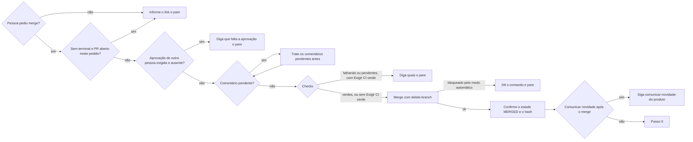

# Criar pull request

## Parâmetros de configuração

Leia cada valor nas instruções do projeto: primeiro na entrada com o nome desta habilidade, depois na entrada `Global` ou no primeiro nível do bloco. Quando um valor não estiver lá, use o padrão abaixo. `Repositório` vem do remoto `origin` quando as instruções não dizem.

```yaml
"Repositório": ""
"Branch base": "main"
"Tipo de merge": "squash"
"Idioma do PR": "inglês"
"Comando de testes": ""
"Comando de build": ""
"Timeout do push (ms)": 600000
"Duração do hook de pre-push (min)": 0
# `Pular o hook de pre-push`: `não` espera o hook. `sim` publica sem ele quando o commit já passou no Passo 2.
"Pular o hook de pre-push": "não"
"Exigir CI verde": "sim"
"Exigir aprovação de outra pessoa": "só sem terminal"
"Comunicar novidade após o merge": "sim"
# `Habilidade que pede a revisão`: nome da habilidade que pede a revisão de um PR pronto, ou vazio quando ninguém pede.
"Habilidade que pede a revisão": ""
# `Atribuição da sessão`: `sim` põe a linha da sessão. `não` nunca põe linha de ferramenta.
"Atribuição da sessão": "sim"
# `Atribuir o PR a quem abre`: `sim` quando o PR sai atribuído a quem o abre.
"Atribuir o PR a quem abre": "sim"
# `Rotular o PR`: `sim` quando o PR sai com o rótulo que melhor descreve a mudança.
"Rotular o PR": "sim"
# `Criar rótulo se nenhum servir`: `sim` cria um rótulo novo se nenhum existente descreve a mudança.
"Criar rótulo se nenhum servir": "não"
# `Termos que não podem aparecer`: palavras que não podem estar no PR nem nos arquivos. Vazio, não há busca.
"Termos que não podem aparecer": []
# `Fatiar por subtarefa`: `não` junta a mesma pergunta de revisão. `sim` abre um PR por subtarefa.
"Fatiar por subtarefa": "não"
# `PR que depende de outro`: `empilhar` abre contra a branch do PR anterior. Vazio não empilha outra demanda.
"PR que depende de outro": ""
# `Refatiar PR já aberto`: como mudar o corte de um PR aberto, sem renomear a branch nem fechar e reabrir.
"Refatiar PR já aberto": ""
# `Criar pull request ao terminar`: `rascunho`, `sim` ou `não`. O merge não entra aqui.
"Criar pull request ao terminar": "rascunho"
"Modo de aprendizado": "perguntar"
```

## Instruções

Nada entra na `Branch base` sem pull request. Nunca dê push na `Branch base`, nem com pedido explícito. Nunca substitua a história da `Branch base`. Toda mudança chega por PR mesclado com `Tipo de merge`.

### Passo 1

Leia o `CONTRIBUTING.md` e o `AGENTS.md` do repositório e siga o que eles dizem de branch, título, descrição e checks: a convenção documentada vale mais que a preferência pessoal.
Com `Fatiar por subtarefa` em `não`, a mesma pergunta de revisão fica no mesmo pull request. Siga `fatiar-pull-request`.
Com `sim`, abra um PR por subtarefa. Um PR que depende de outro segue `PR que depende de outro`.
Antes de criar a branch, confira se a demanda tem uma tarefa no rastreador do projeto, quando o projeto usa um.
Sem tarefa, sugira criá-la antes do PR e espere a resposta: a chave entra no nome da branch e no título do PR conforme a convenção do repositório.
Se o PR já está aberto sem tarefa, diga isso e proponha criá-la depois.

Se a branch atual for a `Branch base`, crie uma branch a partir da `Branch base` remota atualizada antes de qualquer commit, sem rastrear a base.

O nome da branch é `<tipo>/<descrição>`.
O tipo é o do Conventional Commits do commit principal: `feat`, `fix`, `docs`, `refactor`, `perf`, `test`, `chore` ou `ci`.
A descrição é ASCII em kebab-case.
Branch com outro prefixo, como `claude/` ou `cursor/`, que a ferramenta criou, é renomeada antes do push.
Não abra PR de branch fora desse padrão.
Se ela já tem PR aberto, renomear no GitHub fecha esse PR: abra um PR novo da branch renomeada, com o mesmo título e corpo, e comente no antigo o link do novo.

### Passo 2

Antes do commit, rode o `Comando de testes` e o `Comando de build` quando existirem. Se a mudança corrige um bug, confirme que o teste novo falha sem a correção e passa com ela. Guarde o hash do commit que passou nas duas verificações.

### Passo 3

Commite seguindo `criar-commit`.

### Passo 4

Se a branch já tem PR ou está atrás da `Branch base`, siga `atualizar-branch-do-pull-request` antes do push.

### Passo 5

Com `Criar pull request ao terminar` em `rascunho`, o padrão, a mudança de código já autoriza o push da branch e a abertura do pull request em rascunho.
Com `sim`, o push e o pull request pronto.
Com `não`, só publique com pedido explícito.
Pedir "faça o PR", "sobe isso" ou "coloca na main" autoriza o push da branch, nunca da `Branch base`.
"coloca na main" continua sendo o pedido de merge.
O parâmetro não mescla.
Se `Duração do hook de pre-push (min)` for maior que zero, avise antes quanto o hook leva, para a pessoa não achar que travou.
Com `Pular o hook de pre-push` em `não`, o push espera o hook. Com `sim`, e o commit já passou no Passo 2, publique sem o hook e diga isso. A checagem de skill continua no pre-commit. Deixe o hook rodar em segundo plano, com `Timeout do push (ms)`.
Teste antes o acesso ao remoto com a credencial do `gh`. Faça o push com essa credencial.

### Passo 6

Antes de abrir, procure cada termo de `Termos que não podem aparecer` nos arquivos novos e alterados e no texto do PR fora dos endereços `https://`, sem diferenciar maiúsculas.
A busca e a lista de rótulos estão em `Scripts disponíveis`.
Um achado fora do endereço volta para correção e o PR não abre. Run, job, pull request e commit citados levam o endereço `https://`, mesmo com termo da lista no caminho.

Abra o PR contra a `Branch base` no `Repositório`.
O título começa igual ao assunto do commit.
Corpo em `Idioma do PR`.
Com issue, o pull request e o merge request citam `#<número>` na descrição, na forma do repositório.
Sem issue, não invente número.
Se o repositório tiver um template de pull request, siga as seções dele e marque as caixas conforme o que foi feito.
Depois do push, uma vez, confira o título e a descrição contra o código que subiu. Vários commits no mesmo push são uma conferência só. Se um dos dois deixou de contar o que a branch faz, atualize os dois antes de responder.

Com `Atribuição da sessão` em `sim`, termine com a linha de atribuição da sessão.
Com `não`, não ponha linha de ferramenta ou de modelo, e remova a que o PR já tiver na mesma edição.

Com `Atribuir o PR a quem abre` em `sim` e `Rotular o PR` em `sim`, o comando que abre o PR, em `Scripts disponíveis`, já leva a pessoa atribuída e o rótulo.
O rótulo é o do tipo do commit.
`fix` usa o rótulo de bug.
`docs` usa o de documentação.
A extensão do arquivo não escolhe o rótulo.

Não abra o PR para rotular depois.
Se nenhum rótulo serve, só crie um novo com `Criar rótulo se nenhum servir` em `sim`.
Com `não`, diga na resposta que nenhum serviu e não abra o PR sem rótulo.
Um PR que já estava aberto sem pessoa atribuída ou sem rótulo recebe os dois antes de qualquer outra edição.
Mande o link na resposta.

### Passo 7

Depois de abrir, leia o status do PR pelas ferramentas de PR do app e vincule o PR se ele não aparecer. Não fique consultando o CI em loop.

Com `Habilidade que pede a revisão` preenchida e o PR fora do rascunho, siga essa habilidade para o PR aberto e entregue o que ela devolver, como o rascunho do pedido. Um PR em rascunho não pede revisão.

### Passo 8



`Exigir aprovação de outra pessoa` vale `nunca`, `só sem terminal` ou `sempre`. A aprovação é de outra pessoa no PR: check verde não conta, e ser dona do repositório não dispensa.
Comentário pendente é thread de revisão sem resolver, revisão que pede mudança ou comentário da conversa sem resposta, de pessoa ou de bot. Aviso de bot que só informa, como link de preview, não conta. Thread que espera decisão da pessoa segura o merge até ela decidir.
Leia os checks uma vez. Se estiverem pendentes, não espere em loop: diga quais faltam e pare. Com `Exigir CI verde` igual a `não`, mescle mesmo assim e diga na resposta quais checks não passaram.
Mescle só com `Tipo de merge`. Se o modo automático negar o merge, não tente de outro jeito: nada de auto-merge, API ou outra ferramenta. Entregue o comando pronto e diga que a decisão é da pessoa.
Se o projeto sincroniza o repositório com outra ferramenta, como as páginas de habilidade no Notion, confira a sincronização depois do merge.
Com `Comunicar novidade após o merge` igual a `sim`, siga `comunicar-novidade-do-produto` para o PR mesclado. Faça o mesmo quando a pessoa avisar que mesclou: confirme o estado MERGED antes.

### Passo 9

Na resposta final, abra com o link do PR, `[#123](url)`, e depois informe o nome da branch, se ela está no GitHub e o hash de cada commit, e diga o estado de cada etapa: commit, push, PR, quem foi atribuído, o rótulo, CI e merge.
Cada PR citado, inclusive na pergunta sobre quem mescla, vai como link clicável em markdown, com o número no texto, como `[#123](url)`. Nunca `#123` solto nem só a URL.
Se perguntarem "já mesclou?", responda primeiro sim ou não e depois o que falta.
Com `Criar pull request ao terminar` em `rascunho`, o padrão, a branch está no GitHub, o pull request está aberto em rascunho e a resposta leva o link.
Com `sim`, o pull request está aberto pronto e a resposta leva o link.
Com `não` e sem pedido de publicação, o estado do pull request é que ele não está aberto.
Diga se esta habilidade foi chamada.
Não escreva que ela ficou para este pedido, nem para depois.

### Passo 10

Ao terminar, siga `sincronizar-status-da-tarefa` e depois `evoluir-habilidade` conforme `Modo de aprendizado`.

## Problemas comuns

### Conferência a cada commit

Se você conferir o título e a descrição a cada commit, a conferência gasta token antes do push e se repete.

1. Faça os commits sem essa conferência.
2. Depois do push, confira uma vez e atualize o que deixou de contar o que a branch faz.

### PR aberto sem rótulo

Se você abrir o pull request e só depois escolher o rótulo, o PR fica sem rótulo.

1. Leia os rótulos do repositório antes de abrir.
2. Com `Atribuir o PR a quem abre` e `Rotular o PR` em `sim`, o comando que abre já leva `--assignee` e `--label`.
3. Não trate o PR como aberto enquanto o rótulo estiver faltando.

### Frase que adia a habilidade

Se você escrever que a habilidade ficou para este pedido, ou para depois, a pessoa não sabe se ela foi chamada.

1. Diga se esta habilidade foi chamada.
2. Com `Criar pull request ao terminar` em `rascunho`, suba a branch e abra o pull request em rascunho. Com `sim`, abra o pull request pronto. Com `não` e sem pedido de publicação, diga o nome da branch e que ele não está aberto.
3. Não use a expressão "ficou para este pedido".

### Push parado sem saída

Se você der push por HTTPS e o comando ficar minutos sem saída, o helper de credencial do sistema está esperando um prompt que nunca aparece.

1. Encerre o push parado.
2. Teste o acesso ao remoto com prompt de terminal desligado e a credencial do `gh`.
3. Refaça o push com a mesma credencial.

### Push estoura o tempo da ferramenta

Se você rodar o push em primeiro plano com o tempo padrão, o hook de pre-push passa do limite e o comando vai para segundo plano sem aviso.

1. Rode o push com `Timeout do push (ms)` ou em segundo plano.
2. Avise a pessoa quanto tempo vai levar.
3. Espere a notificação. Não fique consultando em loop.

### Pessoa sem notícia

Se você esperar o hook ou o CI sem dizer nada, a pessoa entende que você está enrolando.

1. Antes de cada espera longa, diga o que está rodando e quanto tempo leva.
2. Se o passo repete uma verificação já feita no mesmo commit, pule e diga isso.

### Merge negado

Se você repetir o merge por outro caminho depois que o modo automático negou, está contornando a decisão.

1. Pare.
2. Entregue o comando de merge pronto.
3. Diga que a pessoa pode mesclar pelo botão do PR ou liberar o comando nas permissões.

## Exemplos de entrada e saída

Estes exemplos ilustram fatos. Eles podem não estar no data source.

### Faça o PR pra corrigir isso

Branch `fix/…` a partir da base, testes e build no commit, commit no idioma do projeto, push com a credencial do `gh`, PR aberto e o link na resposta. Sem merge, porque a pessoa não pediu.

### O código mudou e o título ficou no texto antigo

O push levou vários commits. Conferi o título e a descrição uma vez, depois do push, e atualizei os dois antes de responder.

### Só coloca isso na main

O pedido autoriza push e merge. O push espera o hook de pre-push. PR aberto, merge com `Tipo de merge`. Se o modo automático negar, o comando de merge vai pronto na resposta.

## Casos-limite

- Já existe PR aberto para a branch: não abra outro. Depois do push, confira título e descrição uma vez, atualize o que deixou de contar o que a branch faz, e dê o link.
- O PR da branch já foi mesclado: siga `atualizar-branch-do-pull-request`, que não dá rebase nem push nessa branch.
- A branch atual tem trabalho de outra tarefa: comece a nova branch da `Branch base` remota, não da branch atual.
- A ferramenta criou a branch com outro prefixo, como `claude/…`: renomeie para `<tipo>/<descrição>` antes do push. Com PR aberto, a renomeação fecha o PR: abra outro e ligue os dois.
- O teste novo passa também sem a correção: o teste não cobre o bug. Reescreva antes do commit.
- A pessoa pede para não commitar: pare antes do Passo 3.
- A pessoa pede para subir direto na `Branch base`: não suba. Abra o PR e explique a regra.
- Sem terminal: a branch e o commit vêm de `criar-commit`, pela integração do GitHub. Pule os Passos 2, 4 e 5, abra o PR do Passo 6 pela mesma integração, entregue o link e pare. Os checks do CI no PR testam a mudança.

## Pegadinhas

- Número ou hash curto, no lugar do endereço do Passo 6, obriga a pessoa a procurar. `#<número>` no commit e na descrição é a issue.
- `git switch -c <branch> origin/<base>` faz a branch rastrear a base. Use `--no-track` e publique com `push -u origin <branch>`.
- O prefixo que a ferramenta deu parece o nome da branch. Quem manda é o tipo do commit.
- O push por HTTPS pode travar para sempre no helper de credencial do macOS. A credencial do `gh` funciona.
- Não existe `timeout` no macOS. Use o timeout da ferramenta ou rode em segundo plano.
- Um hook de pre-push pode rodar também no push que só apaga uma branch remota.
- Um Markdown parece documentação. O rótulo segue o tipo do commit. Correção de erro é `fix` e o rótulo de bug. `docs` e o rótulo de documentação ficam para a documentação.
- Conferir a cada commit parece necessário. A conferência é uma vez, depois do push.

## Scripts disponíveis

- `Comando de testes` e `Comando de build`: verificações do Passo 2.
- `git fetch origin && git switch --no-track -c <branch> origin/<Branch base>`: Passo 1.
- `git branch -m <tipo>/<descrição>`: renomeia a branch local no Passo 1.
- `gh api -X POST repos/<Repositório>/branches/<branch>/rename -f new_name=<tipo>/<descrição>`: Passo 1. Fecha o PR. Abra outro depois.
- `GIT_TERMINAL_PROMPT=0 git -c credential.helper= -c 'credential.helper=!gh auth git-credential' ls-remote origin HEAD`: teste de acesso do Passo 5.
- `GIT_TERMINAL_PROMPT=0 git -c credential.helper= -c 'credential.helper=!gh auth git-credential' push -u origin <branch>`: push do Passo 5. O hook de pre-push roda.
- `LEFTHOOK=0 GIT_TERMINAL_PROMPT=0 git -c credential.helper= -c 'credential.helper=!gh auth git-credential' push -u origin <branch>`: só com `Pular o hook de pre-push` em `sim`.
- `git grep -i -E "termo1|termo2"`: Passo 6.
- `gh label list --repo <Repositório>`: rótulos do Passo 6.
- `gh pr create --repo <Repositório> --base <Branch base> --head <branch> --title "<assunto>" --body "<corpo>" --assignee <pessoa> --label <rótulo>`: Passo 6. Sem assignee ou rótulo, tire a flag.
- `gh pr edit <número> --repo <Repositório> --title "<título>" --body "<corpo>"`: atualiza o título e a descrição no Passo 6.
- `gh api graphql -f query='query{repository(owner:"<dono>",name:"<nome>"){pullRequest(number:<número>){reviewDecision reviewThreads(first:100){nodes{isResolved}}}}}'`: threads sem resolver e pedido de mudança do Passo 8.
- `gh pr checks <número> --repo <Repositório>`: checks do Passo 8.
- `gh pr merge <número> --repo <Repositório> --<Tipo de merge> --delete-branch`: Passo 8.

1. Rode as verificações, depois a atualização da branch, o teste de acesso, o push, a conferência do título e da descrição, a criação ou a atualização do PR e, só com pedido, os comentários, os checks e o merge.
