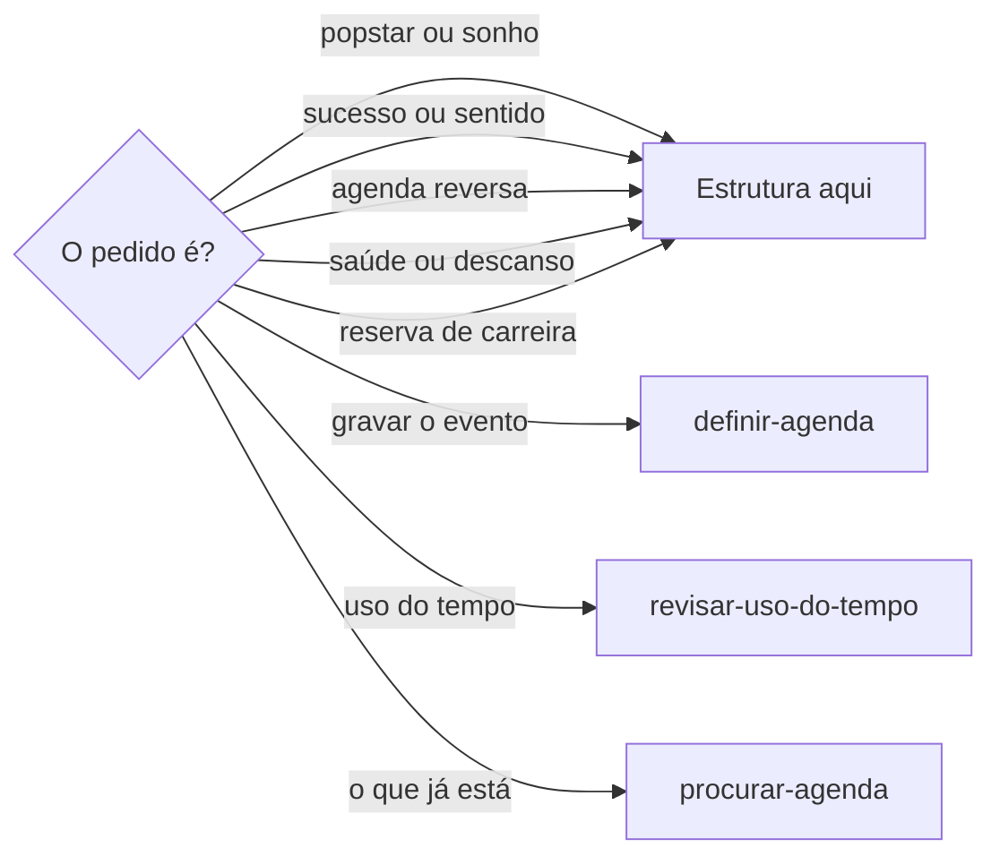

# Definir agenda de popstar

## Parâmetros de configuração

Leia cada valor nas instruções do projeto: primeiro na entrada com o nome desta habilidade, depois na entrada `Global` ou no primeiro nível do bloco. Quando um valor não estiver lá, use o padrão abaixo.
```yaml
"Revisão do bloqueio": mais de 6 meses
# `Segmento` é o segmento da carreira, como moda ou música. Vazio quer dizer que o segmento é o que a pessoa nomeia.
"Segmento": ""
# `Atividades do segmento` lista o que a agenda desse segmento inclui.
"Atividades do segmento": []
# `Critério de sentido` é a frase que pesa cada compromisso.
"Critério de sentido": "Não faça um sucesso, faça história"
# `Compromissos de vida` lista o que um bloco de carreira não apaga.
"Compromissos de vida":
  - "alimentação"
  - "exercícios"
  - "exames e consultas"
  - "tratamentos prescritos"
  - "espiritualidade"
  - "família"
  - "animais de estimação"
  - "relacionamento amoroso"
  - "amizades"
  - "descanso"
```
## Instruções

### Passo 1

As listas e o nome de cada propriedade vêm do mapeamento de dados do projeto. Aplicar a agenda de popstar, agendar o sucesso, montar a agenda reversa, encontrar o sentido e proteger saúde, descanso e relação pessoal é esta habilidade. Cada bloco definido aqui é gravado por `definir-agenda`. Esta habilidade não cria o evento.



### Passo 2

Estas definições vêm da agenda de popstar. Ela transforma intenção em estrutura. Combina o segmento, o negócio, a comunicação, o dinheiro, a saúde, o afeto e o descanso para sustentar uma carreira possível no longo prazo. O segmento é o `Segmento` das instruções do projeto, ou o que a pessoa nomeia. Sem nenhum dos dois, pergunte. Não troque o segmento.
Sonho e objetivo viram marco, compromissos, responsáveis, duração e evidências de conclusão. Só o que a pessoa ou a fonte nomeou. Técnica e paixão ficam. A organização sustenta as duas. Se faltar marco, compromisso, responsável, duração ou evidência, peça. Não invente a pessoa, a duração nem a evidência. Não complete a carreira. Carreira, lançamento, oportunidade, atividade cultural, comunicação, compromisso comercial, retorno financeiro, saúde, descanso, relação pessoal e data significativa entram só quando a pessoa ou a fonte afirma.

### Passo 3

Agenda reversa: a pessoa responsável pela entrega, pelo produto, pela apresentação ou pelo lançamento escolhe a data final. As dependências voltam dessa data, de trás para frente, no tempo que a pessoa ou a fonte nomeou. A margem para revisão e imprevistos entra nesse tempo nomeado. Sem o marco, peça antes. Sem o tempo de uma etapa, peça. Sem a margem, peça. Não invente a antecedência nem a folga. Cada etapa segue o flowchart, em `definir-agenda`.
A resposta da agenda reversa leva a data marco, as etapas, as dependências, a margem, o custo previsto e o critério de conclusão, mais o resumo curto e o fuso usado. Sem custo previsto ou sem critério de conclusão, peça. Não invente o custo nem o critério. O estado de cada evento gravado sai na resposta de `definir-agenda`.

### Passo 4

Saúde, descanso e relação pessoal entram como a pessoa afirmou. Proteja os `Compromissos de vida` que a pessoa ou a fonte nomeou, ou que já estão no Google Agenda. Um bloco de carreira não apaga esses compromissos. Sem horário, peça. Não invente a rotina. Tratamento prescrito entra como foi prescrito. Não escreva orientação de saúde. Não substitua orientação profissional. A gravação do que permanece segue o flowchart, em `definir-agenda`.

### Passo 5

A agenda é ferramenta de carreira. Liga criação, rotina, presença cultural, comunicação, relações, compromissos e viabilidade financeira.
Sonho vira negócio por data, compromisso, processo, custo e resultado esperado. Se faltar um, peça. Não invente custo nem resultado.
A rotina tem o rigor de quem leva a carreira a sério. Profissionalização não é perfeição.
A agenda do segmento inclui as `Atividades do segmento`. Sem elas, use só o que a pessoa nomeou. Não copie a lista de outro segmento.
A organização individual contribui para um mercado do segmento mais profissional e respeitado.
O critério de sentido é o `Critério de sentido`. Viabilidade comercial e retorno financeiro ficam.
Cada compromisso confirma como apoia história, posicionamento, receita, aprendizado, saúde ou relações importantes. Use só o que a pessoa ou a fonte afirmou. Se nenhum desses estiver nomeado, peça. Não invente o sentido.
Comunique processo, bastidores e estilo de vida. A presença digital não se limita a pedido de compra nem à aparência de perfeição.
Marca ou profissional do segmento em construção de reconhecimento reserva tempo para atividade cultural, relacionamento, prospecção, comunicação, participação em eventos, bastidores, as atividades do segmento e estilo de vida antes de existir demanda espontânea. A ação precisa ser coerente com o negócio. Sem coerência clara, peça. Não invente o encaixe. Sem coerência, não reserve. Sem o tempo nomeado, peça. Não invente a duração. Não cadastre a oportunidade. A natureza provisória do bloco segue `definir-reserva`. A gravação segue `definir-agenda`.
Recurso próprio só entra com hipótese, limite, custo, prazo de retorno e critério de revisão registrados. Se faltar um, peça. Não invente.
Não prometa identidade profissional a espaço sem aderência real com a marca, o trabalho ou os objetivos.
Compromisso é responsabilidade a remarcar, não item descartável. Repetição que alcança a revisão do bloqueio pede revisão do bloqueio e uma ação de cuidado. Não escreva orientação de saúde. Não invente a ação.
Respeite o estágio da carreira. Organize o próximo movimento. Não cobre de quem está começando a estrutura de quem já percorreu mais tempo.
Priorize receita e fôlego financeiro para sustentar projeto autoral.

### Passo 6

Toda resposta leva um resumo curto da decisão ou ação. Quando há data ou horário, nomeia o fuso usado. Sem fuso, e se o dia puder mudar, peça. Não invente o fuso. O estado de cada evento gravado, criado, alterado, mantido, removido ou provisório, sai na resposta de `definir-agenda`.

## Problemas comuns

### Etapa sem tempo

Se você inventar quantos dias antes do lançamento a criação, a produção, a comunicação, a comercialização ou a logística acontecem, o plano nasce falso.

1. Use o tempo que a pessoa ou a fonte nomeou.
2. Se faltar o tempo de uma etapa, peça.
3. Não invente a antecedência.

### Carreira que apaga a vida

Se você tirar um dos `Compromissos de vida` para caber a carreira, a agenda deixa de sustentar a vida.

1. Mantenha o compromisso que a pessoa, a fonte ou o Google Agenda já nomeou.
2. Sem horário, peça. Não invente a rotina.
3. Não escreva orientação de saúde. Não substitua o tratamento prescrito.

### Profissionalização como perfeição

Se você cobrar perfeição no lugar de rigor, a rotina deixa de levar a carreira a sério.

1. Posicione a rotina com rigor.
2. Não confunda profissionalização com perfeição.
3. Não limite a presença digital a pedido de compra nem à aparência de perfeição.

### Recurso próprio sem registro

Se você autorizar recurso próprio sem hipótese, limite, custo, prazo de retorno e critério de revisão, o gasto nasce sem revisão.

1. Exija os cinco registros.
2. Se faltar um, peça.
3. Não invente o número nem o prazo.

### Compromisso descartado

Se você apagar um compromisso repetido, ou escrever a ação de cuidado, a responsabilidade vira descarte ou orientação de saúde.

1. Remarque. Não descarte.
2. Alcançou a revisão do bloqueio: peça a revisão do bloqueio e uma ação de cuidado.
3. Não escreva orientação de saúde. Não invente a ação.

### Estágio cobrado

Se você cobrar de quem está começando a estrutura de quem já percorreu mais tempo, a agenda ignora o estágio.

1. Organize o próximo movimento.
2. Não copie a lista de um segmento para outro.
3. Priorize receita e fôlego financeiro para o projeto autoral.

### Plano maior que o sonho

Se você montar uma grade de carreira que a pessoa não pediu, a organização passa da mínima e abafa a técnica e a paixão.

1. Transforme o sonho ou o objetivo em marco, compromissos, responsáveis, duração e evidências de conclusão.
2. Use só o que a pessoa ou a fonte nomeou.
3. Se faltar um, peça. Não invente a pessoa, a duração nem a evidência. Não complete a carreira.

### Sucesso sem peça

Se você gravar o objetivo sem responsável, duração ou evidência de conclusão, ou inventar um dos três, o sucesso nasce incompleto.

1. Peça o que a pessoa ou a fonte não nomeou.
2. Não invente a pessoa, a duração nem a evidência.
3. Grave o bloco em `definir-agenda`.

### Reversa sem margem

Se você distribuir as dependências sem margem para revisão e imprevistos, ou inventar a folga, o plano não cabe um imprevisto.

1. Use a margem que a pessoa ou a fonte nomeou.
2. Se ela não estiver nomeada, peça.
3. Não invente a folga nem a antecedência.
4. A resposta leva data marco, etapas, dependências, margem, custo previsto e critério de conclusão. Sem custo ou sem critério, peça. Não invente.

### Sentido colado

Se você atribuir história, posicionamento, receita, aprendizado, saúde ou relação a um compromisso que a pessoa não afirmou, o sentido nasce falso.

1. Confirme só o apoio que a pessoa ou a fonte afirmou.
2. Se nenhum estiver nomeado, peça.
3. Não invente o sentido.

### Reserva que espera a demanda

Se você esperar demanda espontânea para reservar o tempo, ou cadastrar a oportunidade, a carreira fica sem presença.

1. Reserve o tempo nomeado e coerente com o negócio antes da demanda.
2. Sem coerência ou sem o tempo, peça. Não invente o encaixe nem a duração.
3. Não cadastre a oportunidade. A gravação segue `definir-agenda`. A natureza provisória segue `definir-reserva`.

### Evento gravado aqui

Se você criar o evento no Google Agenda nesta habilidade, a estrutura e a gravação voltam a se misturar.

1. Defina marco, compromisso e bloco.
2. Grave cada bloco em `definir-agenda`.
3. Não invente data, horário nem duração.

## Exemplos de entrada e saída

Estes exemplos ilustram fatos. Eles podem não estar no data source.

### transforme esse objetivo de carreira em compromissos.

Virou marco, compromissos, responsáveis, duração e evidências de conclusão, só o que foi nomeado. Onde faltou responsável, duração ou evidência, pedi. Não inventei a pessoa, a duração nem a evidência. Técnica e paixão ficaram. A gravação ficou com `definir-agenda`.

### Monte minha agenda reversa para o lançamento.

A data marco foi a que a pessoa escolheu. A resposta trouxe etapas, dependências, margem, custo previsto e critério de conclusão, o resumo curto e o fuso. Cada bloco foi para `definir-agenda`, que lista o estado de cada evento. Sem o marco, sem o tempo, sem a margem, sem o custo ou sem o critério, pedi. Não inventei a folga, o custo nem o critério.

### Aplique a agenda de popstar nesta carreira que está começando

Organizei o próximo movimento. A agenda incluiu as atividades do segmento, só o que foi nomeado. O critério foi o `Critério de sentido`, com viabilidade comercial e retorno. Não cobrei a estrutura de quem já percorreu mais tempo.

### Proteja saúde, família e descanso nesta semana de entrega

Mantive os `Compromissos de vida` que já estavam nomeados. A entrega não apagou esses blocos. Sem horário, pedi. Não escrevi orientação de saúde. A gravação ficou com `definir-agenda`.

### reserve tempo para a carreira viva, antes de ter demanda

Reservei o bloco coerente com o negócio, antes da demanda espontânea. Sem coerência ou sem o tempo nomeado, pedi. Não inventei o encaixe nem a duração. Não cadastrei oportunidade. A gravação ficou com `definir-agenda`.

### este compromisso alcançou a revisão do bloqueio

Tratei como responsabilidade a remarcar. Pedi a revisão do bloqueio e uma ação de cuidado. Não escrevi orientação de saúde. Não descartei o compromisso.

## Casos-limite

- Sonho ou objetivo sem marco, compromisso, responsável, duração ou evidência de conclusão: peça. Não invente a pessoa, a duração nem a evidência. Não complete a carreira.
- Agenda reversa sem margem, custo previsto ou critério de conclusão: peça. Não invente a folga, o custo nem o critério.
- A resposta não traz o resumo curto, ou há data sem fuso: escreva o resumo e peça o fuso se o dia puder mudar. Não invente o fuso.
- Compromisso sem história, posicionamento, receita, aprendizado, saúde ou relação importante afirmados: peça. Não invente o sentido.
- A pessoa pede orientação de saúde: não escreva. Descanso entra só como ela afirmou. Tratamento prescrito entra como foi prescrito.
- Um bloco de carreira cobre um dos `Compromissos de vida`: mantenha o compromisso. Não invente o horário.
- O compromisso alcançou a revisão do bloqueio: remarque, peça a revisão do bloqueio e uma ação de cuidado. Não invente a ação.
- O espaço não adere à marca, ao trabalho ou aos objetivos: não prometa identidade profissional.
- Falta hipótese, limite, custo, prazo de retorno ou critério de revisão do recurso próprio: peça. Não invente.
- A carreira está começando: organize o próximo movimento. Não cobre a estrutura de quem já percorreu mais tempo.
- O pedido é gravar, revisar ou alterar o evento: pare e siga `definir-agenda`. Reserva ou bloqueio do evento segue `definir-reserva`.
- O pedido é auditar o uso do tempo ou avaliar o conjunto da obra: pare e siga `revisar-uso-do-tempo`.
- Reserva de tempo de carreira, antes da demanda: decida aqui. Sem coerência ou sem o tempo, peça. Não invente. A gravação segue `definir-agenda`.
- O pedido é gravar o evento que já foi definido: pare e siga `definir-agenda`.
- O pedido é saber o que já está no dia ou na semana: pare e siga `procurar-agenda`.
- O pedido é gerenciar viagem: siga `definir-viagem`.

## Pegadinhas

- Sonho parece texto para guardar. Vira marco, compromisso e bloco de execução. A organização fica na mínima que o material pede.
- O segmento parece sempre o mesmo. Ele é o `Segmento` das instruções do projeto, ou o que a pessoa nomeia. As `Atividades do segmento` valem só nesse segmento.
- Rigor parece perfeição. A rotina leva a carreira a sério. Profissionalização não é perfeição.
- Compromisso repetido parece item descartável. É responsabilidade a remarcar. Alcançou a revisão do bloqueio: revise o bloqueio e peça uma ação de cuidado, sem orientação de saúde.
- Saúde e vínculos parecem folga descartável. Os `Compromissos de vida` sustentam a carreira. A carreira não os apaga.
- O número no meio do passo parece o lugar da edição. O valor mora no bloco `yaml` de `Parâmetros de configuração`.
- Definir a estrutura parece permissão para gravar o evento. O bloco vai para `definir-agenda`.
- Esperar a demanda parece prudência. A presença de carreira se reserva antes, com o tempo nomeado e coerente com o negócio.
- Responsável, duração e evidência parecem detalhe para completar. Se não foram nomeados, peça. Não invente.
- A margem de imprevisto parece folga para estimar. Ela é o tempo nomeado. Sem ela, peça.
- Sentido parece frase para colar em tudo. Cada compromisso confirma um apoio que a pessoa ou a fonte afirmou.

## Scripts disponíveis

- Nenhum.

1. Não há script para executar.
