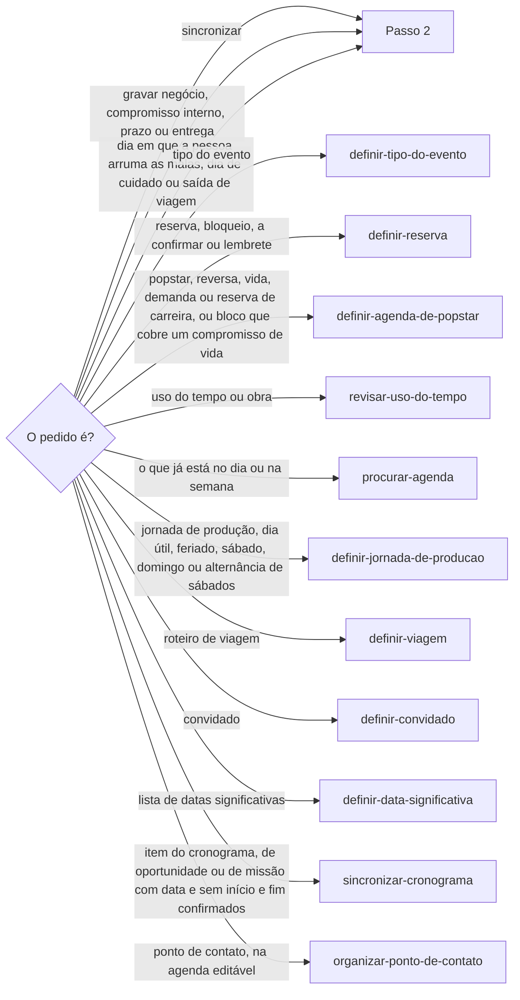
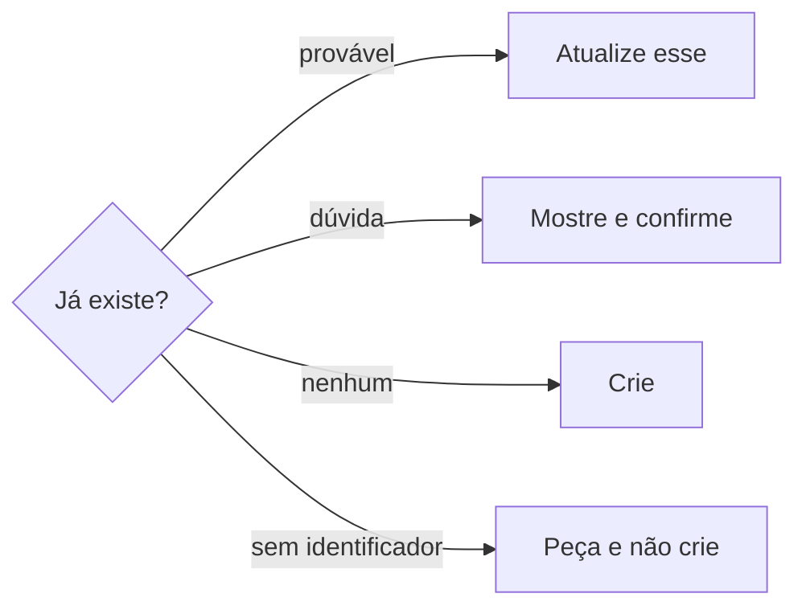
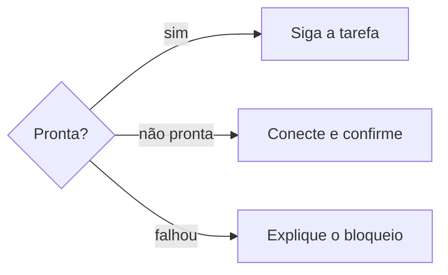
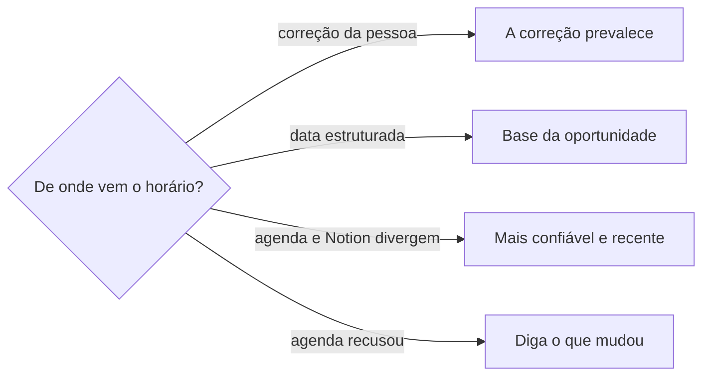
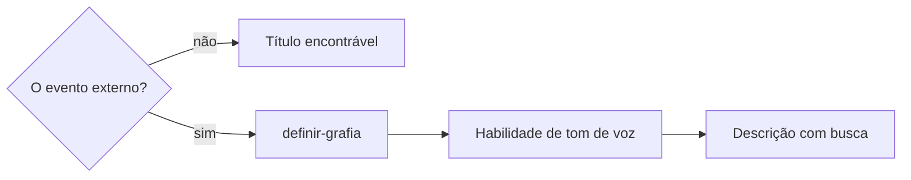

# Definir agenda

## Parâmetros de configuração

Leia cada valor nas instruções do projeto: primeiro na entrada com o nome desta habilidade, depois na entrada `Global` ou no primeiro nível do bloco. Quando um valor não estiver lá, use o padrão abaixo.
```yaml
"Formato da data com dia da semana": "terça-feira, 01/09/2026"
# `Agendas` lista cada agenda pelo `"Nome"` e pelo `"ID"` opcional, com o `"Uso"`: `padrão`, `em uso`, `só leitura`, `aposentada` ou `ignorada`, e a `"Finalidade"` opcional. O evento novo vai para a `padrão`, ou para a principal da conta. Nunca grave em `só leitura`, `aposentada` ou `ignorada`.
"Agendas": []
# `Compromissos de vida` lista o que um bloco de carreira não apaga.
"Compromissos de vida":
  - "alimentação"
  - "exercícios"
  - "exames e consultas"
  - "tratamentos prescritos"
  - "espiritualidade"
  - "família"
  - "animais de estimação"
  - "relacionamento amoroso"
  - "amizades"
  - "descanso"
# `Habilidade de tom de voz` vazia quer dizer que o título de evento externo segue o nome canônico, sem tom próprio.
"Habilidade de tom de voz": ""
# `Pauta obrigatória em evento com convidados` em `sim` exige a pauta na descrição.
"Pauta obrigatória em evento com convidados": "não"
```
## Instruções

### Passo 1

As listas e o nome de cada propriedade vêm do mapeamento de dados do projeto.
Criar, revisar, alterar, reservar, criar demanda e sincronizar o evento no Google Agenda é esta habilidade.
Este passo é o roteador: se o pedido tem outro destino, pare aqui e siga essa habilidade.



Quando o destino é outra habilidade, ela decide e esta só grava o evento que ela definir.
O plano que a pessoa diz para um dia nomeado se grava, sem pedir permissão. Período sem produção já dito não vira pergunta. Não peça para nomear a habilidade.
Bloco sem hora entra como dia inteiro.
Saída de viagem confirmada exige data e hora: peça a hora e não grave sem ela, porque a falta pode causar atraso.
Saída não confirmada e sem hora: proponha reserva com horário aproximado ou de dia inteiro, por `definir-reserva`.
Não apague um dos `Compromissos de vida`. Não escreva orientação de saúde.
Esta habilidade não cadastra, não revisa e não altera a lista de datas significativas.
O evento anual de uma data significativa copia o título que o registro já tem. Sem o registro, pare. Não invente o título nem o ano.
Sincronizar copia o que a fonte já tem e não cria o registro de origem: sincronizar uma oportunidade não a cadastra, e criar a oportunidade segue `definir-tipo-do-evento`.

### Passo 2

Antes de criar, revisar ou alterar, siga `definir-tipo-do-evento`, mesmo quando o tipo parece óbvio, antes da primeira gravação.
Sem tipo claro, pare. Não crie nem altere.
Negócio ou reunião comercial, compromisso interno, prazo e entrega gravam aqui. Os outros tipos seguem o destino daquela habilidade.

### Passo 3

Antes de criar, busque no Google Agenda se o evento já existe.
Use o nome, a data, a organização, a oportunidade relacionada ou outro identificador mínimo que o pedido trouxer. Sem nenhum desses, peça. Não crie.
A busca inclui variação de nome, e não depende só do título exato.



Ao atualizar, leia o evento inteiro e complete o que falta pelo Passo 5, como a descrição com a fonte.
Pode trocar o título existente pelo nome canônico mais buscável.
Só é mantido o que já está completo.
Não crie duplicata. Na dúvida, mostre o que encontrou e peça confirmação antes de criar outro.
Pedido com vários momentos: crie todos, inclusive os de data já passada.

Antes de criar ou alterar, leia as agendas de uso `aposentada` em `Agendas`.
Se houver evento, avise que o produto não é mais usado, mostre o compromisso no formato da data com dia da semana, com o horário da fonte, e sugira mover para a agenda padrão.
Não pergunte qual agenda. A sugestão e a mudança de calendário não esperam tipo nem página canônica.
Quando a pessoa pedir para mover, mova para essa agenda. Case o calendário, não o título.
O evento novo não entra nesse calendário. Sem evento, diga isso e siga a criação na agenda operacional.

### Passo 4

A agenda operacional é o Google Agenda, provavelmente conectada ao Notion Calendar. Criar, revisar e alterar o evento acontecem nele.
O nome e o horário vêm do que a pessoa indicou para esse tipo no Notion e desse Google Agenda, para uma pessoa e para uma IA acharem o mesmo compromisso.
Compromisso, oportunidade, reunião, entrega ou evento comercial sem fonte na conexão: pare. Não crie o evento.
Quando mais de uma página traz a data, a fonte é a página do time dono do evento, não a de outro time.
Busque primeiro nas páginas do próprio time e só use a de outro time se a do time não traz a data.
Antes de concluir que não consegue, confira Calendar Tools, Google Agenda, Notion Calendar ou equivalente nesta sessão. Não afirme que não há ferramenta sem essa checagem.



Não pronta: inicie a conexão. Não responda só com instrução manual.
Ativa: confirme e siga a tarefa original. Não peça para repetir o pedido.
Falhou, indisponível ou ação fora do chat: explique o bloqueio e só então dê a alternativa manual.
Não invente fonte, data, horário nem duração. A data sem horário fica sem horário. Número que não está no material: peça só o que falta.

Revisão ou alteração de evento ligado a oportunidade, negócio ou ponto de contato lê a página canônica no Notion antes de mudar título, horário, data, local ou contexto.
Priorize a propriedade estruturada que a página já tem: data e hora, localidade, empresa ou local, decisão humana, curadoria por IA, status, oportunidade relacionada e pessoa ou empresa abordada.
Não use só memória, título do calendário ou inferência. Sem a página, pare. Não altere.

A data e horário podem vir de oportunidade, inscrição, negócio, ponto de contato, site, formulário, e-mail ou conversa.
Agenda e Notion divergentes: prevalece a fonte canônica mais confiável e mais recente. A data e hora estruturadas da oportunidade são a base.
Correção explícita de horário, ou participação parcial, prevalece sobre essa base. Os dias de participação seguem `organizar-ponto-de-contato`.
Se a mais recente e a mais confiável forem fontes diferentes, pergunte.
Se a agenda não aceitar a alteração de horário, diga o que foi atualizado e o que não foi.



### Passo 5

Antes do título, a grafia segue `definir-grafia`. Não grave a forma do pedido.



O título serve à busca humana e por IA.
Leva o nome canônico mais buscável do evento, da oportunidade, da organização ou da reunião. Quando couber, leva edição, data, cidade e contexto curto.
«Reservado», «o evento», «Reunião» e «Feira» sem qualificador não entram.
Provisório pode começar com «Reservado para» ou «A confirmar» e leva o nome canônico do contexto.
Convidada, convidado ou organização de fora: o título segue a `Habilidade de tom de voz`, quando as instruções do projeto a indicarem.
A descrição leva o link da página canônica, uma frase do que o evento é, e só a variação que ajuda a achar, numa frase "Também chamado de…": acento, sigla, apelido, grupo, edição, venue, cidade, tipo, organização, status e papel da empresa.
Desambiguação curta se for um negócio e não um ponto de contato. Não alongue o que a propriedade já guarda. Criatividade não troca o campo estruturado.
Quando `definir-jornada-de-producao` disser que o dia segue a jornada reduzida, a descrição registra a jornada reduzida e o motivo.
Reunião sem modalidade: pergunte. Remota: crie o Google Meet. Presencial: não crie.
Reunião combinada numa conversa do WhatsApp: depois de criar o evento, siga o Passo 6 de `conversar-no-whatsapp`, que manda na conversa o evento nativo e a mensagem com o link da chamada.

Com `Pauta obrigatória em evento com convidados` em `sim`, a descrição de um evento com convidados leva uma pauta clara.
Sem pauta na conversa, pergunte antes de criar.
Num evento de que a pessoa só participa e que não tem pauta, sugira acrescentá-la e só edite com confirmação.
Confira horário e detalhes do evento na ferramenta de agenda, não pela fala da pessoa.

### Passo 6

A data de evento, compromisso, prazo, viagem, reserva, lançamento, entrega ou outro marco, na resposta, no resumo, na tabela, na descrição ou em outro texto, sai no formato da data com dia da semana.
Calcule e confira o dia com a data, o horário e o fuso antes de escrever.
Sem horário ou sem fuso, e se o dia puder mudar, peça. Não invente.
Intervalo ou vários dias: o dia da semana em cada data.
Dia incompatível com a data, inclusive o da fonte: sinalize e confirme antes de criar ou alterar. Não grave o marco.
O campo estruturado permanece válido.

### Passo 7

A resposta leva um resumo curto da decisão ou ação.
Lista cada evento como criado, alterado, mantido, removido ou provisório. Provisório é a reserva, não a confirmação.
Nomeia o fuso usado. Sem fuso, e se o dia puder mudar, peça. Não invente o fuso.
Não invente evento removido. Compromisso repetido se remarca. A resposta só lista remoção que a agenda já mostra.

## Problemas comuns

### Aviso sem mudança de agenda

Se você só avisar, perguntar qual agenda ou mover para outra que não seja a agenda padrão, o destino definido fica de fora.

1. Sugira mover para a agenda padrão.
2. A agenda padrão é a de uso `padrão` em `Agendas`, ou a principal da conta. Não pergunte qual agenda.
3. Quando a pessoa pedir para mover, mova para essa agenda.

### Alteração sem a página

Se você mudar título, horário, data, local ou contexto de um evento ligado a oportunidade, negócio ou ponto de contato usando só memória, título do calendário ou inferência, a agenda se separa da página canônica.

1. Leia a página canônica no Notion antes de alterar.
2. Copie a propriedade estruturada que ela já tem.
3. Sem a página, pare. Não altere.

### Agenda recusou o horário

Se você calar quando a agenda não aceita a alteração, ou deixar o horário da agenda vencer a fonte, a pessoa não vê o que ficou para trás.

1. Use a fonte canônica mais confiável e mais recente. A base é a data e hora estruturadas da oportunidade.
2. Correção explícita da pessoa prevalece. Fontes diferentes na recência e na confiança: pergunte.
3. Se a agenda recusar, diga o que foi atualizado e o que não foi.

### Resposta sem estado

Se você fechar sem o resumo, sem o estado de cada evento ou sem o fuso, a pessoa não vê o que a agenda fez.

1. Escreva um resumo curto da decisão ou ação.
2. Liste cada evento como criado, alterado, mantido, removido ou provisório.
3. Nomeie o fuso usado. Sem fuso, e se o dia puder mudar, peça. Não invente o fuso nem a remoção.

### Data sem o dia da semana

Se você escrever a data numérica sem o dia da semana, ou aceitar um dia da semana que não bate com a data, a pessoa lê o marco errado.

1. Calcule o dia com a data, o horário e o fuso.
2. Escreva no formato da data com dia da semana em cada data.
3. Se divergir, sinalize e confirme antes de criar ou alterar.

## Exemplos de entrada e saída

Estes exemplos ilustram fatos. Eles podem não estar no data source.

### A reunião de pesquisa está na agenda aposentada.

Sugeri mover para a agenda padrão. A agenda padrão saiu de `Agendas`. Não perguntei qual agenda.

### crie na agenda a reunião que já está no Notion.

O tipo seguiu `definir-tipo-do-evento`. A reunião copiou nome e horário da fonte. A resposta trouxe o resumo, o evento como criado e o fuso usado. Sem a fonte na conexão, parei. Sem fuso, e se o dia pudesse mudar, pedi.

### Dia 13 as malas e o carro. Dia 14 o cuidado e a viagem, sem hora de saída.

Gravei terça-feira, 13/10/2026, e quarta-feira, 14/10/2026, sem pedir permissão. A viagem não estava confirmada: propus reservar a saída com horário aproximado ou o dia inteiro.

### Agende o debriefing do orçamento. O pedido escreveu o nome da empresa com outra grafia.

Conferi a grafia. O título usou o nome canônico e o papel do encontro. A descrição trouxe a página, uma frase e a variação útil.

## Casos-limite

- Sem nome, data, organização, oportunidade relacionada ou outro identificador mínimo: peça. Não crie.
- O evento provável já na agenda: atualize e complete o que falta. Não duplique.
- A resposta não traz resumo, estado do evento ou fuso: escreva os três.

## Pegadinhas

- O número no meio do passo parece o lugar da edição. O valor mora no bloco `yaml` de `Parâmetros de configuração`.
- O ponto de contato parece caber na agenda removida. O destino é a agenda editável de `organizar-ponto-de-contato`.
- O título que cita o nome de uma agenda aposentada parece essa agenda. O aviso usa o calendário.
- Título diferente parece evento novo. A busca usa variação de nome, não só o título exato. Na dúvida, mostre e confirme.
- O link da chamada numa mensagem parece marcar a reunião na conversa do WhatsApp. A conversa recebe o evento nativo e a mensagem com o link, pelo Passo 6 de `conversar-no-whatsapp`.
- «Feira» ou «Reunião» sozinhos parecem título. A busca precisa do nome canônico. O evento externo segue o Passo 5.

## Scripts disponíveis

- Nenhum.

1. Não há script para executar.
