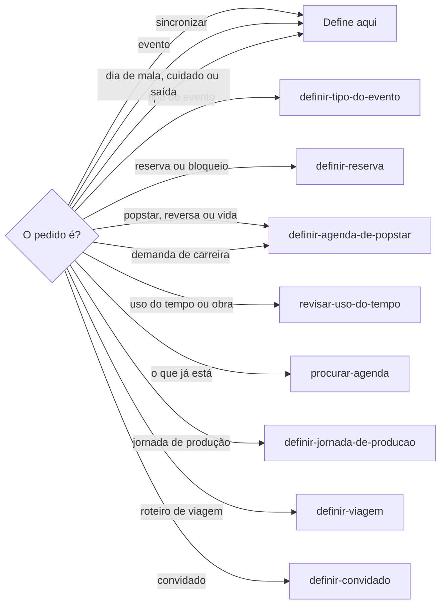
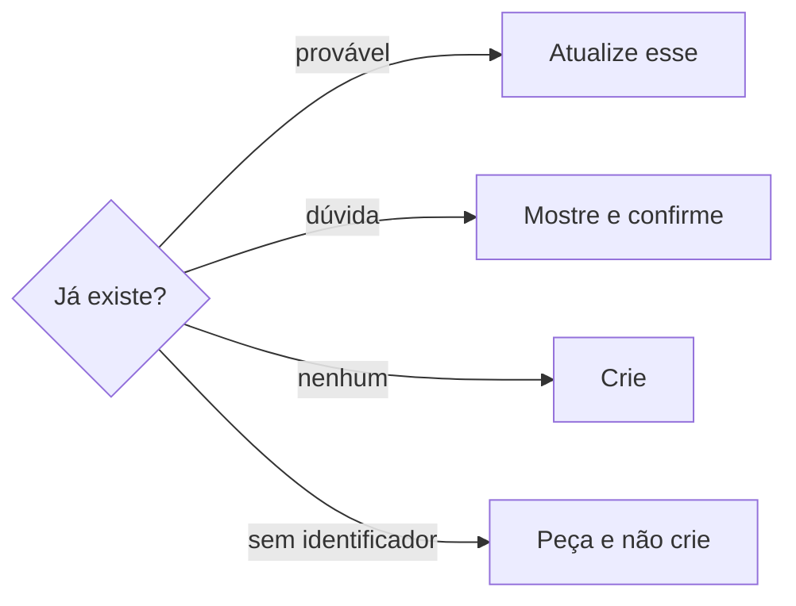
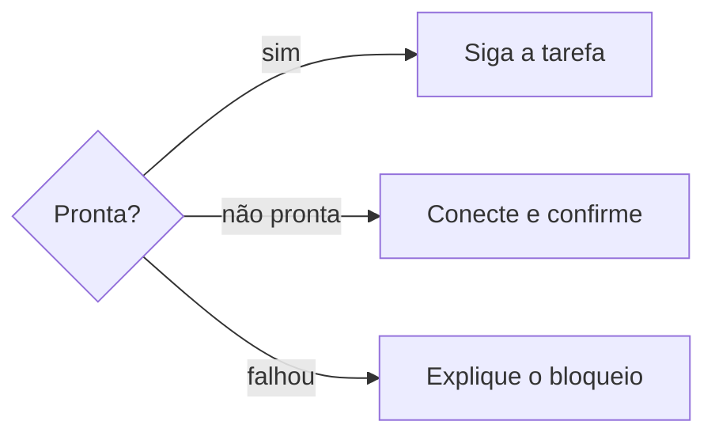
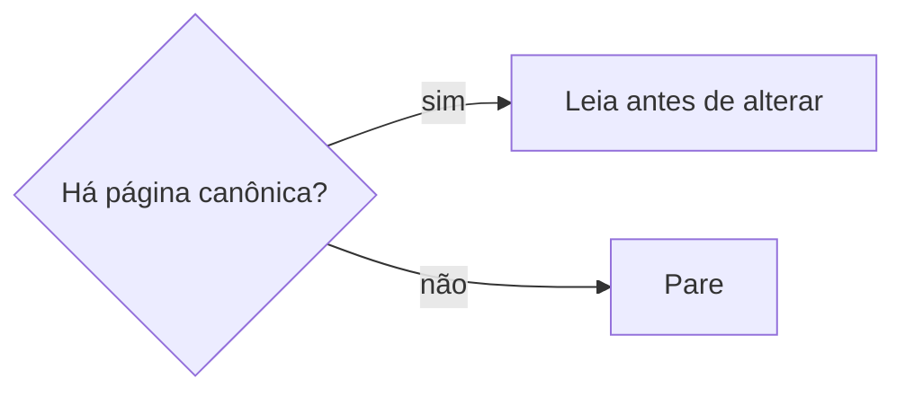
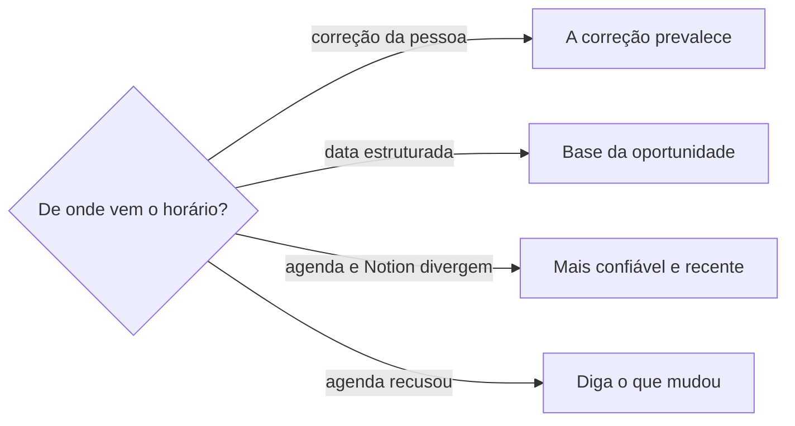
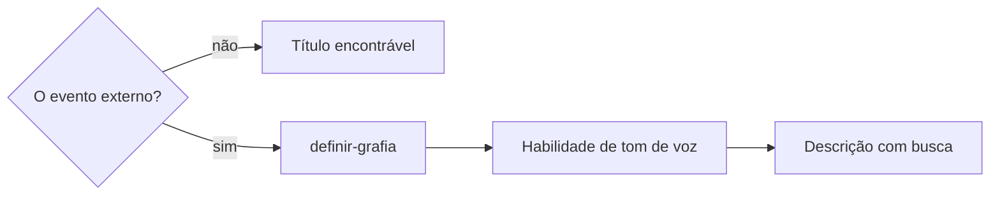

# Definir agenda

## Parâmetros de configuração

Leia cada valor nas instruções do projeto: primeiro na entrada com o nome desta habilidade, depois na entrada `Global` ou no primeiro nível do bloco. Quando um valor não estiver lá, use o padrão abaixo. `Agendas` lista cada agenda pelo `"Nome"` e pelo `"ID"` opcional, com o `"Uso"`: `padrão`, `em uso`, `só leitura`, `aposentada` ou `ignorada`, e a `"Finalidade"` opcional. O evento novo vai para a `padrão`, ou para a principal da conta. Nunca grave em `só leitura`, `aposentada` ou `ignorada`. `Habilidade de tom de voz` vazia quer dizer que o título de evento externo segue o nome canônico, sem tom próprio. `Compromissos de vida` lista o que um bloco de carreira não apaga.

```yaml
"Formato da data com dia da semana": "terça-feira, 01/09/2026"
"Agendas": []
"Compromissos de vida":
  - "alimentação"
  - "exercícios"
  - "exames e consultas"
  - "tratamentos prescritos"
  - "espiritualidade"
  - "família"
  - "animais de estimação"
  - "relacionamento amoroso"
  - "amizades"
  - "descanso"
"Habilidade de tom de voz": ""
"Confirmar antes de escrever na descrição": "sim"
"Título da seção de resumo": "Resumo da reunião"
```

`Confirmar antes de escrever na descrição` vale quando um resumo ou trecho do que foi discutido vai para a descrição de um evento que já existe. `Título da seção de resumo` é o cabeçalho da seção separada em que o trecho é anexado.

## Instruções

### Passo 1

As listas e o nome de cada propriedade vêm do mapeamento de dados do projeto. Criar, revisar, alterar, reservar, criar demanda e sincronizar o evento no Google Agenda é esta habilidade.



O tipo real segue `definir-tipo-do-evento` antes de criar, revisar ou alterar. O roteiro segue `definir-viagem`. O plano que a pessoa diz para um dia nomeado se grava, sem pedir permissão. Bloco sem hora entra como dia inteiro. Saída de viagem confirmada exige data e hora: peça a hora e não grave sem ela, porque a falta pode causar atraso. Saída não confirmada e sem hora: proponha reserva com horário aproximado ou de dia inteiro, por `definir-reserva`. Item do cronograma, de oportunidade ou de missão com data e sem início e fim confirmados segue `sincronizar-cronograma`. Convidado segue `definir-convidado`. Um bloco novo que cobriria um dos `Compromissos de vida` segue o flowchart, em `definir-agenda-de-popstar`. Não apague esse compromisso. Não escreva orientação de saúde.

### Passo 2

Antes de criar, revisar ou alterar, o tipo real segue `definir-tipo-do-evento`. Sem tipo claro, pare. Não crie nem altere. Negócio ou reunião comercial, compromisso interno, prazo e entrega gravam aqui. Os outros tipos seguem o destino daquela skill.

### Passo 3

Antes de criar, busque no Google Agenda se o evento já existe. Use o nome, a data, a organização, a oportunidade relacionada ou outro identificador mínimo que o pedido trouxer. Sem nenhum desses, peça. Não crie. A busca inclui variação de nome, e não depende só do título exato. O evento existente provável: atualize esse. Não crie duplicata. Dúvida razoável: mostre o que encontrou e peça confirmação antes de criar outro.



Saber o que já está no dia ou na semana continua com `procurar-agenda`.

Antes de criar ou alterar, leia as agendas de uso `aposentada` em `Agendas`. Se houver evento, avise que o produto não é mais usado, mostre o compromisso no formato da data com dia da semana, com o horário da fonte, e sugira mover para a agenda padrão. Não pergunte qual agenda. A sugestão e a mudança de calendário não esperam tipo nem página canônica. Quando a pessoa pedir para mover, mova para essa agenda. Case o calendário, não o título. O evento novo não entra nesse calendário. Sem evento, diga isso e siga a criação na agenda operacional.

### Passo 4

A agenda operacional é o Google Agenda. Ela provavelmente está conectada ao Notion Calendar. Criar, revisar e alterar o evento acontecem nesse Google Agenda. O nome e o horário vêm do que a pessoa indicou no Notion e desse Google Agenda, para uma pessoa e para uma IA acharem o mesmo compromisso. Antes de concluir que não consegue, confira Calendar Tools, Google Agenda, Notion Calendar ou equivalente nesta sessão. Não afirme que não há ferramenta sem essa checagem.



Não pronta: inicie a conexão. Não responda só com instrução manual. Ativa: confirme e siga a tarefa original. Não peça para repetir o pedido. Falhou, indisponível ou ação fora do chat: explique o bloqueio e só então dê a alternativa manual. Não invente fonte, data, horário nem duração. Número que não está no material: peça.

Revisão ou alteração de evento ligado a oportunidade, negócio ou ponto de contato lê a página canônica no Notion antes de mudar título, horário, data, local ou contexto. Priorize a propriedade estruturada que a página já tem: data e hora, localidade, empresa ou local, decisão humana, curadoria por IA, status, oportunidade relacionada e pessoa ou empresa abordada. Não use só memória, título do calendário ou inferência. Sem a página, pare. Não altere.



A data e horário podem vir de oportunidade, inscrição, negócio, ponto de contato, site, formulário, e-mail ou conversa. Agenda e Notion divergentes: prevalece a fonte canônica mais confiável e mais recente. A data e hora estruturadas da oportunidade são a base. Correção explícita de horário, ou participação parcial, prevalece sobre essa base. Os dias de participação seguem `organizar-ponto-de-contato`. Se a mais recente e a mais confiável forem fontes diferentes, pergunte. Se a agenda não aceitar a alteração de horário, diga o que foi atualizado e o que não foi.



### Passo 5

Reserva, bloqueio provisório, «a confirmar» e lembrete seguem `definir-reserva`. Reserva de tempo de carreira, antes da demanda, segue `definir-agenda-de-popstar`. Esta habilidade grava o evento que elas definirem. Não duplique evento que já está no Google Agenda. A busca segue o Passo 3.

### Passo 6

A lista de datas significativas fica com `definir-data-significativa`. Esta habilidade não cadastra, não revisa e não altera esse registro. O evento anual no Google Agenda copia o título que o registro já tem. Sem o registro, pare. Não invente o título nem o ano.

### Passo 7

O compromisso que `definir-tipo-do-evento` deixou aqui fica nesta habilidade. Sincronizar copia o que a fonte já tem e não cria o registro de origem. Item com data e sem início e fim confirmados segue `sincronizar-cronograma`.

### Passo 8

Jornada de produção, dia útil, feriado, sábado, domingo e alternância de sábados seguem `definir-jornada-de-producao`. Esta habilidade grava o evento. Quando aquela disser que o dia segue a jornada reduzida, a descrição do evento registra a jornada reduzida e o motivo.

### Passo 9

A data de evento, compromisso, prazo, viagem, reserva, lançamento, entrega ou outro marco, na resposta, no resumo, na tabela, na descrição ou em outro texto, sai no formato da data com dia da semana. Calcule e confira o dia com a data, o horário e o fuso antes de escrever. Sem horário ou sem fuso, e se o dia puder mudar, peça. Não invente. Intervalo ou vários dias: o dia da semana em cada data. Dia incompatível com a data: sinalize e confirme antes de criar ou alterar. O campo estruturado permanece válido.

### Passo 10

Antes do título, a grafia segue `definir-grafia`. Não grave a forma do pedido.



O título serve à busca humana e por IA. Leva o nome canônico mais buscável do evento, da oportunidade, da organização ou da reunião. Quando couber, leva edição, data, cidade e contexto curto. «Reservado», «o evento», «Reunião» e «Feira» sem qualificador não entram. Provisório pode começar com «Reservado para» ou «A confirmar» e leva o nome canônico do contexto. Convidada, convidado ou organização de fora: o título segue a `Habilidade de tom de voz`, quando as instruções do projeto a indicarem. A descrição leva o link da página canônica, uma frase do que o evento é, e só a variação que ajuda a achar: acento, sigla, apelido, grupo, edição, venue, cidade, tipo, organização, status e papel da empresa. Desambiguação curta se for um negócio e não um ponto de contato. Não alongue o que a propriedade já guarda. Criatividade não troca o campo estruturado. Reunião sem modalidade: pergunte. Remota: crie o Google Meet. Presencial: não crie.

Quando um resumo ou trecho do que foi discutido vai para a descrição de um evento que já existe, a descrição de um evento com convidados fica visível a outras pessoas. Com `Confirmar antes de escrever na descrição` em `sim`, mostre o texto exato e o evento de destino, e só atualize depois que a pessoa confirmar aquela atualização, para aquele evento. Anexe o trecho ao que já existia, numa seção separada com o `Título da seção de resumo`, e não sobrescreva, não resuma nem apague o que estava escrito. Para achar o evento, use só o necessário para identificá-lo e não busque nem exponha dado de outros participantes além disso.

### Passo 11

A resposta leva um resumo curto da decisão ou ação. Lista cada evento como criado, alterado, mantido, removido ou provisório. Provisório é a reserva, não a confirmação. Nomeia o fuso usado. Sem fuso, e se o dia puder mudar, peça. Não invente o fuso. Não invente evento removido. Compromisso repetido se remarca. A resposta só lista remoção que a agenda já mostra.

## Problemas comuns

### Aviso sem mudança de agenda

Se você só avisar, perguntar qual agenda ou mover para outra que não seja a agenda padrão, o destino definido fica de fora.

1. Sugira mover para a agenda padrão.
2. A agenda padrão é a de uso `padrão` em `Agendas`, ou a principal da conta. Não pergunte qual agenda.
3. Quando a pessoa pedir para mover, mova para essa agenda.

### Evento criado de novo

Se você criar pelo título exato e ignorar a variação, ou criar na dúvida, a agenda ganha o mesmo compromisso duas vezes.

1. Busque antes de criar, com variação de nome.
2. Provável: atualize o existente. Não crie duplicata.
3. Dúvida: mostre o que achou e confirme antes de criar outro.

### Tipo decidido aqui

Se você classificar o tipo nesta habilidade, o roteamento deixa de ter uma fonte só.

1. Siga `definir-tipo-do-evento` antes de salvar.
2. Sem tipo claro, pare. Não crie nem altere.
3. Grave só negócio, compromisso interno, prazo e entrega.

### Evento sem fonte

Se você criar reunião, entrega ou evento comercial direto na agenda, o calendário deixa de bater com o Notion.

1. Use a fonte que a pessoa indicou para esse tipo.
2. Copie o nome e o horário que a fonte já tem.
3. Sem a fonte na conexão, pare. Não crie.

### Alteração sem a página

Se você mudar título, horário, data, local ou contexto de um evento ligado a oportunidade, negócio ou ponto de contato usando só memória, título do calendário ou inferência, a agenda se separa da página canônica.

1. Leia a página canônica no Notion antes de alterar.
2. Copie a propriedade estruturada que ela já tem.
3. Sem a página, pare. Não altere.

### Agenda recusou o horário

Se você calar quando a agenda não aceita a alteração, ou deixar o horário da agenda vencer a fonte, a pessoa não vê o que ficou para trás.

1. Use a fonte canônica mais confiável e mais recente. A base é a data e hora estruturadas da oportunidade.
2. Correção explícita da pessoa prevalece. Fontes diferentes na recência e na confiança: pergunte.
3. Se a agenda recusar, diga o que foi atualizado e o que não foi.

### Horário inventado

Se você preencher hora que ninguém disse, o compromisso nasce falso.

1. Deixe o horário vazio.
2. Peça só o que falta.
3. Não estime a duração.

### Data significativa na agenda

Se você cadastrar, revisar ou alterar na lista de datas significativas, ou inventar o ano no título do evento anual, o registro nasce fora da habilidade dele.

1. Pare e siga `definir-data-significativa`.
2. No Google Agenda, copie o título que o registro já tem.
3. Sem o registro, não crie o evento anual.

### Viagem no lugar da agenda

Se você montar o roteiro, pare. Se só conversar o dia nomeado, ou pedir permissão, o bloco fica fora.

1. Siga o flowchart.
2. Dia nomeado: grave como o Passo 1 manda. Período sem produção já dito não vira pergunta.
3. Não peça para nomear a habilidade.

### Resposta sem estado

Se você fechar sem o resumo, sem o estado de cada evento ou sem o fuso, a pessoa não vê o que a agenda fez.

1. Escreva um resumo curto da decisão ou ação.
2. Liste cada evento como criado, alterado, mantido, removido ou provisório.
3. Nomeie o fuso usado. Sem fuso, e se o dia puder mudar, peça. Não invente o fuso nem a remoção.

### Data sem o dia da semana

Se você escrever a data numérica sem o dia da semana, ou aceitar um dia da semana que não bate com a data, a pessoa lê o marco errado.

1. Calcule o dia com a data, o horário e o fuso.
2. Escreva no formato da data com dia da semana em cada data.
3. Se divergir, sinalize e confirme antes de criar ou alterar.

## Exemplos de entrada e saída

Estes exemplos ilustram fatos. Eles podem não estar no data source.

### A reunião de pesquisa está na agenda aposentada.

Sugeri mover para a agenda padrão. A agenda padrão saiu de `Agendas`. Não perguntei qual agenda.

### crie na agenda a reunião que já está no Notion.

O tipo seguiu `definir-tipo-do-evento`. A reunião copiou nome e horário da fonte. A resposta trouxe o resumo, o evento como criado e o fuso usado. Sem a fonte na conexão, parei. Sem fuso, e se o dia pudesse mudar, pedi.

### Dia 13 as malas e o carro. Dia 14 o cuidado e a viagem, sem hora de saída.

Gravei terça-feira, 13/10/2026, e quarta-feira, 14/10/2026, sem pedir permissão. A viagem não estava confirmada: propus reservar a saída com horário aproximado ou o dia inteiro.

### Agende o debriefing do orçamento. O pedido escreveu o nome da empresa com outra grafia.

Conferi a grafia. O título usou o nome canônico e o papel do encontro. A descrição trouxe a página, uma frase e a variação útil.

## Casos-limite

- Compromisso, oportunidade, reunião, entrega ou evento comercial sem fonte na conexão: pare. Não crie o evento na agenda.
- Revisão ou alteração ligada a oportunidade, negócio ou ponto de contato: leia a página canônica antes. Não use só memória, título do calendário ou inferência.
- Agenda e Notion com data ou horário diferentes: a fonte canônica mais confiável e mais recente prevalece. Correção da pessoa prevalece sobre a base. Agenda recusou: diga o que mudou e o que não mudou.
- O tipo segue `definir-tipo-do-evento`. Sem clareza, pare. Não crie nem altere. Grave só negócio, compromisso interno, prazo e entrega.
- Sem nome, data, organização, oportunidade relacionada ou outro identificador mínimo: peça. Não crie.
- O evento provável já na agenda: atualize. Não duplique.
- Dúvida razoável: mostre o que encontrou e confirme antes de criar outro.
- O pedido é saber o que já está no dia ou na semana: pare e siga `procurar-agenda`.
- O pedido é agenda de popstar, agenda reversa ou proteção de vida: pare e siga `definir-agenda-de-popstar`.
- O pedido é auditar o uso do tempo ou avaliar o conjunto da obra: pare e siga `revisar-uso-do-tempo`.
- Roteiro: siga o flowchart. Dia nomeado: grave, sem pedir permissão. Saída sem hora segue o Passo 1.
- A data não tem horário: não invente o horário.
- Reserva, bloqueio, «a confirmar» ou lembrete: `definir-reserva`. Reserva de carreira: `definir-agenda-de-popstar`.
- O pedido é cadastrar, revisar ou alterar na lista de datas significativas: pare e siga `definir-data-significativa`.
- O evento anual no Google Agenda sem o registro na lista de datas significativas: pare. Não invente o título nem o ano.
- A pessoa pede orientação de saúde: não escreva.
- Bloco que cobre um dos `Compromissos de vida`: pare e siga `definir-agenda-de-popstar`. Não apague o compromisso.
- Ferramenta de agenda não pronta: conecte, confirme e siga a tarefa. Falhou: explique o bloqueio antes da alternativa manual.
- Jornada de produção, dia útil, feriado, sábado, domingo ou alternância de sábados: `definir-jornada-de-producao`.
- O dia da semana da fonte não bate com a data: sinalize e confirme. Não grave o marco.
- Reunião sem modalidade: pergunte. Remota: crie o Google Meet. Presencial: não crie.
- A resposta não traz resumo, estado do evento ou fuso: escreva os três. Sem fuso, e se o dia puder mudar, peça. Não invente o fuso nem a remoção.
- Há evento numa agenda de uso `aposentada`: avise e sugira mover para a agenda padrão. Não pergunte qual agenda. Quando a pessoa pedir para mover, mova para essa agenda. O evento novo não entra no calendário aposentado.

## Pegadinhas

- Feriado, sábado e domingo parecem dia útil desta habilidade. A jornada segue `definir-jornada-de-producao`.
- O número no meio do passo parece o lugar da edição. O valor mora no bloco `yaml` de `Parâmetros de configuração`.
- A data numérica parece bastar. O texto leva o dia da semana, calculado com a data, o horário e o fuso. O campo estruturado continua válido.
- O ponto de contato parece caber na agenda removida. O destino é a agenda editável de `organizar-ponto-de-contato`.
- O Notion Calendar parece outra agenda. A agenda operacional é o Google Agenda. O Notion Calendar é a conexão provável. Afirmar que não há ferramenta parece fato. A checagem desta sessão vem antes.
- O título do calendário parece a fonte. Na alteração ligada a oportunidade, negócio ou ponto de contato, a página canônica no Notion vem antes. A correção explícita da pessoa prevalece sobre essa base.
- Reserva parece confirmação. A natureza provisória segue `definir-reserva`. A resposta lista o estado, com o fuso usado no resumo.
- A lista de datas significativas parece parte da agenda. O registro fica com `definir-data-significativa`. O Google Agenda só copia o título que já existe.
- Sincronizar uma oportunidade parece permissão para cadastrá-la. A agenda recebe a cópia. Criar a oportunidade segue `definir-tipo-do-evento`.
- «Feira» ou «Reunião» sozinhos parecem título. A busca precisa do nome canônico. O evento externo segue o Passo 10. Não peça para nomear a habilidade.
- Pedir permissão parece cuidado. O dia nomeado já se grava. Saída confirmada sem hora parece detalhe, mas causa atraso.
- Agenda de popstar, agenda reversa, proteção de vida e uso do tempo parecem parte do evento. Cada um segue o flowchart do Passo 1.
- Classificar o tipo parece parte de gravar. A fonte do tipo é `definir-tipo-do-evento`. Esta habilidade grava negócio, compromisso interno, prazo e entrega.
- Título diferente parece evento novo. A busca usa variação de nome, não só o título exato. Na dúvida, mostre e confirme.
- O título que cita o nome de uma agenda aposentada parece essa agenda. O aviso usa o calendário. A sugestão de mover usa a agenda padrão. O evento novo não entra nesse calendário.

## Scripts disponíveis

- Nenhum.

1. Não há script para executar.
