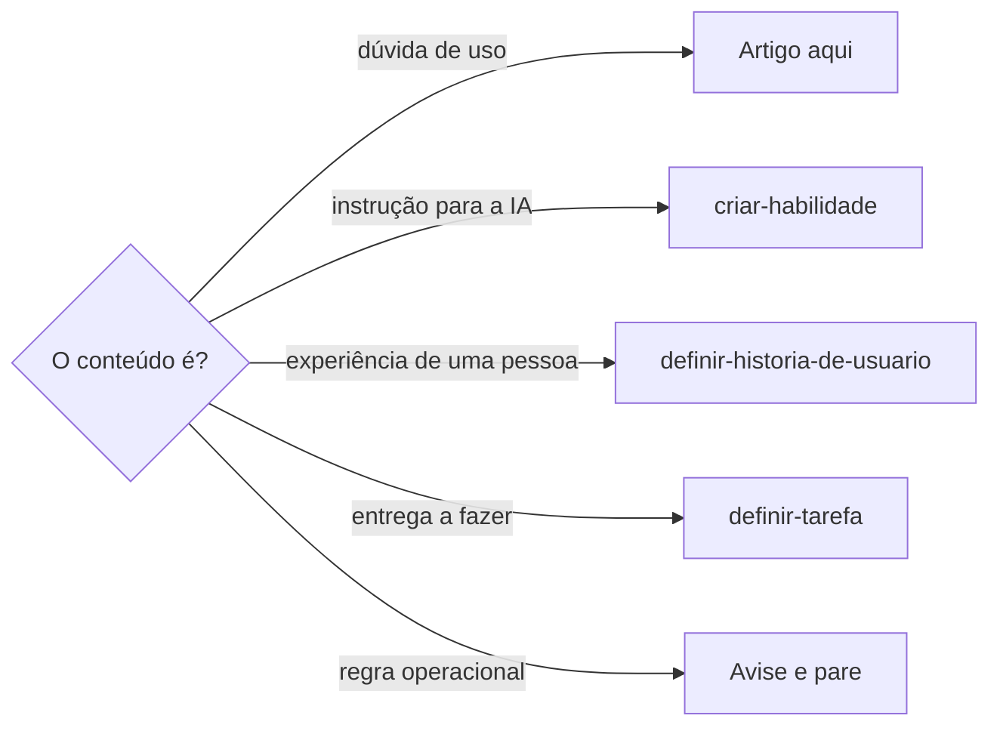

# Definir artigo da base de conhecimento

## Parâmetros de configuração

Leia cada valor nas instruções do projeto: primeiro na entrada com o nome desta habilidade, depois na entrada `Global` ou no primeiro nível do bloco. Quando um valor não estiver lá, use o padrão abaixo.

```yaml
"Nome do data source de artigos": ""
# `pergunta` é o título. `relacionados` liga os artigos de assuntos vizinhos.
"Campos da base de artigos":
  "pergunta": ""
  "variações": ""
  "ferramentas": ""
  "relacionados": ""
  "status": ""
"Status inicial": ""
# `Aviso no topo do artigo` vazio não põe aviso.
"Aviso no topo do artigo": ""
# `Seções do artigo` na ordem em que aparecem.
"Seções do artigo":
  - "Quando usar esse artigo"
  - "Resumo do problema"
  - "Causa mais provável"
  - "Diagnóstico rápido"
  - "Como corrigir"
  - "Observações importantes"
  - "Fonte interna"
"Modo de aprendizado": "perguntar"
```

## Instruções

### Passo 1

Procure no workspace conectado o data source com o nome `Nome do data source de artigos` e use-o sem perguntar.
Abra o data source e leia o esquema.
Só peça o link se a busca não achar nenhum ou achar mais de um.
Não use um banco de outro workspace.
Se `Nome do data source de artigos`, `Campos da base de artigos` ou `Status inicial` estiver vazio, pergunte uma vez e pare.

### Passo 2

Antes de escrever, decida se o conteúdo é artigo.
Artigo responde uma dúvida prática de uso: o que fazer, onde fazer e o que evitar.
Regra operacional, especificação técnica e decisão de governança não são artigo. Avise a pessoa e siga o destino certo.



### Passo 3

Um artigo responde uma pergunta só.
Liste as perguntas que a conversa trouxe.
Assuntos diferentes viram artigos separados, cada um com a própria pergunta.
Ligue os artigos de assuntos vizinhos pelo campo `relacionados`, nos dois artigos.
Na seção de observações, aponte para o outro artigo em vez de repetir a explicação.

### Passo 4

Para cada pergunta, busque no data source pelo título, pelas variações e pelo tema.
Se um artigo já responde a mesma pergunta, atualize-o.
Só crie um artigo novo quando nenhum responde.

### Passo 5

Quando a dúvida envolve uma ferramenta, abra a página da ferramenta e ligue-a no campo `ferramentas`.
Quando uma skill ou um playbook governa o tema, use as regras dele como conteúdo.
Não copie critérios de aceite, cenários em BDD nem a estrutura da skill para o artigo.
O guardrail vira item de checklist, alerta ou passo.

### Passo 6

Escreva o campo `pergunta` como a pessoa faria a pergunta.
No campo `variações`, liste outros jeitos de perguntar a mesma coisa, entre aspas, um por linha.
No corpo, ponha o `Aviso no topo do artigo` e depois as `Seções do artigo`, na ordem.
O diagnóstico é um checklist.
Os passos de correção são uma lista numerada, um clique ou uma decisão por passo, com o nome do botão em negrito.
A fonte interna diz de onde veio o artigo, como um teste na ferramenta numa data ou o pedido numa tarefa, e o que ainda não foi reproduzido.
Ao criar, use o `Status inicial`.

### Passo 7

Sempre que criar ou atualizar um passo a passo de uma tela, capture um print de cada passo.
Mostre na tela o estado do passo, como o menu aberto ou a janela com o botão, antes de capturar.
Suba cada imagem pelo upload de arquivo da ferramenta da base.
Ponha a imagem logo abaixo do passo que ela mostra, num bloco próprio.
Escreva a legenda com o que a tela mostra: o menu, a janela, o campo e o nome da pasta ou da arte quando aparece.
A imagem que a pessoa mandou entra do mesmo jeito, no passo que ela mostra.
Se não conseguir capturar um passo, diga qual ficou sem print e por quê.

### Passo 8

Antes de concluir, confira o artigo com esta lista:

- [ ] Responde uma pergunta só e liga os vizinhos em `relacionados`.
- [ ] Não tem critério de aceite nem cenário em BDD.
- [ ] Cada passo de tela tem o print logo abaixo, com legenda.
- [ ] A pessoa sabe o que fazer, onde fazer e o que evitar sem abrir outro documento.
- [ ] A ferramenta está ligada quando a dúvida é sobre ela.

Corrija o que falhar e confira de novo.
Responda com o link de cada artigo criado ou alterado.

### Passo 9

Ao terminar, siga `evoluir-habilidade` conforme `Modo de aprendizado`.

## Problemas comuns

### Dois assuntos no mesmo artigo

Se você juntar duas perguntas num artigo, a busca não acha nenhuma das duas e a pessoa lê o que não precisava.

1. Separe em um artigo por pergunta.
2. Ligue os dois em `relacionados`.
3. Na seção de observações, aponte para o outro artigo.

### Critérios de aceite no artigo

Se você copiar os critérios de aceite de uma skill para o artigo, a pessoa lê uma especificação no lugar de uma resposta.

1. Apague os critérios e os cenários.
2. Traduza cada guardrail em item de checklist, alerta ou passo.

### Passo sem print

Se você escrever o passo a passo de uma tela só com texto, a pessoa não reconhece o botão nem o menu.

1. Abra a tela no estado de cada passo.
2. Capture, suba e ponha a imagem logo abaixo do passo.
3. Escreva a legenda com o que a tela mostra.

### Artigo repetido

Se você criar o artigo sem buscar, a base fica com duas respostas para a mesma pergunta.

1. Busque pelo título, pelas variações e pelo tema.
2. Atualize o que já responde.

## Exemplos de entrada e saída

Estes exemplos ilustram fatos. Eles podem não estar no data source.

### Como compartilho um design com quem é de fora da equipe e como deixo o mesmo design em duas pastas?

São duas perguntas. Criei um artigo para compartilhar o design pelo link do modelo e outro para pôr o mesmo design em mais de uma pasta. Liguei os dois em `relacionados`. Cada passo tem o print logo abaixo, com a legenda do menu ou da janela.

### Transforme esses critérios de aceite em artigo

Os critérios ficaram de fora. Cada guardrail virou item do diagnóstico rápido ou um passo de correção.

## Casos-limite

- O pedido é uma instrução para a IA, uma regra operacional ou uma entrega: siga o fluxograma do Passo 2.
- A pessoa mandou prints: use-os nos passos que eles mostram e capture os que faltam.
- A tela não está acessível na conexão: escreva o passo e diga qual ficou sem print.
- O artigo existente responde a pergunta: atualize. Não crie outro.
- O passo não é de tela, como uma regra ou uma decisão: não precisa de print.

## Pegadinhas

- O upload da imagem parece aceitar o link do print. A imagem precisa ser enviada como arquivo pelo upload de arquivo da ferramenta, e o bloco de imagem cita o arquivo enviado.
- A imagem colada na mesma linha do passo parece ficar abaixo dele. Ela só vira bloco próprio com uma linha em branco antes e depois.
- O print da tela inicial parece bastar. O passo mostra o estado em que a pessoa clica: o menu aberto, o submenu, a janela de busca.
- Esperar os prints da pessoa parece o caminho seguro. Quem escreve o artigo captura os prints que faltam.

## Scripts disponíveis

- Nenhum.

1. Não há script para executar.
