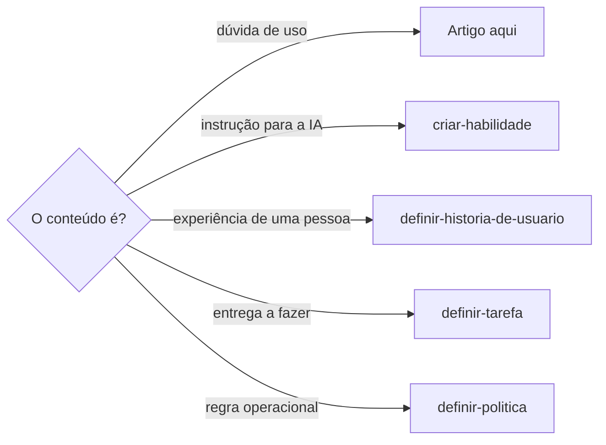

# Definir artigo da base de conhecimento

## Parâmetros de configuração

Leia cada valor nas instruções do projeto: primeiro na entrada com o nome desta habilidade, depois na entrada `Global` ou no primeiro nível do bloco. Quando um valor não estiver lá, use o padrão abaixo.

```yaml
# `Onde ficam os artigos` é `data source` ou `espaço do Confluence`. Com `espaço do Confluence`, `Nome do data source de artigos` guarda o nome ou a chave do espaço.
"Onde ficam os artigos": "data source"
"Nome do data source de artigos": ""
# `pergunta` é o título. `relacionados` liga os artigos de assuntos vizinhos.
"Campos da base de artigos":
  "pergunta": ""
  "variações": ""
  "ferramentas": ""
  "relacionados": ""
  "status": ""
"Status inicial": ""
# `Aviso no topo do artigo` vazio não põe aviso.
"Aviso no topo do artigo": ""
# `Seções do artigo` na ordem em que aparecem.
"Seções do artigo":
  - "Quando usar esse artigo"
  - "Resumo do problema"
  - "Causa mais provável"
  - "Diagnóstico rápido"
  - "Como corrigir"
  - "Observações importantes"
  - "Fonte interna"
# `Fonte de estratégia e cultura` é o nome ou o endereço da página com a estratégia, a tática e a cultura do negócio. Vazio não consulta nada.
"Fonte de estratégia e cultura": ""
"Modo de aprendizado": "perguntar"
```

## Instruções

### Passo 1

Procure no workspace conectado o data source com o nome `Nome do data source de artigos` e use-o sem perguntar.
Abra o data source e leia o esquema.
Só peça o link se a busca não achar nenhum ou achar mais de um.
Não use um banco de outro workspace.
No data source, se `Nome do data source de artigos`, `Campos da base de artigos` ou `Status inicial` estiver vazio, procure no workspace os bancos que parecem guardar artigos, mostre os candidatos com o link, pergunte uma vez e pare.
Quando a pessoa indica um banco que não tem as propriedades de `Campos da base de artigos`, como um banco de aulas ou de anotações, siga com ele: o título leva a pergunta, as variações entram na seção `Quando usar esse artigo`, e a ferramenta e os artigos vizinhos entram no corpo como menção. O banco ganha uma propriedade só se a pessoa pedir.
Com `Onde ficam os artigos` em `espaço do Confluence`, o artigo é uma página desse espaço e não há data source nem esquema.
Procure o espaço pelo nome ou pela chave de `Nome do data source de artigos` e busque as páginas pela busca do Confluence, antes de perguntar qualquer coisa.
Os `Campos da base de artigos` e o `Status inicial` não se aplicam.
A pergunta é o título da página e as variações entram na seção `Quando usar esse artigo`.
Só peça o nome ou o link do espaço se a busca não achar nenhum ou achar mais de um.

### Passo 2

Antes de escrever, decida se o conteúdo é artigo.
Artigo responde uma dúvida prática de uso: o que fazer, onde fazer e o que evitar.
Regra operacional, especificação técnica e decisão de governança não são artigo. Avise a pessoa e siga o destino certo: a regra operacional segue `definir-politica`.



### Passo 3

Um artigo responde uma pergunta só.
Liste as perguntas que a conversa trouxe.
Assuntos diferentes viram artigos separados, cada um com a própria pergunta.
Ligue os artigos de assuntos vizinhos pelo campo `relacionados`, nos dois artigos.
Na seção de observações, aponte para o outro artigo em vez de repetir a explicação.

### Passo 4

Para cada pergunta, busque no data source, ou no espaço do Confluence, pelo título, pelas variações e pelo tema.
Se um artigo já responde a mesma pergunta, atualize-o.
Só crie um artigo novo quando nenhum responde.
Quando a pessoa executa a tarefa que um artigo ensina, acompanhe a execução contra o artigo, passo a passo.
Cada diferença que a execução mostra, como uma tela que mudou, um custo, uma aprovação ou um caso que o artigo não prevê, entra no artigo na mesma sessão, sem esperar outro pedido.
Um assunto novo que a execução levanta vira outro artigo, como manda o Passo 3.
Quando a dúvida nasce de um caso visual ou de comportamento, como uma tela, um componente ou um pull request, confira o caso na fonte antes de escrever.
Abra o desenho no Figma, abra a tela ou o Storybook do pull request na versão dele, leia o código do pull request e meça o que a pessoa viu, como as cores calculadas no navegador.
Legende cada quadro do desenho pela estrutura, a linha, a coluna e o estado dele, e não pela aparência: um quadro que parece outro desenho pode ser o hover de um que já está na página.
O artigo diz a causa confirmada e usa o caso conferido como exemplo, não só o que a conversa contou.
Só deixe "a verificar" o que depende de uma decisão de outra pessoa ou de um acesso que a sessão não tem, e diga qual dos dois.
Nunca deixe "a verificar" o que as ferramentas da sessão conseguem conferir.
Antes de listar o que falta para o artigo, ou de perguntar se pode abrir a ferramenta, abra a ferramenta e leia o que ela mostra, como o histórico de versões, a configuração e as telas dos passos.
Abrir para ler não pede licença: tente o conector, a linha de comando e cada navegador disponível, o do aplicativo e o da pessoa por extensão.
Só diga que falta acesso depois de tentar, e conte o que cada caminho devolveu.
Numa tela de login, peça à pessoa que entre na própria janela e retome.
Antes de publicar, leia de novo o estado atual da fonte, como o último commit do pull request, porque ela pode ter mudado enquanto você escrevia.
No Confluence, ignore a conferência de modelo abaixo: o espaço não tem lista de modelos.
Confira se uma página é modelo do banco pela lista de modelos do data source, que a API do Notion devolve.
O texto de exemplo das seções no corpo não prova que é modelo, porque alguém pode criar uma página a partir de um modelo e não mudar nada.
Uma página que está na lista é o modelo que a pessoa usa no botão de criar página: não a trate como rascunho nem como artigo repetido, e não sugira apagá-la.
Uma página fora da lista é uma página comum, mesmo com o corpo de exemplo: trate como rascunho e pergunte antes de apagá-la.
Sem a lista à mão, não decida: diga que não deu para conferir e pergunte.

### Passo 5

Quando a dúvida envolve uma ferramenta, abra a página da ferramenta e ligue-a no campo `ferramentas`.
Quando a ferramenta tem um endereço de acesso, como o link de uma tela, um endereço interno ou um IP, esse endereço entra por extenso, como link clicável, no passo que manda abri-lo e no resumo do artigo, e a resposta à pessoa também o traz.
Dizer só "o IP" ou "a ferramenta" obriga a pessoa a perguntar onde fica.
Quando a ferramenta responde por mais de um endereço, o artigo diz qual usar e quando.
Quando uma skill ou uma política governa o tema, use as regras dela como conteúdo e ligue a política no artigo, sem reescrever a regra.
Não copie critérios de aceite, cenários em BDD nem a estrutura da skill para o artigo.
O guardrail vira item de checklist, alerta ou passo.
Quando um passo usa uma ferramenta que a pessoa só recebe depois dele, como um autenticador cujo convite chega na conta que ela ainda está ativando, dê o caminho de quem ainda não tem a ferramenta e diga quando trocar.
Quando o artigo orienta uma decisão, um comportamento ou um padrão de trabalho, e a `Fonte de estratégia e cultura` está preenchida, leia essa página antes de escrever e siga o que ela diz.

### Passo 6

Escreva o campo `pergunta` como a pessoa faria a pergunta.
No campo `variações`, liste outros jeitos de perguntar a mesma coisa, entre aspas, um por linha.
No corpo, ponha o `Aviso no topo do artigo` e depois as `Seções do artigo`, na ordem.
O diagnóstico é um checklist.
Os passos de correção são uma lista numerada, um clique ou uma decisão por passo, com o nome do botão em negrito.
A fonte interna diz de onde veio o artigo, como um teste na ferramenta numa data ou o pedido numa tarefa, e o que ainda não foi reproduzido.
Escreva para uma pessoa do time que precisa resolver a dúvida rápido.
Não use jargão técnico. Quando um termo for inevitável, explique-o na mesma frase.
Não presuma que a pessoa conhece a modelagem dos dados: diga o nome do banco, da página ou da propriedade que ela vê na tela.
Quando dois bancos parecidos causam erro, explique a diferença entre eles.
Quando a dúvida vem de uma conversa, um print, uma reunião ou um caso real, use esse caso como exemplo concreto no artigo, sem nome de pessoa nem dado pessoal.
Ao criar, use o `Status inicial`.
Num banco sem os campos de artigo, que a pessoa indicou, use o status de concluído que o banco oferece quando o artigo passou na conferência do Passo 8, e diga qual valor usou.
Uma decisão tomada que o artigo conta, de comportamento, de padrão ou de quem liga o quê, é registrada como manda `formalizar-decisao`, no `Registro de decisão`, e nunca em parágrafo corrido.
Se a decisão ainda está aberta, ela fica pendente, como a mesma habilidade manda.
Quando o artigo trata de uma feature toggle ou flag, o nome exato dela aparece entre crases na seção de abertura, em cada passo, decisão e observação que fala dela, e no título ou nas variações quando couber.
"A feature toggle" sozinha não basta: quem procura pelo nome não acha o artigo.

### Passo 7

Para cada passo de uma tela, siga `capturar-tela-de-passo-a-passo` e use o print que ela devolver.
Suba cada imagem pelo upload de arquivo da ferramenta da base.
Depois de subir, abra cada imagem do artigo e confira o conteúdo dela, não só que ela carrega.
Ponha a imagem logo abaixo do passo que ela mostra, num bloco próprio.
Escreva a legenda com o que a tela mostra: o menu, a janela, o campo e o nome da pasta ou da arte quando aparece.
A imagem que a pessoa mandou entra do mesmo jeito, no passo que ela mostra.
Só deixe um passo sem print depois da tentativa que `capturar-tela-de-passo-a-passo` manda, e diga qual ficou sem print e o que a tentativa mostrou, como uma ferramenta da base sem upload de arquivo.

### Passo 8

Antes de concluir, confira o artigo com esta lista:

- [ ] Responde uma pergunta só e liga os vizinhos em `relacionados`.
- [ ] Não tem critério de aceite nem cenário em BDD.
- [ ] Não tem jargão técnico sem explicação nem nome interno que a pessoa não vê na tela.
- [ ] Usa o caso real como exemplo quando a dúvida veio de um.
- [ ] Cada passo de tela tem o print logo abaixo, com legenda, ou o motivo de não ter, depois de uma tentativa de captura.
- [ ] O caso real foi conferido na fonte, no desenho, na tela ou no Storybook e no código do pull request, e cada "a verificar" que sobrou depende de uma pessoa ou de um acesso que faltou.
- [ ] Cada estado do caso e o desenho de referência têm print, com legenda.
- [ ] Cada print mostra o conteúdo completo, sem imagem em branco nem carregamento pela metade, conferido depois de subir.
- [ ] Nenhum print nem foto mostra nome, e-mail, telefone, nome do computador ou outro dado pessoal.
- [ ] A pessoa sabe o que fazer, onde fazer e o que evitar sem abrir outro documento.
- [ ] A ferramenta está ligada quando a dúvida é sobre ela.
- [ ] O endereço de acesso da ferramenta aparece por extenso, como link clicável, em cada passo que manda abri-lo.
- [ ] Cada decisão está no `Registro de decisão`, com quem decidiu e quando, e não em parágrafo.
- [ ] O nome exato de cada feature toggle ou flag aparece entre crases onde o artigo fala dela.

Corrija o que falhar e confira de novo.
A mensagem final da resposta traz o link de cada artigo criado ou alterado, em markdown com o título da página, como texto próprio dela.
O link escrito antes de um quadro de encerramento, como o de `wrap_up`, ou "o link está acima" não conta, porque a pessoa pode não ver esse trecho.
Uma página publicada sem link na mensagem final deixa o turno aberto.

### Passo 9

Ao terminar, siga `evoluir-habilidade` conforme `Modo de aprendizado`.

## Problemas comuns

### Dois assuntos no mesmo artigo

Se você juntar duas perguntas num artigo, a busca não acha nenhuma das duas e a pessoa lê o que não precisava.

1. Separe em um artigo por pergunta.
2. Ligue os dois em `relacionados`.
3. Na seção de observações, aponte para o outro artigo.

### Critérios de aceite no artigo

Se você copiar os critérios de aceite de uma skill para o artigo, a pessoa lê uma especificação no lugar de uma resposta.

1. Apague os critérios e os cenários.
2. Traduza cada guardrail em item de checklist, alerta ou passo.

### Passo sem print

Se você escrever o passo a passo de uma tela só com texto, a pessoa não reconhece o botão nem o menu.

1. Capture cada passo como manda `capturar-tela-de-passo-a-passo`.
2. Suba e ponha a imagem logo abaixo do passo.
3. Escreva a legenda com o que a tela mostra.

### Banco indicado sem os campos de artigo

Se você parar porque o banco que a pessoa indicou não tem pergunta, variações, ferramentas nem relacionados, ela responde o que já disse e o artigo não sai.

1. Siga com o banco: o título leva a pergunta e o status é o de concluído do banco.
2. Ponha as variações em `Quando usar esse artigo` e a ferramenta e os vizinhos como menção no corpo.
3. Diga quais propriedades faltaram e como você as supriu. Não crie propriedade sem pedido.

### Caso conferido só pela conversa

Se você escrever o artigo só com o que a conversa contou, a causa fica como suposição e o artigo repete a dúvida em vez de resolvê-la.

1. Abra o desenho, a tela ou o Storybook do caso e leia o código do pull request.
2. Meça o que a pessoa viu e ponha a causa confirmada no artigo.
3. Ilustre com os prints do desenho e de cada estado, lado a lado.
4. Deixe "a verificar" só o que depende de outra pessoa ou de um acesso que a sessão não tem.

### Faltas listadas sem abrir a ferramenta

Se você disser que falta o que a ferramenta mostra, ou perguntar se pode abri-la, sem ter aberto, a pessoa recebe uma lista de pendências que uma tentativa resolveria.

1. Abra a ferramenta e leia o histórico, a configuração e as telas dos passos.
2. Liste como faltante só o que depende de uma pessoa ou de um acesso que a tentativa não deu.
3. Diga o que cada caminho devolveu.

### Artigo repetido

Se você criar o artigo sem buscar, a base fica com duas respostas para a mesma pergunta.

1. Busque pelo título, pelas variações e pelo tema.
2. Atualize o que já responde.

### Link só antes do quadro final

Se você escrever o link do artigo antes do quadro de encerramento e a mensagem final disser "o link está acima", a pessoa abre a resposta sem link e tem de pedir.

1. Ponha o link do artigo, em markdown com o título da página, na mensagem final.
2. Repita o link ali mesmo que já tenha aparecido antes.
3. Releia a mensagem final antes de enviar e confira que cada página criada ou alterada tem o link.

### Endereço da ferramenta só por apelido

Se você escrever "acesse pelo IP" ou "abra a ferramenta" sem o endereço, a pessoa lê o artigo e a resposta e não sabe aonde ir.

1. Escreva o endereço por extenso, como link clicável, no passo e no resumo do artigo.
2. Traga o mesmo endereço na resposta à pessoa.
3. Com mais de um endereço, diga qual usar e quando.

## Exemplos de entrada e saída

Estes exemplos ilustram fatos. Eles podem não estar no data source.

### Como compartilho um design com quem é de fora da equipe e como deixo o mesmo design em duas pastas?

São duas perguntas. Criei um artigo para compartilhar o design pelo link do modelo e outro para pôr o mesmo design em mais de uma pasta. Liguei os dois em `relacionados`. Cada passo tem o print logo abaixo, com a legenda do menu ou da janela.

### Transforme esses critérios de aceite em artigo

Os critérios ficaram de fora. Cada guardrail virou item do diagnóstico rápido ou um passo de correção.

## Casos-limite

- O pedido é uma instrução para a IA, uma regra operacional ou uma entrega: siga o fluxograma do Passo 2.
- A pessoa mandou prints: use-os nos passos que eles mostram e capture os que faltam, como manda `capturar-tela-de-passo-a-passo`.
- O artigo existente responde a pergunta: atualize. Não crie outro.
- O passo não é de tela, como uma regra ou uma decisão: não precisa de print.
- A pessoa indica um banco sem os campos de artigo: siga com ele, como o Passo 1 manda.

## Pegadinhas

- O upload da imagem parece aceitar o link do print. A imagem precisa ser enviada como arquivo pelo upload de arquivo da ferramenta, e o bloco de imagem cita o arquivo enviado.
- A resposta do upload devolve a referência do arquivo, que é o que o bloco da imagem cita. Guarde-a ao subir: sem ela, o arquivo sobe de novo.
- A imagem colada na mesma linha do passo parece ficar abaixo dele. Ela só vira bloco próprio com uma linha em branco antes e depois.
- Uma página com o título genérico da ferramenta e o corpo só com o texto de exemplo parece um rascunho esquecido, e também pode ser o modelo do banco. Só a lista de modelos do data source diz qual dos dois é.
- O apelido da ferramenta, como "o IP" ou "o portal", parece bastar porque a conversa já o usou. A pessoa que lê o artigo não estava nela, então o endereço vai por extenso.
- Um artigo encontrado e completo parece encerrar o trabalho. Se a pessoa vai executar a tarefa em seguida, a execução é a conferência: o que ela mostra e o artigo não diz entra nele.
- O link escrito antes do quadro de encerramento parece entregar o artigo. A pessoa lê a mensagem final, então o link vai nela.
- Um caso visual parece bem descrito pela conversa e pelo print do pull request. O print do pull request pode mostrar outra variante, com o mesmo nome, e só o Storybook aberto e o código mostram qual é qual.
- No Confluence, subir o arquivo pela API chamada de dentro da página falha na verificação de origem. O conector devolve um comando de envio que sobe o arquivo, e a lista de anexos da página devolve a referência de cada um para o bloco da imagem.
- Um artigo que manda usar uma ferramenta parece valer para todo mundo. Antes de dizer que uma orientação contradiz o artigo, confira a ordem dos acessos: quem ainda não recebeu a ferramenta segue outro caminho.

## Scripts disponíveis

- Nenhum.

1. Não há script para executar.
