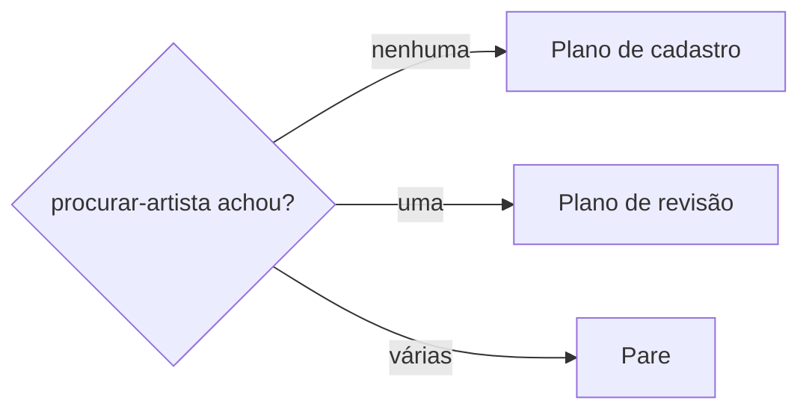
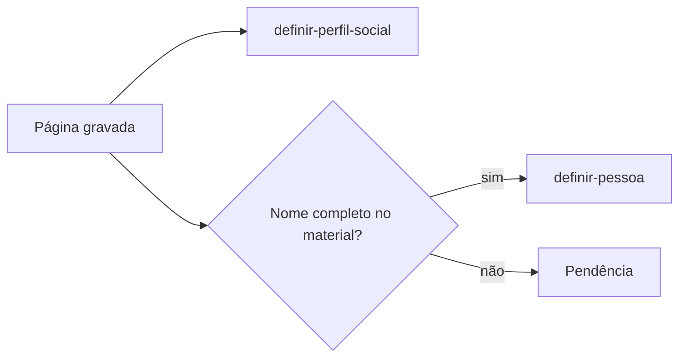

# Definir artista

## Parâmetros de configuração

Leia cada valor nas instruções do projeto: primeiro na entrada com o nome desta habilidade, depois na entrada `Global` ou no primeiro nível do bloco. Quando um valor não estiver lá, use o padrão abaixo.

```yaml
"Nome do data source de artistas": ""
"Status de curadoria de entrada": ""
"Modelo de página de cadastro": ""
"Modelo do perfil do Spotify": ""
"Título do perfil do Spotify": ""
"Campos da base de artistas":
  "nome": ""
  "grafias": ""
  "e-mail": ""
  "telefone": ""
  "Spotify": ""
  "ID do Spotify": ""
  "YouTube": ""
  "Instagram": ""
  "cidade": ""
  "nascimento": ""
  "gênero musical": ""
  "mini bio": ""
  "observação": ""
  "notas internas": ""
  "já tocou": ""
  "status de curadoria": ""
  "line-ups": ""
  "perfis sociais": ""
  "integrantes": ""
  "empresa responsável": ""
  "consentimento": ""
"Campos sensíveis": []
"Campos automáticos": []
"Modo de aprendizado": "perguntar"
```

## Instruções

### Passo 1

Procure no workspace conectado o data source com o nome `Nome do data source de artistas` e use-o sem perguntar: busque um termo da base e tome o data source de origem dos resultados cujo caminho tem esse nome. Abra o data source e leia o esquema e os modelos de página. Só peça o link se a busca não achar nenhum ou achar mais de um. Não use um banco de outro workspace. Se `Campos da base de artistas` ou `Status de curadoria de entrada` estiver vazio, pergunte uma vez e pare.
Sem o resultado de `procurar-artista` nesta conversa, rode essa habilidade antes. Não escreva sem saber se a página existe.



### Passo 2

Monte o plano com cada campo de `Campos da base de artistas`: o valor atual, o proposto e a origem. Campo sem fonte fica vazio e vira pendência. Na revisão, entra só o que muda. Um campo preenchido não é trocado por uma fonte mais fraca sem a pessoa decidir.

- `nome`: a grafia que o próprio artista assina e usa nos perfis.
- `grafias`: siglas, nome civil e formas sem acento, cada uma entre aspas, separadas por ponto e vírgula e quebra de linha.
- `telefone`: E.164, com `+` e DDI.
- `Spotify`: o link do artista, sem o trecho de idioma e sem parâmetros. O ID do mesmo link vai em `ID do Spotify`.
- `YouTube`: o link do canal, não o do vídeo.
- `cidade`: `Cidade - UF`, só quando o material diz onde o artista mora.
- `nascimento`: `Cidade - UF`, quando o material ou a imprensa dizem de onde o artista é.
- `gênero musical`: só uma opção que a base já tem e que o material sustenta.
- `mini bio`: com link do Spotify, fica vazia no plano. A coleta de dados do Spotify grava a bio de lá. Sem Spotify, ou se a coleta deixar o campo vazio, use texto do próprio material, sem link, sem data de envio e sem anotação sobre o material.
- `observação`: só contexto qualitativo, sem número de métrica.
- `notas internas`: só o que não aconteceu numa data. As evidências, com link; o que a busca não achou; o registro que falta fazer na base; e o que uma fonte afirma, com a fonte e a data dela. O que o material chama de atual entra como "segundo a fonte, na data", não como fato de hoje.
- Tudo o que aconteceu numa data vai num comentário datado na página do artista, um por fato, nunca em `notas internas`: a apresentação, a matéria publicada, a chegada do material, a resposta enviada, o contato feito, o pedido à pessoa e a confirmação que falta. O comentário abre com a data do fato e cita a fonte.
- Os comentários seguem a ordem cronológica do fato, não a da gravação. Para pôr um fato antes de outros já gravados, reescreva os comentários seguintes no lugar e acrescente o último no fim. Não apague comentário para reordenar.
- `empresa responsável`: só a empresa que cuida da carreira do artista, como agência, selo ou produtora, e segue `definir-empresa`. Outra empresa do artista fica de fora.
- `já tocou`: marque quando houver vídeo ou declaração do artista, mesmo sem line-up. A evidência vai em `notas internas`, e a apresentação, quando tem data, num comentário datado.
- `status de curadoria`: no cadastro, `Status de curadoria de entrada`. Na revisão, não mude sem a pessoa pedir.

Os `Campos sensíveis` só entram com `consentimento` marcado pelo próprio artista. Não deduza nenhum deles de nome, foto, voz ou pronome do texto. Os `Campos automáticos` não se escrevem. O corpo da página é o do `Modelo de página de cadastro`. Notas vão nas propriedades, nunca no corpo.

### Passo 3

Valide o plano antes de mostrar:

- [ ] cada valor tem origem no material ou numa leitura feita nesta conversa
- [ ] nenhum número de métrica em `observação` nem em `mini bio`
- [ ] nenhum link em `mini bio`
- [ ] links e telefone no formato do Passo 2
- [ ] nenhum campo sensível sem consentimento e nenhum campo automático no plano

Corrija e valide de novo até passar.

### Passo 4

Mostre o plano e as pendências, e espere a confirmação. Depois crie a página com o `Modelo de página de cadastro`, ou atualize só os campos que mudam.

### Passo 5

Antes de criar um perfil, consulte os perfis sociais pela URL e pelo título: o perfil do Spotify pode já ter sido criado, com as métricas, por uma automação da base. Os perfis que faltam seguem `definir-perfil-social` e entram em `perfis sociais`. O do Spotify usa o `Modelo do perfil do Spotify`, com o título no padrão de `Título do perfil do Spotify`. Se o canal do perfil não existir na base de canais, pare e peça. Não crie o canal. A pessoa por trás do artista solo, ou cada integrante da banda, segue `definir-pessoa` quando o material dá o nome completo, e entra em `integrantes`. CPF e RG de cada pessoa vão nos campos próprios da página dela, nunca no corpo da página do artista nem em observações. Ligue `line-ups` só a um line-up que existe.



### Passo 6

Releia a página gravada e confira cada campo contra o plano. Corrija o que divergir. Grave num comentário datado o que mudou na conversa com o artista, como a resposta enviada. Entregue o link da página, o que foi gravado e as pendências, cada uma com quem a resolve.

### Passo 7

Ao terminar, siga `evoluir-habilidade` conforme `Modo de aprendizado`.

## Problemas comuns

### Cadastro duplicado

Se você criar a página sem `procurar-artista`, o artista ganha uma segunda página e a curadoria se divide.

1. Rode `procurar-artista` com todos os identificadores do material.
2. Se achar uma página, revise essa.
3. Se achar várias, pare e mostre.

### Métrica no texto

Se você escrever ouvintes, seguidores ou visualizações em `observação` ou em `mini bio`, o número envelhece e ninguém atualiza.

1. Tire o número do texto.
2. Deixe a métrica de fora do plano e diga onde ela pode entrar.

### Perfil duplicado

Se você criar um perfil que uma automação já criou, o artista fica com dois perfis, e as métricas ficam só em um deles.

1. Compare os dois campo a campo, inclusive o ícone.
2. Copie para o perfil que fica o que só o outro tem, e confira.
3. Apague o duplicado só com a autorização da pessoa, e tire da página do artista a relação com ele.

### Fato sem data

Se você gravar o que o material diz como atual sem a data da fonte, a nota afirma hoje algo que pode ter mudado.

1. Ache a data da fonte: a do documento, a da edição ou a da matéria.
2. Escreva o fato com a fonte e a data.
3. Na dúvida, diga num comentário datado que não foi confirmado.

### Status nas notas

Se você escrever em `notas internas` uma resposta, um contato, a chegada do material ou uma apresentação, a nota envelhece, e a linha do tempo do artista fica espalhada.

1. Tire o trecho das notas.
2. Grave num comentário datado na página do artista, com a data do fato, a fonte e quem fez.
3. Deixe nas notas só as evidências, o que a busca não achou e o registro que falta.

### Comentário fora de ordem

Se você acrescentar no fim um fato mais antigo que os comentários já gravados, a linha do tempo fica fora de ordem.

1. Ache a data exata do fato, como a de publicação na própria página da matéria.
2. Reescreva no lugar os comentários que vêm depois dele, em ordem.
3. Acrescente o último no fim. Não apague comentário.

### Documento no corpo

Se você deixar no corpo da página do artista, ou em observações, a mensagem em que a banda mandou nome completo, CPF e RG, o documento fica exposto a quem abre a página e fora do campo que as automações leem.

1. Grave nome completo, CPF e RG nos campos da página de cada pessoa, com `definir-pessoa`, e ligue em `integrantes`.
2. Confira os valores pela consulta à lista de pessoas.
3. Só depois apague o trecho do corpo, e avise que o histórico de versões ainda guarda o texto.

### Apresentação sem registro

Se você deixar `já tocou` desmarcado porque não há line-up, a curadoria trata como estreante quem já tocou.

1. Marque o campo quando houver vídeo ou declaração do artista.
2. Registre a evidência e o link em `notas internas`, e a apresentação, com a data, num comentário datado.
3. Não crie line-up para cobrir a lacuna.

## Exemplos de entrada e saída

Estes exemplos ilustram fatos. Eles podem não estar no data source.

### Cadastre o Artista Exemplo. A busca não achou nada.

Plano: nome Artista Exemplo; grafias "AE"; o e-mail do material; o link do artista no Spotify, sem idioma nem parâmetro, e o ID; o link do canal no YouTube; nascimento pela imprensa, em `Cidade - UF`; já tocou marcado; comentários datados com a apresentação, a matéria e a chegada do e-mail, em ordem cronológica; notas internas com os três vídeos no canal do evento e o registro da apresentação que falta na base de eventos; status de curadoria de entrada; mini bio vazia, para a coleta do Spotify. Pendências: cidade, Instagram, telefone e a pessoa, sem nome completo no material. Os 261 ouvintes mensais ficaram fora do texto. O perfil do Spotify já existia, criado pela automação: só o do YouTube foi criado.

### Atualize o e-mail da Artista Exemplo. Ela mandou outro.

A página tem e-mail vazio e foi criada por IA a partir de uma reunião. Plano: só o e-mail novo, com a origem. O status de curadoria fica como está.

## Casos-limite

- O press kit traz só a lista de materiais, sem release: `mini bio` fica pendente. Não escreva a bio a partir dos títulos.
- A apresentação está numa planilha de programação, e não na base de eventos: grave num comentário datado, com a planilha e a aba, e deixe em `notas internas` o registro que falta na base. Não crie o evento.
- O material traz métricas datadas, como seguidores e streams: ficam fora do texto, mesmo com a data.
- O artista usa sigla e o nome completo não aparece: a sigla vai em `grafias`, e a pessoa fica pendente.
- O link de Spotify é de uma faixa: o link e o ID do artista vêm do crédito da faixa, não da faixa.
- O material vem de um intermediário: a origem cita quem enviou, e o e-mail do intermediário não substitui o do artista sem a pessoa decidir.
- Dois artistas de nome parecido que não são o mesmo: siga o pedido da pessoa e registre a relação de desambiguação da base.

## Pegadinhas

- O formulário do site preenche a data do cadastro original. No cadastro feito pelo time, ela fica vazia.
- O link copiado do app do Spotify traz trecho de idioma e parâmetro de rastreio, e não serve para busca exata.
- O status de curadoria parece livre. A primeira etapa é `Status de curadoria de entrada`, e as seguintes são de quem faz a curadoria.
- Um campo sensível em branco não é um dado faltando. Sem consentimento, ele fica em branco.
- O selo de verificado define a página canônica numa duplicata. Não é o agente que marca.
- Um "sem resposta até" ou um "não confirmado em" parece contexto de curadoria. É status: vai no comentário datado, e a nota não precisa ser reescrita quando ele muda.
- A coleta de dados do Spotify sobrescreve a mini bio com a bio de lá. Um texto escrito antes se perde na próxima coleta.
- Os modelos de página ficam no esquema do data source, na lista de modelos, e não aparecem nas páginas de exemplo. O modelo de cadastro também preenche propriedades, como quem verifica.
- Uma página na lixeira continua listada na relação da outra página. Tire a relação à mão.
- Mensagem colada no corpo parece registro. CPF e RG têm campo próprio na página da pessoa, e a página do artista os mostra pelo rollup da relação de `integrantes`.
- O título do perfil do Spotify não é um handle. Ele segue `Título do perfil do Spotify`, e não a regra de handle da lista de perfis.

## Scripts disponíveis

- Nenhum.

1. Não há script para executar.
