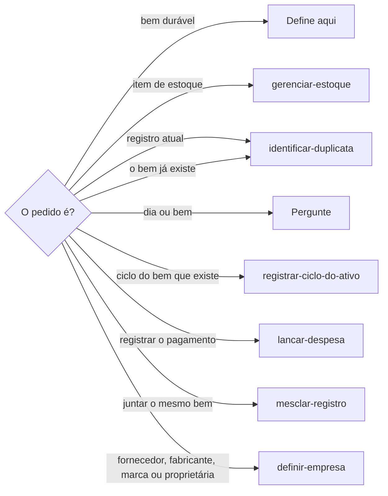
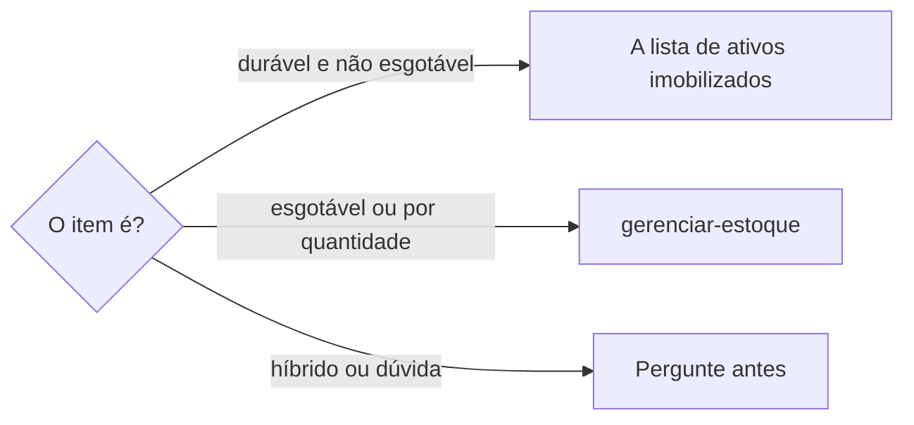
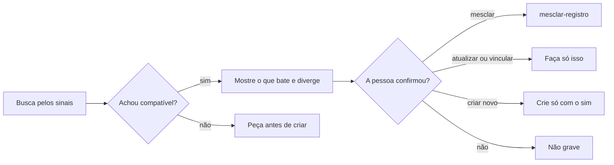
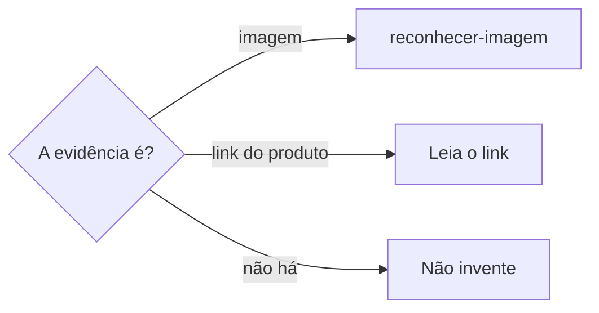

# Definir ativo imobilizado

## Parâmetros de configuração

Leia cada valor nas instruções do projeto: primeiro na entrada com o nome desta habilidade, depois na entrada `Global` ou no primeiro nível do bloco. Quando um valor não estiver lá, use o padrão abaixo.

```yaml
"SKU": "sem hífen"
```

## Instruções

### Passo 1

Cadastrar, revisar, auditar ou vincular um ativo imobilizado, ou saber se o item vai para ativo ou estoque, é esta habilidade. A pessoa informa o data source na execução. Sem essa indicação, use a lista de ativos imobilizados do mapeamento de dados do projeto. O nome de cada propriedade vem desse mapeamento. Se a lista de ativos imobilizados não estiver no workspace conectado, pare. Não use a lista de outro workspace. Estado, manutenção, conserto, empréstimo, parceria, baixa, descarte, venda, perda, troca e depreciação do bem que já existe seguem `registrar-ciclo-do-ativo`. "Temos algum bem hoje?" quer dizer se o registro desse ativo já existe. Segue `identificar-duplicata`. Não é a agenda. Se a frase não separa o dia do bem, pergunte. Não escolha.



### Passo 2

A lista de ativos imobilizados guarda o bem durável, não esgotável e sujeito a depreciação, em unidade identificável e não fungível, mantido para produzir, servir, alugar ou administrar por mais de um período. Sai do balanço por baixa, venda ou fim da vida útil. Sujeito a depreciação classifica o bem. O cálculo segue `registrar-ciclo-do-ativo`. Compra, despesa, investimento, comprovante, nota, recibo ou contexto de item controlável pede o destino antes de criar ou vincular. Máquina, equipamento, mobiliário, ferramenta, arara, manequim, expositor, computador e estrutura ficam na lista de ativos imobilizados. A quantidade das unidades identificáveis permanece no ativo. Tecido, aviamento, linha, botão, etiqueta, embalagem, insumo de produção e material administrativo consumível vão para a lista de estoque quando se esgotam, se consomem, diminuem com o uso, ou se controlam por quantidade, metragem, unidade, lote, rolo, pacote, kit ou volume. Compra por investimento não muda esse destino. O cadastro segue `gerenciar-estoque`. Item híbrido, como tesoura que desgasta e pode ser consertada, ou dúvida entre a lista de ativos imobilizados, a lista de estoque, a lista de produtos, a produção ou só contexto financeiro: peça confirmação. Não crie. Não vincule.



### Passo 3

Antes de criar ou atualizar, busque o bem durável no Notion com `identificar-duplicata`. Use os sinais que existirem: nome, categoria, tipo, marca, modelo, SKU, medidas aberta e fechada, fornecedor, data de compra, preço, foto, link do produto e lançamento financeiro. O SKU segue a chave `SKU`. O fornecedor é a página na empresa proprietária. A foto fica nas fotos. O preço é o preço pago. O lançamento é o que já existe nos lançamentos de custo e investimento. Ativo compatível: mostre o que bate e o que diverge. Peça confirmação antes de mesclar, atualizar, vincular ou criar. Não escolha o canônico. Dois registros do mesmo bem seguem `mesclar-registro` só depois do sim. Título ou descrição ligeiramente diferente no comprovante, na nota, no link ou na conversa não cria outra página.



### Passo 4

Comprovante, nota, recibo, foto do item e link do produto, quando existirem, são lidos antes de preencher. Se for imagem, a leitura fica com `reconhecer-imagem`. Use só o texto que ela devolver. Não leia a imagem aqui. Não invente o que a leitura não trouxe.



Ao criar ou atualizar um bem comprado ou adquirido, relacione o lançamento correspondente nos lançamentos de custo e investimento, quando a propriedade existir. Sem ela, pare. Não crie a propriedade. O preço pago e a data de compra saem dele. O fornecedor é a página da empresa proprietária. O comprovante financeiro fica nesse lançamento. O responsável é quem comprou, quando nomeada. Sem valor, data ou responsável, pare. Não invente esses três. Sem lançamento confiável, acione `lancar-despesa` ou peça os dados mínimos. A origem não está resolvida. O pagamento continua em `lancar-despesa`.

Ao criar ou atualizar, dado útil do comprovante, da nota, do recibo, do link, da foto ou do contexto preenche a propriedade disponível: a categoria do investimento, o tipo, a marca, o modelo, SKU, medidas aberta e fechada, o preço pago, a quantidade, a data de compra, a empresa proprietária, o responsável, as fotos, o link do produto e os lançamentos de custo e investimento. O título é o da página. A sugestão de título, o ID interno e o grupo de categoria não se preenchem. A categoria do investimento é uma página que já existe, no máximo uma. Sem ela, pare e pergunte. Não crie a categoria. Fornecedor, fabricante, marca-empresa e proprietária, quando precisarem de consulta, cadastro ou reconciliação, seguem `definir-empresa`. A empresa proprietária é uma página que já existe. Não crie a empresa aqui. A marca é a lista fechada. Não grave a empresa nesse campo. A data de compra fica no formato da propriedade. O preço pago é o valor efetivamente pago. A quantidade é das unidades identificáveis. Saldo que se esgota fica na lista de estoque. SKU segue a chave `SKU`. As observações patrimoniais recebem só o que não tem propriedade adequada e não substituem categoria, empresa nem lançamento. O corpo guarda contexto, decisão, pendência e o que não tem propriedade. Não copie no corpo o que já está na propriedade. Foto do item fica nas fotos. O link do produto fica no link do produto. Sem inferência segura, não invente marca, modelo, preço, medidas, quantidade nem data.

## Problemas comuns

### Item de estoque no imobilizado

Se você cadastrar tecido, aviamento, linha, botão, etiqueta, embalagem, insumo de produção, material administrativo consumível ou outro item que se esgota na lista de ativos imobilizados, o saldo consumível vira bem durável.

1. Diga que o destino é a lista de estoque e siga `gerenciar-estoque`.
2. Compra por investimento não muda o destino.
3. Não crie a página na lista de ativos imobilizados.

### Híbrido decidido sozinho

Se você cadastrar tesoura ou outro item que desgasta e pode ser consertado sem perguntar, o destino sai errado.

1. Peça confirmação antes de criar e antes de vincular.
2. Não crie a página.
3. Não vincule o registro.

### Destino incerto

Se você criar ou vincular quando a compra, a despesa, o investimento, o comprovante, a nota, o recibo ou o contexto não separa a lista de ativos imobilizados, a lista de estoque, a lista de produtos, a produção ou só o contexto financeiro, o registro nasce no lugar errado.

1. Peça confirmação antes de criar e antes de vincular.
2. Não crie a página.
3. Não vincule o registro.

### Compra sem dado mínimo

Se você criar o bem sem valor pago, data de compra ou responsável, o item fica sem controle.

1. Tire o preço pago e a data de compra do lançamento.
2. O responsável é a pessoa que comprou, quando ela está nomeada.
3. Sem um desses, pare e pergunte. Não invente.

### Lançamento só na nota

Se você escrever a compra só nas observações patrimoniais, o bem fica sem origem financeira.

1. Ligue o lançamento que já existe nos lançamentos de custo e investimento.
2. Sem lançamento confiável, acione `lancar-despesa` ou peça os dados mínimos. A origem não está resolvida.
3. A nota não substitui a relação.

### Origem dada por resolvida

Se você criar ou atualizar o bem sem lançamento confiável e sem pedir os dados mínimos, a compra fica sem rastreio.

1. Relacione nos lançamentos de custo e investimento quando a propriedade existir.
2. Preserve o preço pago, a data de compra, fornecedor e a evidência usada.
3. Sem lançamento confiável, acione `lancar-despesa` ou peça os dados mínimos. A origem não está resolvida.

### Marca no lugar da empresa

Se você gravar a fornecedora na marca, a empresa deixa de ser a página na lista de empresas.

1. A empresa proprietária recebe a página que já existe.
2. A marca permanece a lista fechada do ativo.
3. Sem a empresa, passe para `definir-empresa`. Não crie a empresa aqui.

### Segunda página do mesmo bem

Se você criar ou atualizar a página sem buscar parecidos, arara, máquina, equipamento, mobiliário ou ferramenta nasce de novo.

1. Busque no Notion com `identificar-duplicata` antes de criar e antes de atualizar.
2. Use os sinais que existirem: nome, categoria, tipo, marca, modelo, SKU, medidas aberta e fechada, fornecedor, data de compra, preço, foto, link do produto e lançamento financeiro.
3. Compatível: mostre o que bate e o que diverge. Peça confirmação antes de mesclar, atualizar, vincular ou criar.

### Título diferente que vira página

Se você criar outra página porque o título ou a descrição veio ligeiramente diferente no comprovante, na nota, no link ou na conversa, o mesmo bem nasce de novo.

1. Trate essa diferença como sinal do mesmo bem.
2. Mostre o que bate e o que diverge no ativo compatível.
3. Peça confirmação. Não crie a duplicata.

### Imagem lida aqui

Se você ler a foto do comprovante, da nota, do recibo ou do item nesta habilidade, a leitura pula `reconhecer-imagem`.

1. A imagem vai para `reconhecer-imagem`.
2. Use só o texto que ela devolver.
3. Não invente o que a leitura não trouxe.

### Dado estruturado na nota

Se você gravar marca, modelo, preço, medidas, quantidade ou data só nas observações patrimoniais ou no corpo, a propriedade fica vazia.

1. Preencha a propriedade estruturada disponível.
2. As observações patrimoniais recebem só o que não tem propriedade.
3. Sem inferência segura, deixe vazio. Não invente.

### Comprovante no corpo

Se você colar o comprovante financeiro no corpo do ativo, a evidência sai do lançamento.

1. Foto do item fica nas fotos. O link do produto fica no link do produto.
2. Comprovante financeiro fica no lançamento na lista de despesas e investimentos.
3. O corpo guarda contexto, decisão, pendência e o que não tem propriedade.

### SKU com hífen

Se você gravar o SKU com hífen, o identificador foge da chave `SKU`.

1. Grave o SKU sem hífen.
2. Use esse valor na busca antes de criar.
3. Não invente outro identificador no lugar do ID interno.

## Exemplos de entrada e saída

Estes exemplos ilustram fatos. Eles podem não estar no data source.

### temos algum provador hoje?

Hoje quer dizer atualmente. A pergunta é se já existe registro de um ativo que seja provador. Seguiu `identificar-duplicata`. Não mandei para a agenda. Não criei página.

### o comprovante é uma foto

A imagem foi para `reconhecer-imagem`. Usei só o texto. Não li a foto aqui. Não inventei o que a leitura não trouxe.

### atualize essa máquina

Busquei no Notion com `identificar-duplicata` antes de atualizar. A máquina já existia. Mostrei o que batia e o que divergia. Pedi confirmação antes de atualizar. Não criei outra.

### cadastre a fornecedora dessa máquina

A fornecedora foi consultada, cadastrada ou reconciliada em `definir-empresa`. A empresa proprietária apontou essa página. A marca fechada do ativo permaneceu a lista.

### cadastre essa arara como ativo. A marca veio escrita com um erro.

A marca ficou a da lista fechada, com a grafia certa. A empresa proprietária apontou a página na lista de empresas. O lançamento que já existia entrou nos lançamentos de custo e investimento. O SKU ficou sem hífen.

### essa compra de tecido vai para ativo ou estoque?

O destino é a lista de estoque. O tecido é insumo que se esgota. O cadastro segue `gerenciar-estoque`. Não criei página na lista de ativos imobilizados.

### essa arara vai para ativo ou estoque?

O destino é a lista de ativos imobilizados. A arara é bem durável e não esgotável. Não criei página na lista de estoque.

### essa compra de linha vai para ativo ou estoque?

O destino é a lista de estoque. A linha é insumo que se esgota, controlável por quantidade. Compra por investimento não mudou o destino. O cadastro segue `gerenciar-estoque`. Não criei página na lista de ativos imobilizados.

### essa tesoura vai para ativo ou estoque?

A tesoura desgasta e pode ser consertada. Pedi confirmação. Não criei página. Não vinculei registro.

### o comprovante não separa o destino

Pedi confirmação. O item podia ser a lista de ativos imobilizados, a lista de estoque, a lista de produtos, a produção ou só o contexto financeiro. Não criei página. Não vinculei registro.

### cadastre o bem que comprei nessa despesa

Criei ou vinculei o bem. A origem financeira é o lançamento. O preço pago e a data de compra saíram dele. O responsável é quem comprou. Não registrei o pagamento aqui.

### vincule essa máquina à despesa

Liguei o lançamento que já existia nos lançamentos de custo e investimento. Não registrei o pagamento aqui.

### atualize a origem dessa máquina

Relacionei o lançamento correspondente nos lançamentos de custo e investimento. O preço pago, a data de compra e fornecedor permaneceram no bem. O comprovante financeiro ficou no lançamento. Não registrei o pagamento aqui.

### cadastre o bem sem lançamento confiável

Não havia lançamento confiável. Acionei `lancar-despesa` e pedi os dados mínimos. A origem não ficou resolvida. Não inventei o lançamento.

### o link traz modelo e medidas

Preenchi o modelo e as medidas. O que não tinha propriedade foi para as observações patrimoniais. Não copiei isso no corpo. Não inventei a marca, que a evidência não trouxe.

### a nota fiscal veio com a foto da máquina

A foto foi para as fotos. A nota financeira ficou no lançamento na lista de despesas e investimentos. O corpo não repetiu o preço.

## Casos-limite

- A lista de ativos imobilizados não está no workspace conectado: pare. Não use a lista de outro workspace.
- Item que se esgota, se consome ou diminui com o uso: diga que o destino é a lista de estoque e siga `gerenciar-estoque`. Compra por investimento não muda o destino. Não crie o ativo.
- Item híbrido, como tesoura que desgasta e pode ser consertada: peça confirmação. Não crie. Não vincule.
- O item é máquina, equipamento, mobiliário, ferramenta, arara, manequim, expositor, computador, estrutura ou outro bem durável, não esgotável e sujeito a depreciação: diga que o destino é a lista de ativos imobilizados. A quantidade das unidades identificáveis permanece no ativo.
- Dúvida entre a lista de ativos imobilizados, a lista de estoque, a lista de produtos, a produção ou só contexto financeiro: peça confirmação. Não crie. Não vincule.
- Estado, manutenção, conserto, empréstimo, parceria, baixa, descarte, venda, perda, troca ou depreciação do bem que já existe: `registrar-ciclo-do-ativo`.
- "Temos algum bem hoje?": registro atual em `identificar-duplicata`. Dúvida entre dia e bem: pergunte. Não escolha. Não crie página.
- Criar ou atualizar: busque no Notion com `identificar-duplicata` antes, pelos sinais que existirem. Ativo compatível: mostre o que bate e o que diverge. Peça confirmação antes de mesclar, atualizar, vincular ou criar. Dois registros do mesmo bem: `mesclar-registro` só depois do sim.
- Título ou descrição ligeiramente diferente no comprovante, na nota, no link ou na conversa: não crie outra página.
- Comprovante, nota, recibo, foto, link ou contexto traz dado útil: leia e preencha a propriedade estruturada. Imagem: `reconhecer-imagem`. Use só o texto. Foto do item fica nas fotos. O link do produto fica no link do produto. Comprovante financeiro fica no lançamento. O corpo guarda contexto, decisão, pendência e o que não tem propriedade. Sem inferência segura, não invente marca, modelo, preço, medidas, quantidade nem data.
- A categoria do investimento não existe: pare e pergunte. Não crie a categoria.
- Fornecedor, fabricante, marca ou empresa proprietária precisa de consulta, cadastro ou reconciliação: `definir-empresa`. Não crie a empresa aqui. A marca fechada do ativo não é essa empresa.
- Criar ou atualizar o bem comprado: ligue os lançamentos de custo e investimento quando a propriedade existir. Preserve o preço pago, a data de compra, fornecedor e a evidência usada.
- Não há lançamento financeiro confiável: acione `lancar-despesa` ou peça os dados mínimos. A origem não está resolvida. Não invente o lançamento. Não crie a propriedade.
- A compra não traz valor pago, data de compra ou responsável: pare e pergunte. Não invente esses três.
- A sugestão de título, o ID interno e o grupo de categoria: não preencha.

## Pegadinhas

- Parecido parece autorização para criar outra página. Ativo compatível mostra o que bate e o que diverge. Mesclar, atualizar, vincular ou criar espera confirmação.
- Atualizar parece dispensar a busca. A busca no Notion, com `identificar-duplicata`, acontece antes de criar e antes de atualizar.
- Título ligeiramente diferente no comprovante parece outro bem. Não é. Não crie a duplicata.
- A foto do comprovante parece leitura desta habilidade. Imagem fica com `reconhecer-imagem`.
- O responsável parece a empresa que recebeu o pagamento. O responsável é a pessoa que comprou o bem, quando ela está nomeada.
- A marca parece a fornecedora. A marca é a lista fechada do ativo. Fornecedor, fabricante, marca-empresa e proprietária ficam em `definir-empresa`, e a página entra na empresa proprietária.
- A quantidade no ativo parece saldo de estoque. No ativo, a quantidade é das unidades identificáveis. O saldo que se esgota fica na lista de estoque.
- Linha, botão, etiqueta, embalagem e material administrativo parecem bem durável. Vão para a lista de estoque, em `gerenciar-estoque`. Compra por investimento não muda o destino.
- Tesoura que desgasta e pode ser consertada parece decisão pronta. Peça confirmação.
- Manequim, expositor, computador e estrutura parecem peça ou produção. Sem dúvida, ficam na lista de ativos imobilizados. Com dúvida, peça confirmação antes de criar ou vincular.
- Só o contexto financeiro parece cadastro do bem. Sem o destino claro, peça confirmação. Não crie. Não vincule.
- O grupo de categoria parece um campo para escolher. É rollup. A categoria é a relação da categoria do investimento.
- O link do produto parece o site da fornecedora. É o link da página do item na loja onde ele foi comprado.
- As observações patrimoniais parecem a origem resolvida. A relação é a dos lançamentos de custo e investimento. Sem lançamento confiável, a origem continua aberta.
- As observações patrimoniais e o corpo parecem lugar de marca, modelo, preço, medidas, quantidade ou data. Isso vai na propriedade. Sem inferência segura, o campo fica vazio.
- Baixa, manutenção, empréstimo e depreciação parecem este cadastro. O bem que já existe segue `registrar-ciclo-do-ativo`.
- "Hoje" parece o compromisso do dia. Em "temos algum bem hoje?", é o registro atual do ativo. Se a frase não separa os dois, pergunte.
- Comprovante financeiro parece corpo do ativo. Fica no lançamento na lista de despesas e investimentos.

## Scripts disponíveis

- Nenhum.

1. Não há script para executar.
