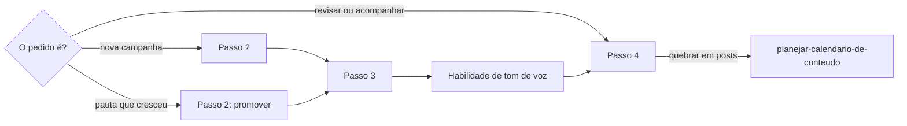

# Definir campanha de conteúdo

## Parâmetros de configuração

Leia cada valor nas instruções do projeto: primeiro na entrada com o nome desta habilidade, depois na entrada `Global` ou no primeiro nível do bloco. Quando um valor não estiver lá, use o padrão abaixo. `Habilidade de tom de voz` vazia quer dizer que a promessa e o CTA seguem só esta habilidade. `Referências da estratégia de conteúdo` lista a página do Notion e outras referências com a estratégia de conteúdo original da marca. Uma referência que a pessoa der no pedido vale junto. Sem nenhuma, o objetivo vem só da pessoa.

```yaml
"Formato da data com dia da semana": "terça-feira, 01/09/2026"
"Habilidade de tom de voz": ""
"Referências da estratégia de conteúdo": []
"Modo de aprendizado": "perguntar"
```

## Instruções

### Passo 1

A lista de campanhas de conteúdo e o nome de cada propriedade vêm do mapeamento de dados do projeto, no workspace conectado. Se a lista não estiver nessa conexão, pare. Este texto usa os conceitos: o nome da campanha, o status, o início e o fim. Os status são rascunho, planejada, em andamento e encerrada. A lista de posts e a lista de datas significativas entram quando o mapeamento as tem.

A campanha é a narrativa estratégica de uma janela. Ela se desdobra em vários posts. Antes de criar, busque a campanha pelo nome e pela janela. Se já existe, revise essa página.



### Passo 2

Defina a janela.

1. Ancore a campanha numa data significativa quando houver uma. A data de referência e o link dela vão no corpo.
2. Se a data de referência deste ano já passou, use a próxima ocorrência e diga a troca.
3. A janela não se sobrepõe a outra campanha nem a outra data significativa com narrativa própria. Comece depois dela e diga o motivo.
4. Não invente data. Sem data de referência nem janela dada pela pessoa, pergunte.

Uma pauta da lista de posts que ganhou janela própria e vários desdobramentos vira campanha. A campanha nova registra a origem no corpo. Não apague o post de origem.

### Passo 3

Leia o modelo de saída `campanha-de-conteudo` quando for gerar a saída.

O objetivo editorial parte das `Referências da estratégia de conteúdo`. A estratégia da campanha fica no corpo da página: conceito, promessa, público, objetivo editorial, etapas por semana, desdobramentos por formato e canal, CTA principal, cadência e decisão editorial. Cada etapa tem a função editorial, os conteúdos sugeridos e as métricas. A promessa e o CTA passam pela `Habilidade de tom de voz`.

### Passo 4

O status segue a janela. Sem janela, rascunho. Com a janela no futuro, planejada. Dentro da janela, em andamento. Depois do fim, encerrada. Ao revisar, mude o status que a data já mudou e diga a mudança.

Para quebrar a campanha em posts, siga `planejar-calendario-de-conteudo`. Esta habilidade não cria posts.

### Passo 5

Valide antes de mostrar. Corrija e repita até passar.

- [ ] A janela tem início e fim, ou a campanha está em rascunho.
- [ ] A janela não se sobrepõe a outra campanha nem a outra data com narrativa própria.
- [ ] A data de referência é deste ano ou da próxima ocorrência.
- [ ] Cada etapa tem função editorial, conteúdos sugeridos e métricas.
- [ ] O status bate com a janela.

Mostre o link da página, a janela no `Formato da data com dia da semana`, o status e o que ficou pendente.

### Passo 6

Ao terminar, siga `evoluir-habilidade` conforme `Modo de aprendizado`.

## Problemas comuns

### Campanha cadastrada como post

Se você registrar a estratégia de uma campanha como um post na lista de posts, ela perde o nível estratégico e some no meio dos posts.

1. Crie a campanha na lista de campanhas.
2. Registre a origem no corpo.
3. Deixe os posts para `planejar-calendario-de-conteudo`.

### Janela sobreposta

Se você abrir a campanha durante outra narrativa, as duas competem pela mesma semana.

1. Veja as campanhas e as datas significativas perto da janela.
2. Comece depois da outra narrativa e diga o motivo.

### Data de referência vencida

Se você mantiver a data do ano que já passou, a campanha fica planejada para o passado.

1. Use a próxima ocorrência da data significativa.
2. Ajuste a janela e diga a troca.

## Exemplos de entrada e saída

Estes exemplos ilustram fatos. Eles podem não estar no data source.

### planeje a campanha de Black Friday

A campanha entrou como planejada, com janela de 4 semanas que começa depois de outras duas datas com narrativa própria, para não misturar narrativas. O corpo traz as etapas por semana, cada uma com função editorial, conteúdos sugeridos e métricas, a cadência e o pico na data principal. Os posts ficaram para a habilidade de calendário.

### essa pauta de Dia dos Pais virou algo maior, transforma em campanha

A pauta virou campanha, com a origem registrada no corpo. A data do ano corrente já tinha passado, então a janela foi ancorada na próxima ocorrência, com o link da data significativa. O post de origem ficou na lista de posts.

## Casos-limite

- A campanha não tem data significativa: a janela vem da pessoa. Sem ela, pergunte.
- Duas campanhas querem a mesma janela: mostre o conflito e deixe a pessoa escolher.
- A janela já começou e o status diz planejada: mude para em andamento e diga.
- A pessoa pede os posts da campanha: siga `planejar-calendario-de-conteudo`.
- A data significativa ainda não está na lista: peça para cadastrar antes de ancorar.

## Pegadinhas

- Uma pauta grande na lista de posts parece só um post. Com janela própria e vários desdobramentos, ela é campanha.
- A data de referência copiada de outro ano parece valer. Ela é da próxima ocorrência.
- Uma data significativa sem campanha parece deixar a janela livre. Ela pode ter narrativa própria.
- O status planejada parece permanente. Ele muda quando a janela começa e quando termina.

## Scripts disponíveis

- Nenhum.

1. Não há script para executar.
