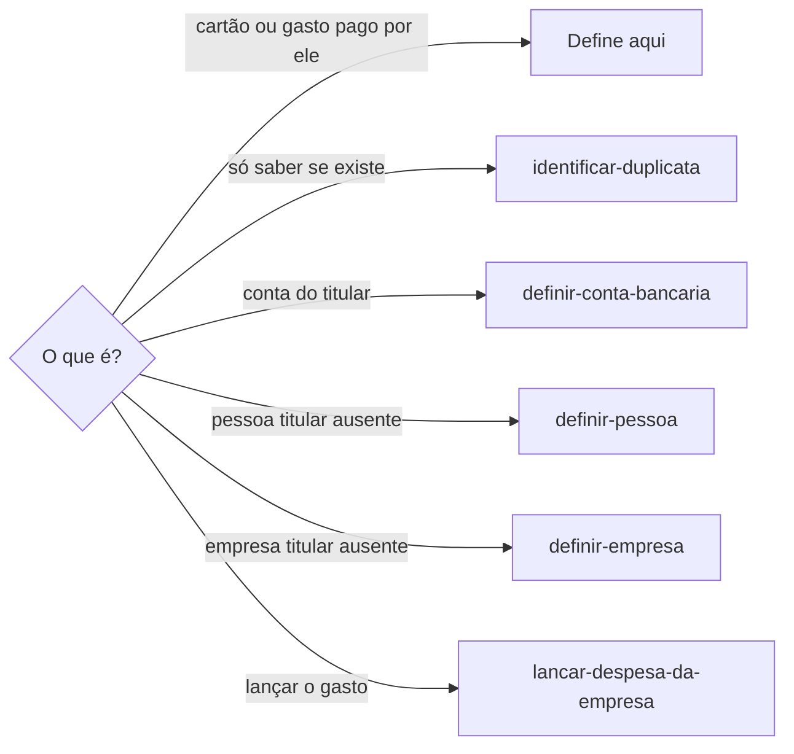

# Definir cartão

## Parâmetros de configuração

Leia cada valor nas instruções do projeto: primeiro na entrada com o nome desta habilidade, depois na entrada `Global` ou no primeiro nível do bloco. Quando um valor não estiver lá, use o padrão abaixo.
```yaml
# `Padrão do nome do cartão` é o molde do título da página do cartão. Os campos entre `<>` vêm do cadastro.
"Padrão do nome do cartão": "Crédito <banco> — <titular> — <bandeira> final <final>"
"Modo de aprendizado": "perguntar"
```
## Instruções

### Passo 1

Cadastrar, revisar ou atualizar um cartão na lista de cartões, e ligar a ele os gastos que ele pagou, é esta habilidade. A pessoa informa o data source na execução, ou o endereço da lista. Sem isso, use a lista do mapeamento de dados do projeto. Se a lista não estiver no workspace conectado, pare. Não use a lista de outro workspace.



### Passo 2

Antes de dizer que a lista de cartões não existe, abra a que a pessoa indicou e procure pelo nome com as variações, como cartão, cartões e cartão de crédito. Uma busca por uma palavra não acha a lista de outro nome. Só peça o endereço depois de tentar essas buscas.

Antes de criar, busque o cartão pelo final, pela bandeira, pelo banco e pelo titular. O mesmo cartão volta a ser usado, e um cartão de outra pessoa com o mesmo final é outro cartão. Resultado ambíguo: pergunte antes de criar ou ligar.

### Passo 3

Cartão tem página própria, separada da conta. Grave o titular, a bandeira e os quatro últimos dígitos. Nunca grave o número completo, a validade nem o código de segurança, mesmo que a pessoa os envie.

O nome da página segue `Padrão do nome do cartão`. A conta vinculada é a conta do titular no banco emissor. Nome do titular e banco, sozinhos, indicam uma candidata, não a conta do cartão: ligue quando a pessoa confirmar ou quando os dados da conta aparecerem na evidência.

### Passo 4

O tipo do cartão segue o titular. Cartão de pessoa física liga a pessoa titular e a conta de pessoa física, e cartão de pessoa jurídica liga a empresa titular e a conta da empresa. Um cartão de pessoa física que pagou compra da empresa continua de pessoa física, e a observação do cartão diz que ele é usado em compras da empresa.

Se a lista não tem propriedade para marcar pessoa física ou jurídica, avise, recomende criá-la e não a crie antes do sim da pessoa. Até lá, o tipo fica na observação.

### Passo 5

Ao ligar um gasto ao cartão, use a relação mapeada e confira o vínculo salvo nos dois lados. O cartão não muda de quem é o gasto: uma despesa da empresa paga no cartão de pessoa física segue da empresa, com a pessoa titular como quem pagou, como `lancar-despesa-da-empresa` manda. As parcelas ficam nas observações do gasto quando a lista de despesas não tem campo para elas.

Ao terminar, siga `evoluir-habilidade` conforme `Modo de aprendizado`.

## Problemas comuns

### Lista de cartões dada como inexistente

Se você disser que não há lista de cartões depois de procurar por uma palavra só, a pessoa precisa mandar o endereço de uma lista que já existia.

1. Abra a lista que a pessoa indicou, ou procure pelo nome e pelas variações.
2. Só peça o endereço depois de tentar.
3. Cadastre o cartão nessa lista.

### Dado do cartão demais

Se você gravar o número completo, a validade ou o código de segurança, a lista passa a guardar o que permite uma compra.

1. Grave só os quatro últimos dígitos.
2. Apague o que sobrou na página, com o sim da pessoa.
3. Avise a pessoa de que o dado entrou.

### Cartão de pessoa física tratado como da empresa

Se você marcar como pessoa jurídica o cartão de pessoa física que pagou a compra da empresa, o histórico perde quem arcou com o dinheiro.

1. Deixe o cartão com a pessoa titular e a conta de pessoa física.
2. Diga na observação que ele é usado em compras da empresa.
3. Mantenha o gasto como da empresa.

## Exemplos de entrada e saída

Estes exemplos ilustram fatos. Eles podem não estar no data source.

### a máquina foi paga no Visa final 1234 de um banco, no cartão da pessoa titular

Busquei o cartão pelo final, pela bandeira e pelo titular, e não achei. Cadastrei com a pessoa titular, a conta de pessoa física do mesmo banco e a observação de que o cartão é usado em compras da empresa. Liguei a despesa ao cartão e conferi o vínculo nos dois lados.

### a lista de cartões não existe

Abri o endereço que a pessoa mandou e achei a lista com o nome "Cartões". Cadastrei lá.

## Casos-limite

- A lista não tem propriedade de tipo, pessoa física ou jurídica: avise e recomende. Não crie a propriedade.
- A pessoa informa só o final e o banco, sem o titular: pergunte o titular antes de criar.
- O mesmo final aparece em dois cartões de titulares diferentes: são dois cartões.
- A empresa ainda não tem cartão de pessoa jurídica: não crie um. Os gastos pagos em cartão de pessoa física ficam ligados a ele.
- A conta do titular não está cadastrada: siga `definir-conta-bancaria` e volte.

## Pegadinhas

- Uma busca por "cartão" parece cobrir a lista de cartões. O banco pode se chamar "Cartões", e a busca por uma palavra não o acha.
- O banco e o titular parecem identificar a conta do cartão. Eles indicam uma candidata.
- O cartão de pessoa física parece tornar o gasto pessoal. O gasto continua da empresa.

## Scripts disponíveis

- Nenhum.

1. Não há script para executar.
