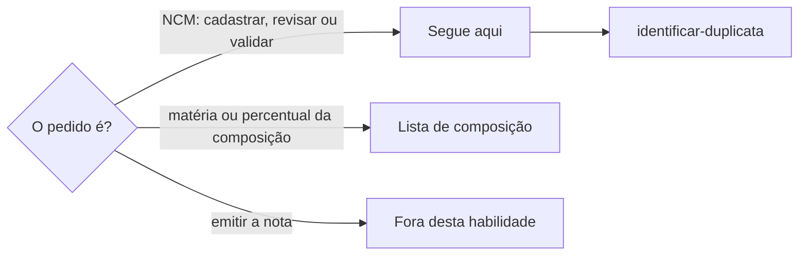

# Definir código fiscal

## Parâmetros de configuração

```yaml
"Modo de aprendizado": "perguntar"
```

## Instruções

### Passo 1



A pessoa informa na execução a lista de códigos fiscais, a de variações e a de composição, como a dos tecidos no vestuário.
Se uma delas não estiver no workspace conectado, pare.
Não use a lista de outro workspace.

### Passo 2

Antes de criar um código, procure pelo número e pela descrição com `identificar-duplicata`.
Um código que já existe serve para toda mercadoria com as mesmas características.
Não crie outro registro para o mesmo número.

### Passo 3

O registro do código diz por que uma mercadoria cai nele, e não quais produtos usam o código.
A descrição é a do texto oficial, e a fonte é o link da tabela ou da consulta oficial usada.
As notas listam as características que levam à classificação: o tipo de mercadoria, o uso, a matéria que predomina e, no vestuário, a construção, como malha ou tecido plano.
As notas não citam produto, variação nem unidade.

### Passo 4

A matéria que predomina vem da composição da variação, como a do tecido no vestuário.
A composição fica na lista de composição, com cada matéria e o percentual.
Não copie a composição para o código.
Sem composição registrada, pergunte à pessoa.
A resposta dela é uma confirmação e segue o Passo 5.

### Passo 5

Toda confirmação, decisão ou mudança de status vira um comentário datado na página do código: quem confirmou, o quê, quando e com que fonte.
Não grave a confirmação nas notas nem em outra propriedade.
O comentário guarda o histórico da decisão.

### Passo 6

O código entra como Em estudo.
Ele só passa para Validado com o sim de quem decide, como a pessoa ou a contabilidade, e esse sim vira comentário pelo Passo 5.
A confirmação de uma matéria não valida o código sozinha.

### Passo 7

O código fica na variação, porque a cor e o material podem mudar a matéria e, com ela, o código.
Não ligue o código à unidade.
Se a variação ainda não tiver o campo, ligue ao produto, diga que a ligação é provisória e sugira o campo na variação.
Não crie a propriedade.

### Passo 8

Ao terminar, siga `evoluir-habilidade` conforme `Modo de aprendizado`.

## Problemas comuns

### Confirmação gravada nas notas

Se você escrever nas notas quem confirmou a matéria e quando, o registro do código passa a contar a história de um produto e o histórico se mistura com a regra.

1. Devolva as notas ao texto de antes.
2. Grave a confirmação como comentário datado na página do código.
3. Deixe nas notas só as características da classificação.

### Composição copiada para o código

Se você copiar a matéria e o percentual da composição para o código, a composição passa a ter duas fontes e uma delas desatualiza.

1. Registre a composição na lista de composição.
2. No código, cite só a característica, como fibras sintéticas ou artificiais.

### Validado sem o sim

Se você marcar o código como Validado porque a pessoa confirmou a matéria, a nota pode sair com uma classificação que ninguém aprovou.

1. Mantenha Em estudo.
2. Pergunte quem valida.
3. Mude o status só com o sim, registrado em comentário.

## Exemplos de entrada e saída

Estes exemplos ilustram fatos. Eles podem não estar no data source.

### o tecido da camisa é todo de poliéster

Gravei na página do código um comentário datado com a confirmação, quem confirmou e a data. As notas não mudaram. O status continuou Em estudo. A composição ficou para a lista de composição, que pede o percentual de cada matéria.

### qual o NCM dessa camisa?

Achei a variação, li a composição e procurei o código pelas características. O código já existia e servia. Mostrei o número, o status e as características que levam a ele.

## Casos-limite

- Matérias misturadas sem predominância clara: pergunte. Não escolha.
- Duas variações do mesmo produto com matérias diferentes: cada uma pode ter um código diferente.
- A variação não tem composição registrada: pergunte a matéria e o percentual. Sem percentual, registre só o comentário.
- As notas antigas citam um produto: proponha reescrever só com as características e espere o sim.
- O pedido é emitir a nota: diga que a emissão fica fora desta habilidade.

## Pegadinhas

- No vestuário, o nome do tecido não diz a fibra. Organza e veludo podem ser de seda, de algodão ou de poliéster.
- No vestuário, a fibra separa códigos vizinhos. No outro vestuário de uso feminino, algodão é 6211.42 e fibras sintéticas ou artificiais são 6211.43.
- Vestuário que não se reconhece como masculino nem como feminino se classifica como de uso feminino.
- O código fica na variação e não na unidade. Repetir o código em cada unidade não acrescenta informação.

## Scripts disponíveis

- Nenhum.

1. Não há script para executar.
