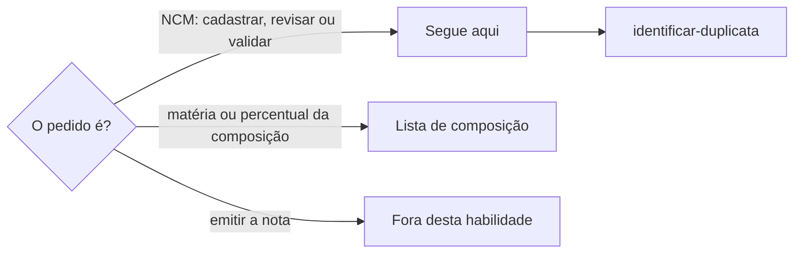

# Definir código fiscal

## Parâmetros de configuração

```yaml
"Status em estudo": "Em estudo"
# `Status validado por IA`: a IA conferiu a fonte oficial, a composição e as características.
"Status validado por IA": "Validado por IA"
# `Status validado por pessoa`: uma pessoa validou. É a validação mais forte.
"Status validado por pessoa": "Validado"
"Modo de aprendizado": "perguntar"
```

## Instruções

### Passo 1



A pessoa informa na execução a lista de códigos fiscais, a de variações e a de composição, como a dos tecidos no vestuário.
Se uma delas não estiver no workspace conectado, pare.
Não use a lista de outro workspace.

### Passo 2

Antes de criar um código, procure pelo número e pela descrição com `identificar-duplicata`.
Um código que já existe serve para toda mercadoria com as mesmas características.
Não crie outro registro para o mesmo número.

### Passo 3

O registro do código diz por que uma mercadoria cai nele, e não quais produtos usam o código.
A descrição é a do texto oficial.
A fonte é o link estável da tabela oficial, como o arquivo da TIPI publicado pela Receita, que abre sem sessão e mostra o código.
Antes de gravar, abra o link e confira que ele mostra o código: link de pesquisa que cai noutra página não serve.
Com a propriedade da fonte vazia ou com um link que não abre, preencha com o link conferido.
Sem a propriedade, sugira criá-la e não valide o código até ela existir.
As notas listam as características que levam à classificação: o tipo de mercadoria, o uso, a matéria que predomina e, no vestuário, a construção, como malha ou tecido plano.
As notas não citam produto, variação nem unidade.

### Passo 4

A matéria que predomina vem da composição da variação, como a do tecido no vestuário.
A composição fica na lista de composição, com cada matéria e o percentual.
Não copie a composição para o código.
No vestuário, a construção, malha ou tecido plano, também conta.
Sem composição registrada, ou sem a construção no vestuário, pergunte as duas à pessoa de uma vez.
A resposta dela é uma confirmação e segue o Passo 5.

### Passo 5

Toda confirmação, decisão ou mudança de status vira um comentário datado na página do código: quem confirmou, o quê, quando e com que fonte.
Não grave a confirmação nas notas nem em outra propriedade.
O comentário guarda o histórico da decisão.

### Passo 6

O código entra como `Status em estudo`.
Ele passa para `Status validado por IA` quando você abriu a fonte gravada e conferiu nela o código, a descrição e as notas do capítulo, a composição e, no vestuário, a construção estão confirmadas, as notas batem com a descrição oficial, e você descartou as posições mais específicas antes de uma posição residual.
Com uma dúvida aberta, o código continua em `Status em estudo`, e o comentário diz qual é a dúvida.
Registre num comentário o que foi conferido e a fonte, pelo Passo 5.
Ele só passa para `Status validado por pessoa` com o sim de uma pessoa, como a responsável ou a contabilidade, também registrado em comentário.
Essa é a validação mais forte, e você nunca a marca sem esse sim.
A confirmação de uma matéria, sozinha, não valida o código.

### Passo 7

O código fica na variação, porque a cor e o material podem mudar a matéria e, com ela, o código.
Não ligue o código à unidade.
Se a variação ainda não tiver o campo, ligue ao produto, diga que a ligação é provisória e sugira o campo na variação.
Não crie a propriedade.

### Passo 8

Ao terminar, siga `evoluir-habilidade` conforme `Modo de aprendizado`.

## Problemas comuns

### Confirmação gravada nas notas

Se você escrever nas notas quem confirmou a matéria e quando, o registro do código passa a contar a história de um produto e o histórico se mistura com a regra.

1. Devolva as notas ao texto de antes.
2. Grave a confirmação como comentário datado na página do código.
3. Deixe nas notas só as características da classificação.

### Composição copiada para o código

Se você copiar a matéria e o percentual da composição para o código, a composição passa a ter duas fontes e uma delas desatualiza.

1. Registre a composição na lista de composição.
2. No código, cite só a característica, como fibras sintéticas ou artificiais.

### Fonte que não abre o código

Se você gravar como fonte um link que cai numa página de pesquisa, ninguém consegue conferir a classificação depois.

1. Abra o link antes de gravar.
2. Troque pelo link estável da tabela oficial, que mostra o código.
3. Registre a troca num comentário.

### Validação por pessoa sem o sim

Se você marcar `Status validado por pessoa` porque a pessoa confirmou a matéria ou porque a sua conferência passou, a nota pode sair com uma validação que nenhuma pessoa deu.

1. Com a conferência completa, use `Status validado por IA` e registre o que conferiu.
2. Pergunte quem valida.
3. Mude para `Status validado por pessoa` só com o sim, registrado em comentário.

## Exemplos de entrada e saída

Estes exemplos ilustram fatos. Eles podem não estar no data source.

### o tecido da camisa é todo de poliéster

Gravei na página do código um comentário datado com a confirmação, quem confirmou e a data. As notas não mudaram. O status continuou `Status em estudo`. A composição ficou para a lista de composição, que pede o percentual de cada matéria.

### qual o NCM dessa camisa?

Achei a variação, li a composição e procurei o código pelas características. O código já existia e servia. Mostrei o número, o status e as características que levam a ele.

## Casos-limite

- Matérias misturadas sem predominância clara: pergunte. Não escolha.
- Duas variações do mesmo produto com matérias diferentes: cada uma pode ter um código diferente.
- A variação não tem composição registrada: pergunte a matéria, o percentual e, no vestuário, a construção. Sem percentual, registre só o comentário.
- As notas antigas citam um produto: proponha reescrever só com as características e espere o sim.
- O pedido é emitir a nota: diga que a emissão fica fora desta habilidade.

## Pegadinhas

- No vestuário, a construção decide o capítulo antes da fibra: malha é o capítulo 61, e tecido plano é o 62.
- No vestuário, o nome do tecido não diz a fibra nem a construção. Organza e veludo podem ser de seda, de algodão ou de poliéster, e o veludo pode ser de malha ou plano.
- No vestuário, a fibra separa códigos vizinhos. No outro vestuário de uso feminino, algodão é 6211.42 e fibras sintéticas ou artificiais são 6211.43.
- No vestuário, o lado do fechamento decide o uso: o que se fecha à frente da direita para a esquerda é feminino, e da esquerda para a direita é masculino, salvo quando o corte indica claramente um dos dois. Só o que não se reconhece como um nem outro vai para o feminino.
- Uma posição residual, como outro vestuário, só vale depois de descartar as posições específicas do capítulo, como a de casacos ou a de roupões.
- O link de consulta do site de normas da Receita pode cair na página de pesquisa. O arquivo da TIPI abre direto.
- O código fica na variação e não na unidade. Repetir o código em cada unidade não acrescenta informação.

## Scripts disponíveis

- Nenhum.

1. Não há script para executar.
