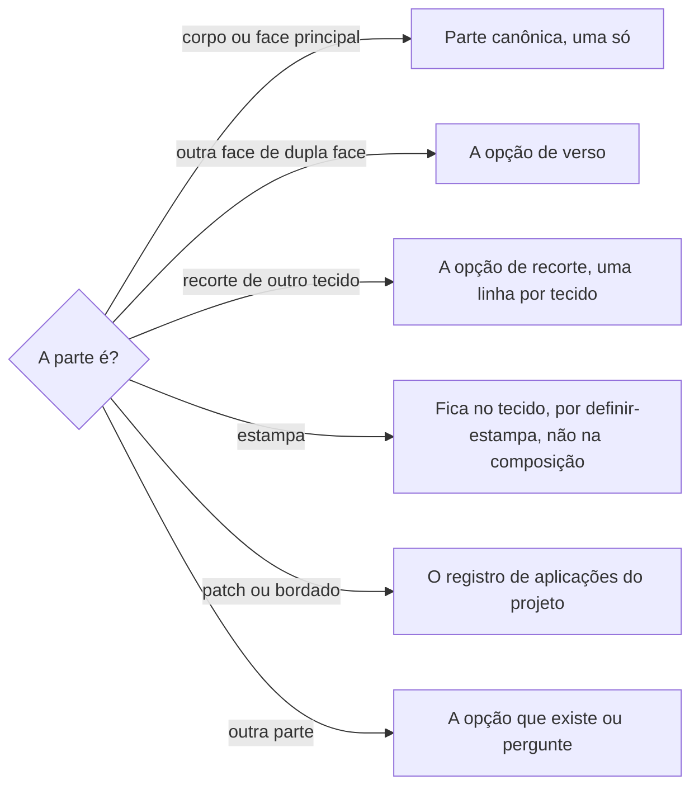

# Definir composição têxtil

## Parâmetros de configuração

Leia cada valor nas instruções do projeto: primeiro na entrada com o nome desta habilidade, depois na entrada `Global` ou no primeiro nível do bloco. Quando um valor não estiver lá, use o padrão abaixo.

```yaml
"Modo de aprendizado": "perguntar"
# Nomes de banco e de parte: o projeto define. Vazios, pergunte uma vez e não escolha.
# `Banco de composições`: uma linha por parte e tecido de cada produto.
"Banco de composições": ""
# `Parte canônica`: a parte que as fórmulas do produto leem para a composição principal e o prefixo do SKU.
"Parte canônica": ""
# `Partes de acabamento`: partes que saem da etiqueta quando o tecido delas já está na frente ou no verso. Um exemplo é a gola.
"Partes de acabamento": []
```

## Instruções

### Passo 1

Ache o produto e a variante pelo nome e pelas variações de nome, e leia todas as linhas de composição da variante antes de mexer.

Os nomes vêm das instruções do projeto. Com `Banco de composições` vazio, a pessoa informa o data source na execução e você não escolhe um. Se ele não estiver no workspace conectado, pare.

Uma linha é uma parte da variante num tecido: a frente é um tecido, o forro é outro. O tecido tem a composição e a estampa, e a linha só o liga à parte, sem copiar nada dele. A parte vem da opção do campo Parte: a pessoa diz "estrutura" ou "tampa do bolso", e você usa a opção mais próxima e diz qual usou. Parte que não existe pede o sim da pessoa antes de criar a opção, com o nome e a descrição. Não crie propriedade nova no produto para isso.

Material que o projeto trata como têxtil entra como tecido, cadastrado por `definir-tecido`, mesmo que não seja têxtil de fato, como um plástico holográfico. Material que o projeto não trata como têxtil, pergunte antes de registrar.



### Passo 2

Cada variante tem uma linha só na `Parte canônica`, porque as fórmulas do produto leem a primeira que acham. Com `Parte canônica` vazia, pergunte qual é antes de gravar. Na dupla face, a face que fica para fora no uso principal é a canônica e a outra vai no verso. Pergunte qual é antes de gravar e avise que o prefixo do SKU pode mudar.

A linha aponta para o tecido real em `definir-tecido`. Um tecido genérico, como "100% CO", é coringa: use só quando a pessoa não souber o tecido, e diga que ficou genérico. Um tecido que falta é cadastrado por `definir-tecido` antes da linha.

O título da linha é a parte, o nome atual do produto, a variante e o nome curto do tecido, como "frente de Camisa Giz com 100% PES". O nome curto é decisão do projeto por causa do espaço da etiqueta. Quando o produto muda de nome, renomeie as linhas dele na mesma hora.

### Passo 3

Monte a composição da etiqueta de uma variante a partir das linhas dela:

- [ ] Um item por tecido distinto, com a composição de fibras dele.
- [ ] O mesmo tecido em cores diferentes conta uma vez.
- [ ] Uma linha de `Partes de acabamento` sai quando o tecido dela já está na frente ou no verso.
- [ ] Dupla face leva uma composição por face. Forro e recorte de tecido próprio entram.

`Partes de acabamento` vazias: pergunte quais partes saem e não presuma uma lista. Mostre a etiqueta montada e as linhas que ficaram de fora, com o motivo.

### Passo 4

Correção que a pessoa pede é gravada, não só comentada. O comentário guarda o histórico quando a pessoa pede, na página do produto, com o que mudou e por quê. Linha sem produto vinculado é apagada só com o sim da pessoa.

Na resposta, dê o link de cada linha criada ou mudada e a decisão que falta.

### Passo 5

Ao terminar, siga `evoluir-habilidade` conforme `Modo de aprendizado`.

## Problemas comuns

### Duas faces na parte canônica

Se você gravar as duas faces de um produto dupla face na `Parte canônica`, a composição principal e o SKU leem uma face só, sem aviso.

1. Pergunte qual face fica para fora.
2. A outra vai no verso.

### Produto renomeado com linhas antigas

Se você só comentar que o título da linha ficou com o nome antigo, a etiqueta e a busca continuam com o produto errado.

1. Renomeie as linhas do produto.
2. Procure o nome antigo nas outras linhas e corrija as que pertencem a produtos renomeados.

### Etiqueta que repete tecido

Se você listar uma composição por linha, a etiqueta repete o mesmo tecido no cós, na gola e na frente e não cabe.

1. Agrupe por tecido.
2. Tire as partes de acabamento repetidas.

### Nome de banco ou de parte inventado

Se você escolher um banco ou uma parte que o projeto não definiu, a linha cai no lugar errado e a fórmula do produto lê outra.

1. Leia os parâmetros nas instruções do projeto.
2. Vazios, pergunte uma vez.
3. Não escolha.

## Exemplos de entrada e saída

Estes exemplos ilustram fatos. Eles podem não estar no data source.

### A calça dupla face é 100% viscose de um lado e linho do outro

As linhas eram frente em 100% CV, frente em linho, cós e tornozeleira em linho. Perguntei qual face fica para fora e avisei do SKU. A etiqueta: 55% algodão, 30% viscose e 15% linho, e 100% viscose. Cós e tornozeleira ficaram de fora porque repetem o linho.

### O colete é algodão com dois tecidos de recorte

frente em um tecido de 100% CO, uma linha de recorte em uma malha e outra em outra malha. A etiqueta leva os três tecidos.

## Casos-limite

- A pessoa não sabe as porcentagens de uma malha: registre o tecido com as fibras, sem inventar o percentual, e guarde no comentário de onde virá a inferência.
- A estampa é do tecido, não do produto nem da variante: outra estampa é outro tecido, cadastrado por `definir-tecido`, e a variante troca a linha para ele. Recorte não é aplicação.
- A pessoa usa um apelido para o tecido: confira o nome no banco de tecidos antes de ligar a linha.
- Um parâmetro está vazio nas instruções do projeto: pergunte uma vez e não escolha.

## Pegadinhas

- As fórmulas do produto pegam a primeira linha da `Parte canônica`. Duas linhas ali dão um SKU que depende da ordem.
- O banco pode exigir uma linha na `Parte canônica`. Uma frente toda em recortes leva um tecido na canônica e os outros nos recortes.
- Elastano aparece como PUE nas linhas de fibra.
- Duas malhas parecidas do mesmo fornecedor podem ter os nomes trocados pela pessoa. A ficha técnica decide.

## Scripts disponíveis

- Nenhum.

1. Não há script para executar.
