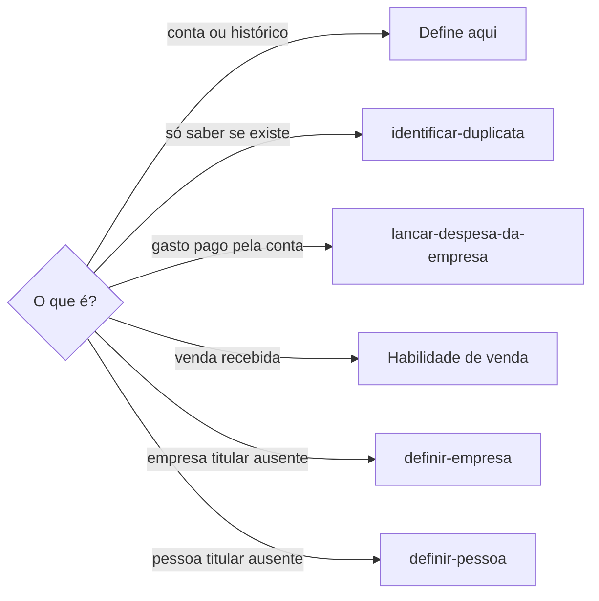

# Definir conta bancária

## Parâmetros de configuração

Leia cada valor nas instruções do projeto: primeiro na entrada com o nome desta habilidade, depois na entrada `Global` ou no primeiro nível do bloco. Quando um valor não estiver lá, use o padrão abaixo. `Títulos dos modelos` lista o começo do título das páginas que são modelos da lista de contas. `Habilidade de venda` vazia quer dizer que a venda recebida fica fora desta habilidade. `Chave Pix nos dados para pagamento` com `obrigatória` faz os dados para pagamento, enviados a quem vai pagar, levarem a chave Pix principal da conta. Com `opcional`, a chave entra só se já estiver cadastrada.

```yaml
"Títulos dos modelos": []
"Habilidade de venda": ""
"Chave Pix nos dados para pagamento": "opcional"
"Modo de aprendizado": "perguntar"
```

## Instruções

### Passo 1

Cadastrar, revisar ou atualizar uma conta na lista de contas bancárias, e registrar o histórico dela, é esta habilidade. A pessoa informa o data source na execução. Se a lista não estiver no workspace conectado, pare. Não use a lista de outro workspace.



### Passo 2

Antes de criar, busque a conta pelo banco, pela conta, pela agência e pelo titular. Página cujo título começa com um item de `Títulos dos modelos` é modelo da lista. Não preencha nem altere o modelo. Crie uma página nova.

### Passo 3

Conta PJ liga a empresa titular e marca o tipo de conta como pessoa jurídica. Conta PF liga a pessoa titular e marca pessoa física. A mesma pessoa pode ter as duas no mesmo banco. São registros diferentes. Quando a fonte cita um CNPJ, a conta é a PJ. Ao repassar dados de uma conta, confira na fonte qual das duas foi usada. Ao informar dados para pagamento, leia a chave Pix principal no cadastro da conta e inclua junto com os dados, mesmo que seja a aleatória. Pergunte à pessoa só quando `Chave Pix nos dados para pagamento` for `obrigatória` e a chave faltar: com o campo vazio, peça a chave, grave no campo e então envie. Se a lista não tem um campo para a chave Pix principal, diga no fim e sugira criar o campo. Não grave a chave no corpo nem num comentário.

### Passo 4

Grave o número da conta e o dígito nos campos próprios, se a lista os separa. Agência, conta e titular vêm da fonte: comprovante, cadastro do banco ou mensagem da pessoa. Não complete com o que o banco costuma usar. O que falta fica vazio.

### Passo 5

O histórico da conta fica nos comentários da página, nunca no corpo. Histórico é envio dos dados a alguém, teste de ativação, transferência esperada ou recebida, uso da conta num evento e a diferença para outra conta parecida. Cada fato é um comentário que começa com a data do fato e cita a origem. O corpo da página fica vazio. Se encontrar histórico no corpo, copie para comentários datados, confira os comentários e só então peça para limpar o corpo. Menção a outra página no comentário usa o ID da página, sem a URL. Depois de comentar, leia os comentários e confira se cada menção abre a página certa.

### Passo 6

Ao terminar, siga `evoluir-habilidade` conforme `Modo de aprendizado`.

## Problemas comuns

### Histórico no corpo

Se você escrever o histórico no corpo da página, a conta mistura cadastro com acontecimento e o registro não segue o padrão da lista.

1. Grave cada fato como comentário datado.
2. Deixe o corpo vazio.
3. Se o histórico já está no corpo, copie para os comentários antes de limpar.

### Modelo preenchido

Se você preencher a página de modelo achando que é uma conta vazia, o modelo da lista muda para todas as contas novas.

1. Compare o título com `Títulos dos modelos`.
2. Crie uma página nova para a conta.

### PF no lugar da PJ

Se você usar a conta PF de quem também tem PJ no mesmo banco, o dinheiro vai para a conta errada.

1. Confira na fonte se há CNPJ.
2. Com CNPJ, use a conta PJ, ligada à empresa titular.
3. Se a conta PJ não está na lista, cadastre antes de repassar.

### Conta sem chave Pix

Se você informar dados para pagamento sem a chave Pix quando `Chave Pix nos dados para pagamento` é `obrigatória`, quem vai pagar fica sem o jeito mais rápido de transferir.

1. Leia a chave Pix principal no cadastro da conta.
2. Campo vazio: peça a chave, grave no campo e só então envie.
3. Sem o campo na lista: avise e sugira criar.

### Menção quebrada

Se você mencionar a página no comentário com a URL completa, o link aponta para uma página que não existe.

1. Use só o ID da página na menção.
2. Leia os comentários depois de gravar.
3. Corrija o comentário. Não apague para criar outro.

## Exemplos de entrada e saída

Estes exemplos ilustram fatos. Eles podem não estar no data source.

### Cadastre a conta PJ que a Ana passou para o gerente da maquininha. Nela foi feito um teste de ativação de R$ 50.

Busquei a conta e só achei a PF da Ana e o modelo da lista. Criei a conta PJ, com agência, conta, dígito, empresa titular e pessoa jurídica. O envio dos dados e o teste de R$ 50 entraram como comentários datados. O corpo ficou vazio.

### O histórico da conta está no corpo da página.

Copiei cada fato para um comentário datado, conferi as menções e pedi para limpar o corpo.

## Casos-limite

- A fonte não mostra a agência: deixe vazia. Não complete.
- A mesma pessoa tem conta PF e PJ no mesmo banco: são duas páginas. Não junte.
- `Títulos dos modelos` está vazio e a página parece um modelo sem dados: pergunte antes de preencher.
- `Chave Pix nos dados para pagamento` é `obrigatória` e só existe a chave aleatória: informe a aleatória.
- A chave Pix principal já está no cadastro: use. Não pergunte à pessoa.
- O fato não tem data: pergunte a data. Não use a data de hoje no lugar.
- A empresa ou a pessoa titular não está cadastrada: siga o flowchart do Passo 1 antes de ligar.

## Pegadinhas

- O modelo da lista aparece na busca como uma página comum da lista, com os campos vazios.
- O nome da conta PF pode ser só o banco e o nome da pessoa. Isso não diz que a pessoa não tem PJ.
- Uma menção com a URL completa grava o prefixo duas vezes e quebra o link. O ID sozinho funciona.

## Scripts disponíveis

- Nenhum.

1. Não há script para executar.
