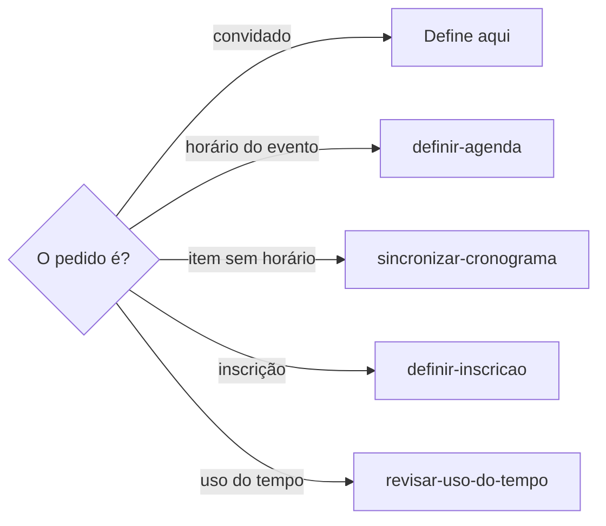
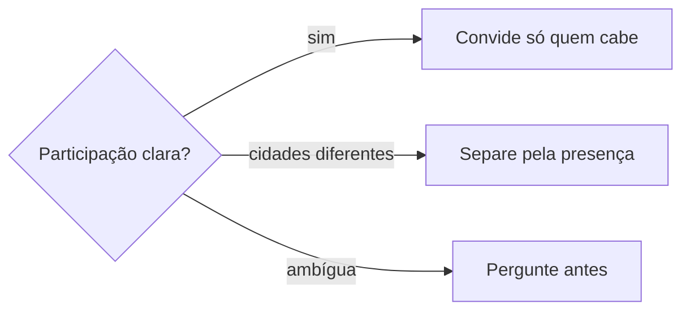

# Definir convidado

## Parâmetros de configuração

```yaml
{}
```

## Instruções

### Passo 1

As listas e o nome de cada propriedade vêm do mapeamento de dados do projeto. Criar, revisar, sincronizar ou auditar o convidado de um evento é esta habilidade. O horário do evento segue `definir-agenda`. Item com data e sem início e fim confirmados segue `sincronizar-cronograma`. O status da inscrição segue `definir-inscricao`. O uso do tempo segue `revisar-uso-do-tempo`. Saber o que já está no dia segue `procurar-agenda`.



### Passo 2

A lista de pessoas da empresa podem dividir compromissos no mesmo período. Antes de enviar, manter ou tirar um convite, verifique uma a uma quem realmente participará. A evidência é a lista de inscrições, a lista de oportunidades, o cronograma, viagem, responsabilidade, descrição confirmada e a lista de localidades. Não invente campo. Se uma dessas listas não estiver no workspace conectado, pare. Não use lista de outro workspace. Não crie a lista.



Não convide todos os sócios só porque o compromisso é da empresa, está numa agenda compartilhada ou é uma oportunidade formativa.

### Passo 3

Duas pessoas em cidades ou praças diferentes no mesmo período: cada uma entra só no compromisso compatível com a presença física, a participação confirmada ou a responsabilidade operacional. Conflito geográfico simultâneo é evidência de divisão de agenda. Não duplique o convite por causa dele.

### Passo 4

Convite enviado à pessoa errada: remova quando houver autorização e diga a correção no resumo da operação. Participação individual ainda ambígua: pergunte antes de enviar ou remover. Não escolha no lugar da pessoa.

## Problemas comuns

### Convite automático de sócio

Se você convidar todos os sócios porque o compromisso é da empresa, está na agenda compartilhada ou é formativo, gente que não participa entra no evento.

1. Verifique uma a uma quem participará.
2. Use inscrição, oportunidade, o cronograma, viagem, responsabilidade, descrição confirmada e localidade.
3. Sem essa evidência, pergunte. Não convide o grupo inteiro.

### Conflito geográfico duplicado

Se você tratar cidades diferentes no mesmo período como motivo para convidar as duas pessoas nos dois compromissos, o convite se duplica.

1. Trate o conflito como divisão de agenda.
2. Convide cada pessoa só no compromisso compatível com a presença, a participação confirmada ou a responsabilidade.
3. Não duplique o convite.

### Remoção sem autorização

Se você tirar a pessoa errada sem autorização, ou enviar o convite com a participação ambígua, a agenda muda sem confirmação.

1. Com autorização, remova e diga a correção no resumo.
2. Participação ambígua: pergunte antes de enviar ou remover.
3. Não escolha no lugar da pessoa.

## Exemplos de entrada e saída

Estes exemplos ilustram fatos. Eles podem não estar no data source.

### Convide os sócios. o compromisso é da empresa.

Não convidei todo mundo. Conferi inscrição, oportunidade, o cronograma, viagem, responsabilidade, descrição confirmada e localidade. Onde a participação ficou ambígua, perguntei antes de enviar.

### A missão é em outra cidade e um dos sócios está na cidade da empresa

A sócia da missão ficou na missão, na outra cidade. O outro sócio ficou nos eventos da cidade da empresa que ele acompanha. O conflito geográfico não duplicou o convite.

### tira quem entrou por engano

Havia autorização. Removi a pessoa errada e disse a correção no resumo.

## Casos-limite

- A lista de inscrições, a lista de oportunidades ou a lista de localidades fora do workspace conectado: pare. Não use outro workspace. Não crie a lista.
- Compromisso da empresa, agenda compartilhada ou oportunidade formativa: isso não convida todos os sócios.
- Cidades ou praças diferentes no mesmo período: cada pessoa entra só no compromisso compatível. Não duplique o convite.
- Convite errado com autorização: remova e diga a correção no resumo.
- Participação ambígua, ou remoção sem autorização: pergunte. Não envie nem remova.
- O pedido é o horário do evento: `definir-agenda`. Item sem horário confirmado: `sincronizar-cronograma`.

## Pegadinhas

- Ser da empresa parece convite para todos os sócios. A participação é individual.
- Agenda compartilhada parece a mesma lista de convidados. Cada pessoa entra só onde a presença, a participação ou a responsabilidade cabe.
- Cidades diferentes no mesmo período parecem motivo para duplicar o convite. São divisão de agenda.
- Participação ambígua parece seguro convidar assim mesmo. Pergunte antes de enviar ou remover.

## Scripts disponíveis

- Nenhum.

1. Não há script para executar.
