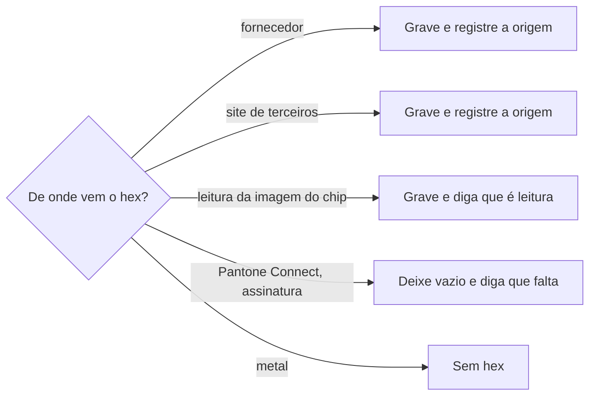

# Definir cor

## Parâmetros de configuração

Leia cada valor nas instruções do projeto: primeiro na entrada com o nome desta habilidade, depois na entrada `Global` ou no primeiro nível do bloco. Quando um valor não estiver lá, use o padrão abaixo.

```yaml
"Modo de aprendizado": "perguntar"
# Nomes de banco e de campo: o projeto define. Vazios, use `procurar-banco-de-dados` antes de perguntar.
# `Banco de cores`: uma página por código de cor de uma empresa, com número, nome, família, sistema, hex, empresa e variações de nome.
"Banco de cores": ""
# `Banco de empresas`: o cadastro que a relação `Empresa` da cor aponta.
"Banco de empresas": ""
# `Metais sem hex`: cores que são metal e ficam sem hex.
"Metais sem hex": "ouro, prata, cobre"
```

## Instruções

### Passo 1

A cor do fornecedor ou do fabricante tem um registro canônico no `Banco de cores`. Tecido, aviamento, linha e item de estoque ligam a esse registro e não guardam a cor como texto solto. Os nomes dos bancos e dos campos vêm das instruções do projeto. Com um banco vazio, use `procurar-banco-de-dados`, dizendo que o de cores guarda código, nome, família, sistema, hex, empresa e variações de nome. Não mude a estrutura do banco. Este texto usa os conceitos: número da cor, nome da cor, família, sistema, hex, empresa e variações de nome.

### Passo 2

Leia o `Banco de cores` agora, filtrado pela empresa e pelo número, e busque com `identificar-duplicata`, inclusive pela grafia alternativa do nome. Achou, reaproveite a página e ligue a ela. A empresa vem do `Banco de empresas`: uma que falta é cadastrada por `definir-empresa`, e a grafia segue `definir-grafia`.

### Passo 3

O número da cor é texto, com os caracteres que o fornecedor deu, inclusive o zero à esquerda e a sigla da biblioteca. `0378` fica `0378`, nunca `378`. `18-1659 TCX` e `18-1659 TPG` são duas cores, porque o mesmo número existe em bibliotecas com valores diferentes: TCX é o algodão, para têxtil, e TPG é o papel. Sem a sigla, pergunte qual é antes de gravar.

### Passo 4

O título da página tem o nome da empresa e o número da cor. Com nome comercial oficial, ele vai entre parênteses.

- Sem nome comercial: `<Empresa> <número>`.
- Com nome comercial: `<Empresa> <número> (<nome>)`.

A empresa é ligada na relação `Empresa`, apontando para o cadastro. Só o título repetir o nome da empresa não liga.

### Passo 5

O nome da cor só entra quando o catálogo do fornecedor o traz. Sem nome oficial, o nome fica vazio até a confirmação. Não suponha nome visual, como "azul-bebê", e não copie o nome de outra biblioteca. Uma grafia alternativa de um nome oficial vai em variações de nome, e nada mais.

### Passo 6

O hex é uma aproximação de tela e é da biblioteca do número. Nunca grave o hex de uma biblioteca em outra.



A origem do hex vai no corpo da página, nunca em variações de nome. A Pantone esconde o hex atrás da assinatura: não inicie teste nem assinatura e não contorne a trava. Ouro, prata e cobre são metais, em `Metais sem hex`, e ficam sem hex.

### Passo 7

A família vem da página da cor na biblioteca do fornecedor, como a Pantone mostra, e não do hex nem do nome. Uma família que parece estranha a olho, como um roxo-claro em `Red`, não é erro: não aponte nem corrija por suspeita. Só avise, com o link da página, quando a família cadastrada diverge da que a página da cor mostra. Não corrija sozinha.

### Passo 8

Quando outra skill, como `definir-tecido`, `definir-estampa` ou `gerenciar-estoque`, precisa da cor de um item com código de fornecedor ou de marca, consulte o banco pelos Passos 2 e 3. Cor que não existe é cadastrada com o mínimo, a empresa e o número da cor, antes de concluir o vínculo. O vínculo é a relação do item com a página da cor.

### Passo 9

Na resposta, dê o link de cada página criada ou mudada, o que ficou sem nome, sem hex ou sem família e as famílias que divergem da página da cor. Ao terminar, siga `evoluir-habilidade` conforme `Modo de aprendizado`.

## Problemas comuns

### Zero à esquerda perdido

Se você gravar `0378` num campo numérico ou converter para número, o código vira `378` e outro fornecedor passa a ter a mesma cor.

1. Grave o número da cor como texto, como o fornecedor deu.
2. Releia o campo depois de gravar e confira os caracteres.

### Hex de outra biblioteca

Se você copiar o hex de TCX para uma cor TPG, a cor de papel sai com o tom de algodão.

1. Guarde a sigla no número da cor.
2. Busque o hex na biblioteca da sigla.
3. Sem o hex dela, deixe vazio e diga que falta.

### Nome comercial inventado

Se você preencher o nome com o que a cor parece, o catálogo ganha um nome que o fornecedor não usa.

1. Deixe o nome vazio sem nome oficial.
2. Peça a confirmação.

### Origem do hex em variações de nome

Se você escrever "leitura do chip" em variações de nome, essa lista deixa de ser só de grafias do nome e a busca por duplicata erra.

1. Escreva a origem do hex no corpo da página.
2. Deixe variações de nome só com grafias alternativas do nome.

### Assinatura da Pantone

Se você iniciar um teste ou uma assinatura para ver o hex, ou contornar a trava, a pessoa assume uma contratação que não pediu.

1. Pare e diga que o hex está atrás da assinatura.
2. Use o fornecedor, um site de terceiros ou a leitura da imagem do chip, com a origem registrada.

### Banco inventado

Se você usar um banco que o projeto não definiu, a escrita cai no banco errado.

1. Leia `Banco de cores` e `Banco de empresas` nas instruções do projeto.
2. Vazios, use `procurar-banco-de-dados`.

## Exemplos de entrada e saída

Estes exemplos ilustram fatos. Eles podem não estar no data source.

### Cadastre a cor 0378 da Empresa Exemplo, sem nome comercial

Busquei a empresa e o número e não achei. Criei a página `Empresa Exemplo 0378`, com o número `0378` como texto, a empresa ligada ao cadastro e o nome da cor vazio, até o fornecedor confirmar um nome oficial.

### Cadastre a cor 12-0752 TCX da Empresa Exemplo, nome Aspen Gold

Criei a página `Empresa Exemplo 12-0752 TCX (Aspen Gold)`, com a empresa ligada e a sigla no número da cor. O hex veio do chip, e a origem está no corpo da página.

### Qual o hex do 18-1659 TCX? E o do TPG?

São cores diferentes. O TCX, o do algodão, é `#B91428`, e o TPG, o do papel, é `#B9333E`. Cada hex foi para a página da sua sigla, com a origem no corpo.

### Cadastre o aviamento com o código 0378 da Empresa Exemplo

Consultei o banco de cores: a `Empresa Exemplo 0378` não existia. Cadastrei com a empresa e o número e liguei o aviamento a ela.

### Qual o hex do ouro?

Ouro é metal e fica sem hex. Não preenchi o campo.

## Casos-limite

- O número vem sem a sigla da biblioteca: pergunte qual é, TCX ou TPG, antes de gravar.
- O hex só aparece com a assinatura da Pantone: deixe vazio, diga que falta e não inicie teste.
- A cor existe com outro nome na grafia do fornecedor: reaproveite a página e registre a grafia em variações de nome.
- A família cadastrada diverge da que a página da cor mostra: avise na resposta e não corrija. Parecer estranha não basta.
- A empresa não está cadastrada: cadastre por `definir-empresa` antes.
- Um banco ou campo está vazio nas instruções do projeto: use `procurar-banco-de-dados`.

## Pegadinhas

- O código com zero à esquerda parece número. Um campo numérico o corta.
- O mesmo número em duas bibliotecas parece a mesma cor. TCX e TPG têm hex diferentes.
- O hex parece a cor do fornecedor. É uma aproximação de tela.
- Um nome visual, como "vermelho-vivo", parece um nome comercial. Só o nome do catálogo do fornecedor vale.
- A família parece não combinar com o tom. A que vale é a da página do fornecedor, e a Pantone classifica algumas cores de modo que parece estranho.

## Scripts disponíveis

- Nenhum.

1. Não há script para executar.
