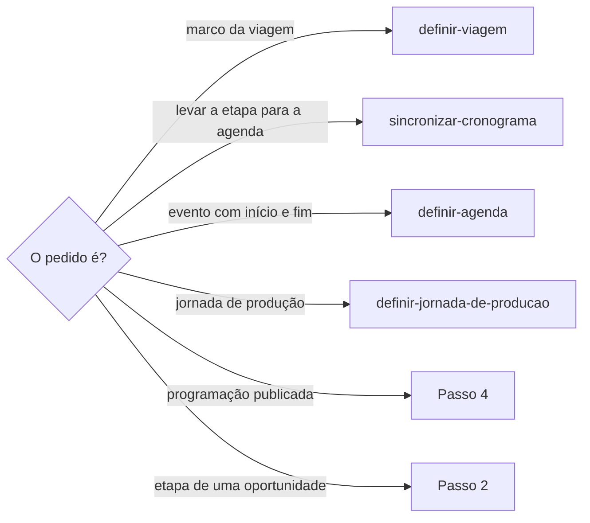
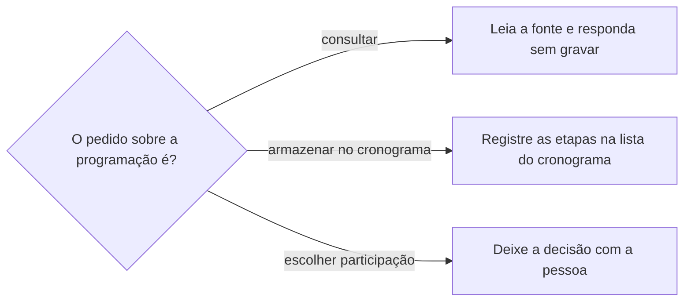

# Definir cronograma

## Parâmetros de configuração

Leia cada valor nas instruções do projeto: primeiro na entrada com o nome desta habilidade, depois na entrada `Global` ou no primeiro nível do bloco. Quando um valor não estiver lá, use o padrão abaixo.
```yaml
"Formato da data com dia da semana": "terça-feira, 01/09/2026"
"Modo de aprendizado": "perguntar"
```
## Instruções

### Passo 1

A lista do cronograma, a de oportunidades e o nome de cada propriedade vêm do mapeamento de dados do projeto, no workspace conectado. Se uma lista não estiver nessa conexão, pare. Não use a lista de outro workspace. Este texto usa os conceitos: a etapa, o nome da etapa, o tipo da etapa, o início e o fim planejados, o local, o contexto e observações, a ordem visual, a oportunidade, o ponto de contato e os responsáveis.



A oportunidade precisa existir. Saber se ela existe fica com `procurar-oportunidade`, e cadastrá-la fica com `criar-oportunidade`.

### Passo 2

Antes de criar, busque no cronograma pela oportunidade, pelo nome da etapa e pela data. Existindo equivalente, atualize e não duplique.

O nome da etapa é a ação em duas a cinco palavras, sem conectivo nem especificação, como "ao local do evento" ou "de acordo com o mapa", e sem orientação entre parênteses. O que mais houver vai no contexto e observações, sem repetir data, hora nem local, que ficam nas propriedades próprias.

O tipo da etapa é uma das opções que a lista já tem. Não crie opção nova.

### Passo 3

A etapa liga sempre à oportunidade e, havendo ponto de contato correspondente, também a ele. A atividade formativa, sem ponto de venda, liga só à oportunidade. Não crie ponto de contato para ligar a etapa: a distinção segue `criar-ponto-de-contato`.

Início e fim planejados só vêm do que a pessoa ou a fonte afirmou. Sem horário, a etapa fica sem ele. Não invente o horário nem copie o da etapa seguinte. Levar a etapa para a agenda segue `sincronizar-cronograma`, e o evento com início e fim segue `definir-agenda`.

Ao criar, atualizar ou relacionar uma etapa de uma oportunidade, quando a ação afeta data, horário, ordem do dia, equipe, responsável, montagem ou apresentação, registre num comentário da etapa o resumo da ação, a origem da informação, o canal, e a data e a hora da confirmação. Diga o que está confirmado e o que ainda depende da produção ou de outra pessoa. Não duplique o comentário quando a mesma informação já está registrada e atual.

### Passo 4

Consultar uma programação é leitura; não é inscrição nem escolha de participação. Retome a fonte oficial já identificada sem pedir nova autorização para a consulta solicitada. Carregue o conteúdo completo antes de apresentar a programação como completa.

Timeout na leitura rápida não é prova de indisponibilidade: use uma leitura mais completa oferecida pela mesma ferramenta. Não invente horários, palestrantes ou salas a partir de trechos de busca.



No armazenamento solicitado, carregue o esquema do cronograma e consulte as etapas já ligadas à oportunidade antes de criar. Registre uma etapa por sessão, com o vínculo para a oportunidade, início e fim planejados no fuso do evento e ordem de leitura. Preserve sessões simultâneas, repetições em horários diferentes e atividades fechadas, com a restrição explícita.

Guarde eixo, palestrante informado e URL da fonte no contexto e observações; datas, horários e local ficam nas propriedades próprias. Ausência de palestrante ou de sala permanece ausência.

Não confunda programação publicada com presença escolhida, inscrição, tarefa ou compromisso no calendário. O pedido de guardar para escolher depois não autoriza bloquear a agenda nem selecionar sessões.

### Passo 5

Teste uma sessão real do pedido com todas as propriedades pretendidas antes de enviar o lote. Reaproveite o registro de teste e não o crie de novo. Examine o resultado por etapa, não apenas o sucesso da chamada.

Campo opcional rejeitado interrompe a repetição do mesmo lote: confira o formato documentado e teste uma correção numa única etapa. Persistindo a rejeição, grave os outros campos e informe a lacuna, sem alterar a estrutura, inventar coordenadas ou mover o local para texto livre. Retome só as etapas que não foram gravadas; preserve os sucessos parciais.

Compare as sessões da fonte com as etapas vinculadas, seus nomes, início e fim antes de afirmar completude. Não use a quantidade de atividades do anúncio como quantidade da programação publicada.

### Passo 6

Responda com as etapas criadas, atualizadas e puladas, as lacunas e o link da oportunidade. Data de etapa sai no formato da data com dia da semana, calculado com a data, o horário e o fuso do evento, antes de escrever. Sem horário ou sem fuso, e se o dia puder mudar, peça. Não invente.

Se a fonte trouxer um dia da semana incompatível com a data, sinalize a divergência e não grave a etapa até a pessoa confirmar. Não inscreva, não escolha sessão e não crie evento na agenda.

### Passo 7

Ao terminar, siga `evoluir-habilidade` conforme `Modo de aprendizado`.

## Problemas comuns

### Nome de etapa com texto de orientação

Se você escrever no nome da etapa o local, a regra ou a orientação, a lista fica ilegível e o detalhe se perde quando o nome é cortado.

1. Deixe o nome em duas a cinco palavras, só com a ação.
2. Ponha a orientação no contexto e observações.
3. Não repita data, hora nem local no contexto.

### Horário inventado

Se você preencher o horário que a fonte não trouxe, ou copiar o da etapa seguinte, o cronograma mente e a agenda herda o erro.

1. Deixe a etapa sem horário.
2. Diga na resposta o que ficou pendente.
3. Levar a etapa para a agenda segue `sincronizar-cronograma`.

### Programação virou presença

Se você escolher sessões, inscrever ou criar evento na agenda ao guardar a programação, uma lista publicada vira compromisso que ninguém assumiu.

1. Guarde só as sessões publicadas, como etapas da oportunidade.
2. A escolha da participação é da pessoa.
3. O evento na agenda segue `definir-agenda`, e o horário que falta segue `sincronizar-cronograma`.

### Programação incompleta dada como completa

Se você apresentar a leitura rápida, ou o número do anúncio, como a programação inteira, faltam sessões e ninguém percebe.

1. Carregue o conteúdo completo. Timeout não é indisponibilidade.
2. Compare as sessões da fonte com as etapas vinculadas antes de afirmar completude.
3. Não use a quantidade de atividades do anúncio.

### Lote sem teste

Se você enviar o lote sem testar uma sessão com todas as propriedades, um campo rejeitado repete a falha em todas as etapas.

1. Teste uma sessão real e reaproveite esse registro.
2. Corrija o campo rejeitado numa única etapa. Persistindo, grave os outros campos e informe a lacuna.
3. Retome só as etapas que não foram gravadas.

## Exemplos de entrada e saída

Estes exemplos ilustram fatos. Eles podem não estar no data source.

### Ponha a montagem do estande do Festival Rota Sul no cronograma, para terça-feira, 29/09/2026, às 8h.

Busquei antes e não havia equivalente. Criei a etapa com o nome Montagem do estande, o início planejado em terça-feira, 29/09/2026, às 8h, e a oportunidade ligada. Registrei um comentário com a origem, o canal e a hora da confirmação. Não criei evento na agenda.

### Consulte a programação do Festival Rota Sul. Você pode fazer isso sem confirmar comigo.

Consultei a fonte oficial já identificada, sem pedir nova confirmação. A leitura rápida deu timeout, então usei a leitura mais completa e apresentei a programação inteira. Não inscrevi nem criei evento na agenda.

### Armazene toda a programação do Festival Rota Sul no cronograma ligado à oportunidade. Depois a gente escolhe.

Testei uma sessão com todas as propriedades, corrigi o campo de local rejeitado numa única etapa e gravei o lote. Todas as sessões publicadas ficaram vinculadas à oportunidade, inclusive as simultâneas e as fechadas, com início, fim e palestrante quando informados. Nenhuma sessão foi escolhida e nenhum evento foi criado na agenda.

## Casos-limite

- A oportunidade não existe: siga `procurar-oportunidade` e, se faltar, `criar-oportunidade`. Não grave etapa sem ela.
- O pedido é o marco de uma viagem: `definir-viagem`.
- A fonte oficial da programação não está identificada: pergunte qual é. Não procure a programação em página de terceiros.
- A pessoa pede para escolher as sessões a que vai: a decisão é dela. Mostre as opções e não grave a escolha.
- O mapeamento não tem onde guardar a etapa ou uma propriedade obrigatória: pare e diga qual falta.
- A etapa sem ponto de venda: liga só à oportunidade. Não crie o ponto de contato.
- Programação sem horário de início ou de fim: grave a etapa sem inventar o horário.
- A mesma informação já está num comentário atual da etapa: não registre outro.

## Pegadinhas

- Guardar a programação para escolher depois parece o primeiro passo da inscrição. É só leitura e armazenamento: não inscreve, não escolhe e não bloqueia a agenda.
- O timeout da leitura rápida parece fonte indisponível. A mesma ferramenta tem uma leitura mais completa.
- A quantidade de atividades do anúncio parece o total da programação. O total é o que a fonte publica, conferido etapa a etapa.
- O nome da etapa parece o lugar de explicar a regra. O nome é a ação, e a explicação vai no contexto e observações.
- Ausência de palestrante ou de sala parece lacuna a preencher. Ela permanece ausência.
- Pôr a etapa no cronograma parece pô-la na agenda. A agenda segue `sincronizar-cronograma` e `definir-agenda`.

## Scripts disponíveis

- Nenhum.

1. Não há script para executar.
