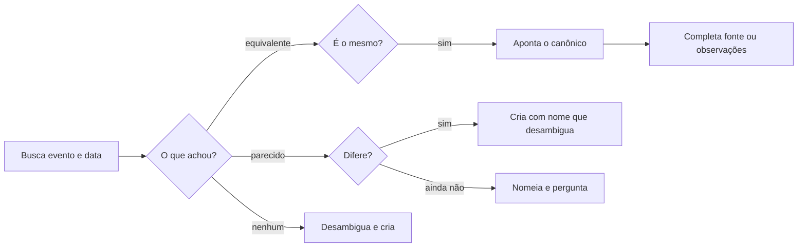

# Definir data significativa

## Parâmetros de configuração

Leia cada valor nas instruções do projeto: primeiro na entrada com o nome desta habilidade, depois na entrada `Global` ou no primeiro nível do bloco. Quando um valor não estiver lá, use o padrão abaixo. `Fontes de calendário` é uma lista. Cada fonte traz a URL e o código do país que aquele site usa, porque cada site tem o seu código. Código vazio numa URL com `{country}` quer dizer que você pergunta o código antes de seguir essa fonte.

```yaml
"Formato da data com dia da semana": "terça-feira, 01/09/2026"
"Título do evento anual": "nome do evento ano"
"Fontes de calendário":
  - "URL": "https://www.timeanddate.com/calendar/?year={year}&country={country}"
    "Código do país": ""
"Uso das fontes de calendário": "as que o Notion costuma utilizar, na ordem da lista, sem se restringir a elas"
```

## Instruções

### Passo 1

Cadastrar, revisar e alterar um registro na lista de datas significativas é esta habilidade. Data comemorativa, marco, feriado, sazonalidade, alta temporada, baixa temporada e janela entram aqui, mesmo sem dizer cadastrar. Saber quando a data cai, ou se ela já está na lista, fica com `procurar-data-significativa`. Saber o que já está no dia ou na semana é outra habilidade. Criar, revisar, alterar ou reservar o evento na agenda, montar a agenda reversa e auditar o uso do tempo são outras habilidades. Se o pedido for a agenda, pare. Não crie o evento da agenda.

### Passo 2

A lista de datas significativas e o nome de cada propriedade vêm do mapeamento de dados do projeto. Este texto usa os conceitos: o evento, que é o título, a data, a categoria, a fonte e as observações. Lista ausente da conexão: pare. Não use lista de outro workspace. Sem início e fim no material, peça. Não invente a janela. Número que não está no material: peça. Feriado ou data comemorativa sem fonte no material: siga o uso das fontes de calendário. `{year}` é o ano da data. `{country}` é o código do país daquela fonte. Fonte com `{country}` e sem o código: pergunte. A data que não está no material sai da página consultada. Não invente a data.

### Passo 3

Antes de criar, cheque duplicata na lista de datas significativas. Busque o termo principal no evento. Busque também a variação útil: com e sem acento, singular e plural, sigla, nome equivalente ou reduzido, e grafia alternativa. Quando a janela separar os registros, filtre pelo mesmo mês ou pelo mesmo ano. Abra cada possível match e compare a data, a categoria e a fonte.



Não invente o que o material não trouxe. O nome do registro novo inclui o que separa: ano, edição, cidade ou país.

### Passo 4

Evento que acontece uma vez por ano, como data comemorativa, feriado fixo, marco anual, lançamento recorrente ou observância anual, leva o título do evento anual. O ano fica no final. Sem o ano da data, peça. Não invente o ano. Se o registro anual já existe sem o ano, renomeie e ponha o ano no final. Não crie outro para o mesmo ano. Anos diferentes são registros diferentes. Quando o nome parecido é outro registro, o título também leva a edição, a cidade ou o país, no que separa. Evento que não é anual não ganha ano no título, salvo quando o ano é o que separa o registro parecido.

### Passo 5

Data de evento, compromisso, prazo, viagem, reserva, lançamento, entrega ou outro marco, na resposta, no resumo, na tabela, na descrição ou em outro texto, sai no formato da data com dia da semana. Calcule e confira o dia com a data, o horário e o fuso antes de escrever. Sem horário ou sem fuso, e se o dia puder mudar, peça. Não invente. Intervalo ou vários dias: o dia da semana em cada data. Se a fonte trouxer um dia da semana incompatível com a data, sinalize e confirme antes de criar ou alterar. O campo estruturado permanece válido. O dia da semana é a camada extra para a pessoa.

## Problemas comuns

### Data duplicada

Se você criar na lista de datas significativas sem buscar, ou deixar a fonte e as observações vazias no registro que já é o mesmo, o marco entra duas vezes ou fica incompleto.

1. Busque o termo principal e as variações no evento. Compare a data, a categoria e a fonte.
2. Confirmado que é o mesmo, aponte esse registro como canônico. Não crie outro.
3. Complete a fonte ou as observações quando o material trouxer o que falta. Não invente.

### Busca só pelo título exato

Se você buscar só o título exato no evento, a variação de acento, número, sigla, nome reduzido ou grafia vira outro registro.

1. Busque o termo principal no evento.
2. Busque com e sem acento, singular e plural, sigla, nome equivalente ou reduzido, e grafia alternativa.
3. Quando a janela separar, filtre pelo mesmo mês ou pelo mesmo ano. Abra o match e compare a data, a categoria e a fonte.

### Nome parecido sem separação

Se você criar o registro parecido com o mesmo título, ou recusar o cadastro depois que a pessoa confirmou que é outro, a lista mistura ou perde o evento.

1. Sem a confirmação, nomeie cada um e pergunte. Não crie.
2. Confirmado que é o mesmo, aponte o canônico e complete a fonte ou as observações. Não crie outro.
3. Confirmado que difere, crie com o nome que inclui ano, edição, cidade ou país, no que separa.

### Ano fora do título anual

Se você gravar o evento anual sem o ano no final, ou puser ano num evento que não é anual e que nada separa, o nome mistura edições ou inventa uma edição.

1. Use o título do evento anual. O ano fica no final.
2. Se o registro já existe sem o ano, renomeie. Não crie outro para o mesmo ano.
3. Evento que não é anual fica sem ano no título, salvo quando o ano é o que separa o registro parecido.

### Fonte solta

Se você gravar a fonte de memória, o registro não aponta uma página.

1. Aponte uma página que traga a data. Siga o uso das fontes de calendário.
2. `{year}` é o ano da data. `{country}` é o código do país daquela fonte.
3. A data que não está no material sai da página consultada. Não invente.

### Data sem o dia da semana

Se você escrever a data numérica sem o dia da semana, ou aceitar um dia da semana que não bate com a data, a pessoa lê o marco errado.

1. Calcule o dia com a data, o horário e o fuso.
2. Escreva no formato da data com dia da semana em cada data.
3. Se divergir, sinalize e confirme antes de criar ou alterar. O campo estruturado permanece válido.

## Exemplos de entrada e saída

Estes exemplos ilustram fatos. Eles podem não estar no data source.

### Cadastre o Dia da Internet na lista de datas significativas.

Busquei o termo principal no evento e as variações, como Dia Mundial da Internet e Dia da Internet, e a grafia alternativa, como Dia do Abraço e Dia do Abraco. Quando a janela separava, filtrei pelo mesmo mês ou pelo mesmo ano. Abri os matches e comparei a data, a categoria e a fonte antes de criar.

### Cadastre essa data comemorativa na lista de datas significativas.

Um registro equivalente já existia. Confirmei que é o mesmo evento e a mesma data. Apontei esse registro como canônico. Completei a fonte ou as observações no que faltava. Não criei outro.

### Cadastre o Dia das Mães de outro ano no Brasil na lista de datas significativas.

Nomes parecidos já existiam. Confirmei que não são o mesmo evento. Criei o registro com o nome que separa, como Dia das Mães 2026 (Brasil) ou Dia das Mães 2027 (Brasil).

### Cadastre essa data comemorativa de um ano na lista de datas significativas.

O título ficou no título do evento anual, com o ano no final. Se já existia sem o ano, renomeei. Não criei outro para o mesmo ano.

### Cadastre esse feriado na lista de datas significativas. A fonte não veio no material.

A fonte ficou numa página da data. Segui o uso das fontes de calendário, com o ano da data e o código do país daquela fonte. Não inventei a data.

### a fonte diz segunda-feira, 01/09/2026

01/09/2026 é terça-feira. Sinalizei a divergência e confirmei antes de criar ou alterar. O campo estruturado ficou válido. Na resposta, usei o formato da data com dia da semana.

## Casos-limite

- Antes de criar: busque o termo principal e as variações no evento, filtre mês ou ano quando a janela separar, e compare a data, a categoria e a fonte.
- Registro equivalente confirmado como o mesmo evento e a mesma data: aponte o canônico, complete a fonte ou as observações no que falta e não crie outro.
- Nomes parecidos sem confirmação: nomeie e pergunte. Não crie.
- Nomes parecidos confirmados como edição, ano, cidade ou contexto diferente: crie com o nome que inclui o que separa.
- Um registro igual: não crie outro.
- A lista de datas significativas não está no workspace conectado: pare.
- Sem início e fim da janela: peça. Não invente.
- Evento anual sem o ano no título: renomeie e ponha o ano no final. Não crie outro para o mesmo ano.
- Evento que não é anual: não acrescente ano ao título, salvo quando o ano é o que separa o registro parecido.
- Sem o ano da data no evento anual: peça. Não invente o ano.
- Feriado ou data comemorativa sem fonte no material: siga o uso das fontes de calendário. A data que falta sai da página consultada. Não invente.
- O pedido é saber quando a data cai, ou se ela já está na lista: pare e siga `procurar-data-significativa`.
- O pedido é saber o dia ou a semana: pare. É outra habilidade.
- O pedido é criar ou alterar o evento na agenda: pare. É outra habilidade.
- O dia da semana da fonte não bate com a data: sinalize e confirme. Não grave o marco.

## Pegadinhas

- A lista de datas significativas parece livre. A checagem antes de criar usa acento, número, sigla, nome reduzido e grafia alternativa, e compara a data, a categoria e a fonte. Registro equivalente confirmado permanece o canônico. Nome parecido confirmado como outro leva no título o ano, a edição, a cidade ou o país, no que separa.
- Um nome de data real parece regra. Fora dos exemplos, a habilidade vale para qualquer evento. O fato fica no data source.
- A agenda parece o lugar do cadastro. O registro fica na lista de datas significativas. O evento da agenda é outra habilidade.
- A data numérica parece bastar. O texto leva o dia da semana, calculado com a data, o horário e o fuso. O campo estruturado continua válido.
- Uma fonte lembrada parece bastar. Feriado sem fonte no material segue o uso das fontes de calendário.
- O código do país parece valer para qualquer site. Cada fonte de calendário tem o seu código. Use o código da fonte que você está seguindo.

## Scripts disponíveis

- Nenhum.

1. Não há script para executar.
