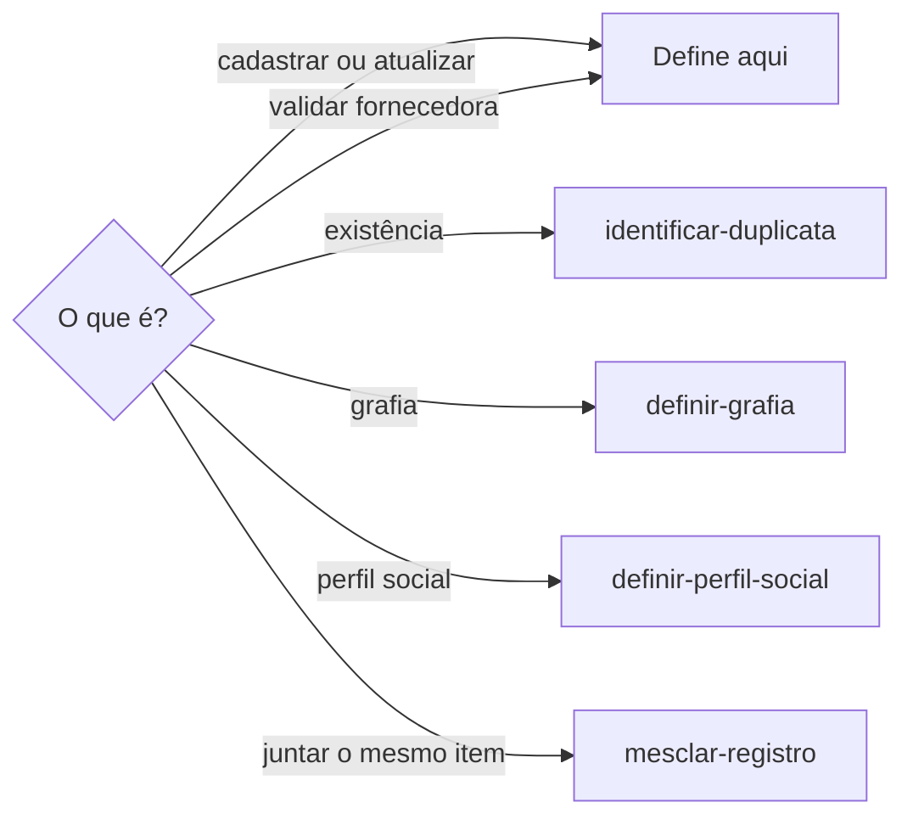
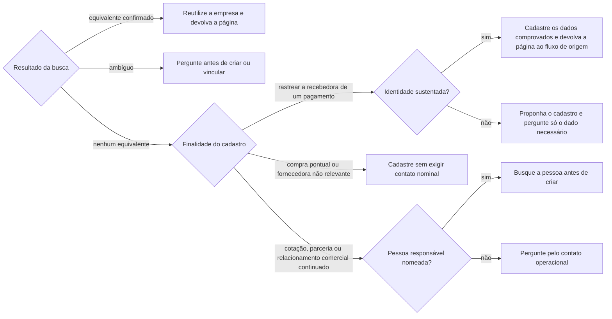

# Definir empresa

## Parâmetros de configuração

```yaml
{}
```

## Instruções

### Passo 1

Cadastrar, atualizar, validar ou consolidar uma empresa na lista de empresas é esta habilidade. A pessoa informa o data source na execução. Sem essa indicação, use a lista de empresas do mapeamento de dados do projeto. O nome de cada propriedade e as opções vêm desse mapeamento. Este texto usa os conceitos: o nome da empresa, as pessoas responsáveis, os donos, quem verifica, o tipo de público com a opção de fornecedor, as notas, e, na lista de pessoas, as empresas relacionadas. Se a lista não estiver no workspace conectado, pare. Não use a lista de outro workspace.



### Passo 2

Antes de criar, use `identificar-duplicata` com nome, variações e CNPJ disponíveis. Não trate um novo nome no comprovante como empresa nova sem essa comparação.



Uma compra pontual, como uma refeição em restaurante, não exige conhecer o dono nem uma pessoa do atendimento. Não invente pessoa, não crie contato genérico e não bloqueie o cadastro nem o vínculo da despesa por essa ausência. A falta de contato nesse contexto não é pendência obrigatória.

O cadastro mínimo de recebedora financeira não valida a fornecedora para relacionamento comercial. Nele, site e razão social completa ausentes ficam como pendências, sem impedir o vínculo com o pagamento. O contato responsável ausente só vira pendência quando há relacionamento continuado. Não invente esses dados nem trate a instituição de pagamento como recebedora.

A pessoa responsável é, de preferência, gerente, representante comercial, vendedora, dona ou contato do atendimento. Mais de um registro da mesma pessoa segue o flowchart do Passo 1.

### Passo 3

Quando houver pessoa identificada, relacione-a nas pessoas responsáveis. Os donos são outra relação e não substituem essa. Quem verifica é usuário do workspace e não substitui essa. No tipo de público, acrescente a opção de fornecedor quando fizer sentido. Não apague os valores que já estão. Com pessoa vinculada, abra o registro dela e confira as empresas relacionadas. Se a empresa já apareceu, pare. Se não apareceu, relacione. Não relacione de novo. As notas qualificam o papel, o contexto, a pendência ou a certeza. A nota não substitui a relação. Telefone, WhatsApp e endereço não entram na nota.

## Problemas comuns

### Pessoa só na nota

Se você gravar o nome da pessoa responsável só na nota, a fornecedora fica sem o vínculo.

1. Relacione a pessoa nas pessoas responsáveis.
2. A nota fica com o papel, o contexto, a pendência ou a certeza.
3. Confira as empresas relacionadas na pessoa.

### Dono no lugar do responsável

Se você ligar a pessoa só nos donos, a fornecedora continua sem a pessoa responsável.

1. Relacione nas pessoas responsáveis.
2. Os donos permanecem a relação de dono.
3. Não apague os donos para cumprir este critério.

## Exemplos de entrada e saída

Estes exemplos ilustram fatos. Eles podem não estar no data source.

### Cadastrei a fornecedora e a pessoa responsável só foi para as notas.

Associei a pessoa nas pessoas responsáveis. A nota ficou com o papel. O tipo de público ganhou a opção de fornecedor. As empresas relacionadas na pessoa mostraram a empresa.

## Casos-limite

- A exigência de contato segue o flowchart do Passo 2. Não invente o nome nem confunda contato operacional com dono.
- Cadastro mínimo de recebedora: registre como pendência o que faltar, salvo o contato numa compra pontual, e devolva a página para vincular o pagamento. Não dê a validação comercial por concluída.
- A pessoa já existe: aponte o registro. Não crie outra.
- O tipo de público já tem outros valores: acrescente a opção de fornecedor quando fizer sentido. Não apague os outros.
- As empresas relacionadas já mostram a empresa: não relacione de novo.
- A empresa não apareceu nas empresas relacionadas: relacione.
- Donos preenchidos não autorizam presumir quem é o contato operacional. Preserve as relações existentes.

## Pegadinhas

- Ter recebido uma compra não torna o estabelecimento um relacionamento comercial continuado. O contato nominal não é requisito universal do cadastro.

- Os donos parecem a pessoa responsável. É outra relação. A pessoa responsável fica nas pessoas responsáveis.
- Quem verifica parece o contato da fornecedora. É um usuário do workspace, não uma página da lista de pessoas.
- As pessoas responsáveis parecem preencher as empresas relacionadas. São relações diferentes. Confira a pessoa. Se a empresa não apareceu, relacione.
- A nota com o nome da pessoa parece o vínculo. A nota não substitui as pessoas responsáveis.

## Scripts disponíveis

- Nenhum.

1. Não há script para executar.
