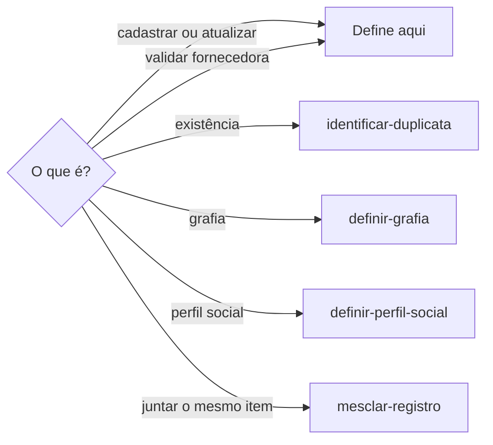
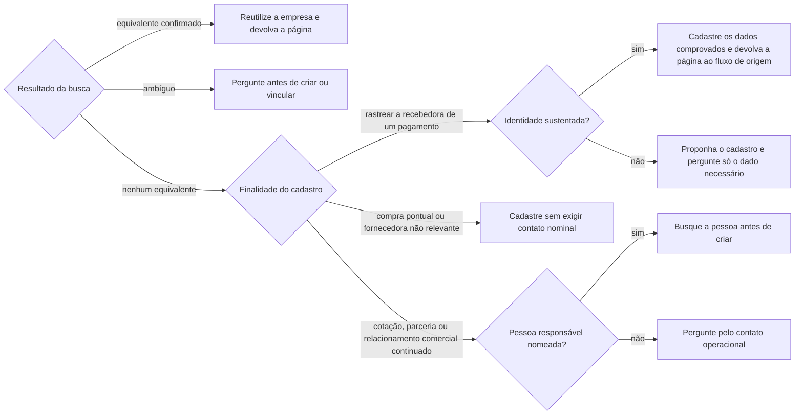

# Definir empresa

## Parâmetros de configuração

```yaml
{}
```

## Instruções

### Passo 1

Cadastrar, atualizar, validar ou consolidar uma empresa na lista de empresas é esta habilidade. A pessoa informa o data source na execução. Sem essa indicação, use a lista de empresas do mapeamento de dados do projeto. O nome de cada propriedade e as opções vêm desse mapeamento. Este texto usa os conceitos: o nome da empresa, as pessoas responsáveis, os donos, quem verifica, o tipo de público com a opção de fornecedor, as notas, e, na lista de pessoas, as empresas relacionadas. Se a lista não estiver no workspace conectado, pare. Não use a lista de outro workspace.



### Passo 2

Antes de criar, use `identificar-duplicata` com nome, variações e CNPJ disponíveis. Não trate um novo nome no comprovante como empresa nova sem essa comparação.



Uma compra pontual, como uma refeição em restaurante, não exige conhecer o dono nem uma pessoa do atendimento. Não invente pessoa, não crie contato genérico e não bloqueie o cadastro nem o vínculo da despesa por essa ausência. A falta de contato nesse contexto não é pendência obrigatória.

O cadastro mínimo de recebedora financeira não valida a fornecedora para relacionamento comercial. Nele, site e razão social completa ausentes ficam como pendências, sem impedir o vínculo com o pagamento. O contato responsável ausente só vira pendência quando há relacionamento continuado. Não invente esses dados nem trate a instituição de pagamento como recebedora.

Quando a lista exige a cidade da empresa e ninguém a informou, pesquise na internet, no site oficial e em fontes confiáveis, antes de usar uma localidade mais ampla. Empresa com uma só sede ou um só endereço: relacione essa cidade. Empresa que atua em várias cidades, com unidades ou escritórios regionais: relacione a localidade mais ampla que as cobre, como o país, e diga nas notas que é de propósito e quais fontes mostraram as unidades.

Não escolha a sede só por ser a mais citada. Nome parecido de outra empresa, como uma filial ou uma entidade de outro porte, não vale como fonte: registre a distinção em `Não confundir com` ou nas notas.

A pessoa responsável é, de preferência, gerente, representante comercial, vendedora, dona ou contato do atendimento. Mais de um registro da mesma pessoa segue o flowchart do Passo 1.

Quando o conector do Notion falta ou falha, siga a ordem de meios das instruções do projeto e só peça o dado à pessoa depois de esgotar os meios que a sessão tem.

No navegador, busque e cadastre pelo Notion, com o login da pessoa. Busque o nome também pelo tipo de local, como feira ou venue, porque a empresa pode já existir com outro tipo, e conte como resultado só a página da lista de empresas.

Crie a página numa visão sem agrupamento, para o tipo não nascer preenchido. Confira que a página nova abriu antes de digitar. Depois de escolher uma opção, não aperte Escape: ele fecha a página e o texto seguinte cai na tabela. Clique no valor da propriedade, nunca no nome dela. Ao fim, ordene a busca por última edição e confira que só as páginas esperadas mudaram.

### Passo 3

Antes de gravar, leia a descrição de cada propriedade no esquema da lista: ela diz o que é obrigatório, como a cidade, e o que não vai em cada campo, como o telefone fixo no campo do WhatsApp ou o telefone nas notas. Uma propriedade obrigatória sem dado exato recebe o que a fonte sustenta, como o estado quando a cidade não aparece, e a resposta diz que foi inferido. A negociação já cadastrada com a empresa liga-se à empresa nos negócios em que ela foi abordada.

Quando houver pessoa identificada, relacione-a nas pessoas responsáveis. Os donos são outra relação e não substituem essa. Quem verifica é usuário do workspace e não substitui essa. No tipo de público, acrescente a opção de fornecedor quando fizer sentido. Não apague os valores que já estão. Com pessoa vinculada, abra o registro dela e confira as empresas relacionadas. Se a empresa já apareceu, pare. Se não apareceu, relacione. Não relacione de novo. As notas qualificam o papel, o contexto, a pendência ou a certeza. A nota não substitui a relação. Telefone, WhatsApp e endereço não entram na nota.

## Problemas comuns

### Empresa criada sem buscar o tipo de local

Se você buscar só pelo nome da marca, a empresa que já existe como local de feira não aparece e a lista ganha uma duplicata.

1. Busque pelo nome e pelo tipo de local antes de criar.
2. Empresa já cadastrada com outro tipo: vincule a pessoa a ela, sem criar outra.
3. Releia as empresas relacionadas na pessoa depois de vincular.

### Cidade preenchida sem pesquisar

Se você gravar o país, ou chutar uma cidade, sem pesquisar, a empresa fica com a localidade errada ou genérica e ninguém sabe se foi de propósito.

1. Pesquise a cidade no site oficial e em fontes confiáveis.
2. Uma só sede: relacione essa cidade. Várias cidades: relacione a localidade mais ampla e diga nas notas o motivo e a fonte.
3. Não use uma empresa de nome parecido como fonte.

### Pessoa só na nota

Se você gravar o nome da pessoa responsável só na nota, a fornecedora fica sem o vínculo.

1. Relacione a pessoa nas pessoas responsáveis.
2. A nota fica com o papel, o contexto, a pendência ou a certeza.
3. Confira as empresas relacionadas na pessoa.

### Dono no lugar do responsável

Se você ligar a pessoa só nos donos, a fornecedora continua sem a pessoa responsável.

1. Relacione nas pessoas responsáveis.
2. Os donos permanecem a relação de dono.
3. Não apague os donos para cumprir este critério.

## Exemplos de entrada e saída

Estes exemplos ilustram fatos. Eles podem não estar no data source.

### Cadastrei a fornecedora e a pessoa responsável só foi para as notas.

Associei a pessoa nas pessoas responsáveis. A nota ficou com o papel. O tipo de público ganhou a opção de fornecedor. As empresas relacionadas na pessoa mostraram a empresa.

### cadastre a empresa de proteção veicular onde a atendente trabalha, sem cidade

Pesquisei a cidade no site oficial e em uma matéria sobre a associação. Ela tem sede em uma capital e unidades em outras regiões, então relacionei o país e escrevi nas notas o motivo e as fontes. Uma entidade de nome parecido, de veículos pesados, ficou fora, com a distinção nas notas.

## Casos-limite

- A cidade da empresa não foi informada: pesquise na internet antes de usar uma localidade mais ampla, como o Passo 2 manda. Várias cidades: localidade mais ampla, com o motivo nas notas.
- A exigência de contato segue o flowchart do Passo 2. Não invente o nome nem confunda contato operacional com dono.
- Cadastro mínimo de recebedora: registre como pendência o que faltar, salvo o contato numa compra pontual, e devolva a página para vincular o pagamento. Não dê a validação comercial por concluída.
- A pessoa já existe: aponte o registro. Não crie outra.
- O tipo de público já tem outros valores: acrescente a opção de fornecedor quando fizer sentido. Não apague os outros.
- As empresas relacionadas já mostram a empresa: não relacione de novo.
- A empresa não apareceu nas empresas relacionadas: relacione.
- Donos preenchidos não autorizam presumir quem é o contato operacional. Preserve as relações existentes.

## Pegadinhas

- Ter recebido uma compra não torna o estabelecimento um relacionamento comercial continuado. O contato nominal não é requisito universal do cadastro.

- A cidade desconhecida parece pedir o país direto. Pesquise antes, e deixe o motivo nas notas quando a empresa atua em várias cidades.
- Os donos parecem a pessoa responsável. É outra relação. A pessoa responsável fica nas pessoas responsáveis.
- Quem verifica parece o contato da fornecedora. É um usuário do workspace, não uma página da lista de pessoas.
- As pessoas responsáveis parecem preencher as empresas relacionadas. São relações diferentes. Confira a pessoa. Se a empresa não apareceu, relacione.
- A nota com o nome da pessoa parece o vínculo. A nota não substitui as pessoas responsáveis.

## Scripts disponíveis

- Nenhum.

1. Não há script para executar.
