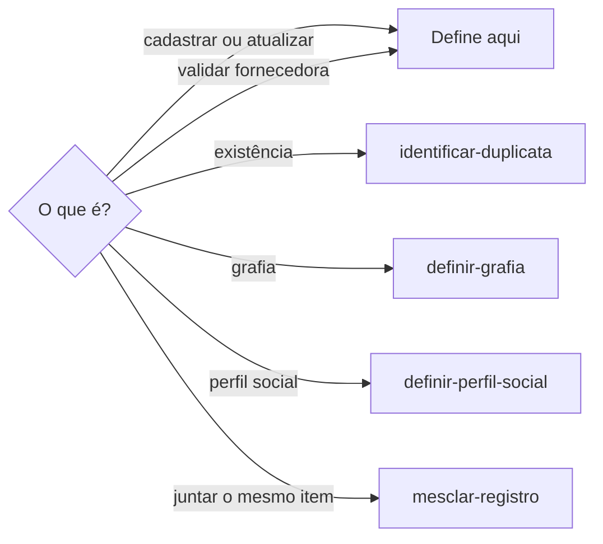
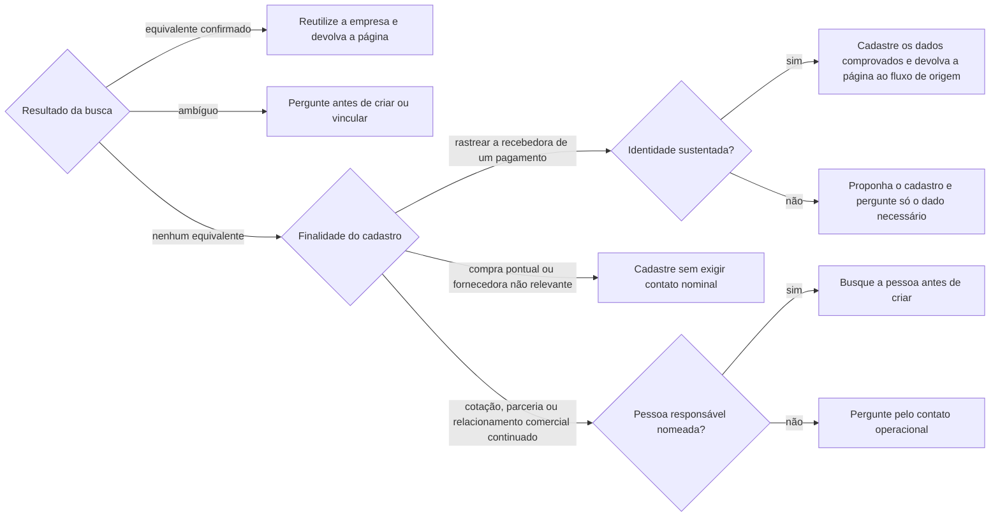

# Definir empresa

## Parâmetros de configuração

Leia cada valor nas instruções do projeto: primeiro na entrada com o nome desta habilidade, depois na entrada `Global`. Quando um valor não estiver lá, use o padrão abaixo.

```yaml
# `Praça prioritária do endereço` é a cidade cujo endereço a empresa recebe como canônico quando tem mais de um. Vazio, vale o endereço que a fonte mais forte sustenta, e a resposta diz que não há praça prioritária.
"Praça prioritária do endereço": ""
```

## Instruções

### Passo 1

Cadastrar, atualizar, validar ou consolidar uma empresa na lista de empresas é esta habilidade. A pessoa informa o data source na execução. Sem essa indicação, use a lista de empresas do mapeamento de dados do projeto. O nome de cada propriedade e as opções vêm desse mapeamento.

Este texto usa os conceitos: o nome da empresa, as pessoas responsáveis, os donos, quem verifica, o tipo de público com a opção de fornecedor, as notas, a desambiguação, que diz o que um nome ou parte dele não é, e, na lista de pessoas, as empresas relacionadas. Se a lista não estiver no workspace conectado, pare. Não use a lista de outro workspace.

Quando uma pessoa ou outra empresa indica esta empresa, ou esta empresa indica uma pessoa ou outra empresa, a indicação liga as duas páginas por relação, e o comentário não substitui a relação. Use a relação de indicação que o mapeamento de dados tem. Sem relação para o par, não crie propriedade: diga a limitação e recomende o campo na resposta, e registre quem indicou nas notas até lá.



### Passo 2

Antes de criar, use `identificar-duplicata` com nome, variações e CNPJ disponíveis. Não trate um novo nome no comprovante como empresa nova sem essa comparação.
Repita a busca no instante de criar, no mesmo passo e depois de qualquer pesquisa na web. Outra sessão ou pessoa pode ter cadastrado a mesma empresa enquanto você pesquisava, e uma busca feita minutos antes não vale.



Uma compra pontual, como uma refeição em restaurante, não exige conhecer o dono nem uma pessoa do atendimento. Não invente pessoa, não crie contato genérico e não bloqueie o cadastro nem o vínculo da despesa por essa ausência. A falta de contato nesse contexto não é pendência obrigatória.

O cadastro mínimo de recebedora financeira não valida a fornecedora para relacionamento comercial. Nele, site e razão social completa ausentes ficam como pendências, sem impedir o vínculo com o pagamento. O contato responsável ausente só vira pendência quando há relacionamento continuado. Não invente esses dados nem trate a instituição de pagamento como recebedora.

Quando a lista exige a cidade da empresa e ninguém a informou, pesquise na internet, no site oficial e em fontes confiáveis, antes de usar uma localidade mais ampla. Empresa com uma só sede ou um só endereço: relacione essa cidade. Empresa que atua em várias cidades, com unidades ou escritórios regionais e sem unidade na `Praça prioritária do endereço`: relacione a localidade mais ampla que as cobre, como o país, e diga nas notas que é de propósito e quais fontes mostraram as unidades.

O site, o CNPJ e o WhatsApp da empresa que as fontes respondem entram na mesma rodada do cadastro, sem avisar a pessoa antes. Pesquise o site e o perfil social oficial, o link da bio do perfil, o que o convite ou o formulário trazem e, para o CNPJ, a internet. Grave o que achou e diga as fontes. Só o que a busca não respondeu vira pendência, com o motivo e o que a resolve, como o contrato. Não liste como pendência o que ninguém tentou achar.

A inscrição estadual vale por UF e tem dígito verificador. Antes de gravá-la na empresa ou de usá-la num formulário, confirme o número, pelo CNPJ, na consulta pública do cadastro de contribuintes da UF do endereço, como o Sintegra da UF.

Número que essa fonte não confirma não se grava nem se reenvia: corrija o registro pela fonte.

Número que a fonte confirma e o formulário recusa fica como está no registro: o formulário pode validar o formato de outro jeito, e a pessoa decide se tenta de novo ou fala com o suporte do site.

A consulta com captcha é da pessoa: peça que ela a resolva e leia o resultado depois.

Consulta que o navegador embutido não abre, como uma conexão recusada, segue a ordem de meios das instruções do projeto até o Claude in Chrome, e a página da Secretaria da Fazenda da UF costuma levar à consulta quando o mapa do Sintegra nacional não abre.

Empresa sem inscrição, como um MEI isento, só se marca como isenta com a fonte ou com o sim da pessoa.

Não escolha a sede só por ser a mais citada. Nome parecido de outra empresa, como uma filial ou uma entidade de outro porte, não vale como fonte: registre a distinção em `Não confundir com` ou nas notas.

Empresa com mais de um endereço, como matriz, filial, ponto de coleta ou galpão: com `Praça prioritária do endereço`, o endereço canônico é o dessa praça sempre que a empresa tiver ali unidade, atendimento ou operação confirmada. Os outros endereços relevantes ficam em comentário datado, ou na propriedade própria quando existir. Não troque o canônico pelo de outra cidade só porque ele apareceu primeiro na busca, no site, no comprovante ou na nota de reunião.

Se o endereço da praça prioritária for hipótese, estiver incompleto, conflitar com uma fonte mais forte ou puder ser de uma empresa homônima, confirme com a pessoa antes de gravar. Escolhido o canônico, relacione a localidade dessa praça na empresa.

A cidade onde a operação de uma cotação acontece vai nas propriedades da negociação, como origem e destino, e não no endereço da empresa.

A pessoa responsável é, de preferência, gerente, representante comercial, vendedora, dona ou contato do atendimento. Mais de um registro da mesma pessoa segue o flowchart do Passo 1.

Quando o conector do Notion falta ou falha, siga a ordem de meios das instruções do projeto e só peça o dado à pessoa depois de esgotar os meios que a sessão tem.

No navegador, busque e cadastre pelo Notion, com o login da pessoa. Busque o nome também pelo tipo de local, como feira ou venue, porque a empresa pode já existir com outro tipo, e conte como resultado só a página da lista de empresas.

Crie a página numa visão sem agrupamento, para o tipo não nascer preenchido. Confira que a página nova abriu antes de digitar. Depois de escolher uma opção, não aperte Escape: ele fecha a página e o texto seguinte cai na tabela. Clique no valor da propriedade, nunca no nome dela. Ao fim, ordene a busca por última edição e confira que só as páginas esperadas mudaram.

Toda conversa enviada ou recebida, por WhatsApp, e-mail, reunião ou outro canal, é registrada em comentário datado na discussão da página do assunto, e nunca no corpo nem numa propriedade. Isso vale para a conversa de agora e para a que ficou sem registro. Conversa que já está no corpo é copiada para comentários datados, e o corpo só é limpo com o sim da pessoa.

### Passo 3

Antes de gravar, leia a descrição de cada propriedade no esquema da lista: ela diz o que é obrigatório, como a cidade, e o que não vai em cada campo, como o telefone fixo no campo do WhatsApp ou o telefone nas notas. Uma propriedade obrigatória sem dado exato recebe o que a fonte sustenta, como o estado quando a cidade não aparece, e a resposta diz que foi inferido. A negociação já cadastrada com a empresa liga-se à empresa nos negócios em que ela foi abordada.

Quando houver pessoa identificada, relacione-a nas pessoas responsáveis. Os donos são outra relação e não substituem essa. Quem verifica é usuário do workspace e não substitui essa. No tipo de público, acrescente a opção de fornecedor quando fizer sentido. Não apague os valores que já estão. Com pessoa vinculada, abra o registro dela e confira as empresas relacionadas. Se a empresa já apareceu, pare. Se não apareceu, relacione. Não relacione de novo. As notas qualificam o papel, o contexto, a pendência ou a certeza. A nota não substitui a relação. Telefone, WhatsApp e endereço não entram na nota.

Quando a pessoa descobre que o nome que usávamos para a empresa estava errado, o nome certo vira o nome da empresa e o nome que entendemos antes entra nas variações de grafia, no feitio de `definir-grafia`, sem apagar os itens que já estão. Registre também a página que já existir com o nome errado, em vez de criar outra.

As pistas de memória são o que a pessoa lembra da empresa e ajuda a achá-la depois: o que ela faz, o que fazia, o ramo e a referência de lugar, como "fica perto da Avenida Pedro II, não na avenida". Grave cada pista que a pessoa der, na primeira vez que ela falar da empresa, mesmo antes de achar o nome.

Pista não é variação de grafia, nota nem endereço. A busca da empresa lê as pistas, como `identificar-duplicata` lê as variações. Sem a propriedade de pistas de memória na lista, avise, proponha a criação e não a crie antes do sim.

O corpo da página fica só com o que o modelo da lista traz, como o aviso do modelo. Serviço, endereço, telefone, WhatsApp e site vão na propriedade que o esquema tem para cada um, e a fonte da informação vai nas notas. Dado sem propriedade própria não vai para o corpo: diga a limitação e recomende o campo, como o Passo 1 manda.

## Problemas comuns

### Dado no corpo ou no campo errado

Se você gravar o serviço no corpo, o WhatsApp no campo do telefone fixo ou o endereço nas notas, a página foge do modelo e a pessoa descobre o erro depois de cobrar.

1. Leia a descrição de cada propriedade no esquema antes de gravar.
2. Grave cada dado no campo próprio e deixe o corpo só com o aviso do modelo.
3. Sem campo para o dado, diga a limitação e recomende o campo. Não use o corpo.

### Empresa criada com a busca antiga

Se você criar a página confiando numa busca feita antes da pesquisa na web, outra sessão pode já ter cadastrado a mesma empresa e a lista ganha uma duplicata.

1. Busque de novo pelo nome e pelas variações, no mesmo passo em que cria.
2. Achada, atualize essa página e não crie outra.
3. Duas páginas já criadas: pare e diga qual fica, sem apagar nenhuma.

### Empresa criada sem buscar o tipo de local

Se você buscar só pelo nome da marca, a empresa que já existe como local de feira não aparece e a lista ganha uma duplicata.

1. Busque pelo nome e pelo tipo de local antes de criar.
2. Empresa já cadastrada com outro tipo: vincule a pessoa a ela, sem criar outra.
3. Releia as empresas relacionadas na pessoa depois de vincular.

### Dado listado como pendente sem pesquisar

Se você cadastrar a empresa e listar o site, o CNPJ ou o WhatsApp como pendência sem tê-los procurado, a pessoa descobre que o dado estava ao alcance e pede o que já era seu.

1. Pesquise o site, o perfil social e o link da bio, e o CNPJ, na mesma rodada do cadastro.
2. Grave o que achou, com as fontes nas notas.
3. Deixe como pendência só o que a busca não respondeu, com o motivo e o que a resolve.

### Inscrição estadual sem fonte

Se você usar a inscrição estadual como veio de um cadastro antigo, ou trocar o número só porque o formulário o recusou, o dado errado continua no registro ou o certo é apagado.

1. Consulte a UF do endereço, pelo CNPJ, antes de gravar ou de usar o número.
2. A fonte diverge: grave o número confirmado e corrija o registro antigo. A fonte confirma: não mude o registro e leve a recusa do formulário à pessoa.
3. Captcha na consulta: peça à pessoa que o resolva.

### Cidade preenchida sem pesquisar

Se você gravar o país, ou chutar uma cidade, sem pesquisar, a empresa fica com a localidade errada ou genérica e ninguém sabe se foi de propósito.

1. Pesquise a cidade no site oficial e em fontes confiáveis.
2. Uma só sede: relacione essa cidade. Várias cidades sem unidade na praça prioritária: relacione a localidade mais ampla e diga nas notas o motivo e a fonte.
3. Não use uma empresa de nome parecido como fonte.

### Endereço de outra praça como canônico

Se você gravar o primeiro endereço que a busca mostrou, a empresa fica com o de uma unidade que a marca não usa, e a coleta ou a visita vai à cidade errada.

1. Veja `Praça prioritária do endereço` e procure a unidade, a filial ou o atendimento da empresa nela.
2. Confirmada, grave esse endereço como canônico e relacione a localidade. Os outros vão em comentário datado.
3. Hipótese, endereço incompleto ou possível homônima: confirme com a pessoa antes de gravar.

### Pessoa só na nota

Se você gravar o nome da pessoa responsável só na nota, a fornecedora fica sem o vínculo.

1. Relacione a pessoa nas pessoas responsáveis.
2. A nota fica com o papel, o contexto, a pendência ou a certeza.
3. Confira as empresas relacionadas na pessoa.

### Conversa gravada no corpo

Se você gravar no corpo da página, ou nas notas, o que a empresa disse ou o que enviamos, o histórico se perde na próxima edição e a linha do tempo não existe.

1. Grave um comentário datado por troca, com o canal e quem falou.
2. Se a conversa já está no corpo, copie cada fato para um comentário antes de qualquer limpeza.
3. Limpe o corpo só com o sim da pessoa, e avise que o histórico de versões ainda guarda o texto.

### Nome errado que some

Se você trocar o nome da empresa e não guardar o que entendíamos antes, a próxima busca pelo nome antigo não acha nada e a empresa volta a ser cadastrada.

1. O nome certo vai no nome da empresa.
2. O nome anterior entra nas variações de grafia.
3. As pistas que a pessoa deu entram nas pistas de memória.

### Dono no lugar do responsável

Se você ligar a pessoa só nos donos, a fornecedora continua sem a pessoa responsável.

1. Relacione nas pessoas responsáveis.
2. Os donos permanecem a relação de dono.
3. Não apague os donos para cumprir este critério.

## Exemplos de entrada e saída

Estes exemplos ilustram fatos. Eles podem não estar no data source.

### Cadastrei a fornecedora e a pessoa responsável só foi para as notas.

Associei a pessoa nas pessoas responsáveis. A nota ficou com o papel. O tipo de público ganhou a opção de fornecedor. As empresas relacionadas na pessoa mostraram a empresa.

### cadastre a empresa de proteção veicular onde a atendente trabalha, sem cidade

Pesquisei a cidade no site oficial e em uma matéria sobre a associação. Ela tem sede em uma capital e unidades em outras regiões, então relacionei o país e escrevi nas notas o motivo e as fontes. Uma entidade de nome parecido, de veículos pesados, ficou fora, com a distinção nas notas.

### a fornecedora tem matriz em outra capital e uma filial na praça prioritária

Com a praça prioritária preenchida, gravei o endereço da filial como canônico e relacionei a localidade dela. A matriz, que a busca mostrou primeiro, ficou num comentário datado e não substituiu o endereço da filial.

### Empresa lembrada pelo ramo e pelo lugar

Contei que achávamos "Design Print", fica perto da Avenida Pedro II e imprime em tecido. O nome certo era "Dream Estamparia Digital". Gravei o nome certo, guardei "Design Print" nas variações e as três pistas nas pistas de memória.

## Casos-limite

- A pessoa não lembra o nome da empresa e dá só pistas: guarde as pistas, procure por elas e só cadastre quando o nome vier. Não invente o nome.
- A lista não tem a propriedade de pistas de memória: avise e proponha. Não ponha as pistas na nota nem na variação de grafia.
- A cidade da empresa não foi informada: pesquise na internet antes de usar uma localidade mais ampla, como o Passo 2 manda. Várias cidades sem unidade na praça prioritária: localidade mais ampla, com o motivo nas notas.
- A empresa tem mais de um endereço e `Praça prioritária do endereço` está vazia: grave o que a fonte mais forte sustenta e diga que não há praça prioritária. Não invente uma.
- A exigência de contato segue o flowchart do Passo 2. Não invente o nome nem confunda contato operacional com dono.
- Cadastro mínimo de recebedora: registre como pendência o que faltar, salvo o contato numa compra pontual, e devolva a página para vincular o pagamento. Não dê a validação comercial por concluída.
- A pessoa já existe: aponte o registro. Não crie outra.
- O tipo de público já tem outros valores: acrescente a opção de fornecedor quando fizer sentido. Não apague os outros.
- As empresas relacionadas já mostram a empresa: não relacione de novo.
- A empresa não apareceu nas empresas relacionadas: relacione.
- A inscrição estadual gravada é recusada pelo formulário: consulte a fonte da UF antes de reenviar. Se a fonte diverge, corrija o registro. Se confirma, mantenha o registro e leve a recusa à pessoa.
- Donos preenchidos não autorizam presumir quem é o contato operacional. Preserve as relações existentes.

## Pegadinhas

- Ter recebido uma compra não torna o estabelecimento um relacionamento comercial continuado. O contato nominal não é requisito universal do cadastro.

- O endereço que a busca mostra primeiro parece o canônico. Com `Praça prioritária do endereço`, vale o da praça, quando confirmado.
- A cidade desconhecida parece pedir o país direto. Pesquise antes, e deixe o motivo nas notas quando a empresa atua em várias cidades.
- Os donos parecem a pessoa responsável. É outra relação. A pessoa responsável fica nas pessoas responsáveis.
- Quem verifica parece o contato da fornecedora. É um usuário do workspace, não uma página da lista de pessoas.
- As pessoas responsáveis parecem preencher as empresas relacionadas. São relações diferentes. Confira a pessoa. Se a empresa não apareceu, relacione.
- A nota com o nome da pessoa parece o vínculo. A nota não substitui as pessoas responsáveis.

- A nota com a pista parece lugar da memória. A pista tem propriedade própria, e a nota qualifica o papel, o contexto, a pendência ou a certeza.
- A inscrição estadual gravada parece confiável, e a recusa do formulário parece provar que está errada. Nenhuma das duas prova: só a consulta da UF do endereço decide.
- O nome errado parece descartável depois da correção. Ele fica nas variações de grafia, porque a pessoa e as conversas antigas ainda o usam.

## Scripts disponíveis

- Nenhum.

1. Não há script para executar.
