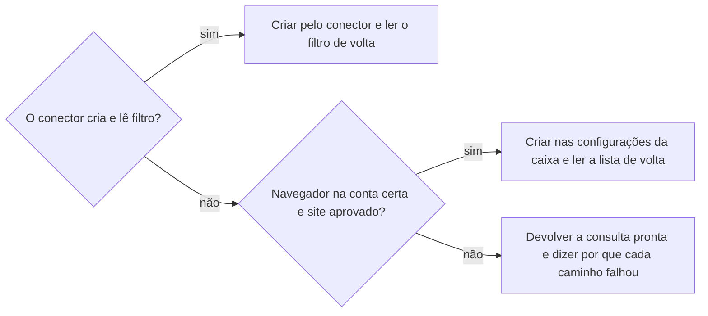

# Definir filtro de e-mail

## Parâmetros de configuração

Leia os valores nas instruções do projeto, na entrada desta habilidade. Na ausência, use os padrões abaixo.

```yaml
# `Aplicar filtro ao histórico`: `sim` aplica o filtro também às conversas antigas que ele atinge. `não` vale só para as próximas mensagens.
"Aplicar filtro ao histórico": "sim"
"Caminhos para criar filtro":
  - "conector"
  - "navegador"
  - "devolver a consulta"
"Navegador para criar filtro": "navegador conectado, na conta da caixa"
"Navegador do aplicativo para criar filtro": "só se a pessoa pedir"
"Modo de aprendizado": "perguntar"
```

## Instruções

### Passo 1

O filtro sai do plano que a triagem de `organizar-emails` validou com a pessoa, ou do pedido dela para mudar um filtro.

Leia os filtros existentes da conta antes de criar outro: um filtro com o mesmo remetente se edita, não se duplica.

Um filtro sem nenhuma ação, ou com uma etiqueta que a conta não tem mais, perdeu a etiqueta quando ela foi apagada e não organiza nada. Ele entra no plano como filtro a editar: a triagem escolhe a etiqueta, o filtro volta a etiquetar e a aplicação alcança as conversas antigas.

Teste o critério na busca da conta exata e leia o assunto das conversas que ele atinge. Examine as correspondências inesperadas: o que não for do tipo confirmado muda o critério antes do filtro.

O critério lista os endereços exatos do remetente, ou o subdomínio dedicado a envio automático.
O domínio inteiro só serve quando nenhuma pessoa escreve dele: numa organização grande, ele traz também o e-mail de um funcionário a muitos destinatários.

Quando o remetente muda de endereço, o novo entra com `OR` e o antigo fica, para o filtro continuar pegando o histórico.

Pouca ou nenhuma conversa atingida não é motivo para excluir um filtro: o volume do remetente pode crescer depois. Confira se o endereço do critério é o que o remetente usa e mantenha o filtro. Exclua um filtro só quando a pessoa pedir.

### Passo 2

Escolha as ações pelo que a pessoa precisa ver. A etiqueta é a que a triagem decidiu, dentro da estrutura dela.

Antes de pôr a etiqueta no filtro, siga `rotular-item` com ela e com as listas de etiquetas que `organizar-emails` passa, para ler as etiquetas da conta e reusar ou criar a do filtro. Uma etiqueta de ferramenta não entra no filtro. Quem aplica a etiqueta nas conversas é o filtro, no Passo 4.

Pular a entrada e marcar como lida servem só para remetente que nunca traz o que ela possa querer acompanhar ou responder, como relatório automático. Na dúvida, pergunte antes de pular a entrada.

Remetente que anuncia evento, workshop, curso, convite ou oportunidade fica na entrada: o filtro só etiqueta, e pode tirar a importância e categorizar. Mensagem de uma organização que pode valer uma resposta, como o agradecimento depois de um evento, também fica na entrada: responder estreita a relação institucional.

Quando o filtro pula a entrada, inclua nunca marcar como importante, porque a caixa pode estar configurada para as mensagens importantes passarem por cima dos filtros.

### Passo 3

Tente os `Caminhos para criar filtro` na ordem e registre qual funcionou. Confirme a capacidade real de cada caminho antes de prometer o filtro: uma proposta não é filtro instalado.



Use o `Navegador para criar filtro`; o `Navegador do aplicativo para criar filtro` diz quando o navegador do próprio aplicativo entra.

No navegador, confirme que a conta é a da caixa antes de salvar e peça a aprovação do site quando ela ainda não existir. Na tela de login, peça a credencial ao gerenciador de senhas conectado e preencha com ele. A pessoa entra na conta só sem gerenciador ou quando o preenchimento falha.

A consulta devolvida traz o critério, a etiqueta e as ações do plano, e diz em que tela cada uma fica.

### Passo 4

Com `Aplicar filtro ao histórico` em `sim`, marque a aplicação às conversas que o critério atinge; com `não`, o filtro vale só para as próximas mensagens. Uma conversa antiga sem etiqueta não testa um filtro criado depois.

### Passo 5

Leia o filtro salvo na lista da caixa e compare o critério e cada ação com o plano.

Leia de volta as conversas atingidas. A etiqueta se confere como `rotular-item` manda, e na mesma leitura confira entrada, importância e leitura. O estado de leitura anterior fica como estava; abrir uma mensagem no navegador a marca como lida, e ela volta a não lida.

Não deduza o nome de uma etiqueta a partir de identificadores diferentes. Sem correspondência fornecida pela integração entre o identificador interno e o nativo, declare a validação do nome no filtro limitada.

Relate o caminho que criou o filtro, ou que nenhum criou, o filtro armazenado, as conversas conferidas e a aplicação automática futura.

### Passo 6

Ao terminar, siga `evoluir-habilidade` conforme `Modo de aprendizado`.

## Problemas comuns

### Evento escondido

Se você criar um filtro que pula a entrada para um remetente que também anuncia workshop ou evento, a pessoa perde o convite que queria ver.

1. Rode a busca do critério na conta e leia o assunto de cada conversa que ela devolve.
2. Com evento, curso ou oportunidade entre eles, o filtro só etiqueta.
3. Na dúvida, pergunte antes de pular a entrada.

### Remetente trocado

Se você trocar o endereço antigo pelo novo no critério, as próximas mensagens do antigo deixam de receber a etiqueta.

1. Mantenha o endereço antigo no critério.
2. Acrescente o novo com `OR`.
3. Teste o critério na busca antes de salvar.

### Filtro excluído por pouco volume

Se você propor excluir um filtro porque ele quase não pega mensagens, a caixa fica sem regra quando o remetente passar a mandar mais.

1. Mantenha o filtro.
2. Confira se o critério usa o endereço certo.
3. Proponha só a mudança de critério ou de ação que o plano pede.

### Filtro prometido

Se você disser que o filtro existe sem ler a lista da caixa, a pessoa confia num filtro que não foi salvo.

1. Leia o filtro na lista da caixa.
2. Compare critério e ações com o plano.
3. Sem caminho que salve, devolva a consulta pronta e diga por que cada caminho falhou.

## Exemplos de entrada e saída

Estes exemplos ilustram fatos. Eles podem não estar no data source.

### Cria um filtro para a escola de cursos que só manda oferta.

O critério pega 25 conversas, todas oferta ou aviso de aula. O filtro etiqueta, pula a entrada e nunca marca como importante, e as conversas antigas não lidas continuam não lidas.

### O filtro da marca de cores não pega os e-mails novos.

O filtro procurava o endereço antigo e os e-mails chegam de outro domínio. O critério fica com os dois, unidos por `OR`. As ações continuam as mesmas, sem pular a entrada, porque a marca anuncia workshops que a pessoa quer ver.

## Casos-limite

- O conector não cria filtro e o navegador pede login: o gerenciador de senhas conectado preenche, ou, sem ele, a pessoa entra, e o filtro sai pelo navegador.
- O critério não atinge nenhuma conversa: o filtro fica. Confira se o endereço está certo e, com o remetente usando outro, acrescente-o com `OR`.
- O filtro precisa de duas etiquetas: crie dois filtros com o mesmo critério.

## Pegadinhas

- Um filtro pelo domínio de uma organização grande parece pegar tudo dela. Ele pega também o e-mail em massa de um funcionário, que não é do tipo confirmado.
- O filtro do Gmail busca no texto todo, não só no corpo, e aplica uma etiqueta de usuário por filtro.
- A ferramenta de etiqueta e a leitura do filtro podem mostrar identificadores distintos; a lista disponível pode não expor a correspondência necessária para verificar o nome no filtro.
- A criação de filtro pode falhar só em parte e devolver sucesso. A leitura de volta mostra o que faltou.
- A caixa pode deixar mensagem marcada como importante passar por cima de "pular a entrada". O filtro que pula a entrada precisa também de nunca marcar como importante.
- Na interface atual do Gmail, editar um filtro abre primeiro a busca do critério: clique em Continuar para chegar às ações.
- Na tela das ações, a opção "Também aplicar filtro às conversas correspondentes" aplica o filtro às conversas antigas, e ela vem desmarcada a cada edição.
- Um filtro sem ação na lista parece só inútil. Ele costuma ser o rastro de uma etiqueta apagada, e as conversas dele chegam sem etiqueta.
- Importar filtros por arquivo XML cria muitos de uma vez, mas a importação recusa o filtro que categoriza como Promoções ou Atualizações. Importe sem a categoria e acerte a categoria na tela de edição.
- A importação com "Aplicar os novos filtros aos e-mails existentes" pode mostrar erro e ainda salvar os filtros e etiquetar o histórico. Conte os filtros na lista e as conversas etiquetadas antes de refazer.
- Depois de importar, a tela de filtros mostra abaixo da lista o resultado da importação, com linhas iguais às dos filtros. Conte só as linhas que têm editar.

## Scripts disponíveis

- Nenhum.

1. Não há script para executar.
