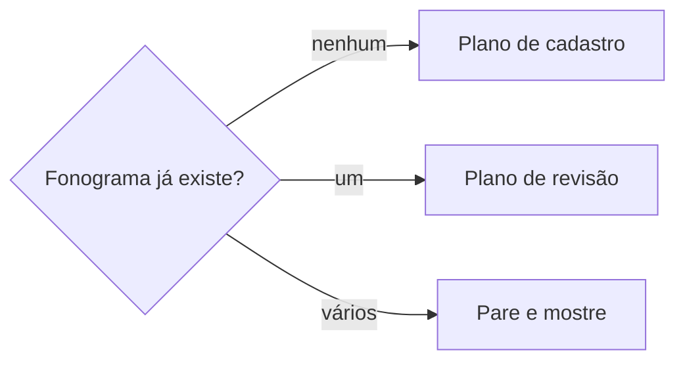

# Definir fonograma

## Parâmetros de configuração

Leia cada valor nas instruções do projeto: primeiro na entrada com o nome desta habilidade, depois na entrada `Global` ou no primeiro nível do bloco. Quando um valor não estiver lá, use o padrão abaixo.

```yaml
"Nome do data source de fonogramas": "Fonogramas"
"Campos da base de fonogramas":
  "ISRC": ""
  "Tonalidade": ""
  "BPM": ""
  "compasso": ""
  "duração": ""
  "Cifra": ""
  "Spotify": ""
  "Apple Music": ""
  "YouTube": ""
  "SoundCloud": ""
  "data de lançamento": ""
  "créditos": ""
  "obra musical": ""
"Modo de aprendizado": "perguntar"
```

## Instruções

### Passo 1

Procure no workspace conectado o data source com o nome `Nome do data source de fonogramas` e use-o sem perguntar: busque um termo da base e tome o data source de origem dos resultados cujo caminho tem esse nome. Abra o data source e leia o esquema. Só peça o link se a busca não achar nenhum ou achar mais de um. Não use um banco de outro workspace. Se `Campos da base de fonogramas` estiver vazio, pergunte uma vez e pare.

Antes de criar ou revisar, procure se o fonograma já existe: busque pelo ISRC ou pelo nome da faixa. Não crie duplicata.



### Passo 2

Monte o plano com cada campo de `Campos da base de fonogramas`: o valor atual, o proposto e a origem. Campo sem fonte fica vazio e vira pendência. Na revisão, entra só o que muda. Um campo preenchido não é trocado por uma fonte mais fraca sem a pessoa decidir.

- `ISRC`: o código internacional da gravação, obtido da distribuidora. Formato padrão com 12 caracteres.
- `Tonalidade`: a tonalidade da gravação, com relação ao banco de acordes quando o negócio tem um.
- `BPM`: batidas por minuto da gravação.
- `compasso`: a fórmula de compasso da gravação.
- `duração`: duração total da faixa em minutos e segundos.
- `Cifra`: a cifra completa ou simplificada da faixa.
- `Spotify`: link completo da faixa no Spotify, sem parâmetros de rastreio.
- `Apple Music`: link completo da faixa no Apple Music.
- `YouTube`: link do vídeo oficial ou áudio oficial da faixa.
- `SoundCloud`: link da faixa no SoundCloud.
- `data de lançamento`: a data oficial de lançamento da faixa.
- `créditos`: produção, mixagem, masterização, músicos e demais créditos da gravação.
- `obra musical`: relação com a obra musical correspondente no banco de obras.

Cada fonograma é ligado à obra musical correspondente. Uma obra pode ter vários fonogramas. O ISRC vem da distribuidora e deve ser preservado na troca de distribuidora.

### Passo 3

Valide o plano antes de mostrar:

- [ ] cada valor tem origem no material ou numa leitura feita nesta conversa
- [ ] o ISRC está no formato correto de 12 caracteres
- [ ] a relação com a obra musical está definida ou é pendência
- [ ] links de plataformas estão sem parâmetros de rastreio
- [ ] nenhuma subpágina será criada no Notion
- [ ] nenhum dado foi inventado: o que falta fica vazio

Corrija e valide de novo até passar.

### Passo 4

Mostre o plano e as pendências, e espere a confirmação. Depois crie a página ou atualize só os campos que mudam. Ligue o fonograma à obra musical correspondente.

### Passo 5

Releia a página gravada e confira cada campo contra o plano. Corrija o que divergir. Entregue o link da página, o que foi gravado e as pendências, cada uma com quem a resolve.

### Passo 6

Ao terminar, siga `evoluir-habilidade` conforme `Modo de aprendizado`.

## Problemas comuns

### Fonograma duplicado

Se você criar a página sem procurar pelo ISRC ou nome da faixa, o fonograma ganha uma segunda página e os dados se dividem.

1. Procure pelo ISRC completo e pelo nome da faixa.
2. Se achar uma página, revise essa.
3. Se achar várias, pare e mostre.

### ISRC inventado

Se você criar ou modificar o ISRC sem fonte da distribuidora, o código fica incorreto e a faixa perde rastreabilidade.

1. Use apenas o ISRC fornecido pela distribuidora.
2. Deixe vazio quando faltar.
3. Não invente nem modifique o código.

### Link com parâmetro de rastreio

Se você gravar links com parâmetros de rastreio, os links ficam longos e podem quebrar.

1. Remova todos os parâmetros após `?` na URL.
2. Mantenha apenas o link limpo da faixa.
3. Valide que o link abre a faixa correta.

### Fonograma sem obra

Se você criar o fonograma sem ligar à obra musical, a relação entre gravação e composição se perde.

1. Procure a obra musical correspondente no banco de obras.
2. Ligue o fonograma à obra.
3. Se a obra não existir, siga `definir-obra-musical` primeiro.

### Troca de distribuidora

Se você criar novo ISRC na troca de distribuidora, a faixa perde histórico e métricas.

1. Preserve o ISRC original da faixa.
2. Configure a nova distribuidora com o ISRC existente.
3. Faça takedown da antiga só depois de confirmar que a faixa está no ar na nova.

## Exemplos de entrada e saída

Estes exemplos ilustram fatos. Eles podem não estar no data source.

### Cadastre o fonograma de Linha do Horizonte com ISRC e links

A busca não achou nada. Plano: ISRC fornecido pela distribuidora; links do Spotify, Apple Music e YouTube sem parâmetros; tonalidade Lá menor; BPM 120; data de lançamento; ligado à obra musical "Linha do Horizonte" já cadastrada. Pendências: cifra completa, créditos de produção, link do SoundCloud.

### Atualize os links do fonograma de Linha do Horizonte após a troca de distribuidora

A página existe com ISRC preservado. Plano: novos links do Spotify e Apple Music após a migração; ISRC mantido igual; data da confirmação de que as faixas estão no ar na nova distribuidora. O takedown na distribuidora antiga ainda não foi feito e fica como pendência.

## Casos-limite

- O fonograma não tem ISRC ainda: deixe vazio e registre como pendência; não invente.
- A faixa é remix ou cover: é um fonograma separado, ligado à mesma obra ou à obra original.
- A faixa tem várias versões: cada versão é um fonograma separado no banco.
- A tonalidade não existe no banco de acordes: deixe vazia e registre como pendência; não crie a entrada sozinho.
- A faixa está apenas no YouTube: grave o link do YouTube e deixe outros vazios; não é pendência.
- O fonograma é ao vivo ou acústico: cadastre como fonograma separado, ligado à obra original.
- A distribuidora ainda não forneceu o ISRC: deixe vazio e registre como pendência crítica.

## Pegadinhas

- ISRC vem da distribuidora, nunca da UBC nem do ECAD. Não confunda com ISWC da obra.
- Na troca de distribuidora, o ISRC deve ser preservado. Nunca criar novo ISRC para a mesma faixa.
- Takedown na distribuidora antiga só depois de confirmar que as faixas estão no ar na nova. Nunca antes.
- Links de plataformas não podem ter parâmetros de rastreio. Sempre limpe a URL.
- Cada fonograma é ligado à obra. Uma obra pode ter vários fonogramas, mas cada fonograma tem uma obra.
- BPM e tonalidade são do fonograma específico. Duas gravações da mesma obra podem ter BPM e tonalidades diferentes.
- Nunca publicar, enviar ou pedir takedown sem aprovação. Sempre confirmar com a pessoa antes.
- Créditos de fonograma incluem produção, mixagem, masterização. Créditos de composição ficam na obra.
- Um fonograma só parece isolado. Ele pode estar em playlists, e a relação fica nos bancos de playlists quando o negócio os tem.
- Nunca criar subpáginas no Notion. Fonogramas são páginas no mesmo nível do banco.

## Scripts disponíveis

- Nenhum.

1. Não há script para executar.
