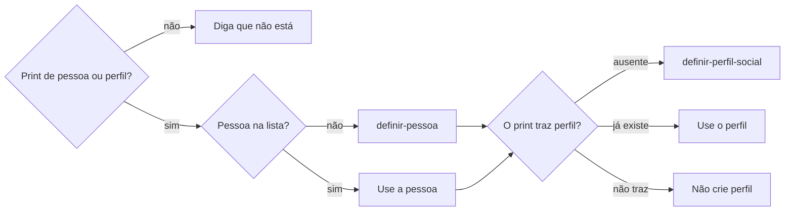

# Definir grafia

## Parâmetros de configuração

```yaml
{}
```

## Instruções

### Passo 1

Resolva também o nome transcrito no comando que acompanha uma imagem, não só os nomes lidos nela. Faça a conferência antes de a habilidade de origem escrever esse nome na operação. A transcrição de voz é termo de busca, não grafia confirmada. Pessoa fica na lista de pessoas. Empresa fica na lista de empresas. As duas listas e o nome de cada propriedade vêm do mapeamento de dados do projeto, no workspace conectado. Este texto usa os conceitos: o nome do registro, que é o nome completo da pessoa ou o nome da empresa, o nome civil da pessoa, as variações de grafia de cada lista e Não confundir com. Se a lista não estiver nessa conexão, pare. Não use a lista de outro workspace. Não responda o e-mail, a inscrição nem a tarefa.

### Passo 2

Busque o pedaço no nome e nas variações, por consulta direta e por busca semântica, só nessa lista. Na lista de pessoas, leia o nome completo, o nome civil e as variações de grafia. Na lista de empresas, leia o nome da empresa e as variações de grafia. Uma forma entre aspas na variação também acha o registro. Não exija o nome inteiro. Não busque no workspace inteiro. Semelhança sonora levanta candidato, não confirma identidade. A correção explícita da pessoa que aponta o cadastro confirma a correspondência.

### Passo 3

Separe duas listas. A busca usa o nome do registro e todas as formas entre aspas, certas e erradas. A frase para a pessoa usa só a forma correta: o nome completo, ou o nome da empresa, e a forma que a nota marca como correta naquele papel, como apelido ou primeiro nome. Não escreva o erro. Não reduza a busca à forma correta. A busca de remetente não espera a caixa mostrar o endereço e não usa o operador from:. Esse operador não filtra o remetente: devolve páginas que citam o texto. A busca usa, como texto, o primeiro nome marcado como correto, e esse primeiro nome, ponto, e o sobrenome do nome completo. E-mail vazio não dispensa essas formas. O endereço não vira nome civil. Se houver mais de um registro, liste cada um. Não escolha um. Não confundir com separa homônimos. Não junte os registros. Quando a pessoa confirma que são pessoas ou empresas diferentes, o vínculo sai na hora com `identificar-duplicata`. A correção não fica só no chat.

### Passo 4

Se a forma citada já está na lista, não duplique. Se ainda não está e só um registro casa, acrescente um item na mesma hora, sem apagar os que já estão. O item tem a forma entre aspas e termina com ponto e vírgula. A nota entre parênteses entra quando explica que a forma é correta ou que a transcrição a captou, no mesmo feitio dos itens que já existem. Se a lista estiver vazia, o primeiro item segue esse mesmo feitio. Não mude o nome completo nem o nome da empresa. A variação não cria a página. Não crie a empresa. O print de quem não está na lista segue o Passo 5. Se houver mais de um registro, não grave. Corrigir a grafia do título guarda a forma anterior, o erro e o termo ambíguo na variação, quando ainda ajudam a busca. O nome canônico permanece no título. Renomear o registro ou consolidar o nome canônico fica com `mesclar-registro`. Sem a propriedade de variações, avise e proponha a criação. Não dê a correção por concluída para a dedupe. Não crie a propriedade antes do sim. Renomeação recente com a variação antiga vazia: acrescente o nome anterior, sem apagar os itens que já estão. A variação recebe só nome, grafia, apelido, transcrição incorreta e forma alternativa da mesma pessoa ou empresa. Diferença permanente entre registros não entra na variação. As variações de grafia não substituem Não confundir com. Esse vínculo e o contexto permanente ficam com `identificar-duplicata`. Contato, preço, disponibilidade, resposta, decisão, status, prazo e mudança operacional vão em comentário datado.

### Passo 5

Devolva à habilidade de origem o nome canônico, o vínculo do registro e as formas de busca. Ela retoma a operação pedida, sem repetir a checagem concluída. Não altere a evidência original nem reescreva outras páginas para trocar a grafia. Não execute o lançamento nesta habilidade. Diga o pedaço buscado e que usou as duas buscas. Não crie a empresa.



O print que mostra a grafia cadastra o que falta. Pessoa ausente segue `definir-pessoa`. Perfil ausente segue `definir-perfil-social`. Os dois, quando o print traz os dois. Já existe: use o registro. Não crie outro. Sem print, diga que o nome não está na lista e não crie.

## Problemas comuns

### Grafia inventada

Se você trocar o nome por uma forma que não está no registro, uma transcrição vira a pessoa.

1. Escreva o nome completo, ou o nome da empresa.
2. Use a forma que a variação marca como correta.
3. A forma errada entra na variação. Não vira o nome do registro.

### Variação parada

Se você só disser a grafia certa e não guardar a forma errada, a próxima transcrição repete o erro.

1. Acrescente a forma que ainda não está, no feitio dos itens que já existem.
2. Mantenha os itens que já estão.
3. Não mude o nome do registro.

### Homônimo

Se você juntar duas pessoas porque o primeiro nome parece, registros diferentes viram a mesma pessoa.

1. Liste cada registro que o pedaço achou.
2. Não confundir com separa homônimos.
3. Não grave enquanto houver mais de um registro.

### Busca estreita

Se você buscar só pela grafia correta, a mensagem enviada com outra forma ou com o endereço some.

1. A busca usa todas as formas entre aspas, mais o nome do registro.
2. A forma correta só entra na frase para a pessoa.
3. A busca de remetente usa, como texto, o primeiro nome correto e esse nome, ponto, e o sobrenome. Não mande from:. E-mail vazio não dispensa. O endereço não vira nome civil.

### Print sem cadastro

Se você corrigir a frase e parar porque a pessoa não está na lista de pessoas, o print da grafia não vira cadastro.

1. Pessoa ausente segue `definir-pessoa`.
2. Perfil ausente segue `definir-perfil-social`.
3. Não crie a empresa a partir desse print.

### E-mail como nome civil

Se você ler o endereço de e-mail como o nome da pessoa, a caixa vira o cadastro.

1. O nome que se escreve está no nome completo.
2. Nome civil só entra se a propriedade tiver valor e a pessoa pedir esse nome.
3. Não invente o nome civil a partir do e-mail. O endereço continua na busca.

## Exemplos de entrada e saída

Estes exemplos ilustram fatos. Eles podem não estar no data source.

### faça a procurar-grafia buscar pela Bia Moreira pra ver como eu cadastrei as variações de nome

na lista de pessoas, o nome completo é Bia Moreira. Bia é o apelido correto, Beatriz é o primeiro nome correto e Biá é erro de transcrição. Bia Moreira e Beatriz Moreira são a mesma pessoa. A busca de remetente é Beatriz e beatriz.moreira, como texto, além das outras formas da lista. Não mandei from:. E-mail vazio não dispensa essas formas. Na frase, escrevi Bia Moreira. Não reduzi a busca ao nome do registro. Não disse que a busca por Beatriz não achou Bia Moreira.

## Casos-limite

- A forma já está na lista: use a correta. Não duplique o item.
- A forma ainda não está e só um registro casa: acrescente o item na mesma hora, sem apagar os outros.
- Há mais de um registro: liste cada um. Não grave.
- A lista está vazia: o primeiro item tem a forma entre aspas, termina com ponto e vírgula, e a nota entre parênteses quando explica a forma.
- É empresa: leia as variações de grafia da lista de empresas e escreva o nome da empresa. A forma nova entra no mesmo feitio.
- A pessoa pediu o nome civil: só se a propriedade tiver valor.
- Nada nessa lista e não há print de pessoa ou de perfil: diga que não está. Não crie.
- O print mostra pessoa ou perfil ausente: siga `definir-pessoa` e `definir-perfil-social` para o que falta. Não crie outro se já existe.
- A pergunta é o e-mail, a inscrição ou a tarefa: devolva as formas de busca e a forma da frase. A busca não fica só na forma da frase.
- O nome chegou no título de um evento ou no comando de uma despesa: devolva a forma canônica e o registro à habilidade de origem. Não grave a operação.

## Pegadinhas

- Apelido correto, primeiro nome correto e erro de transcrição parecem pessoas diferentes. Quando a variação marca as três como o mesmo registro, a frase usa só a forma correta. A busca usa todas, inclusive o primeiro nome e esse nome, ponto, e o sobrenome, como texto, mesmo com e-mail vazio. Não diga que a busca pelo primeiro nome não achou o apelido. O operador from: não filtra o remetente.
- Cada item traz a forma entre aspas e termina com ponto e vírgula. A nota entre parênteses diz se a forma é correta ou se a transcrição a captou.
- Uma forma errada não muda o nome completo. Ela entra na variação.
- Nome civil vazio não se completa com o e-mail.
- Grafia de empresa não mora na lista de pessoas. Mora na lista de empresas, nas variações de grafia dela.
- A forma escrita no pedido, inclusive por ditado, pode ser erro de transcrição. A forma canônica sai do cadastro confirmado, não da semelhança sonora.
- A pessoa ausente parece motivo para só corrigir a frase. O print cadastra a pessoa e o perfil que ele mostra.

## Scripts disponíveis

- Nenhum.

1. Não há script para executar.
